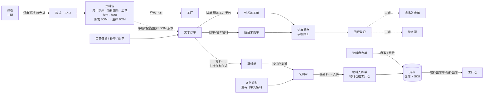
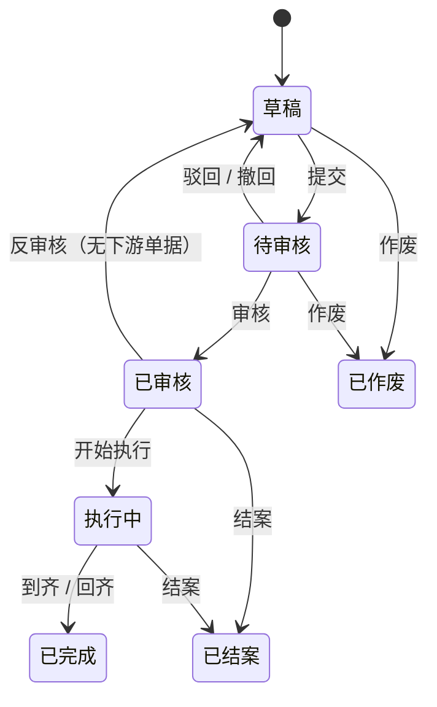
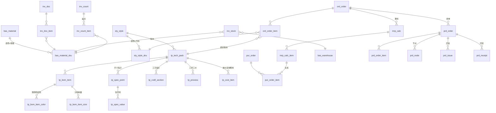

# 服装 SCM 产品需求文档（PRD）

| 项 | 内容 |
|---|---|
| 版本 | v0.7 草稿，2026-11-14 |
| 状态 | **待甲方确认**：§2 分期、§12 待决问题（每条都写了默认做法，不回复就按默认做）。Q24 双 BOM、Q42 工艺指示、Q43 花名是急问题，资料包 11-21 发版前要定 |
| 依据 | 甲方《服装SCM模块清单_需求确认表》（黄色 = 这次要做；没标黄 = 待定，以后再做，见 §2.5）；《领猫SCM模块字段清单》（11-03 采集，160 个页面、2985 列）；领猫原系统分析（10-01）；甲方 11-11、11-14 对原型和 PRD 的反馈；甲方线下工艺单模板（11-14） |
| 原型 | `docs/原型/index.html`，浏览器直接打开，不用联网。所有模块（含待定的）都能点，单据之间真的联动；左下"意见"按页留言、圈位置，"意见汇总"导出 |
| 原件 | 两份 xlsx 和原系统分析在 `docs/private/`（含甲方企业信息，gitignore，**不进公开仓库**） |
| 不在本文 | 开发约定（仓库根目录 `CLAUDE.md`）、进度（`docs/进度.md`） |

## 变更记录

| 版本 | 日期 | 改了什么 |
|---|---|---|
| v0.1 | 2026-11-05 | 初稿：分期、9 个模块、数据模型、20 个待决问题 |
| v0.2 | 2026-11-05 | 没标黄的模块从"不做"改为"待定，以后再做"；新增 §2.5，写清一期先替它们记下哪些数据；13.09 低代码改为待定（建议不做） |
| v0.3 | 2026-11-05 | 部署改为甲方负责：改 §8 部署、备份、安全和 §11 的 HTTPS 风险；新增 Q21（上线前的试用环境），§2.4 加说明 |
| v0.4 | 2026-11-05 | Q21 加三问：服务器 CPU 架构、能不能访问 Docker Hub、有没有已备案的域名；§11 加"域名没备案"的风险 |
| v0.5 | 2026-11-11 | 按甲方 11-11 反馈：客户和客供料收起来，新增 §2.6 TRADE 开关，§1、§2.2、§2.3、§4、§6.1、§6.2、§6.5、§6.6、§10 跟着改；款号改为大类 + 日期 + 设计师编号 + 流水（§5.2、§6.2）；供应商改为准入审批、关键字段改动审批，加信用代码和企查查风险排查（§6.8）；资料包分研发、生产两个阶段（§6.4）；算料自动扣在途、补货提醒、到料和开裁日期比（§6.6）；新增 §6.10 价格档案、§6.11 合同；§9 加企查查、OCR 对账；改 §3、§6.3、§6.9、§7.2、§8、§11、§13；新增 Q22-Q29，Q05 款号部分、Q19 标为已答复；订单导入改按分单号分单（§6.5.2）；管理层也能改价格档案，供应商的询价记录并进价格记录（用户 11-11 定，§3.1、§6.10） |
| v0.6 | 2026-11-12 | 多级审批提前到一期（用户 11-12 定）：订单、采购单、加工单按金额加级，门槛和审批人在设置里配，默认采购单超过 5 万、加工单超过 10 万再给总经理审一级；改 §2.2 的 13.03、§5.1、§6.9.2、§6.9.3、Q10。按原型走查改：手机报工分"只报开始""报完成"，实际完成不预填，和电脑上同一套（§6.7.3）；合同状态"已生成"改叫"待签回"，占位符表按原型补全、分出采购单和加工单各自能用的，`{{账期}}` 从 `{{结算方式}}` 里拆出来（§6.11） |
| v0.7 | 2026-11-14 | 按甲方 11-14 反馈：资料包改成尺寸指示、物料清单、工艺指示、核价四个页签，尺寸表（04.05）提前到一期，工艺单照线下模板分段，核价页签和按款看成本的列表从 M05 提进一期，打印改成导出 PDF 发微信（§6.4 重写，原 §6.4.2-§6.4.5 顺延成 §6.4.3、§6.4.4、§6.4.6、§6.4.7）；订单改叫需求订单（§6.5）；加工单拆成外发加工单、成品采购单（§6.7.1，前缀 JG / CP）；到料并进物料入库单的"待到料"页签（§6.6.3），出入库单拆成物料入库单、物料出库单（§6.6.5，前缀 RK / CK，LL / DB 不再用），新增物料盘点单（§6.6.8），期初库存改用盘点单录（§10）；成品模块（成品入库单、成品出库单、成品库存）定在 12 月二期第一周（§2.5、§6.12）；款式加花名（§6.2）；设置加工艺标准，新权限"看成本"（§6.9.2、§3.1）；改 §1、§2、§3、§4、§5.1、§5.2、§6.1、§6.8、§6.10、§6.11、§7、§8、§9.1、§9.5、§11、§13；新增 Q42-Q44，Q01、Q02、Q07、Q10、Q12 的默认做法跟着改；§12 开头注明 Q30-Q41 在数据库设计附录 C.3；§6.1.3 尺码组补"基码" |

## 0. 怎么读

甲方和业务同事：读 §1 到 §4，每个模块读"做什么""规则""验收"三块，然后把 §12 的问题逐条答复。

开发：全读。§5 通用规则对所有模块生效，各模块里不再重复。§7 是表结构概要。

---

## 1. 背景与目标

### 1.1 甲方的业务

从两份表看，甲方是一家服装企业，业务有两条线：

- **自有款式**：设计、打样、评审，通过后转成大货款，给自营渠道备货。
- **贸易代工**：接品牌客户的订单（表里多处标【贸商核心】），按客户要求组织生产，料有一部分是客户提供的（客供料）。一期收起，见下（TRADE，§2.6）。

**一期只做自有款式**。甲方 11-11 说，按现在的业务，客户档案暂时用不上。贸易代工（客户、客户订单、客供料）先收起来，表结构留口子，以后要接代工再把界面加回来（§2.6）。

大货都交给外部工厂做：工厂要么包工包料（相当于直接买成品，下成品采购单），要么只收加工费（清加工，下外发加工单），料由甲方采购后发过去。成品进聚水潭，再从那里发货。

涉及三个部门：开发（表里记作"开"）、生产（"产"）、财务（"财"）。

现在用的是领猫 SCM。它功能很全（19 组菜单、160 个页面），但大部分用不上。页面也慢：采购单页面冷加载要 60 秒以上，一个页面 20 多个按钮，外发加工订单列表有 45 列。

### 1.2 目标

一句话：把"款式 → 需求订单 → 算料采购 → 发料 → 外发生产 → 回货"这条主线搬进一个更快、更简单的系统，让料账和进度对得上。

一期（12-01）做到下面四条算成功：

1. 一张需求订单从录入到回货，全程在系统里走完，算料不用再开 Excel。
2. 任何时候都能回答：这张单的料齐了没有，在哪个工厂，做到哪一步，会不会延期。
3. 物料库存（含已经发到工厂的料、还在路上的备料）账实相符，每一次变动都有单据和日志。
4. 页面 1 秒内打开，列表默认不超过 12 列。

### 1.3 这次不做、以后再定的事

- 表里没标黄的模块：商品企划、核价与成本、质量管理、成品仓储与发货、财务结算，以及供应商管理里的客户商务条款、供应商绩效、合作历史与询价。**它们不是不做，是待定**：等主线跑起来、甲方确认要不要做和怎么做以后再排期。一期先替它们把要用的数据记下来，设计上留好口子，以后加进来不用推翻已有的（§2.5）。其中两块甲方已经提前要了：资料包里的核价页签和按款看成本的列表 11-14 提进一期（§6.4.5）；成品入库单、成品出库单、成品库存定在 12 月二期第一周（§6.12）。
- 低代码配置（13.09）：待定，建议不做。字段和流程要改，走"提需求 → 开发"，比做一套低代码便宜得多。
- 一期不做外部账号（工厂登录）、不对接聚水潭、不做 PDA 扫码。这三项等 §12 的 Q01、Q02 有结论再排。
- 贸易代工：收起来，以后不准备用，留口子（§2.6）。
- 11-11 新加的两块：采购合同（§6.11）、供应商风险排查（企查查，§6.8.3）。需求和设计先写进本文，排期待定（Q22）：放进 12-01 会挤掉别的。
- OCR 识别工厂对账单（§9.5）：属于财务结算 M11 的供应商对账，跟着 M11 待定。

---

## 2. 范围与分期

### 2.1 怎么分的

| 分期 | 时间 | 放什么 |
|---|---|---|
| 一期 | 12-01 上线 | 黄色且 P0 |
| 二期 | 12 月内，每周发一次 | 黄色且 P1 |
| 三期 | 2027 年起 | 黄色且 P2；以及卡在待决问题上的 P0（聚水潭、外部账号、开放 API） |
| 待定 | 甲方确认后再排 | 没标黄的 32 条（§2.5）；13.09 低代码（建议不做） |
| 待排期 | 等 Q22 | 11-11 新加、原范围之外的两块：合同（§6.11）、供应商风险排查（§6.8.3） |
| 收起 | 接代工业务时再打开 | 客户、客供料（§2.6） |

两种例外：

- **顺带**：很小、和一期页面放在一起顺手就做了的（供应商准入状态、黑名单与停用），提进一期。
- **简版**：P0 里工作量大的，拆成"一期简版 + 二期完整版"，下表写清简版做到哪。

为什么按 P 级排：甲方表里 P0 的定义是"没有它业务跑不起来"，P1 是"首版可以先用 Excel 或人工顶住"。今天是 11-05，离 12-01 只有 26 天，按 P 级排是唯一能按时上线的排法。

### 2.2 黄色范围逐条分期

黄色的 62 条：一期 41 条（含简版、顺带，以及已经有的 13.10），二期 16 条，三期或待定 4 条（含 13.09 低代码），收起 1 条（07.05 客供料）。没标黄的 32 条见 §2.5。

11-11 的调整：07.05 客供料一期收起（§2.6）；07.10 里的补货提醒提进一期（§6.6.7）；表末尾加了"11-11 新加"一块。

11-14 的调整：04.05 尺寸表提进一期，叫"尺寸指示"；04.03、04.07、06.04、07.04、07.06、07.07、07.08、08.01 的做法跟着甲方 11-14 反馈改了；表末尾加了"11-14 新加"一块。

**M01 基础资料与主数据**

| 编号 | 功能 | P | 分期 | 一期做到哪 / 说明 |
|---|---|---|---|---|
| 01.01 | 组织架构与多经营主体 | P0 | 一期简版 | 主体公司档案，每张单据带"主体"字段；按主体隔离数据放二期（§6.9） |
| 01.02 | 编码体系与单号规则 | P0 | 一期 | 款号、物料码、SKU 码、单号自动生成（§5.2）；款号 = 大类 + 日期 + 设计师编号 + 流水（11-11 定）；物料编码规则待 Q05 |
| 01.03 | 物料主数据 | P0 | 一期 | 物料、颜色规格 SKU、供应商货号与色号、采购单位换算 |
| 01.04 | 品类/季节/年份/波段/风格 | P0 | 一期 | 品类树 + 字典 |
| 01.05 | 颜色尺码矩阵与 SKU 生成 | P0 | 一期 | 选颜色 × 尺码组，一键生成 |
| 01.06 | 仓库/货位/工厂/产线 | P0 | 一期简版 | 仓库（含"工厂仓"，§6.1.6）；工厂就是供应商里的一类；货位二期，产线三期 |
| 01.07 | 计量单位/币种/税率/账期 | P0 | 一期 | 字典；账期挂在供应商上 |
| 01.08 | 基础数据变更日志 | P1 | 二期 | 一期已有操作日志（谁、什么时候、改了哪条）；二期补字段级"改前 → 改后" |

**款式管理**

| 编号 | 功能 | P | 分期 | 一期做到哪 / 说明 |
|---|---|---|---|---|
| 02.03 | 款式档案 | P0 | 一期 | |
| 02.04 | 款式 SKU / 吊牌与包装信息 | P0 | 一期简版 | SKU + 吊牌基础字段（吊牌价、品名、成分、执行标准、安全类别）；完整的吊牌水洗唛资料随 04.06 放二期 |
| 02.05 | 款式版本与变更记录 | P1 | 二期 | 一期资料包已经分版本（§6.4），二期补款式自身字段的改动记录 |
| 02.06 | 样品图库/素材库 | P2 | 三期 | 一期款式可以传多张图 |

**M03 研发打样**（整块二期，甲方表里这块全是 P1）

| 编号 | 功能 | P | 分期 | 说明 |
|---|---|---|---|---|
| 03.01 | 打样需求与派单 | P1 | 二期 | |
| 03.02 | 打样进度节点 | P1 | 二期 | |
| 03.03 | 样衣评审 | P1 | 二期 | |
| — | 样衣档案与版次管理 | — | 二期 | 表里这行没编号 |
| 03.04 | 样衣转大货节点 | P1 | 二期 | 一期款式直接新建；二期起可以从样衣转 |

**M04 BOM 与工艺资料包**

| 编号 | 功能 | P | 分期 | 一期做到哪 / 说明 |
|---|---|---|---|---|
| 04.01 | 大货 BOM（多版本/批次差异） | P0 | 一期 | 资料包分版本，分研发、生产两个阶段（§6.4.1，待 Q24）；需求订单审核时锁定生产 BOM 的版本 |
| 04.02 | 用量与损耗率 | P0 | 一期 | 单件用量、分码用量、损耗率；排版利用率只记录，不参与计算 |
| 04.03 | 工艺单 | P0 | 一期 | 11-14 起叫"工艺指示"，照甲方线下工艺单分车间缝制、后道、注意事项几段写（§6.4.4，待 Q42） |
| 04.04 | 工序工价库与标准工时 | P0 | 一期简版 | 工艺指示页签最下面的"工序工价（内部）"可以填工时和工价，合计成参考加工价；可复用的工价库放二期 |
| 04.05 | 尺寸表 | P1 | 一期（11-14 提前） | 叫"尺寸指示"：部位、测量方法、公差、档差、各尺码尺寸（§6.4.2） |
| 04.06 | 吊牌/水洗唛/包装资料 | P1 | 二期 | 包装方式、洗唛位置一期已经在工艺指示里 |
| 04.07 | 资料包分发与版本权限 | P1 | 一期简版 + 三期 | 一期导出 PDF（照线下工艺单的版式，手机上分享发微信，§6.4.6）发给工厂；在线共享要等外部账号（Q02） |

**M06 订单与排单**

| 编号 | 功能 | P | 分期 | 一期做到哪 / 说明 |
|---|---|---|---|---|
| 06.01 | 订单录入/导入/API 对接 | P0 | 一期简版 | 手工录入 + Excel 导入；API 三期 |
| 06.02 | 订单 SKU 明细、交期与送货要求 | P0 | 一期 | |
| 06.03 | 订单评审与交期承诺 | P0 | 一期简版 | 审核就是评审：填承诺交期，审核页显示齐料参考；产能评估随 08.02 放二期 |
| 06.04 | 排单/下单 | P0 | 一期 | 每个款选生成外发加工单还是成品采购单（11-14，§6.5.5）；算料后生成采购单 |
| 06.05 | 翻单/补单 | P1 | 二期 | |
| 06.06 | 订单变更与取消留痕 | P0 | 一期 | 变更单 |
| 06.07 | 订单进度总览 | P1 | 二期 | 一期在需求订单详情里能看到下游生产单的进度 |

**M07 物料管理**

| 编号 | 功能 | P | 分期 | 一期做到哪 / 说明 |
|---|---|---|---|---|
| 07.01 | 物料需求测算 | P0 | 一期 | 算料（§6.6.1）；自动扣交期赶得上的在途 |
| 07.02 | 采购需求/请购与审批 | P0 | 一期简版 | 算料结果就是采购需求，采购单审核就是审批；独立的请购单二期 |
| 07.03 | 物料采购单 | P0 | 一期 | 分批到货 |
| 07.04 | 采购进度跟踪与到料预警 | P0 | 一期 | 11-14 起原来的到料跟踪页并进物料入库单，是它的"待到料"页签；到料除了和采购交期比，还和生产单的开裁日期比（§6.6.3） |
| 07.05 | 客供料 vs 自购料区分与核销 | P0 | 一期收起 | TRADE 关时不做（§2.6）；物权字段留着，一期都是自有 |
| 07.06 | 物料入库/出库/退货（PDA 扫码）（对接聚水潭） | P0 | 一期简版 | 11-14 起分物料入库单、物料出库单两种（§6.6.5）；单据在本系统；PDA 三期；和聚水潭的关系待 Q01 |
| 07.07 | 物料进销存、货位库存与库存日志 | P0 | 一期简版 | 库存 + 日志；物料盘点单一期（11-14 加，§6.6.8）；货位、进销存汇总表二期 |
| 07.08 | 领料/退料/调拨 | P0 | 一期 | 领料出库、调拨在物料出库单里，退料入库在物料入库单里（§6.6.5） |
| 07.09 | 委外发料与外发物料跟踪 | P1 | 二期 | 一期领料进"工厂仓"，已经能查到每个工厂手上有多少料 |
| 07.10 | 库存预警与呆滞料分析 | P2 | 一期简版 + 三期 | 11-11 起：低于安全库存进首页待办，能一键生成备货采购单（§6.6.7）；呆滞料分析三期 |

**M08 生产与外发加工**

| 编号 | 功能 | P | 分期 | 一期做到哪 / 说明 |
|---|---|---|---|---|
| 08.01 | 外发加工单/成品采购单 | P0 | 一期 | 11-14 起分成两种单、两个菜单：外发加工单（清加工、半包，JG）、成品采购单（包工包料，CP）；字段和流程一样（§6.7.1） |
| 08.02 | 工厂产能与负荷 | P1 | 二期 | |
| 08.03 | 生产进度节点汇报 | P0 | 一期 | 计划开始、计划完成、实际开始、实际完成四个时点 |
| 08.04 | 二次加工/外协 | P1 | 二期 | |
| 08.05 | 移动端跟单报工 | P0 | 一期简版 | 跟单员用手机网页报工；工厂自己报要外部账号（Q02） |
| 08.06 | 货期预警与异常事件 | P0 | 一期 | |
| 08.07 | 发料与成品回收平衡 | P1 | 二期 | |
| 08.08 | 生产看板 | P0 | 一期 | |

**M12 供应商管理**（只有三条标黄）

| 编号 | 功能 | P | 分期 | 一期做到哪 / 说明 |
|---|---|---|---|---|
| 12.01 | 供应商档案与分类 | P0 | 一期 | 加统一社会信用代码（11-11） |
| 12.02 | 准入与资质 | P1 | 一期简版（顺带）+ 三期 | 准入审批、关键字段改动审批（11-11，§6.8.2）、证照附件（带有效期）；邀请注册、实名认证要外部账号，三期 |
| 12.05 | 黑名单与停用 | P2 | 一期（顺带） | |

**M13 系统权限、协同门户、报表与集成**

| 编号 | 功能 | P | 分期 | 一期做到哪 / 说明 |
|---|---|---|---|---|
| 13.01 | 组织/角色/菜单/字段/数据权限 | P0 | 一期简版 | 用户、角色、菜单、接口权限已经有了；一期加数据范围（本人/全部）；按主体隔离、字段权限放二期 |
| 13.02 | 外部协同账号 | P0 | 待 Q02 | |
| 13.03 | 审批流引擎 | P0 | 一期 | 按单据类型、金额设多级审批（§5.1）；按部门、品类等其他条件分支和会签放二期 |
| 13.04 | 消息与待办 | P1 | 一期简版 | 首页待办；钉钉、企微推送二期 |
| 13.05 | 移动端 | P1 | 一期简版 | 只做手机报工页（08.05）；手机审批二期 |
| 13.06 | 报表看板 | P1 | 二期 | 一期有生产看板 |
| 13.07 | 业务报表与预警中心 | P1 | 二期 | 一期的预警分散在待到料、生产看板、首页待办 |
| 13.08 | 开放 API 与集成 | P1 | 三期 | 待 Q01、Q04 |
| 13.09 | 低代码配置 | P2 | 待定（建议不做） | 见 §1.3 |
| 13.10 | 操作日志与数据留痕 | P1 | 已有 | 10-12 已上线 |

**11-11 新加**（甲方 11-11 反馈里提的，表里没有这几条，或者是从待定模块里提前的）

| 功能 | 分期 | 说明 |
|---|---|---|
| 设计师编号 | 一期 | 用户上加 2 位设计师编号，款号要用（§5.2） |
| 供应商准入审批、关键字段改动审批 | 一期（随 12.02） | §6.8.2 |
| 研发 BOM、生产 BOM | 一期（默认，待 Q24） | 资料包加"阶段"（§6.4.1） |
| 价格档案 | 一期（默认，待 Q24） | 05.06 的一部分提前做：供应商 × 物料、工厂 × 款的价格和调价记录（§6.10） |
| 备料：在途自动扣、补货提醒、到料和开裁日期比 | 一期 | 属于 07.01、07.04、07.10（§6.6） |
| 供应商风险排查（企查查） | 待排期（Q22） | §6.8.3、§9.4 |
| 合同：模板、生成、导出、签回归档 | 待排期（Q22） | §6.11；电子签章不做 |
| OCR 识别工厂对账单 | 待定（随 M11） | §9.5 |

**11-14 新加**（甲方 11-14 反馈里提的）

| 功能 | 分期 | 说明 |
|---|---|---|
| 资料包四个页签：尺寸指示、物料清单、工艺指示、核价 | 一期（随 11-21） | 04.05 提前；04.03 照线下工艺单分段（Q42）；核价是 M05 的一部分提前（§6.4） |
| 导出 PDF 发给工厂 | 一期（随 11-21） | 04.07 的做法：照线下工艺单版式，默认不带价格（§6.4.6） |
| 设置 › 工艺标准 | 一期（随 11-21） | 工艺标准文件、工艺指示默认文字、尺寸部位的测量方法（§6.9.2） |
| 按款看成本 | 一期（随 11-21） | 侧边栏"核价"先做这张列表（§6.4.5）；M05 其余仍待定 |
| 款式花名 | 一期（随 11-21） | 待 Q43（§6.2） |
| 订单改叫需求订单 | 一期（随 11-21） | 单号前缀 DD 不变（§6.5） |
| 外发加工单、成品采购单分开 | 一期（随 11-21） | 08.01 拆成两种单、两个菜单（§6.7.1） |
| 物料入库单、物料出库单；到料并进入库单 | 一期（随 11-28） | 07.04、07.06、07.08（§6.6.3、§6.6.5） |
| 物料盘点单 | 一期（随 11-28） | 甲方表里只有成品的 10.07 盘点（P2，待定）；物料盘点是这次新加的，期初库存也用它录（§6.6.8、§10） |
| 成品：成品入库单、成品出库单、成品库存 | 二期（12 月第一周） | M10 的 10.01、10.03 和 10.05 里的发货出库提前排期（§6.12，待 Q44）；10.07 成品盘点等其余条目仍待定 |

### 2.3 没标黄、但一期离不开的两件事

| 功能 | 为什么要 | 做到哪 |
|---|---|---|
| 回货登记 | 生产单要知道工厂交回了多少才能完成；需求订单要靠它判断做完没有 | 登记回货数和次品数（§6.7.5），一期不管成品库存（成品模块 12 月二期第一周，§6.12） |
| Excel 导入 | 上线时要把领猫里的物料、供应商、款式搬过来 | 物料、供应商、款式、期初库存（导进"期初录入"盘点单）、需求订单五个模板（§10） |

原来这里还有"客户档案"，11-11 随贸易代工一起收起来了（§2.6）。

### 2.4 上线节奏

| 日期 | 发什么 | 甲方做什么 |
|---|---|---|
| 11-07 | — | 确认 §2 和 §12，PRD 定稿 v1.0 |
| 11-14 | 第 1 次发版：基础资料、供应商、款式与 SKU、Excel 导入 | 开始录入、导入基础数据 |
| 11-21 | 第 2 次：资料包（尺寸指示、物料清单、工艺指示、核价页签）、导出 PDF、按款看成本、需求订单、排单生成外发加工单 / 成品采购单 | 给在做的款建资料包，导一份 PDF 发给工厂试试 |
| 11-28 | 第 3 次：算料、采购、物料入库单（含待到料）、物料出库单、物料盘点单、库存、进度节点、回货、生产看板、手机报工 | 拿一张真实需求订单走一遍全流程 |
| 11-29 ~ 11-30 | 修试用发现的问题 | 导入在途需求订单；用"期初录入"盘点单录期初库存 |
| **12-01** | **一期上线** | 新订单开始在系统里走 |
| 12 月 | 二期，每周发一次：第一周成品（成品入库单、成品出库单、成品库存，§6.12），然后研发打样，再其余 P1 | |

11-11 新加的进一期的几块，跟着用到它的那次发版：设计师编号、供应商信用代码和准入审批随 11-14；资料包的研发 / 生产阶段随 11-21（Q24 要在这之前定）；价格档案随 11-21 的生产单和 11-28 的采购单；在途自动扣、补货提醒、到料和开裁日期比随 11-28。合同和企查查不在这张表里，待排期（Q22）。

11-14 反馈的几块：尺寸指示、工艺指示改版、核价页签、导出 PDF、设置 › 工艺标准、款式花名、外发加工单 / 成品采购单拆单随 11-21（Q42、Q43 要在这之前定）；物料入库单、物料出库单、物料盘点单，到料并进入库单随 11-28；成品模块 12 月二期第一周（Q44）。

11-14 起甲方要在系统里试用、导入基础数据，需要一台已经部署好的服务器。部署由甲方那边负责，用哪台、谁来装、每周谁来升级，见 Q21。

### 2.5 没标黄的模块：待定，以后再做

甲方表里没标黄的 32 条不是不做，是等主线跑起来、甲方确认要不要做和怎么做以后再排期。现在先做两件事：

1. **数据先记下来**。这些模块大多是"拿已经发生的单据去算账、评分、对比"。历史数据事后补不回来，所以一期的单据要把它们以后要用的数记全：价格、金额、税率、实际日期、次品数、责任方。
2. **口子留好**。以后加这些模块时，已有的表只加列、不改列，已有的功能不用改流程。技术上怎么留，见 `docs/架构设计.md` §14。

| 模块 | 条目 | 一期先记下的数据、留的口子 | 等什么 |
|---|---|---|---|
| M02 商品企划 | 02.01 企划（主题、品类、价格带、数量）P2；02.02 企划任务与看板 P2 | 款式上的品类、季节、年份、波段、风格、吊牌价（§6.2）。企划做好以后，按这些口径对比"计划 vs 实际" | 甲方企划负责人确认需求 |
| M05 核价与成本 | 05.01 询报价与比价 P0；05.02 成本 BOM 测算 P0；05.03 核价单与报价单 P0；05.04 目标 vs 实际成本 P1；05.05 订单毛利测算 P0；05.06 价格档案与调价记录 P1 | BOM 行的用量、损耗率、参考单价（研发 BOM 和生产 BOM 分开记，§6.4.1）；工艺指示的工序工价；生产单的单价（加工费、成品单价）；采购单的成交价；需求订单行的销售单价；采购入库按成交价记单价。成本、毛利以后都能从这些算出来。**05.06 的价格档案 11-11 提前到一期**（§6.10）。**11-14：05.02 的一部分提前到一期**——资料包里的核价页签（面料、辅料、加工费、其他费用，§6.4.5）和侧边栏"核价"里按款看成本的列表。05.01 询报价与比价、05.03 核价单与报价单、05.04 目标 vs 实际成本、05.05 订单毛利，以及研发核价、生产核价、实际成本的对比报表，还跟着 M05 待定 | 一期主线先跑通 |
| M09 质量管理 | 09.01 来料检验 P1；09.02 产前样确认 P1；09.03 中检与尾期验货 P1；09.04 次品与返修 P1；09.05 质量扣款 P2；09.06 供应商质量档案 P2 | 回货的次品数；异常事件的类型（面料质量、做工质量）和责任方；进度节点模板可以加"产前样确认""验货"；仓库类型以后可以加"待检仓""不良品仓" | 甲方定质检流程 |
| M10 成品仓储与发货 | 10.01 成品入库 P0；10.02 条码与装箱 P1；10.03 成品库存 P0；10.04 调拨、退换货 P1；10.05 发货与物流 P1；10.06 聚水潭对接 P0；10.07 盘点 P2 | **11-14 甲方要求成品单独成一个模块，定在 12 月二期第一周**（§6.12）：成品入库单（10.01）、成品出库单（发货出库、其他出库，10.05 的一部分）、成品库存（10.03）。一期回货单按 SKU 记数量、日期、收货仓，二期直接用。10.02、10.04、10.06、10.07 成品盘点仍待定；成品库存以本系统还是聚水潭为准等 Q01、Q44。款式 SKU 码和条码定编码规则时考虑和聚水潭的商品编码对得上（Q05） | Q01、Q44 |
| M11 财务结算 | 11.01 供应商对账 P0；11.02 客户对账与应收 P0（TRADE 关时不适用）；11.03 应付应收与付款计划 P0；11.04 发票 P0；11.05 扣款与索赔 P1；11.06 单款毛利结算 P1；11.07 预付款、定金、尾款 P1；11.08 结算状态共享 P2 | 11-14 起侧边栏里和成品分开，叫"对账结算"。采购单、生产单、需求订单都有单价、金额、税率、是否含税、结算方式；供应商有账期；每次入库、回货记实际日期；单据被对账单引用以后不能再反审核（框架已支持）。11.01 的做法 11-11 先定了：OCR 识别工厂对账单，按单号逐行比对（§9.5） | 甲方财务流程、Q04、Q27 |
| M12 供应商管理（没标黄的部分） | 12.03 客户（品牌方）商务条款 P0（TRADE 关时不适用）；12.04 供应商绩效 P2；12.06 合作历史与询价记录 P2 | TRADE 开以后在客户档案（§6.1.8）上加商务条款；绩效要的交期（约定交期 vs 实际到货、实际回货）、质量（次品率、质量异常）、价格（价格档案和历史成交价）一期都有；合作历史就是供应商详情里的"往来单据"；询价记录并进供应商详情的"价格记录"（选定的报价记进价格档案，每张单的成交价列在"成交记录"，§6.10） | 甲方确认考核指标 |

### 2.6 贸易代工：收起来，留口子

甲方 11-11 说，按现在的业务，客户档案暂时用不上。定下来的做法：一期只做自有款式，贸易代工（客户、客户订单、客供料）整条收起来，以后也不准备用；但表结构留口子，哪天要接代工，把界面加回来就行，已有的表不用改。

用一个开关 **TRADE** 管，默认关。

| 地方 | TRADE 关（一期） | TRADE 开（以后接代工） |
|---|---|---|
| 客户 | 没有客户菜单、客户页面、客户导入模板 | 有（§6.1.8） |
| 订单类型 | 自营备货、补单、翻单，都不选客户 | 加"客户订单"，要选客户、可填客户订单号 |
| 订单交期 | 叫"要求交期" | 叫"客户交期" |
| 订单变更、异常的责任方 | 我方、工厂、供应商，默认"我方" | 加"客户" |
| 款式、样衣 | 来源没有"客户来样"；没有客户、客户款号 | 有 |
| BOM 物料来源 | 我方采购、工厂自备 | 加"客供" |
| 物料入库单类型 | 没有"客供入库" | 有 |
| 物权 | 采购、入库出库、盘点、库存、领料都不显示，全是自有 | 显示，客供料和自有料分开记（§6.6.4） |
| 算料结果 | 我方采购、工厂自备两块 | 加"待客户提供" |

**留了什么**：客户表；需求订单、款式上的客户字段（可空）；采购明细、入库出库明细、盘点明细、库存、库存日志上的物权（一期都记"自有"）；订单类型、BOM 物料来源、物料入库单类型里保留"客户订单""客供""客供入库"这几个值，开关关着时不让选。业务表都还没建，现在留几乎不花成本。技术上怎么留，见架构 §14.4。

**打开以后要补做的**：客户档案页面和导入模板、各页面上的客户和物权字段、客供料的规则（§6.6.4）、客供核销报表。表不用改。

本文后面凡是写着"TRADE 关时不适用"或"TRADE 开时"的，都是这一节说的东西。

---

## 3. 用户与角色

| 角色 | 是谁 | 每天在系统里做什么 | 主要页面 |
|---|---|---|---|
| 超级管理员 | IT 或老板指定的人 | 建账号、分角色、维护字典 | 管理后台（已有） |
| 开发 | 设计师、版师 | 建款式（款号用设计师编号自动编），维护资料包（尺寸指示、研发 BOM 和生产 BOM、工艺指示），导出 PDF 发工厂；二期起建样衣、提打样 | 款式、资料包、研发打样 |
| 业务 | 业务员、订单员 | 录需求订单、导入需求订单、提变更 | 需求订单 |
| 生产跟单 | 生产跟单员 | 排单、下外发加工单和成品采购单、跟进度、手机报工、处理异常、登记回货 | 需求订单、外发加工单、成品采购单、生产看板、手机报工 |
| 采购 | 面辅料采购员 | 算料、下采购单（含备货）、跟待到料、补货；建供应商、申请准入；看核价 | 算料、采购单、物料入库单（待到料）、供应商、核价 |
| 仓管 | 物料仓管理员 | 入库、领料发料、退料、调拨、盘点 | 物料入库单、物料出库单、物料盘点单、库存 |
| 财务 | 财务 | 一期只看采购单、生产单的金额和核价（财务结算 M11 待定） | 采购单、生产单（只读）、核价 |
| 管理层 | 老板、主管 | 审核需求订单、采购单、生产单、盘点单；审批供应商准入和改动；看看板、核价 | 首页、生产看板、核价 |
| 外部 | 工厂、面辅料商 | 三期（Q02） | — |

### 3.1 一期预置的角色模板

甲方可以在管理后台改。"看"= 能打开页面；"改"= 新建、编辑、提交；"审"= 审核、反审核、结案；"—"= 看不到。

| 模块 | 开发 | 业务 | 生产跟单 | 采购 | 仓管 | 财务 | 管理层 |
|---|---|---|---|---|---|---|---|
| 基础资料 | 改 | 看 | 看 | 改（物料） | 看 | 看 | 看 |
| 供应商 | 看 | 看 | 看 | 改，申请准入 | 看 | 看 | 审（准入、关键字段改动、拉黑） |
| 款式、资料包 | 改，审（资料包生效） | 看 | 看 | 看 | 看 | 看 | 看 |
| 看成本（核价页签、按款看成本、PDF 含价格） | —（开发主管有） | — | — | 有 | — | 有 | 有 |
| 设置 › 工艺标准 | 看（开发主管改） | — | 看 | — | — | — | 看 |
| 需求订单 | 看 | 改 | 看 | 看 | — | 看 | 审 |
| 排单、外发加工单、成品采购单 | 看 | 看 | 改 | 看 | 看 | 看 | 审 |
| 算料、采购单 | — | 看 | 看 | 改 | 看 | 看 | 审 |
| 价格档案 | 看 | 看 | 改（加工价） | 改（物料价） | — | 看 | 改 |
| 物料入库单、物料出库单、库存 | — | — | 看 | 看 | 改，审 | 看 | 看 |
| 物料盘点单 | — | — | — | 看 | 改 | 看 | 审 |
| 进度、异常、回货 | — | 看 | 改 | 看 | 看 | — | 看 |
| 合同（待排期） | — | — | 改（生产单的） | 改（采购单的） | — | 看 | 看，管模板 |

11-14 起多预置一个"开发主管"角色模板：权限同开发，另加看成本、改工艺标准（§6.9.2）。

供应商准入和关键字段改动的审批，自己提的不能自己批（§6.8.2）。这一条和 Q10 的默认做法（自己做的单可以自己审）不一样：甲方 11-11 要求准入走审批、不能随时调整，一个人自己提、自己批就等于没审批。

### 3.2 数据范围

每个角色设一个数据范围：

- **全部**：看所有单据。默认给管理层、财务、仓管。
- **本人**：只看自己相关的单据——制单人是自己，或者单据上的跟单员、采购员、业务员是自己。默认给业务、跟单、采购。

有"全部"范围的人，列表上方有"我的 / 全部"切换。

---

## 4. 业务全景

### 4.1 主线



TRADE 开时（§2.6）多一条线：客户订单，以及客户提供的料走"客供入库"进库存，库存再按物权分开。

### 4.2 单据之间怎么关联

| 从 | 到 | 怎么生成 | 回写什么 |
|---|---|---|---|
| 需求订单 | 外发加工单、成品采购单 | 需求订单详情点"排单"，每个款选加工方式：清加工、半包生成外发加工单，包工包料生成成品采购单 | 需求订单明细的已排产数 |
| 需求订单 | 算料单 | 需求订单详情或算料页点"算料"，可以多选需求订单 | — |
| 算料单 | 采购单 | 勾选行点"生成采购单"，按供应商自动拆成几张 | 算料行的已转采购量 |
| 采购单 | 物料入库单（采购入库） | 采购单点"到货入库"，或在物料入库单的"待到料"行上点"入库" | 采购明细的已入库数；全部入齐后采购单变"已到齐" |
| 采购单 | 物料出库单（采购退货） | 采购单点"退货" | 采购明细的已退货数 |
| 生产单 | 物料出库单（领料出库） | 外发加工单、成品采购单点"领料"，按 BOM × 数量 − 已领 带出 | 生产单的领料状态 |
| 生产单 | 回货单 | 外发加工单、成品采购单点"登记回货" | 生产单明细的已回货数、次品数；回齐后生产单变"已完成" |
| 订单变更单 | 需求订单 | 变更单审核通过后改需求订单 | 下游生产单、采购单显示"上游订单已变更" |
| 采购单、生产单 | 价格档案 | 审核时，单价和档案里的现价不一样就自动记一条（§6.10） | — |
| 采购单、生产单 | 合同（待排期） | 审核后详情页点"生成合同"（§6.11） | — |

"生产单"是外发加工单、成品采购单的统称，只在同时说两种单时用（§6.7.1）。

### 4.3 一张需求订单的一生（贯穿全文的例子）

后面各模块的验收都用这个例子，数字是真算过的。

一张自营备货的需求订单：款 27CF001 女式风衣（从领猫导入的老款，款号照用旧规则），3 个颜色 × 5 个尺码，共 1,200 件，要求交期 2027-03-20。其中卡其色 400 件：S 80、M 120、L 120、XL 60、XXL 20。

1. **资料包**：这个款是导入的老款，没有研发阶段，直接建生产 BOM。大身面料"220g 斜纹棉"按款色配料（卡其款配卡其布）、分码用量（S 2.25、M 2.35、L 2.45、XL 2.55、XXL 2.65 米/件），损耗 3%，我方采购。同一个版本里填好尺寸指示、工艺指示，核价页签算出单件成本。
2. **需求订单审核**：锁定生产 BOM V2，承诺交期 03-20。
3. **算料**：卡其布毛需求 = 80×2.25 + 120×2.35 + 120×2.45 + 60×2.55 + 20×2.65 = 962 米，乘 1.03 = 990.86 米。物料仓有卡其布 120 米，没有在途，本次全部使用，净需求 870.86 米，向上取整 = **871 米**（最小包装 1 米，起订量 100 米）。
4. **采购**：生成采购单给面料商，871 米，单价默认取价格档案里这家的现价，交期 01-10。
5. **到货**：01-08 到 500 米，01-12 到 371 米，都在物料入库单的"待到料"里点"入库"。采购单先变"部分到货"，再变"已到齐"。"待到料"里 01-11 这一行标红（逾期一天）。
6. **排单**：卡其 400 件给"某某制衣厂"，清加工，生成外发加工单，加工费 38 元/件（价格档案里这家工厂做这个款的现价），交期 03-10。
7. **领料**：开一张物料出库单（领料出库），从物料仓领 990.86 米卡其布到"某某制衣厂"工厂仓。
8. **进度**：跟单员在手机上报"裁剪完成 402 件""车缝完成 400 件"……
9. **回货**：03-08 回货 400 件，其中次品 4 件。外发加工单变"已完成"。这张需求订单的生产单都完成后，需求订单"已完成"。

---

## 5. 通用规则（所有模块都适用）

### 5.1 单据的公共部分

每张单据的单头都有：单号、主体公司、状态、制单人、制单时间、审核人、审核时间、备注、附件；详情页都有"操作记录"页签（创建、提交、审核、驳回原因、变更……）。

**状态和动作**



| 状态 | 能做什么 |
|---|---|
| 草稿 | 改、删、提交、作废 |
| 待审核 | 审核（通过 / 驳回）、撤回（只有制单人）、作废 |
| 已审核 | 反审核（没有下游单据时）、生成下游单据、结案 |
| 执行中 | 继续生成下游单据、结案。各单据把"执行中"叫成自己的名字，如采购单叫"部分到货"、生产单叫"生产中" |
| 已完成、已结案 | 只读。有审核权限的人可以"取消结案" |
| 已作废 | 只读，单号不再使用 |

- **审核即过账**：物料入库单、物料出库单、物料盘点单审核时改库存；反审核时把库存改回去，库存不够改回就不让反审核。
- **不物理删除**：只有草稿能删（逻辑删除），其他状态只能作废或结案。
- **审核**：有该单据审核权限的人都能审。自己做的单能不能自己审，见 Q10，默认允许。
- **多级审批**（11-12 提前到一期）：需求订单、采购单、生产单金额超过门槛，就多审一级。规则见下表。

**多级审批规则**

| 项 | 规则 |
|---|---|
| 第 1 级 | 有这种单据审核权限的角色（§3.1），谁审都行 |
| 往上加级 | 每条规则写"单据类型 + 金额超过多少 + 审批人"，超过几条门槛就加几级，门槛低的先审。审批人可以是一个角色（角色里谁审都行），也可以是指定的人。超级管理员在"设置 › 审批"里配 |
| 默认规则 | 采购单超过 5 万、生产单（外发加工单、成品采购单共用一条）超过 10 万，管理层审完再给总经理审一级。数字是我们定的，等甲方确认（Q10） |
| 审批流什么时候定 | 提交时按当时的金额和规则定下要几级、每级谁审，存在单据上；之后改规则，只管以后提交的单。第 1 级例外：始终看当前谁有审核权限，收回权限马上生效 |
| 审的过程 | 没审完一直是"待审核"，详情里看得到审到第几级、每级谁什么时候审的、现在等谁。只有当前这一级的审批人能审核、驳回；首页"待我审核"也只给他 |
| 一个人管几级 | 同一个人连着几级都能审的，审一次这几级都过，不用点几遍 |
| 驳回、撤回、反审核 | 哪一级驳回都退回草稿，记下原因；改完重新提交从第 1 级审起 |
| 每一级都查 | 审核要做的检查（如采购单的单价和价格档案对不上），每一级审核时都查 |
| 需求订单的承诺交期 | 每一级审核都要填，带出上一级填的；以最后一级填的为准（§6.5.4） |

验收：

1. 采购单金额 5.55 万：管理层审了以后还是待审核，首页"待我审核"只出现在总经理那里；总经理审了才变成已审核。
2. 不是当前这一级的人点审核或驳回，提示现在该谁审，单据不变。
3. 第 2 级驳回，单据回到草稿；改完重新提交，从第 1 级重新审。
4. 单据提交以后把门槛改高，这张单还按提交时的级数走。

### 5.2 编码规则

| 对象 | 规则 | 例子 | 说明 |
|---|---|---|---|
| 单号 | 前缀 + 年月日 + 4 位流水（已有单号生成器，每天从 0001 开始） | CG202611050001 | 前缀：DD 需求订单、BG 订单变更、SL 算料、CG 采购、RK 物料入库、CK 物料出库、PD 物料盘点、JG 外发加工、CP 成品采购、HH 回货、DY 打样、HT 合同；二期 CR 成品入库、CC 成品出库。11-14 起领料、调拨归进物料出库单（CK），退料归进物料入库单（RK），原来的 LL、DB 不再用 |
| 款号 | 大类 + 年月日（yyMMdd）+ 设计师编号（2 位）+ 2 位流水 | FS2611080701（服饰、2026-11-08 建、设计师 07、当天第 1 款） | **11-11 定**（Q05 的款号部分算答复了），规则见下 |
| 样衣编号 | YY + 年月 + 4 位流水 | YY26110001 | 二期 |
| 物料编码 | 物料分类码 + 4 位流水 | ML0012（面料-梭织） | 待 Q05 |
| 款式 SKU 码 | 款号-颜色码-尺码 | FS2611080701-KQ-M、27CF001-KQ-M | 自动生成，不能改 |
| 物料 SKU 码 | 物料编码-颜色码[-规格码] | ML0012-KQ、FL0031-JS-15 | 自动生成，不能改 |
| 供应商编码 | GYS + 4 位流水 | GYS0008 | |
| 客户编码 | KH + 4 位流水 | KH0003 | TRADE 开时才用 |

**款号规则**（甲方要求 SKU 编码里带设计师编码，11-11 定）：

- **大类**：FS 服饰、XZ 鞋子。是字典，甲方可以加；被款号用过的大类编码不能改。
- **日期**：建款当天，yyMMdd。
- **设计师编号**：2 位数字，在"设置 › 用户"里填（Q28）。全系统唯一；款号用过以后不能改，也不能给别人，人离职了也不回收。
- **流水**：同一个设计师同一天、同一个大类，从 01 起，一天最多 99 个，用完了只能手填。
- **换设计师**：款号不变，只改款式上的"设计师"。
- **设计师没有编号**：不能自动编号，提示"去 设置 › 用户 给 xxx 填设计师编号"；款号仍然可以手填。
- **老款号**：导入的历史款（如 27CF001）照用。手填的款号系统查重；自动编号碰上手填占用的号，跳到下一个。
- **SKU**：款式 SKU 码还是"款号-颜色码-尺码"，设计师编码就跟着进了 SKU。季节码、品类码不再进款号。

### 5.3 数量、单位、金额

- 成品数量：整数，单位"件"。
- 物料数量：最多 3 位小数（米、码、公斤），显示时去掉末尾的 0。
- 单价 4 位小数，金额 2 位小数（四舍五入），税率按百分比。
- **单位换算**：物料有库存单位、采购单位和换算系数（1 采购单位 = n 库存单位）。比如面料按公斤买、按米用，1 公斤 = 3.2 米。采购单按采购单位下，入库时换算成库存单位记账。BOM 用量一律用库存单位。
- 币种：默认人民币。订单可以选外币，但一期不做汇率换算（财务结算 M11 待定）。

### 5.4 列表页

- 顶部：关键字搜索（单号、款号、名称……）+ 常用筛选（状态、日期范围、供应商、跟单员）。
- 单号、款号可以一次查多个，用空格隔开（领猫用户的习惯）。
- 默认按制单时间倒序，每页 20 / 50 / 100 条。
- 默认列不超过 12 列，其余放详情页。
- 物料、款式、订单、采购单、库存可以导出 Excel（导出当前筛选结果）。
- 状态用标签显示：实线 = 定了（已审核、已完成），虚线 = 等人处理（草稿、待审核）或停用。

### 5.5 留痕

- **操作日志**（已有）：每次新增、修改、删除、审核，记录人、时间、接口、参数（密码打码）。
- **单据操作记录**：每张单据详情页的"操作记录"页签，按时间列出这张单发生过什么，驳回原因、变更原因都在这里。
- **字段级"改前 → 改后"**：二期（01.08）。

### 5.6 主数据的停用与引用

物料、物料 SKU、款式、款式 SKU、供应商、仓库、客户被单据用过以后不能删，只能停用。停用的不会出现在新单据的下拉框里，已有单据不受影响。

### 5.7 主体公司

每张单据带主体公司，默认取当前用户的默认主体。主数据（物料、款式、供应商……）一期各主体共用。按主体隔离数据放二期（见 Q13）。

### 5.8 图片和附件

沿用已有的上传功能。款式、物料、样衣可以传多张图，第一张是主图；单据可以挂附件。


---

## 6. 模块需求

每个模块按"做什么 → 页面 → 字段 → 规则 → 验收"写。字段表里"必填"一栏：● 必填，○ 选填，⚙ 系统自动。

### 6.1 基础资料（M01）

#### 6.1.1 主体公司

做什么：登记甲方名下做生意的公司或品牌主体。每张单据记是哪个主体做的，为以后按主体分账、隔离数据打底。

| 字段 | 必填 | 说明 |
|---|---|---|
| 编码 | ● | 2-6 位，唯一 |
| 名称 | ● | 公司全称 |
| 简称 | ● | 列表和单据上显示 |
| 统一社会信用代码 | ○ | |
| 地址、电话 | ○ | 打印采购单、生产单时用作抬头 |
| 状态 | ⚙ | 启用 / 停用 |

规则：至少有一个启用的主体。用户档案加"默认主体"，新建单据时自动带出。

#### 6.1.2 分类口径（品类、季节、年份、波段、风格……）

做什么：统一款式和物料的分类，报表才能按同一个口径比。

| 名称 | 形式 | 默认值（甲方可改） | 用在哪 |
|---|---|---|---|
| 款式大类 | 字典，带 2 位字母编码 | FS 服饰、XZ 鞋子 | 款式；款号的开头（§5.2） |
| 品类 | 三级树 | 女装 > 外套 > 风衣 | 款式 |
| 季节 | 字典 | 春、夏、秋、冬 | 款式、物料 |
| 年份 | 4 位数字 | 当年 | 款式、物料 |
| 波段 | 字典 | 第 1 波 ~ 第 6 波 | 款式 |
| 风格 | 字典 | 通勤、休闲、运动…… | 款式 |
| 品牌 | 字典 | 甲方自有品牌 | 款式、订单 |
| 系列 | 字典 | | 款式 |
| 性别 | 字典 | 女、男、童、中性 | 款式 |

规则：已经被款式用过的品类、大类不能删，只能停用；大类编码一旦被款号用过就不能改。11-11 起季节码、品类码不再进款号，所以品类、季节不再要编码。

#### 6.1.3 颜色与尺码组

做什么：服装特有的颜色 × 尺码矩阵。颜色和尺码统一建档，款式和物料选，不手打，SKU 码才不会乱。

**颜色**

| 字段 | 必填 | 说明 |
|---|---|---|
| 颜色编码 | ● | 2-3 位字母或数字，唯一，进 SKU 码（如 KQ = 卡其） |
| 颜色名称 | ● | 唯一 |
| 色系 | ○ | 字典：黑白灰、红、蓝、绿、黄、棕、紫…… |
| 色块 | ○ | 一个颜色值，只用于页面上显示小色块 |
| 状态 | ⚙ | 启用 / 停用 |

**尺码组**

| 字段 | 必填 | 说明 |
|---|---|---|
| 名称 | ● | 如"女装字母码""女装数字码""童装身高码""均码" |
| 尺码 | ● | 有顺序的列表，如 S、M、L、XL、XXL；尺码本身就是 SKU 码的一部分 |
| 基码 | ● | 其中一个尺码，默认取中间那个（如 M）；资料包的尺寸指示按它推档差，用量、核价按它算 |
| 状态 | ⚙ | 启用 / 停用 |

规则：已经有款式用的尺码组，只能在末尾追加尺码，不能删、不能改名、不能调顺序。

#### 6.1.4 物料分类

一棵树，两级就够：面料（梭织、针织、牛仔……）、辅料（拉链、纽扣、织带、线、衬、松紧……）、包材（包装袋、纸箱、吊牌、洗唛……）。每个节点 2 位字母编码，作为物料编码的前缀。

#### 6.1.5 物料档案

做什么：面料、辅料、包材统一建档。一个物料下面挂多个 SKU（颜色 × 规格），采购、库存、BOM 都落到 SKU 上。目标是"一物一码"。

页面：左边物料分类树，右边列表；点一行在右侧抽屉里编辑，抽屉下半部分是 SKU 子表。

**物料（主表）**

| 字段 | 必填 | 说明 | 领猫对应 |
|---|---|---|---|
| 物料编码 | ⚙ | 按分类自动生成（§5.2） | 物料编码 |
| 物料名称 | ● | 如"220g 斜纹棉" | 物料名称 |
| 分类 | ● | 物料分类树的叶子 | 分类 |
| 物料类型 | ● | 字典：面料、里料、辅料、包材、标签吊牌 | 类型 |
| 图片 | ○ | 多张 | 图片 |
| 库存单位 | ● | 字典：米、码、公斤、个、条、套、张…… | 单位 |
| 采购单位 | ● | 默认等于库存单位 | — |
| 换算系数 | ● | 1 采购单位 = n 库存单位，默认 1 | — |
| 门幅 | ○ | 厘米，面料用 | 门幅 |
| 克重 | ○ | g/㎡，面料用 | 克重 |
| 成分 | ○ | 如"100% 棉" | 物料成分 |
| 组织/纹理 | ○ | 如"斜纹""平纹" | 纹理 |
| 默认供应商 | ○ | 只能选合作中的供应商 | 供应商 |
| 供应商货号 | ○ | | 供应商货号 |
| 参考单价 | ○ | 按采购单位，含税；价格档案里没有这家供应商的价时，算料、采购单默认带它（§6.10） | 成本价 |
| 起订量 | ○ | 按采购单位；算料时建议采购量不小于它 | — |
| 最小包装量 | ○ | 按采购单位，默认 1；建议采购量向上取整到它的倍数 | — |
| 采购周期 | ○ | 天；采购单默认交期 = 下单日 + 采购周期 | — |
| 年份、季节 | ○ | | 年份、季节 |
| 状态 | ⚙ | 启用 / 停用 | 状态 |
| 备注 | ○ | | 备注 |

**物料 SKU（子表）**

| 字段 | 必填 | 说明 |
|---|---|---|
| SKU 编码 | ⚙ | 物料编码-颜色码[-规格码] |
| 颜色 | ○ | 从颜色档案选；没有颜色的物料（如透明胶袋）可以空 |
| 供应商色号 | ○ | 供应商自己的色号，如"C-1032" |
| 规格 | ○ | 自由填，如拉链"15cm"、纽扣"18L"；填了就生成规格码 |
| 单价 | ○ | 不填就用物料的参考单价 |
| 安全库存 | ○ | 库存单位；低于它进首页待办，能一键生成备货采购单（§6.6.7） |
| 图片 | ○ | |
| 状态 | ⚙ | 启用 / 停用 |

规则：

1. **查重**：同一分类下名称相同，或同一供应商下供应商货号 + 色号相同，保存时提示"可能和 ML0012 重复，确定新建？"。
2. **批量加 SKU**：可以一次选多个颜色，每个颜色生成一个 SKU；规格同理。
3. 被采购单、库存、BOM 用过的 SKU 不能删，只能停用。
4. 物料停用后，它的 SKU 不能再选进新单据；已有库存照常可以出库。

验收：

1. 在"面料-梭织"下新建"220g 斜纹棉"，编码自动生成 ML 开头；一次选卡其、藏青、黑三色，生成三个 SKU，编码分别以 -KQ、-ZQ、-HE 结尾。
2. 再建一个同名物料，保存时出现查重提示。
3. 采购单位设"公斤"、库存单位"米"、换算系数 3.2，采购 100 公斤入库后库存加 320 米。

#### 6.1.6 仓库

做什么：明确货在哪。这里有一个关键设计——**工厂仓**。

| 字段 | 必填 | 说明 |
|---|---|---|
| 编码、名称 | ● | |
| 类型 | ● | 物料仓 / 成品仓 / 工厂仓 |
| 绑定加工厂 | 工厂仓必填 | 一个加工厂对应一个工厂仓 |
| 地址、负责人、电话 | ○ | |
| 状态 | ⚙ | 启用 / 停用 |

**为什么要工厂仓**：料发给工厂以后，还是甲方的料，只是放在工厂那里。把每个工厂当成一个"虚拟仓库"：

- 领料 = 从物料仓调到工厂仓，账上不少，只是换了地方；
- 面料直接从供应商发到工厂 = 采购入库时直接入工厂仓；
- 工厂之间转料 = 两个工厂仓之间调拨；
- 剩料退回 = 从工厂仓调回物料仓。

这样"每个工厂手上有多少料"（07.09、08.07 要的）是库存表上直接查得到的数，不用另外记一本账。二期做料账平衡时，只要再按回货数 × BOM 用量算出"应该用掉多少"，和工厂仓里剩的比就行。

规则：供应商分类里有"成衣厂"或"加工厂"的，新建时自动建一个同名工厂仓。

#### 6.1.7 字典

沿用已有的字典功能，一期预置下面这些（甲方可增改）：

| 字典 | 默认值 |
|---|---|
| 单位 | 米、码、公斤、个、条、套、张、卷、件 |
| 币种 | 人民币、美元、欧元、港币 |
| 税率 | 0%、1%、3%、6%、9%、13% |
| 结算方式 | 月结、货到付款、预付、银行转账、承兑 |
| 发票类型 | 专票、普票、不开票 |
| 物料类型 | 面料、里料、辅料、包材、标签吊牌 |
| 供应商分类 | 面料商、辅料商、成衣厂、加工厂、外协（印绣洗）、包材商、其他 |
| 款式大类 | FS 服饰、XZ 鞋子 |
| 订单类型 | 自营备货、补单、翻单（"客户订单"保留，TRADE 开时才出现） |
| 加工方式 | 包工包料（下成品采购单）、清加工、半包（下外发加工单）；"包工包料"是内置项，不能删 |
| 生产节点 | 到料、裁剪、车缝、后整、包装、入仓 |
| 异常类型 | 缺料、面料质量、做工质量、延期、工艺问题、其他 |
| BOM 部位 | 大身、里布、袋布、领、袖、拉链、纽扣、织带、主唛、洗唛、吊牌、包装袋 |
| 尺寸部位 | 后中长、肩袖长、胸围、摆围、领圈、领围、袖肥、袖口；每个部位的默认测量方法在"设置 › 工艺标准"里填（11-14 加） |
| 包装方式 | 平铺、挂装、折叠（11-14 加，工艺指示用） |

#### 6.1.8 客户（最小档案，TRADE 关时不显示）

11-11 起一期收起（§2.6）：TRADE 关着时没有客户菜单、页面和导入模板，表照建、留空。下面是打开以后的样子。

| 字段 | 必填 | 说明 |
|---|---|---|
| 编码 | ⚙ | KH + 4 位 |
| 名称、简称 | ● | |
| 联系人、电话、地址 | ○ | |
| 结算方式、账期（天） | ○ | |
| 状态 | ⚙ | 启用 / 停用 |
| 备注 | ○ | |

价格协议、扣点等商务条款（12.03）待定（§2.5），以后在客户档案上加。

---

### 6.2 款式（M02 款式管理）

做什么：款式是下单、生产、装箱取数的唯一来源。一个款式下挂颜色 × 尺码展开的 SKU，挂资料包（§6.4）。

页面：

- **款式列表**：可以切换图卡视图（服装看图找款快）和表格视图。表格列：主图、款号、名称、品类、年份/季节/波段、颜色数 × 尺码数、资料包状态、吊牌价、设计师、状态、更新时间。关键字能搜款号、名称、花名。
- **款式详情**：页签"基本信息 / 颜色尺码 / 资料包 / 订单 / 操作记录"。

**款式字段**

| 字段 | 必填 | 说明 | 领猫对应 |
|---|---|---|---|
| 款号 | ● | 按规则自动编（§5.2：大类 + 日期 + 设计师编号 + 流水），也可以手填（系统查重）；保存后不能改 | 款式编号 |
| 款式名称 | ● | | 款式名称 |
| 花名 | ○ | 款式的俗称、别名（11-14 加，待 Q43）；款式详情、导出的工艺单表头上显示 | — |
| 图片 | ○ | 多张，第一张为主图；可以传图稿、设计说明附件 | 图片 |
| 大类 | ● | 字典：FS 服饰、XZ 鞋子；自动编号时是款号的开头 | — |
| 品牌 | ● | | 品牌 |
| 品类 | ● | 品类树叶子 | 产品分类 |
| 年份、季节 | ● | | 年份、季节 |
| 波段、风格、系列、性别 | ○ | | 同名 |
| 设计师 | 自动编号时必填 | 选用户；自动编号用他的设计师编号。以后换设计师，款号不变 | 设计师 |
| 版师 | ○ | 选用户 | — |
| 来源 | ● | 自主开发 / 选款 / 改款（TRADE 开时加"客户来样"） | 来源 |
| 客户、客户款号 | ○ | TRADE 关时不显示；开时客户来样填 | 客户简称 |
| 样衣编号 | ⚙ | 二期起从样衣转大货时自动带 | 样衣编号 |
| 尺码组 | ● | 有订单以后不能换 | — |
| 颜色 | ● | 多选 | — |
| 主力面料 | ○ | 选物料 | 主力面料 |
| 品名 | ○ | 吊牌上的品名，如"风衣" | 品名 |
| 成分 | ○ | 如"面料：100% 棉；里料：100% 聚酯纤维" | 成分 |
| 执行标准 | ○ | 字典，如"GB/T 2664-2017" | 执行标准 |
| 安全类别 | ○ | A 类 / B 类 / C 类 | 安全类别 |
| 吊牌价 | ○ | | 吊牌价 |
| 参考成本价 | ○ | 手填。资料包核价页签算出的单件成本另外显示（§6.4.5），不覆盖它 | 成本价 |
| 默认加工厂 | ○ | 排单时默认带出 | 默认供应商 |
| 上市日期 | ○ | | 上市日期 |
| 状态 | ⚙ | 草稿 / 启用 / 停用 | 状态 |
| 资料包状态 | ⚙ | 无 / 研发中 / 生产 BOM 已生效（§6.4.1） | BOM 状态 |
| 备注 | ○ | | 备注 |

**款式 SKU**

| 字段 | 必填 | 说明 |
|---|---|---|
| SKU 码 | ⚙ | 款号-颜色码-尺码 |
| 颜色、尺码 | ⚙ | |
| 条码 | ○ | 一期手填或导入（条码管理随 M10 待定） |
| 吊牌价 | ○ | 默认等于款式吊牌价，可以单独改（大码加价） |
| 状态 | ⚙ | 启用 / 停用 |

规则：

1. **一键生成 SKU**：在"颜色尺码"页签选颜色、确认尺码组，下面实时出颜色 × 尺码的表格，点"生成"。以后加颜色只追加新 SKU，不动已有的。
2. 被订单用过的 SKU 不能删，只能停用；停用的颜色或尺码不能再下订单。
3. 款式是"草稿"时不能下订单；"停用"后不能下新订单。
4. 款式加了新颜色，而已生效的生产 BOM 里有"随款色"的物料行，这个新颜色还没配料：款式页顶部提示"新颜色 酒红 未配料，订单不能下这个颜色"，直到生产 BOM 新版本生效。
5. **自动编号**：新建款式时选大类和设计师，点"自动编号"出款号；设计师没有编号就提示去"设置 › 用户"填，这时可以手填款号。

验收：

1. 设计师编号为 07 的设计师在 2026-11-08 新建款式，大类选 FS，自动编号得到 FS2611080701；同一天再建一款得到 FS2611080702；另一位编号 12 的设计师当天建款得到 FS2611081201。
2. FS2611080701 选卡其、藏青、黑 3 色和"女装字母码"（S-XXL），一键生成 15 个 SKU，SKU 码如 FS2611080701-KQ-M。
3. 把 FS2611080701 的设计师改成编号 12 的那位，款号不变。
4. 设计师没填设计师编号时点"自动编号"，提示去设置里填；手填 27CF001（已经导入过）保存被拒绝，提示款号重复。
5. 给 27CF001 下过订单以后，删除 27CF001-KQ-S 被拒绝，提示"已有订单使用，只能停用"。
6. 27CF001 追加颜色"酒红"，只新增 5 个 SKU；款式页出现"新颜色未配料"提示。
7. 给 FS2611080701 填花名"小风衣"，款式列表搜"小风衣"能找到它；导出它的资料包 PDF，表头有这个花名。

---

### 6.3 研发打样（M03，二期）

做什么：样衣从需求到评审的全过程在线跑，评审通过后一键转成大货款式，样衣阶段的信息（打样工厂、面料来源、各版次意见）都保留下来。

**为什么样衣和款式分两张表**：大部分样衣最后会被淘汰，不该混进大货款式列表里；转大货时再生成款式，带上样衣的资料。领猫也是这么分的。

**要不要这么细，待 Q26**。甲方 11-11 说：重点是转大货，不确定要不要下面这么细的环节，要和甲方开发负责人再沟通。默认做法：二期先做简版"新建样衣 → 评审 → 转大货"；打样单（§6.3.2）和打样节点做成可选，在设置里打开，等甲方确认要不要。下面写的是完整版。

#### 6.3.1 样衣档案

| 字段 | 必填 | 说明 |
|---|---|---|
| 样衣编号 | ⚙ | YY + 年月 + 4 位 |
| 样衣名称 | ● | |
| 图片 | ○ | 多张 |
| 品牌、品类、年份、季节、波段 | ● | |
| 设计师、版师 | ○ | 转大货时带到款式上，自动编款号用设计师的编号 |
| 来源 | ● | 自主开发 / 选款（TRADE 开时加"客户来样"） |
| 客户、客户款号 | ○ | TRADE 关时不显示 |
| 尺码组、颜色 | ○ | |
| 打样工厂 | ○ | 供应商 |
| 面料来源 | ○ | 面料供应商 + 文字描述（还没建物料档案的面料也能记） |
| 当前版次 | ⚙ | 第几版 |
| 预计开发完成日期 | ○ | |
| 预估吊牌价、预估成本 | ○ | |
| 状态 | ⚙ | 开发中 / 已通过 / 已淘汰 / 已转大货 |
| 转大货款号、转大货时间 | ⚙ | |

#### 6.3.2 打样单（一个版次一张）

| 字段 | 必填 | 说明 |
|---|---|---|
| 单号 | ⚙ | DY…… |
| 样衣 | ● | |
| 版次 | ⚙ | 第 n 版 |
| 打样类型 | ● | 初样 / 改版样 / 齐色齐码样 / 产前样 |
| 打样方式 | ● | 内部版房 / 外部工厂 |
| 打样工厂或版师 | ● | 外部选供应商，内部选人 |
| 需求日期 | ● | |
| 打样数量、颜色、尺码 | ● | |
| 改版原因 | 第 2 版起必填 | 默认带上一版的评审意见 |
| 要求说明、附件 | ○ | |
| 状态 | ⚙ | 待派单 / 打样中 / 待评审 / 已通过 / 需改版 / 已淘汰 / 已取消 |

**节点**：接单 → 纸样 → 裁剪 → 车版 → 送样（字典可改）。每个节点有计划日期、实际完成时间、负责人、备注。当前节点 = 第一个没完成的节点；过了计划日期没完成标红。列表上直接看得到"卡在谁那里"。

**评审**：评审时间、评审人（可多人）、结论（通过 / 改版 / 淘汰）、意见、图片。

- 通过 → 样衣变"已通过"，可以转大货；
- 改版 → 自动生成下一版打样单草稿，带上本版信息，改版原因 = 评审意见；
- 淘汰 → 样衣变"已淘汰"。

#### 6.3.3 样衣转大货

样衣"已通过"后点"转大货"：弹窗确认款号（按 §5.2 规则生成，日期取转大货当天）、品类、季节等 → 生成款式，复制样衣的字段和图片；样衣有研发 BOM 的，复制成款式的生产 BOM V1（草稿，§6.4.1）；样衣记下转大货款号、时间、操作人，变"已转大货"。

一个样衣只转一个款（Q06）。

验收：

1. 样衣 YY26110001 打第 1 版，评审"改版"，自动生成第 2 版打样单，改版原因 = 第 1 版的评审意见。
2. 第 2 版评审通过，12-15 转大货生成 FS2612150701，样衣详情显示转大货款号，款式详情显示来源样衣编号；样衣的研发 BOM 复制成这个款的生产 BOM V1 草稿。

---

### 6.4 资料包（M04）

做什么：一个款"做多大、用什么料、用多少、怎么做、一件多少钱"的完整说明。工厂按同一份资料做货，采购按它算料。甲方 11-14 要求照线下工艺单的样子来，核价里要包含物料清单和工艺指示，并能导出 PDF 发给微信上的工厂。

#### 6.4.1 资料包和版本

一个资料包 = 一个款式的一个阶段的一个版本。页面上四个页签（11-14 起，照领猫的"标准资料包"取了这四块）：

| 页签 | 里面是什么 | 小节 |
|---|---|---|
| 尺寸指示 | 部位 × 尺码的成衣尺寸，带测量方法、公差、档差 | §6.4.2 |
| 物料清单 | BOM：用什么料、用多少 | §6.4.3 |
| 工艺指示 | 车间缝制、后道、注意事项分段写，可以插图；最下面一块是工序工价（内部） | §6.4.4 |
| 核价 | 单件成本：面料、辅料、加工费、其他费用；要有看成本的权限 | §6.4.5 |

四块都跟着版本走：修订、转生产 BOM 时一起复制。导出 PDF 见 §6.4.6；吊牌包装资料二期加（§6.4.7）。

| 字段 | 必填 | 说明 |
|---|---|---|
| 款式 | ● | 二期起研发 BOM 也可以挂在样衣上 |
| 阶段 | ● | 研发 / 生产（11-11 加，待 Q24） |
| 版本号 | ⚙ | 每个阶段各自从 V1 起递增 |
| 状态 | ⚙ | 草稿 / 已生效 / 已作废 |
| 本版说明 | V2 起必填 | 这版改了什么 |
| 来源 | ⚙ | 生产 BOM 是从哪个研发 BOM 版本复制来的 |
| 排版利用率 | ○ | %，只记录 |
| 参考加工价 | ⚙ | 工艺指示里工序工价的合计 |
| 生效人、生效时间 | ⚙ | |

**两个阶段**（甲方 11-11：价格环节缺了研发 BOM 和生产 BOM）：

| 阶段 | 干什么 | 单价从哪来 | 谁能用 |
|---|---|---|---|
| 研发 BOM | 打样、估价：款还没定，先估这个款大概要多少料、多少钱 | 手填估价，默认带物料参考单价 | 只用来估价，订单不能用 |
| 生产 BOM | 大货：发给工厂、算料都按它 | 默认取价格档案里这行供应商的现价（§6.10） | 订单审核时锁定的就是它 |

- 研发 BOM 生效后，点"转生产 BOM"复制成生产 BOM V1（草稿），记下来源版本；之后两边各改各的，互不影响。二期样衣上线后，研发 BOM 挂在样衣上，样衣转大货时自动复制（§6.3.3）。
- 没有研发阶段的款（导入的老款、直接下大货的款），直接建生产 BOM。
- 研发、生产两版的用量和单价都留着：生产 BOM 的核价页签上并排显示研发估的（§6.4.5）；"研发估的 vs 生产定的 vs 实际花的"汇总报表还跟着 M05（待定）。

**版本规则**（这是 04.01"多版本/批次差异"的落点）：

1. 每个款每个阶段同时最多一个"已生效"版本。新版本生效时，同阶段的旧版本自动变"已作废"（还能看，不能改）。
2. 已生效的版本不能直接改。要改就点"修订"，复制出一个新草稿，改完再生效。
3. **需求订单审核时，每个订单行锁定这个款当时生效的生产 BOM 版本**。以后资料包怎么改都不影响已审核的订单；这张订单要换新版本，走订单变更（§6.5.6）。这样同一个款的两批订单可以用不同的 BOM（批次差异），而且每批用的是哪版查得到。

#### 6.4.2 尺寸指示（04.05，11-14 提前到一期）

做什么：成衣各部位做多大、怎么量、允许差多少，工厂照着做、照着验。对应甲方线下工艺单的"尺寸标准指示"。

| 字段 | 必填 | 说明 |
|---|---|---|
| 序号 | ⚙ | 可拖动排序 |
| 部位 | ● | 从字典"尺寸部位"选（后中长、肩袖长、胸围、摆围、领圈、领围、袖肥、袖口……），也可以手填 |
| 测量方法 | ○ | 文字。选了部位时默认带"设置 › 工艺标准"里这个部位的测量方法（§6.9.2），可改 |
| 公差 ± | ○ | cm，如 1、0.5 |
| 档差 | ○ | cm，相邻两个尺码差多少 |
| 各尺码尺寸 | ○ | cm；按款式尺码组的尺码出列，基码那一列标出来 |
| 备注 | ○ | |

规则：

1. 测量单位一期只有 cm。
2. **按档差生成**：基码 = 尺码组的基码。填了基码尺寸和档差，点"按档差生成"，其他尺码 = 基码 ± 离基码第几档 × 档差（比基码大的加，小的减）。生成以后每格还能改（有的部位跳码时档差不一样）；这一行已经填了数的格子会被覆盖，生成前问一句。
3. 不是生效的必填项：没填尺寸指示也能生效，导出 PDF 时就不出这一页。
4. "面料用量"不在这里填：导出 PDF 时，从物料清单里物料类型是面料、里料的行带出部位、物料名、基码用量和单位，如"大身 220g 斜纹棉 2.35 米/件（M 码）"。

#### 6.4.3 物料清单（BOM 行）

| 字段 | 必填 | 说明 |
|---|---|---|
| 序号 | ⚙ | 可拖动排序 |
| 部位 | ● | 字典：大身、里布、拉链…… |
| 物料 | ● | |
| 颜色方式 | ● | **固定**：所有款色都用同一个物料 SKU（如黑色拉链）；**随款色**：每个款色各配一个物料 SKU（卡其款配卡其布） |
| 物料 SKU / 配色 | ● | 固定：选一个 SKU；随款色：款式每个启用颜色各选一个 SKU |
| 用量方式 | ● | **统一**：所有尺码一个用量；**分码**：每个尺码一个用量 |
| 单件用量 | ● | 库存单位。统一填一个数，分码每码填一个 |
| 单位 | ⚙ | 物料的库存单位 |
| 损耗率 | ● | %，默认 0 |
| 物料来源 | ● | **我方采购** / **加工厂自备**（包工包料时工厂自己买的料）；TRADE 开时加 **客供** |
| 供应商 | ○ | 默认带物料的默认供应商 |
| 参考单价 | ⚙ | 生产 BOM：默认取价格档案里这家供应商的现价，没有就带物料 SKU 单价；研发 BOM：手填估价，默认带物料 SKU 单价。都可改 |
| 单件成本 | ⚙ | 用量 ×（1 + 损耗率）× 单价，按基码或统一用量算；核价页签按它汇总（§6.4.5） |
| 备注 | ○ | 如"注意对格" |

页面：BOM 表格里，随款色的行可以展开成"款色 → 物料 SKU"小表；分码的行展开成"尺码 → 用量"小表。另外提供"按颜色展开"视图：选一个款色，列出这个颜色实际要用的每个物料 SKU 和各码用量——导出 PDF 里的物料清单就是它（§6.4.6）。

**生效前检查**（不通过不让生效，并指出哪一行）：

1. 至少一行 BOM；
2. 随款色的行，款式每个启用颜色都配了物料 SKU；
3. 分码的行，尺码组每个尺码都有用量；
4. 用到的物料和 SKU 都没有停用。

#### 6.4.4 工艺指示（04.03、04.04 简版）

做什么：怎么做。原来叫"工艺单"（一段整体要求 + 工序表），11-14 起照甲方线下工艺单分段写（甲方原话"工艺指示（凌格）"，按这个理解，待 Q42）。

| 部分 | 段 | 写什么 |
|---|---|---|
| 车间缝制 | 裁剪要求、缝制要求、部位工艺细则、做工品质 | 每段一段文字，可以插图 |
| 后道 | 锁钉要求、整烫说明、洗唛 / 烫标、包装 | 每段文字 + 插图；洗唛 / 烫标写位置（如"左侧摆缝上 8cm 缝洗唛"）；包装方式单选平铺 / 挂装 / 折叠，另可写包装要求 |
| 注意事项 | 一段 | 如"大货生产前必须先封产前样"这类话 |
| 工序工价（内部） | 工序表 | 每行：序号、工序类别（裁剪/车缝/整烫/后道/包装）、工序名称、工艺要求、图示（图片）、标准工时（秒）、工价（元）、备注；合计 = 总工时、参考加工价 |

规则：

1. **默认文字**：新建资料包时，每段默认带"设置 › 工艺标准"里的公司默认文字（如缝制要求里的针距、注意事项那句固定话，§6.9.2），按款改。修订、转生产 BOM 带的是上一版的文字，不再取默认。
2. 段可以空着，导出 PDF 时空的段不出。
3. **工序工价放在页签最下面，标"内部"**：合计就是参考加工价，核价的加工费用它（§6.4.5）。发给工厂的 PDF 不出这一块，勾了"含价格"才出（§6.4.6）。
4. 工价库（04.04 完整版）二期：常用工序和工价存成库，新建时挑选。

#### 6.4.5 核价（11-14 加，M05 的一部分提前）

做什么：甲方 11-14 要求核价里包含物料清单、工艺指示。在资料包里按这个版本算一件衣服多少钱，和吊牌价比。看这个页签要有"看成本"的权限（§6.9.2，默认给开发主管、采购、财务、管理层）。

按基码用量算（统一用量的行用统一用量），分四块：

| 块 | 算什么 | 数从哪来 |
|---|---|---|
| 面料 | 物料类型是面料、里料，物料来源是我方采购的行：用量 ×（1 + 损耗率）× 参考单价 | 物料清单 |
| 辅料 | 其余物料来源是我方采购的行，同上 | 物料清单 |
| 加工费 | 按外发算：工序工价合计（参考加工价）；按成品采购算：成品单价（含料） | 工序工价在工艺指示里；成品单价默认取价格档案里这个款的默认加工厂做它"包工包料"的现价（§6.10），没有就手填 |
| 其他费用 | 每行：名称、金额（元/件）、备注，如印绣花外加工、运费、包装 | 在核价页签上直接填 |

- 页签顶上选"按外发算"还是"按成品采购算"，默认按外发，跟着这个版本存。
- 物料来源是工厂自备的行也列出来，标"含在加工价里"，不加进合计。
- 随款色的行各颜色的单价可能不一样：按页面上选的颜色算，默认第一个颜色。
- 合计 = 单件成本；旁边显示吊牌价和倍率（吊牌价 ÷ 单件成本）。
- 生产 BOM 有来源的研发 BOM 版本时，多一列"研发估"：同一块研发版算出多少、差多少。
- 参考单价有含税、不含税两种口径的，照录入的数加总，页面上标出来；按统一口径折算放到 M05。

**按款看成本**：侧边栏"核价"（M05）一期先做这一张列表，同样要有看成本的权限。一个款一行：款号、款名、资料包阶段和版本、面料、辅料、加工、其他、单件成本、吊牌价、倍率。取这个款生产 BOM 的已生效版，没有就取研发 BOM 的已生效版；都没有的款不列。点一行打开这个版本的核价页签。M05 的其余部分（询报价与比价、核价单与报价单、目标 vs 实际成本、订单毛利）还是待定（§2.5）。

#### 6.4.6 导出 PDF（04.07 简版）

做什么：把资料包导成一份和甲方线下工艺单一样的 PDF，发给微信上的工厂。原来的"打印资料包"改成这个；一期没有工厂账号（Q02），就靠它代替"资料包在线分发"。

**版式**（照线下工艺单，从上到下）：

| 部分 | 内容 |
|---|---|
| 表头 | "{年份}{季节}工艺单"，样衣编号、款式编码、款式名称、花名、日期（版本的生效日期）、款式主图 |
| 尺寸标准指示 | 尺寸指示的表（部位、测量方法、公差、各尺码），下面一行面料用量（§6.4.2）。没填尺寸指示就不出这一页 |
| 物料清单 | 按颜色展开：每个颜色一张表，列这个颜色用的物料 SKU 和各码用量 |
| 车间缝制 | 裁剪要求、缝制要求、部位工艺细则、做工品质，带插图 |
| 后道 | 锁钉要求、整烫说明、洗唛 / 烫标、包装方式和要求、注意事项 |
| 附页 | "设置 › 工艺标准"里上传的工艺标准文件，按排好的顺序 |

**导出时选**：

| 选项 | 默认 | 说明 |
|---|---|---|
| 颜色 | 全部 | 全部颜色，或只出某一个颜色的物料清单 |
| 含价格 | 不勾 | 勾了才出 BOM 的参考单价、单件成本和工序工价。要有看成本的权限，没有就不显示这个选项 |
| 附工艺标准 | 勾 | 不勾就不带附页 |

**怎么发**：

- 文件名 `款号-款名-工艺单-V版本.pdf`，如 `27CF001-女式风衣-工艺单-V2.pdf`。
- 电脑上下载以后拖进微信；手机上导出后点"分享"，用系统的分享面板发微信。在微信里打开系统时，下载和分享文件都受限，页面提示"点右上角，在浏览器里打开"。
- 外发加工单、成品采购单上的"打印"也能出这一份，用单据锁定的版本（§6.7.1）。
- 草稿版本也能导出（自己核对用），表头标"草稿"。
- 每次导出记一条操作日志：谁、哪个版本、选了什么。

#### 6.4.7 二期补充

- 吊牌、水洗唛、包装资料（04.06）：洗涤说明、洗护符号、装箱规格。包装方式和洗唛、烫标的位置一期已经在工艺指示里。
- 生产单资料包：下生产单时把生产 BOM 复制一份到这张单上，可以按批次微调（领猫叫"生产资料包"，和上面的"生产 BOM"不是一回事）。

验收（用 §4.3 的例子）：

1. 27CF001 生产 BOM V1 加一行"大身 / 220g 斜纹棉 / 随款色 / 分码 / 损耗 3% / 我方采购"，只给卡其、藏青配了布，没给黑色配：点"生效"被拒绝，提示"第 1 行：黑色未配料"。
2. 配齐后生效 V1；修订出 V2 改 M 码用量为 2.35 再生效，V1 自动变"已作废"。
3. 需求订单审核后，再修订出 V3 并生效：该订单详情里仍显示用的是 V2，按 V2 算料。
4. 导出 V2 的 PDF，颜色选卡其、不勾含价格：物料清单只有卡其一张表，大身一行是"220g 斜纹棉-卡其"和 S-XXL 五个用量；全文没有单价、单件成本、工序工价；文件名是 `27CF001-女式风衣-工艺单-V2.pdf`。
5. FS2611080701 建研发 BOM V1 估价，生效后点"转生产 BOM"，得到生产 BOM V1 草稿，来源显示"研发 V1"；改生产 BOM 的用量，研发 BOM 不变。
6. 一个款只有已生效的研发 BOM、没有生产 BOM 时，加进需求订单提交被拒绝，提示"没有生效的生产 BOM"。
7. 尺寸指示加一行"胸围"，测量方法自动带出设置里的那句；基码 M 填 100、档差 4，点"按档差生成"得到 S 96、L 104、XL 108、XXL 112；把 XXL 改成 113 保存，再打开还是 113。
8. FS2611080701 新建研发 BOM V1：工艺指示的缝制要求、注意事项已经带出"设置 › 工艺标准"里的默认文字。改了缝制要求再生效，修订出 V2 时带的是改过的文字。
9. 没有看成本权限的人打开资料包，看不到核价页签，导出 PDF 时没有"含价格"选项，直接调导出接口带上含价格被拒绝。
10. 核价页签：工厂自备的行列在辅料块里、标"含在加工价里"、不进合计；加一行其他费用"运费 1.50"，合计多 1.50；倍率 = 吊牌价 ÷ 合计。"核价"列表里这个款一行的单件成本和页签上的合计一样，点这一行打开这个页签。


---

### 6.5 需求订单与排单（M06）

做什么：自营备货、补单、翻单统一录进来，结构化到 SKU 和交期；审核时评审交期、锁定生产 BOM；然后拆成给工厂的生产单（外发加工单或成品采购单）和给供应商的采购单。TRADE 开时多一种"客户订单"（§2.6）。

11-14 起"订单"改叫"需求订单"：菜单、页面标题、按钮（新建需求订单）、单据类型名都改，单号前缀 DD 不变；"订单号""关联订单"这类简称不改。需求订单上没有客户（TRADE 关时本来就不显示）、也没有供应商：加工厂在生产单上选，供应商在采购单上选。

页面：需求订单列表；需求订单详情（页签：明细 / 下游单据 / 变更记录 / 附件 / 操作记录）；排单对话框；变更单。

#### 6.5.1 需求订单字段

**单头**

| 字段 | 必填 | 说明 | 领猫对应 |
|---|---|---|---|
| 订单号 | ⚙ | DD…… | 订单编号 |
| 主体公司 | ● | 默认取用户的默认主体 | 主体公司 |
| 订单类型 | ● | 自营备货 / 补单 / 翻单（TRADE 开时加"客户订单"） | 订单类型 |
| 客户、客户订单号 | — | TRADE 关时不显示（字段留着，可空）；开时客户订单必选客户 | 客户、外部单号 |
| 合同号 | ○ | 可以按它搜 | 合同号 |
| 品牌 | ○ | | 品牌 |
| 下单日期 | ● | 默认今天 | 制单日期 |
| 要求交期 | ● | 要求的交货日期（TRADE 开时叫"客户交期"） | — |
| 承诺交期 | 审核时必填 | 评审后答应的日期 | — |
| 业务员、跟单员 | ● | 跟单员决定这张单出现在谁的"我的"里 | 跟单员 |
| 币种 | ● | 默认人民币 | 币种 |
| 送货要求 | ○ | 送货地址、方式、包装要求（文字） | — |
| 总数量、总金额 | ⚙ | | 总数量、总金额 |
| 来源 | ⚙ | 手工 / Excel 导入 / 翻单（二期） | — |
| 状态 | ⚙ | 见 §6.5.3 | 状态 |
| 进度 | ⚙ | 已排产、齐料、已回货的汇总百分比 | — |
| 备注、附件 | ○ | | 备注 |

**明细**（一行一个 SKU）

| 字段 | 必填 | 说明 |
|---|---|---|
| 款式 | ● | 只能选"启用"的款，且生产 BOM 已生效 |
| 颜色、尺码 | ● | 即款式 SKU；只能选启用的 |
| 数量 | ● | 整数，> 0 |
| 单价、金额 | ○ | 金额 = 数量 × 单价 |
| 行交期 | ○ | 不填就用单头的要求交期；同一张单不同款交期不同时填 |
| 资料包版本 | ⚙ | 审核时锁定生产 BOM 的版本 |
| 已排产数、已回货数 | ⚙ | 下游回写 |
| 备注 | ○ | |

**录入方式：颜色 × 尺码矩阵**。选一个款，下面出一张表，行是颜色、列是尺码，格子里填数量，右边和底下自动合计。这是服装下单最自然的方式，一个款一张矩阵，多个款就加多张。保存时展开成一行一个 SKU。

#### 6.5.2 Excel 导入

模板一行一个 SKU：分单号、合同号、款号、颜色（名称或编码）、尺码、数量、单价、行交期。分单号选填，只在导入时用：同一个分单号的行进同一张订单，都不填就整个文件一张。合同号（TRADE 开时是客户订单号）选填，记到订单上；同一张订单的行填了不一样的合同号，报错。

不按合同号分单，是因为 11-11 加了合同模块（§6.11），"合同"在系统里指我方和供应商、工厂签的合同，拿它分订单容易混。

校验：款号、颜色、尺码都要存在且启用；数量是正整数。有任何一行错，整批不导入，返回错误清单（第几行、哪一列、什么问题）。

#### 6.5.3 状态

| 状态 | 什么时候 |
|---|---|
| 草稿 → 待审核 → 已审核 | 通用流程（§5.1） |
| 生产中 | 有了已审核的生产单 |
| 已完成 | 所有数量都已排产，所有生产单都已完成 |
| 已结案 | 手动结案（如剩下的不做了） |
| 已取消 | 审核前作废；审核后通过变更单取消 |

#### 6.5.4 审核即评审（06.03）

审核对话框显示三样东西，帮审核人判断交期能不能答应：

1. **资料包**：每个款当前生效的生产 BOM 版本，审核后锁定；没有生效生产 BOM 的款不让审。
2. **齐料参考**：按生产 BOM 粗算一遍物料需求，和可用量（库存 + 赶得上的在途 − 已被占用，§6.6.1）比，列出"缺口最大的 5 种料"及其采购周期。
3. **在手负荷**：这个款的默认加工厂手上还有多少件在制（取自生产看板）。完整的产能评估二期做。

审核人填"承诺交期"后通过。

#### 6.5.5 排单（06.04）

已审核的需求订单点"排单"，对话框里每个款一块：

- 选加工厂（默认带款式的默认加工厂，只能选合作中的成衣厂或加工厂）；
- 选加工方式，选了就定了生成哪种单：清加工、半包 → 外发加工单；包工包料 → 成品采购单（§6.7.1）；
- 单价：外发加工单是加工费，成品采购单是成品单价（含料），都默认取价格档案里这家工厂做这个款、这种加工方式的现价（§6.10），没有就手填；交期默认 = 承诺交期 − 10 天，可改；
- 每个 SKU 分配数量，默认 = 订单数量 − 已排产数；一个款可以拆给几个工厂，点"再加一个工厂"，数量分开填，每一块各选各的加工方式。

确定后按加工方式生成外发加工单或成品采购单的草稿：**一张生产单 = 一个加工厂 + 一个款式**（进度是按款跟的，一张单里放多个款，节点就报不清了）。

规则：同一 SKU 的已排产数合计不能超过订单数量 ×（1 + 溢装比例），向下取整，溢装比例默认 3%（Q09）。

#### 6.5.6 订单变更（06.06）

已审核的订单不能直接改，要提变更单。

| 字段 | 必填 | 说明 |
|---|---|---|
| 变更单号 | ⚙ | BG…… |
| 订单 | ● | |
| 变更类型 | ● | 可多选：数量、交期、配色配码（加减颜色尺码）、单价、资料包版本、取消订单 |
| 变更明细 | ⚙ | 每一处改动的"原 → 新"，如"27CF001-KQ-M：120 → 100""要求交期：03-20 → 03-25" |
| 原因 | ● | |
| 责任方 | ● | 我方 / 工厂 / 供应商，默认"我方"（TRADE 开时加"客户"） |
| 费用说明 | ○ | 如"已裁片损失由我方承担" |
| 状态 | ⚙ | 草稿 / 待审核 / 已审核 |

规则：

1. 变更单审核通过后才写回订单，订单的"变更记录"页签列出所有变更单。
2. 新数量小于已排产数时不让提交，提示"先调整生产单 JG……"。
3. 写回后，下游的生产单、采购单、算料单顶部出现黄色提示"上游订单 DD…… 于 11-20 变更：27CF001-KQ-M 数量 −20"，负责人点"已处理"后消失；首页待办里也有这一条。
4. 取消订单：没有下游单据就直接取消；有的话列出来，要先处理。

#### 6.5.7 二期

- 翻单/补单（06.05）：选一张历史订单"复制为新订单"，款、资料包、明细都带过来，改数量交期就行。
- 订单进度总览（06.07）：按需求订单看每个款的排产、齐料、各生产单当前节点、回货、剩余天数。一期在订单详情的"下游单据"页签里能看到这些单据和它们的状态。

验收（§4.3 的例子）：

1. 用矩阵录入 27CF001 三色五码共 1,200 件，保存后明细是 15 行。
2. 生产 BOM 未生效的款加进订单，提交时被拒绝。
3. 审核时填承诺交期 03-20，订单行显示锁定生产 BOM V2。
4. 新建需求订单时类型下拉只有自营备货、补单、翻单，页面上没有客户、没有供应商；交期一栏叫"要求交期"。
5. 排单：卡其 400 件给某某制衣厂、清加工，加工费默认带出价格档案里的 38 元/件；藏青、黑 800 件给另一家、清加工，生成两张外发加工单草稿；再给 27CF001-KQ-M 排 10 件被拒绝（订单 120 件，上限 120 × 1.03 = 123 件，最多还能排 3 件）。
6. 提变更单把 27CF001-KQ-M 从 120 改成 100，审核后订单数量变了，卡其那张外发加工单顶部出现变更提示。
7. 排单时一块选包工包料：生成的是成品采购单草稿，单号 CP 开头，单价一栏叫"成品单价"；它出现在"成品采购单"菜单里，不在"外发加工单"里。

---

### 6.6 物料（M07）

#### 6.6.1 算料（07.01）

做什么：选订单，一键算出要买什么料、买多少，替代现在的 Excel。

输入：一张或多张已审核的订单（只算还没取消的数量），每个订单行用它锁定的生产 BOM 版本。

**公式**（对每个物料 SKU 算）：

```
毛需求       = Σ（订单 SKU 数量 × 该 SKU 尺码对应的单件用量 ×（1 + 损耗率））
需求         = 毛需求 ×（1 + 备料比）                 备料比按物料类型设，默认 0
可用库存     = 物料仓库存 − 别的算料单占着的库存
可用在途     = 赶得上的在途 − 别的算料单占着的在途
本次使用库存 = 默认 min（可用库存，需求），可以手改小
本次使用在途 = 默认 min（可用在途，需求 − 本次使用库存），可以手改小
净需求       = 需求 − 本次使用库存 − 本次使用在途
建议采购量   = 净需求 ÷ 换算系数（换成采购单位），向上取整到最小包装量的倍数，且不小于起订量；净需求 ≤ 0 时为 0
```

合起来就是：**可用量 = 库存 + 交期赶得上的在途 − 已被占用**。11-11 前在途只列出来参考、要手填，先下的备料还没到货时容易漏填、重复买；现在自动扣。

- **在途**：已审核、还没入齐的采购行里没入库的数（换成库存单位），只算交货地点是物料仓的。直发工厂仓的料是给那张生产单的，不进公共的数。
- **要料日期**：这批料最晚哪天要到。订单已排单的，取它的生产单"裁剪"节点的计划开始；还没排单的，按承诺交期倒推（生产单默认交期 = 承诺交期 − 10 天，再按生产节点的默认天数往前推到"裁剪"的计划开始）。一张算料单有几张订单的，取最早的那个。
- **赶得上**：采购行的预计到货日期（没填用交期）不晚于要料日期。赶不上的在途单独列出来，不扣。
- **别的算料单占着的**：别的已确认、没关闭的算料单，用了的和买了的都算占着——它们的本次使用库存、本次使用在途，以及它们生成的采购单（送物料仓的）。在途到了货，就从"占着的在途"变成"占着的库存"；它们的订单领料领走多少，占着的库存就减多少。把"它们生成的采购单"也算进去，是为了 A 单买的料到货以后，不会被 B 单算成可用库存。
- **备料谁先算谁用**：备货采购单不是算料生成的，没人占着，进公共的数，谁先算料谁占用（§6.6.7）。
- **本次使用在途记到具体的采购行上**：用的是哪张采购单的哪一行；那行到货了，这部分就算到了（齐料按它算，§6.6.3）。

TRADE 开时再按物权分开算：客户订单里物料来源 = 客供的行，只看这个客户的客供库存（§6.6.4）。

**结果分两块**：

| 块 | 内容 |
|---|---|
| 我方采购 | 每行：物料 SKU、供应商、毛需求、需求、可用库存、本次使用库存、可用在途、本次使用在途（点开看用的是哪几张采购单）、赶不上的在途（只看）、净需求、采购单位、建议采购量、参考单价、预计金额、已转采购量 |
| 工厂自备 | 加工厂自备的料，只列出来，不算 |

TRADE 开时多一块"待客户提供"：客供料的需求、该客户客供库存、缺口，提醒业务去催客户。

动作：勾选"我方采购"里的行 → "生成采购单"，按供应商自动拆成几张采购单草稿，回写已转采购量。

**算料单**：每次算料存成一张算料单（SL……），记下当时的输入和结果，状态：草稿 → 已确认 → 已关闭。

- "已确认"的算料单，它的本次使用库存、本次使用在途、生成的采购单算作软占用——别的算料单算可用量时会扣掉（不改库存表）。确认时用最新的数再算一遍，可用量变了就提示"可用量已变化，请重新计算"，两个人同时确认也不会占到同一批料。
- 订单的生产单都领完料，或者手动关闭，算料单变"已关闭"，占用释放。
- 订单变更后点"重新算料"：生成新算料单，和上一张对比列出每种料 + / −，旧的自动关闭。

一期不做硬锁库（库存锁给某张订单、别人领不走）。同一款给不同工厂、供料方式不同时，算料按资料包的"物料来源"算，特殊情况在结果里手动删行或改数（二期改成按生产单算）。

#### 6.6.2 采购单（07.02、07.03）

**单头**

| 字段 | 必填 | 说明 | 领猫对应 |
|---|---|---|---|
| 采购单号 | ⚙ | CG…… | 采购单号 |
| 主体公司 | ● | | — |
| 供应商 | ● | 只能选"合作中"的 | 供应商 |
| 采购类型 | ● | 订单采购 / 备货采购 / 打样采购 | 单据类型 |
| 计划用于款号 | ○ | 备货采购时选填，可多选。只是备注，不给这个款预留（§6.6.7） | — |
| 采购员 | ● | | 跟单员 |
| 下单日期、交货日期 | ● | 交货日期默认 = 下单日 + 物料采购周期（取各行最长） | 制单日期 |
| 交货地点 | ● | 一个仓库：物料仓，或某个工厂仓（面料直发工厂） | 仓库 |
| 结算方式、税率、是否含税 | ● | 默认带供应商 | — |
| 总数量、总金额 | ⚙ | | 数量、金额 |
| 到货进度 | ⚙ | 已入库 / 采购数 | — |
| 状态 | ⚙ | 草稿 / 待审核 / 已审核 / 部分到货 / 已到齐 / 已结案 / 已作废 | 状态 |
| 备注、附件 | ○ | | 备注 |

**明细**

| 字段 | 必填 | 说明 |
|---|---|---|
| 物料 SKU | ● | 带出名称、颜色、规格、供应商货号、色号 |
| 物权 | ⚙ | TRADE 关时不显示，都是自有；开时可选"客户代采"（记客户） |
| 采购单位、数量 | ● | |
| 单价、金额 | ● | 单价默认取价格档案里这家供应商的现价（§6.10），没有就带物料 SKU 单价 |
| 改价原因 | 改了默认单价时必填 | 审核时连同新单价记进价格档案 |
| 行交期 | ○ | 不填用单头交货日期 |
| 来源 | ⚙ | 算料单行、订单号、款号（从算料生成时自动带） |
| 已入库、已退货、未入库 | ⚙ | 采购单位 |
| 预计到货日期、跟进备注 | ○ | 采购员跟进时更新，如"供应商说 11-18 发货" |

动作：提交、审核（审核即审批，07.02 简版）、打印、到货入库（生成采购入库单，带出未入库数量）、退货（生成采购退货出库单）、结案、生成合同（待排期，§6.11）。

规则：

1. 分批到货：一张采购单可以对应多张采购入库单，每次入库回写已入库数。入库数超过未入库数时，允许超收到溢收比例（默认 5%，Q09），再多不让。
2. 全部入齐（已入库 ≥ 采购数）→ 已到齐；有入库但没齐 → 部分到货；剩下不要了 → 结案。
3. 供应商被停用或拉黑后，它的未完成采购单列表上标"供应商已停用"，可以继续入库，不能新建。
4. 审核时，单价和价格档案现价不一样的行，自动在价格档案里记一条（§6.10）。

#### 6.6.3 待到料（07.04）

做什么：采购员每天打开看一眼，哪些料该到没到；到了就在这里直接入库。

11-14 起不再单独一个"到料"菜单：原来的到料跟踪是"物料入库单"页面的第一个页签"待到料"（§6.6.5）。甲方说到料和入库重复，合在一处以后，看到哪行到了，点一下就入库。首页待办、采购单上原来去"到料"的链接都改到这里。

页面：一个列表，一行是一条未入齐的采购明细：采购单号、供应商、物料 SKU、关联订单/款号、采购数、已入库、未入库、交期、预计到货、剩余天数、要料日期、跟进备注、状态。

| 状态 | 条件 | 显示 |
|---|---|---|
| 已逾期 | 今天 > 交期（有预计到货日期时用它） | 红 |
| 临期 | 交期 − 今天 ≤ 3 天 | 黄 |
| 正常 | 其他 | — |

**和生产挂钩**（11-11 加）：到料除了和采购交期比，还和要料日期比。

- **要料日期**：这行料要给哪张生产单用，就取那张生产单"裁剪"节点的计划开始（开裁日期）；还没排单的按 §6.6.1 倒推。订单采购的行看它来源的订单；备货采购的行被算料用了（本次使用在途），看用它的那张订单；没人用的备货采购没有要料日期。
- **赶不上开裁**：预计到货（没有就用交期）晚于要料日期，这一行另标"赶不上开裁"（红），并显示晚几天。采购交期没逾期、但赶不上开裁的，也要标出来——这正是采购员要催的。
- 生产单的"裁剪"计划改了，这里跟着变。

可以直接在行上改"预计到货日期"和"跟进备注"。

**入库**：行上点"入库"，生成一张采购入库单草稿，带出这一行的未入库数，改实收数量、填缸号后审核。勾几行一起点"入库"，按采购单分，一张采购单生成一张入库单。

**齐料状态**：需求订单和生产单上显示齐料状态，按它们关联的算料单算——算料结果"我方采购"每一行，自己采购的已入库 + 本次使用在途里已经到货的 + 本次使用库存 ≥ 需求就算齐。全部行齐了 = 齐料；部分 = 部分到料（显示 x/y 行）；都没到 = 未到料。

#### 6.6.4 客供料（07.05，TRADE 开时才有）

一期收起（§2.6），TRADE 关时整节不适用。打开以后按下面做：

- **入库**：入库类型选"客供入库"，必须选客户，库存物权记为"客供-该客户"。
- **库存**：库存页多一列"物权"，可以按物权筛选；客供料和自有料数量分开，不会混用。
- **领料**：给某客户订单的生产单领料时，客供行只能从这个客户的客供库存里领。
- **核销报表**（TRADE 开以后再排）：每个客户：给了多少、用了多少（按回货数 × 用量）、退还多少、剩多少。

#### 6.6.5 物料入库单、物料出库单（07.06、07.08）

甲方 11-14：到料和出入库里的入库重复了，要分成物料入库单、物料出库单两种，再加物料盘点单（§6.6.8）。侧边栏"物料"组 11-14 起是：算料、采购、物料入库单、物料出库单、物料盘点单、库存；原来的"到料""出入库"两个菜单去掉。

**物料入库单**（RK）：页面两个页签，第一个"待到料"（§6.6.3），第二个是入库单列表。

| 类型 | 从 → 到 | 源单 | 说明 |
|---|---|---|---|
| 采购入库 | 供应商 → 物料仓或工厂仓 | 采购单 | 回写采购单已入库；一般从待到料的行上点"入库"生成 |
| 退料入库 | 工厂仓 → 物料仓 | 外发加工单 / 成品采购单（可选） | 工厂剩料退回 |
| 其他入库 | → 物料仓 | — | 原因必选：期初、样品、其他 |

TRADE 开时多一种"客供入库"（客户 → 物料仓，必选客户，物权记客供，§6.6.4）。

**物料出库单**（CK）：

| 类型 | 从 → 到 | 源单 | 说明 |
|---|---|---|---|
| 领料出库 | 物料仓 → 工厂仓 | 外发加工单 / 成品采购单 | 按资料包带出建议数 |
| 采购退货 | 物料仓 → 供应商 | 采购单 | 回写采购单已退货 |
| 调拨 | 仓 → 仓 | — | 物料仓之间、工厂仓之间转料 |
| 其他出库 | 物料仓 → | — | 原因必选：报废、卖余料、其他 |

盘盈、盘亏不再走其他入库、其他出库，改用物料盘点单（§6.6.8）。领料、退料、调拨原来单独的前缀 LL、DB 不再用：入库单都是 RK，出库单都是 CK。

其他入库的原因"期初"留着，给上线以后零星补录一两种料用；上线前成批的期初库存用"期初录入"盘点单录（§10）。

**单头**：单号（入库单 RK、出库单 CK）、类型、主体公司、源单、出仓、入仓（按类型显示）、供应商或加工厂、日期、原因（其他入库、其他出库必选）、供应商送货单号、物流单号、状态（草稿 / 已审核）、备注、附件。

**明细**：物料 SKU、数量（库存单位）、采购单位数量（采购入库时显示）、单价、金额、缸号、卷数、备注。物权 TRADE 关时不显示，都记自有。

**领料的建议数** = 生产单数量 × BOM 用量 ×（1 + 损耗率）− 已领数，只算物料来源 = 我方采购的行（TRADE 开时连客供的行一起算）。成品采购单的料大多是工厂自己买，我方采购的行通常只有主唛、吊牌、包装袋，也可能一行都没有。实际领的比建议多（超领），要填原因。

规则：

1. **审核即过账**：审核时改库存、写库存日志、回写源单；反审核时反过来，改不回来（比如领到工厂仓的料又被调走了）就不让反审核。
2. **库存不能为负**：出库、移库（领料出库、退料入库、调拨）时某个 SKU 库存不够，整张单审核失败，并列出哪几行不够、差多少（Q08）。
3. **缸号**：面料按缸染色，同一种布不同缸会有色差。一期缸号记在入库明细和库存日志里，可以按缸号查流水；库存数量不按缸号分开（Q07）。

#### 6.6.6 库存与库存日志（07.07）

**库存**：维度 = 仓库 × 物料 SKU × 物权。TRADE 关时物权都是自有，页面上不显示这一列。

页面：上方按仓库类型分页签（物料仓 / 工厂仓 / 全部），列：仓库、物料编码、名称、颜色、规格、数量、在途、单位、安全库存、最近变动时间；低于安全库存的标黄（§6.6.7）。可以切成"按物料汇总"看所有仓合计。点一行打开它的库存日志。

**库存日志**：每一次变动一行，只增不改。

| 字段 | 说明 |
|---|---|
| 时间 | |
| 变动类型、单号 | 变动类型就是入库单、出库单的类型（采购入库、领料出库……）；盘点单记"盘盈""盘亏"，期初录入盘点单记"期初"。点单号打开单据 |
| 仓库、物料 SKU | 物权也记，TRADE 关时不显示 |
| 变动数量 | 入为正、出为负 |
| 变动后结存 | |
| 缸号 | |
| 操作人 | |

规则：库存数量只能由入库单、出库单、盘点单审核改，页面上不能直接改。并发时（两个人同时领同一种料）用条件更新保证不超领、不丢数。

二期：货位、进销存汇总表（期初、本期入、本期出、期末，按物料按月）。

验收（§4.3 的例子）：

1. 对订单算料，卡其布一行：毛需求 962、需求 990.86、可用库存 120、可用在途 0、本次使用库存 120、净需求 870.86、建议采购 871 米。
2. 确认这张算料单、生成采购单 871 米以后，再对另一张也用卡其布的订单算料：它的可用库存是 0、可用在途也是 0（120 米库存和 871 米在途都被第一张占着）。01-12 这 871 米全部到货以后再算，可用库存仍是 0。
3. 采购单 871 米：01-08 入库 500 米 → 部分到货；01-11 待到料里该行标红；01-12 在该行点"入库"，生成的采购入库单带出 371 米，审核后采购单已到齐，待到料里该行消失。
4. 领料出库单从物料仓领 990.86 米到某某制衣厂工厂仓：物料仓卡其布剩 0.14 米，工厂仓 990.86 米，库存日志两条。
5. 物料仓卡其布只剩 0.14 米时再领 1 米，审核失败，提示"220g 斜纹棉-卡其：库存 0.14，差 0.86"。

#### 6.6.7 备料：货期和库存（07.01、07.04、07.10）

甲方 11-11：有些产品没有订单时就先下面辅料备用，要有货期管理和库存管理。备货采购、库存、到料跟踪（现在的"待到料"）原来都有，缺下面三样，都是一期：

| 缺的 | 改成 | 在哪 |
|---|---|---|
| 在途不自动扣 | 算料的可用量 = 库存 + 交期赶得上的在途 − 已被占用；先下的备料还没到，也不会重复买 | §6.6.1 |
| 安全库存低了只标红 | 进首页待办，能一键生成备货采购单 | 下面 |
| 到料只和采购交期比 | 再和生产单的开裁日期比，赶不上的标出来 | §6.6.3 |

**备料不预留给某个款**：备货采购的料到了进公共库存，谁先算料谁占用。备货采购单上可以填"计划用于款号"（选填），只是备注，算料不看它。

**补货提醒**：

- 物料 SKU 设了安全库存的，**物料仓库存 + 全部在途 − 已被占用 < 安全库存** 时，进首页待办"物料低于安全库存 n"，给采购员；库存页这一行标黄。这里在途不看赶不赶得上：补货看的是"会不会断"，不是某张订单的开裁。
- 点待办打开一张列表：物料 SKU、默认供应商、库存、在途、已被占用、安全库存、差多少、建议补货量。
- 勾选几行点"生成备货采购单"：按默认供应商拆成几张采购单草稿，采购类型 = 备货采购，数量 = 差多少换成采购单位、按最小包装和起订量取整，单价按价格档案（§6.10）。没设默认供应商的行要先选供应商。
- 补上以后（库存加在途回到安全库存以上），这条待办自己消失。

验收：

1. 卡其布物料仓 120 米，先下一张备货采购单 500 米、预计 12-20 到，早于订单的要料日期；对 §4.3 的订单算料：可用在途 500 自动扣，净需求 = 990.86 − 120 − 500 = 370.86，建议采购 371 米。
2. 把那张备货采购单的预计到货改到要料日期之后，重新算料：这 500 米列在"赶不上的在途"里，不扣，建议采购回到 871 米。
3. 卡其布安全库存设 300，库存 120、在途 0、没人占用：首页待办出现"物料低于安全库存 1"；勾选生成备货采购单，数量 180 米（起订量 100、最小包装 1）。审核这张采购单后，库存加在途 = 300，待办消失。
4. 01-09 这天，871 米那张采购单还有 371 米没到，采购员把预计到货填成 01-12；把卡其那张外发加工单"裁剪"的计划开始改成 01-11：待到料里这一行标"赶不上开裁，晚 1 天"，虽然采购交期 01-10 还没过。

#### 6.6.8 物料盘点单（07.07，11-14 加）

做什么：定期把仓库数一遍，账面库存按实际数调；上线前的期初库存也用它录。甲方 11-14 要求加，一期，随 11-28。

**单头**

| 字段 | 必填 | 说明 |
|---|---|---|
| 盘点单号 | ⚙ | PD…… |
| 主体公司 | ● | 默认取用户的默认主体 |
| 仓库 | ● | 一张单盘一个仓库，物料仓、工厂仓都能盘 |
| 用途 | ● | 日常盘点 / 期初录入 |
| 盘点范围 | ● | 全部 / 按物料分类（可多选）/ 手选物料 |
| 盘点日期 | ● | 默认今天 |
| 盘点人 | ● | 默认自己 |
| 状态 | ⚙ | 草稿 → 待审核 → 已审核；草稿可以作废 |
| 备注、附件 | ○ | 附件如签了字的盘点表照片 |

**明细**（一行一个物料 SKU）

| 字段 | 说明 |
|---|---|
| 物料 SKU | 带出编码、名称、颜色、规格、单位 |
| 物权 | TRADE 关时不显示，都是自有 |
| 账面数 | 建单时这个仓库这个 SKU 的库存，存成快照；草稿时可以点"重新取账面数" |
| 实盘数 | 盘点人填；有空着的行不能提交 |
| 差异 | = 实盘数 − 账面数，正的是盘盈、负的是盘亏 |
| 备注 | |

**明细怎么来**：

- 日常盘点按盘点范围带出：全部 = 这个仓库里有库存记录的 SKU（数量是 0 的也带）；按物料分类 = 其中这几个分类的；手选 = 从物料库弹窗里挑。
- 期初录入：账面数都是 0，实盘数就是期初数。手选物料，或者按 Excel 导入。
- **导出盘点表**：Excel，列物料编码、名称、颜色、规格、单位、账面数，实盘数空着，打印出来去仓库数。
- **按 Excel 导回实盘数**：按物料 SKU 对上行，填进实盘数；表里有、单上没有的 SKU 加一行（账面数取当前库存）。有一行对不上物料，整批不导入，返回错误清单（和其他导入一样）。

规则：

1. **审核即过账**：差异不为 0 的行按差异调库存，调整量 = 实盘数 − 账面数（建单时的快照），加到当前库存上。盘点期间仓库照常进出，建单以后入的、领走的不会被盘点冲掉。库存日志记"盘盈""盘亏"，期初录入记"期初"。差异为 0 的行不动库存。
2. 审核时，建单以后这个仓库里这些料有进出的，提示"建单以后有 n 笔进出，盘点只调差异，不影响这些进出"，不拦。
3. 调完某行库存为负，整单审核失败，列出哪几行、差多少（和出库一样，Q08）。
4. **同一个仓库同时只能有一张没审核的盘点单**（草稿或待审核）。再建提示"这个仓库有一张没审核的盘点单 PD……"。
5. 反审核：把调的数调回去；调不回（库存会变负），或者这个仓库已经有另一张没审核的盘点单，不让反审核。
6. 盘点单不记缸号：库存本来就不按缸号分（Q07）。
7. 仓管建单、填实盘数、提交；管理层审核（§3.1）。

验收：

1. 物料仓卡其布账面 120 米。建日常盘点单，范围选面料的分类：卡其布一行账面 120；实盘填 118，差异 −2；审核后库存 118，库存日志一条"盘亏 −2"。
2. 再建一张，账面 118、实盘填 117，提交；审核前领料出库 20 米（库存 98）。审核时提示"建单以后有 1 笔进出"，审核后库存 97，不是 117。
3. 这个仓库还有一张草稿盘点单时再建一张，被拒绝，提示里有那张单的单号。
4. 新的物料仓建"期初录入"盘点单，导入 3 行实盘数，审核后这 3 个 SKU 的库存就是这 3 个数，库存日志记"期初"。
5. 某料账面 5、实盘 0，提交后被领走 3（库存 2）：审核失败，提示"库存 2，差 3"。

---

### 6.7 生产与外发（M08）

#### 6.7.1 外发加工单、成品采购单（08.01）

做什么：给工厂下单在线化。甲方 11-14 要求分成两种单据、两个菜单（都在侧边栏"生产"组），按加工方式分：

| 单据 | 加工方式 | 料谁出 | 单价 | 算料、领料时 | 单号 |
|---|---|---|---|---|---|
| 外发加工单 | 清加工 | 全部由我方提供，按资料包领料 | 加工费（元/件） | 全部算 | JG |
| 外发加工单 | 半包 | 部分料工厂出 | 加工费（元/件） | 按资料包每行的物料来源 | JG |
| 成品采购单 | 包工包料 | 工厂自己买料，做好成衣卖给我们 | 成品单价（元/件，含料） | 只算资料包里标了"我方采购"的行（通常是主唛、吊牌、包装袋，常常一行都没有） | CP |

两种单的字段、状态、进度节点、手机报工、异常、回货登记都一样，加工厂都在单头上选；价格档案还是按"工厂 × 款 × 加工方式"（§6.10）。需要同时说两种单的地方（看板、待办、首页概况、报表）叫"生产单"，单据本身叫外发加工单、成品采购单。下面说"生产单"的，两种都适用。

单的种类建单时就定了：草稿里加工方式只能在清加工、半包之间改；外发加工单要改成成品采购单（或反过来），作废以后重新排单。

**单头**

| 字段 | 必填 | 说明 | 领猫对应 |
|---|---|---|---|
| 单号 | ⚙ | 外发加工单 JG……，成品采购单 CP…… | 加工单号 |
| 主体公司 | ● | | 主体公司 |
| 加工厂 | ● | 合作中的成衣厂或加工厂 | 供应商 |
| 加工方式 | ● | 外发加工单：清加工 / 半包；成品采购单：包工包料 | 采购类型 |
| 需求订单、款式 | ● | 从排单生成时自动带 | 需求单号、款式编号 |
| 资料包版本 | ⚙ | 带需求订单锁定的生产 BOM 版本 | — |
| 下单日期、交货日期 | ● | | 制单日期、交付日期 |
| 预计交期 | ⚙ | 有异常改过交期时显示；原交期保留 | 新交期 |
| 单价 | ● | 元/件。外发加工单叫"加工费"，成品采购单叫"成品单价"（含料）。默认取价格档案里这家工厂做这个款、这种加工方式的现价（§6.10）；改了要填改价原因，审核时记进价格档案 | — |
| 总数量、总金额 | ⚙ | | 总数量、总金额 |
| 生产跟单 | ● | 决定谁在手机上能看到这张单 | 生产跟单 |
| 结算方式 | ● | 默认带供应商 | 结算方式 |
| 条款 | ○ | 质量要求、延期扣款、溢短装等文字，可以从模板带出 | — |
| 状态 | ⚙ | 见下 | 状态、生产状态 |
| 当前节点、进度 | ⚙ | | 生产进度 |
| 齐料状态、领料状态 | ⚙ | 有料赶不上开裁时标出来（§6.6.3） | 领料齐料状态 |
| 已回货、次品 | ⚙ | | — |
| 异常 | ⚙ | 有未关闭的异常时显示 | 异常状态 |
| 备注、附件 | ○ | | 备注 |

**明细**：颜色、尺码（SKU）、数量、已回货、次品、未回货。

**状态**：草稿 → 待审核 → 已下单（审核后）→ 生产中（第一个节点有了实际开始）→ 部分回货 → 已完成（累计回货 ≥ 数量 ×（1 − 短装比例），短装比例默认 3%）；另有已结案、已作废。

动作：提交、审核、打印（单据 + 资料包 PDF，用单据锁定的版本，§6.4.6）、领料（生成领料出库单）、报进度、上报异常、登记回货、结案、生成合同（待排期，§6.11）。

#### 6.7.2 进度节点（08.03）

- 节点模板来自字典：到料 → 裁剪 → 车缝 → 后整 → 包装 → 入仓（甲方可改名、增减），每个节点有默认天数。
- 生产单审核时生成节点，**从交货日期往前倒排**计划日期（如入仓 = 交期，包装 = 交期 − 1 天……），跟单员可以改。
- 每个节点记**四个时点**：计划开始、计划完成、实际开始、实际完成；另有完成数量（如裁剪 402 件）、汇报人、汇报时间、照片、备注。
- 节点一般按顺序报，跳着报时提示一下，不拦。

| 节点状态 | 条件 | 显示 |
|---|---|---|
| 已完成 | 有实际完成 | 绿 |
| 延期 | 今天 > 计划完成，还没实际完成；或实际完成 > 计划完成 | 红 |
| 临期 | 计划完成 − 今天 ≤ 2 天，还没完成 | 黄 |
| 未开始 / 进行中 | 其他 | 灰 / 蓝 |

#### 6.7.3 手机报工（08.05 简版）

跟单员在手机浏览器（含微信内置浏览器）登录，进"我的跟单"：

1. 列出生产跟单是自己、还没完成的生产单，按风险排序（逾期 → 临期 → 正常），每张显示款图、款号、工厂、数量、交期、当前节点；
2. 点进去选节点，填数量、拍照（最多 9 张）、备注，再点"只报开始"或"报完成"：实际开始默认今天；实际完成不预填，点"报完成"时没选日期就按今天，不会一提交就把节点报成完成。报过完成的节点不能再"只报开始"改回进行中，完成日期报错了重新"报完成"改日期。电脑上生产单详情的"报进度"是同一套规则；
3. 也可以在这里上报异常。

页面宽度 360px 起要能正常用。工厂自己报工要外部账号，等 Q02。

#### 6.7.4 异常事件与货期预警（08.06）

**异常事件**

| 字段 | 必填 | 说明 |
|---|---|---|
| 生产单 | ● | |
| 类型 | ● | 字典：缺料、面料质量、做工质量、延期、工艺问题、其他 |
| 描述、照片 | ● | |
| 上报人、上报时间 | ⚙ | |
| 是否影响交期、预计新交期 | ○ | 填了新交期，生产单的"预计交期"跟着变，原交期保留 |
| 责任方 | ○ | 我方 / 工厂 / 供应商（TRADE 开时加客户） |
| 处理措施、处理人、处理时间 | 关闭时必填 | |
| 状态 | ⚙ | 待处理 / 处理中 / 已关闭 |

**货期预警**（系统算，不用人录）：

| 预警 | 条件 |
|---|---|
| 已逾期 | 今天 > 交货日期（或预计交期），还没完成 |
| 临期 | 交货日期 − 今天 ≤ 7 天，还没完成（天数可配置） |
| 节点延期 | 有节点延期 |
| 有异常 | 有没关闭的异常 |

预警显示在生产看板、外发加工单和成品采购单的列表，以及跟单员的首页待办里。

#### 6.7.5 回货登记

做什么：工厂交货回来，登记交了多少、多少次品；成品采购单的到货也在这里登记。一期成品库存还在聚水潭，这里只为生产单和需求订单收尾；成品入库单、成品库存 12 月二期第一周做（§6.12）。

| 字段 | 必填 | 说明 |
|---|---|---|
| 回货单号 | ⚙ | HH…… |
| 生产单 | ● | |
| 回货日期 | ● | |
| 收货仓库 | ○ | 成品仓（一期只记录，不记成品库存） |
| 物流单号 | ○ | |
| 明细 | ● | 每个 SKU：本次回货数（含次品）、其中次品数、备注 |

规则：

1. 每个 SKU 的累计回货数不能超过它在生产单上的数量 ×（1 + 溢装比例），向下取整（Q09）。
2. 回写生产单明细的已回货、次品；达到完成条件 → 生产单"已完成"。
3. 需求订单的所有数量都已排产、所有生产单都已完成 → 需求订单"已完成"。
4. 次品怎么处理（返修、扣款）属于质量（M09）和结算（M11），待定；这里先把次品数记准，以后它们直接用。
5. 二期起回货登记后生成成品入库单，进成品库存（§6.12）；成品库存以本系统还是聚水潭为准、要不要推送聚水潭，等 Q01、Q44。

#### 6.7.6 生产看板（08.08）

做什么：一屏看全局进度，先看到有问题的单。

- **顶部数字卡**：在制（生产中 + 部分回货）单数和件数、待产（已下单没开工）、临期、已逾期、本月已完成件数。点卡片筛选下面的列表。
- **列表**：单号（外发加工单、成品采购单都列，可以按种类筛）、款图、款号、加工厂、数量、交期、剩余天数、节点进度条（每个节点一格，绿 = 完成、蓝 = 进行中、红 = 延期）、齐料、回货 %、异常。默认按风险排序。
- **按工厂看**：每个工厂一行：在制单数、在制件数、逾期单数。完整的产能负荷（08.02）二期做。
- 筛选：加工厂、跟单员、品牌、交期范围。

#### 6.7.7 二期

- 工厂产能与负荷（08.02）：工厂登记日产能，排单时显示这段时间的负荷。
- 二次加工、外协（08.04）：印花、绣花、洗水等，裁片或成衣发出去再收回。
- 发料与成品回收平衡（08.07）：每张生产单的料账——领了多少，按回货数 × BOM 用量应该用掉多少，退了多少，工厂仓里实际剩多少，差异多少。

验收（§4.3 的例子）：

1. 排单生成的外发加工单审核后，自动生成 6 个节点，入仓的计划完成 = 03-10，往前倒排。
2. 跟单员在手机上报"裁剪 实际完成 402 件"，电脑上生产单详情的节点时间线立刻显示，状态变"生产中"。
3. 车缝节点计划完成 02-25，到 02-26 还没报完成，节点标红，看板"节点延期"里能筛出来，跟单员首页待办里有这条。
4. 上报异常"面料色差"，填预计新交期 03-15，生产单显示预计交期 03-15（原交期 03-10 保留）；不填处理措施不能关闭。
5. 回货 400 件、其中次品 4 件，卡其那张外发加工单变"已完成"；这张需求订单的生产单都完成后，需求订单变"已完成"。
6. 卡其 M 码已回 120 件，再登记 10 件被拒绝（加工 120 件，上限 123 件）。

---

### 6.8 供应商（M12）

做什么：面料商、辅料商、成衣厂、加工厂统一建档；准入要审批，合作中的改关键信息也要审批；停用、拉黑都有记录，有问题的供应商在下单时就被拦住。

甲方 11-11 提了三件事：工厂准入要加审批流，不能随时调整和新建；能不能接入企查查，定期查工厂的风险预警；能不能自动生成采购合同、导出文档给工厂签。前一件一期做（§6.8.2）；后两件待排期（Q22），见 §6.8.3 和 §6.11。

页面：列表按分类分页签；点一行打开详情（基本信息 / 资质 / 价格记录 / 往来单据 / 风险 / 合同 / 操作记录）。价格记录页签见 §6.10；风险、合同两个页签随 §6.8.3、§6.11 排期。

#### 6.8.1 档案

"关键"一栏打 ★ 的是关键字段：准入以后要改，得走审批（§6.8.2）。

| 字段 | 必填 | 关键 | 说明 | 领猫对应 |
|---|---|---|---|---|
| 编码 | ⚙ | | GYS + 4 位 | 编码 |
| 全称 | ● | ★ | | 全称 |
| 简称 | ● | | | 简称 |
| 统一社会信用代码 | 申请准入时必填 | ★ | 18 位，按国家标准校验格式和最后一位校验码；全系统唯一，重复时提示和哪家重复。查企查查要用它，按名称会查到同名企业（11-11 加） | — |
| 分类 | ● | | 可多选：面料商、辅料商、成衣厂、加工厂、外协、包材商、其他 | 分类 |
| 等级 | ○ | | A / B / C / D | 等级 |
| 状态 | ⚙ | | 待准入 / 准入审批中 / 合作中 / 停用 / 黑名单 | 状态 |
| 擅长品类 | ○ | | 多选，选款式品类 | — |
| 联系人 | 申请准入时必填 | | | 联系人 |
| 电话、微信、地址 | ○ | | | 联系电话、公司地址 |
| 结算方式、账期（天） | ○ | ★ | | 结算方式 |
| 发票类型、税率 | ○ | ★ | | 发票类型、开票税点 |
| 开户行、账号 | 申请准入时必填 | ★ | | — |
| 负责采购员 | ○ | | | 采购员 |
| 准入申请人、申请时间 | ⚙ | | | — |
| 准入日期、准入人 | ⚙ | | 审批通过的人 | 准入编号 |
| 黑名单原因、时间、操作人 | ⚙ | | | — |
| 备注 | ○ | | | 备注 |

**资质**（子表）：证照类型（营业执照、验厂报告、环保证明、其他）、文件、有效期至、备注。

#### 6.8.2 准入审批和改动审批

**状态怎么变**（11-11 起从"待准入 → 合作中"改成"待准入 → 准入审批中 → 合作中"）：

| 动作 | 谁能做 | 从 → 到 | 要求 |
|---|---|---|---|
| 新建 | 采购 | → 待准入 | 新建只能是待准入 |
| Excel 导入 | 有准入权限的人 | → 待准入或合作中 | **只有导入能直接建成合作中**，给上线时搬领猫数据用（§10） |
| 申请准入 | 采购 | 待准入 → 准入审批中 | 先补齐：统一社会信用代码、营业执照（资质里传，没过期）、联系人、开户行和账号；缺哪项提示哪项。提交后自动查一次风险（§6.8.3，排上期以后） |
| 撤回 | 申请人 | 准入审批中 → 待准入 | |
| 驳回 | 有准入权限的人，不能是申请人 | 准入审批中 → 待准入 | 原因必填 |
| 通过 | 有准入权限的人，不能是申请人 | 准入审批中 → 合作中 | 最近一次风险结果不是"无风险"时，弹窗提醒审批人（不拦） |
| 停用 / 启用 | 采购 | 合作中 ⇄ 停用 | |
| 拉黑 | 有准入权限的人 | 任意 → 黑名单 | 原因必填；有未完成单据时列出来提示 |
| 解除黑名单 | 有准入权限的人 | 黑名单 → 停用 | 原因必填 |

- **准入审批中不能改资料**，资质也不能动；要改先撤回。
- 每一次申请、撤回、驳回（含原因）、通过都写进操作记录。

**改关键信息要审批**：

- 合作中、停用的供应商，改关键字段（★：全称、信用代码、结算方式、账期、税率、发票类型、开户行、账号）时，保存后改动先挂起，详情页顶部显示"改动待审批：账期 30 → 60"。另一个有准入权限的人批准才生效；驳回要写原因。停用的也要审批，不然停用、改完、再启用就绕过去了。
- 其他字段（联系人、电话、地址……）直接生效。一次保存里两种都有的，非关键的直接生效，关键的挂起，页面上分别告诉用户。
- 一家供应商同时只能有一份待批的改动；要再改，先撤回这一份，或者等批完。
- 挂起期间，新建的采购单、生产单还用旧值；批准以后的新单据用新值，已有单据不变。
- 待准入的直接改，不用审批（还没准入，本来就要过一遍准入审批）。

**首页待办**：原来的"供应商待准入"改成"供应商待审批 n"，准入待批和改动待批都算在里面，给有准入权限的人；自己提的不算进自己的待办。

**能不能被选进单据**：

| 状态 | 打样 | 采购单、生产单 |
|---|---|---|
| 待准入、准入审批中 | 可以 | 不可以 |
| 合作中 | 可以 | 可以 |
| 停用、黑名单 | 不可以 | 不可以 |

其他规则：证照 30 天内到期，首页提醒负责采购员；分类含成衣厂或加工厂时自动建工厂仓（§6.1.6）。

邀请注册、实名认证（12.02 完整版）要外部账号，三期。

#### 6.8.3 风险排查（企查查，待排期 Q22）

做什么：用企查查定期查合作工厂和供应商的风险（被执行、失信、经营异常、行政处罚……），有新增风险时提醒采购，不用人隔三岔五去查。怎么接企查查见 §9.4。

- **按信用代码查**。没填信用代码的不查，列表上标"缺信用代码"。
- **结果分三档**：无风险 / 关注 / 高风险。哪种风险算哪一档做成字典，甲方可以调。默认：失信被执行人、被执行人、经营异常、严重违法、吊销或注销、破产重整算高风险；行政处罚、作为被告的诉讼、股权冻结、动产抵押算关注。
- **什么时候查**：
  1. 申请准入时自动查一次；审批通过时，结果不是"无风险"就提醒审批人（§6.8.2）。
  2. 合作中的每周自动复查一次（默认周一凌晨），和上一次的结果比。
  3. 详情页"现在查一次"（有风险查看权限的人）。同一家当天查过的，直接显示当天的结果，省调用次数（企查查按次收费，Q23）。
- **结果存成快照**挂在供应商上：查的时间、怎么触发的（准入 / 每周复查 / 手动）、等级、风险明细、和上一次比新增了什么。
- **风险页签**：最近一次结果（无风险 / 关注 / 高风险）、风险明细、历次排查记录、"现在查一次"按钮。
- **有新增风险**：供应商详情顶部标红（如"11-16 复查新增 2 条：被执行人……"）；首页待办"供应商新增风险 n"，给负责采购员和有准入权限的人；点"已知悉"消掉，记谁、什么时候知悉的。
- **只提醒，不自动处理**：不自动停用或拉黑；要停用、拉黑，由人按 §6.8.2 做。
- **查失败**（网络不通、额度用完）：记一条"没查成"的排查记录，不影响申请准入和审批；审批页显示"风险没查成"，可以点"现在查一次"重试。

验收：

1. 新建"某某制衣厂"（分类：成衣厂），只能是待准入，自动多出一个"某某制衣厂"工厂仓；排单时选不到它。
2. 没填信用代码、没传营业执照就点"申请准入"，提示缺这两项；信用代码填 17 位，保存被拒；填一个已有供应商的信用代码，提示"和 GYS0003 重复"。
3. 补齐后申请，状态变"准入审批中"，资料不能改；申请人自己点"通过"被拒绝；另一个有准入权限的人通过后变"合作中"，排单能选到。
4. 另一份申请被驳回：不写原因不让驳回；驳回后回到"待准入"，操作记录里有原因。
5. 合作中的供应商把账期 30 改成 60、电话也改了：电话立刻生效；账期显示"待审批"，新建采购单仍带 30；另一个人批准后新采购单带 60。
6. Excel 导入一家状态填"合作中"的供应商，导入后直接是合作中；页面上新建时状态只能是待准入。
7. 拉黑时它有一张未完成的外发加工单，弹出提示列出单号；拉黑后新建采购单、生产单都选不到它，那张未完成的外发加工单可以继续回货。
8. （待排期）每周复查，某家比上一次多了一条"被执行人"：详情顶部标红，首页待办"供应商新增风险"多一条，点"已知悉"后消失。

---

### 6.9 系统与首页（M13）

#### 6.9.1 已经有的（10-12 上线）

用户、角色、菜单、接口权限（`@PreAuthorize`，停用即失效）、操作日志、字典（带缓存）、单号生成、文件上传、管理后台只给超级管理员、部署流水线。

#### 6.9.2 一期要加的

1. **用户**：加默认主体公司、部门、岗位、**设计师编号**（2 位数字，全系统唯一；款号用过以后不能改，也不能给别人，§5.2）。
2. **角色**：加数据范围（全部 / 本人，§3.2）。
3. **审核权限点**：每种单据一个，如 `order:audit`、`purchase:audit`、`production:audit`、`stock:audit`、`techpack:publish`（资料包生效）、`supplier:admit`（准入审批、关键字段改动审批、拉黑、导入合作中的供应商）。11-11 新加：`price:edit`（在价格档案里直接录价）；待排期的 `supplier:risk`（看风险、现在查一次）、`contract:template`（合同模板的导入、更新、停用）、`contract:create`（生成合同、上传签回件、作废）。11-14 新加：`cost:view`（看成本：核价页签、按款看成本、导出 PDF 含价格）、`count:audit`（盘点单审核）、`techpack:standard`（改设置 › 工艺标准）；`production:audit` 外发加工单、成品采购单共用。
4. **预置角色模板**：§3.1 那张表。11-14 多一个"开发主管"：权限同开发，另加 `cost:view`、`techpack:standard`。
5. **首页待办**（13.04 简版），按当前用户的权限和身份显示：

| 待办 | 给谁 |
|---|---|
| 待我审核：需求订单 n、采购单 n、生产单 n、盘点单 n、资料包 n | 有对应审核权限的人；多级审批的单，只给当前这一级的审批人（§5.1） |
| 供应商待审批 n（准入待批 + 改动待批） | 有准入权限的人；自己提的不算 |
| 我跟单的生产单：逾期 n、临期 n、节点延期 n | 生产跟单 |
| 到料逾期 n、到料赶不上开裁 n | 采购员（自己的采购单）；赶不上开裁的也给那张生产单的生产跟单 |
| 物料低于安全库存 n | 采购员 |
| 上游订单已变更，待处理 n | 下游单据的负责人 |
| 供应商证照将到期 n | 负责采购员 |
| 供应商新增风险 n（待排期） | 负责采购员、有准入权限的人 |

点每一条打开对应列表，已经按条件筛好（到料的两条打开物料入库单的"待到料"页签）。另有快捷入口和"本周交期"列表。

6. **设置 › 工艺标准**（11-14 加）：在业务菜单的"设置"里，不在管理后台。开发、生产跟单、管理层能看，有 `techpack:standard` 的人能改（默认开发主管）。

| 内容 | 说明 | 用在哪 |
|---|---|---|
| 工艺标准文件 | PDF 或图片，可以传多份、拖动排序，如测量方法说明、用针与针距要求、工艺操作流程与标准 | 导出 PDF 勾了"附工艺标准"，按这个顺序附在最后（§6.4.6） |
| 工艺指示默认文字 | 裁剪要求、缝制要求、部位工艺细则、做工品质、锁钉要求、整烫说明、洗唛 / 烫标、包装要求、注意事项，每段一段默认文字 | 新建资料包时带进工艺指示（§6.4.4） |
| 尺寸部位的测量方法 | 字典"尺寸部位"里每个部位一句测量方法，部位可以加 | 尺寸指示选部位时带出（§6.4.2） |

改了默认文字和测量方法，只影响以后新建的资料包，已有资料包里的不变；工艺标准文件导出时取当时的。

#### 6.9.3 二期

- 按主体公司隔离数据（01.01 / 13.01 完整版，Q13）。
- 字段权限：如某些角色看不到单价、金额。
- 审批流的其他条件（13.03 完整版）：按部门、品类分支，会签。按金额的多级审批 11-12 提前到一期（§5.1）。
- 消息推送（13.04）：钉钉、企业微信。
- 手机审批（13.05）。
- 报表看板（13.06）、预警中心（13.07）。

---

### 6.10 价格档案（05.06 的一部分，11-11 提前到一期）

做什么：回答甲方 11-11 的问题——"过程中同一个工厂的价格也可能调整，在哪里看？"。把供应商给的物料价、工厂给的加工价，连同每次调价，都记在一个地方；下单时默认取现价，单据上改了价就留痕并记进来。

原来的样子：加工价只记在每张加工单上；物料调价记录在"核价"里，而核价（M05）是待定模块。

**两种价格**：

| 类型 | 按什么记 | 单位 |
|---|---|---|
| 物料价 | 供应商 × 物料（SKU 选填：不填 = 这个物料所有颜色同价；填了只管这个 SKU，给单独定价的颜色用） | 采购单位 |
| 加工价 | 工厂 × 款式 × 加工方式（同一个工厂做同一个款，包工包料和清加工的价差很多）。包工包料的加工价就是成品采购单的成品单价（含料） | 件 |

**一条记录**：

| 字段 | 必填 | 说明 |
|---|---|---|
| 类型 | ● | 物料价 / 加工价 |
| 供应商或工厂 | ● | |
| 物料、SKU | 物料价必填物料 | SKU 选填，见上 |
| 款式、加工方式 | 加工价必填 | |
| 单价 | ● | 带税率、是否含税，口径和单据一样 |
| 生效日期 | ● | 默认今天 |
| 调价原因 | 有上一条价时必填 | 第一次报价可以不填 |
| 来源单据 | ⚙ | 从采购单、生产单记进来的，记单号，点开能看；手工录的为空 |
| 记录人、记录时间 | ⚙ | |

规则：

1. **只增不改**。调价就加一条新的；录错了把那条作废（留着、标作废，不参与取价）。
2. **现价** = 生效日期不晚于当天的最新一条（同一天有几条，取最后录的）。物料价先找这个 SKU 的，没有再找物料的。
3. **默认取价**：采购单按下单日期取现价；排单生成生产单时取现价；生产 BOM 的参考单价取默认供应商的现价；核价按成品采购算时，成品单价取款式默认加工厂"包工包料"的现价（§6.4.5）。档案里没有的，采购单退回到物料 SKU 单价、物料参考单价，生产单和核价手填。
4. **单据上改了价**：和现价不一样的行要填改价原因，操作记录里留痕；单据审核时自动记一条（来源单据 = 这张单，生效日期 = 下单日期，调价原因 = 行上填的改价原因）。偏离要不要审批见 Q25，默认只留痕。
5. **直接录**：供应商来了新报价、还没下单的，有 `price:edit` 权限的人可以在档案里直接录一条。

**在哪看**：

- 物料详情"价格记录"页签：这个物料各供应商的现价和历史；下面是成交记录（审核过的采购单，一单一行）。
- 供应商详情"价格记录"页签：这家的物料价、加工价，现价和历史；下面是成交记录（审核过的采购单、生产单，一单一行）。原来设想的"询价记录"并到这里，不另开页签。
- 款式详情"价格"页签：研发 BOM 和生产 BOM 逐行对比（用量、单价、单件成本差多少），旁边是实际花的（最近一张采购单的成交价、最近一张生产单的单价）；下面是各工厂、各加工方式的加工价现价和历史。

每一行能点开来源单据。单个款的对比在款式详情里一期就有；跨款的研发核价、生产核价、实际成本汇总报表还跟着 M05 核价（待定）。

验收：

1. 给面料商录一条"220g 斜纹棉"物料价 18.50 元/米，生效 11-01；新建采购单，这行单价默认 18.50。
2. 采购单上改成 19.00，不填改价原因保存被拒；填"原料涨价"后审核，档案多一条 19.00，来源 = 这张采购单；之后新采购单默认 19.00。
3. 再给卡其色单独录一条 SKU 价 19.50：卡其的采购行默认 19.50，其他颜色还是 19.00。
4. 录"某某制衣厂 × 27CF001 × 清加工 38 元/件"，排单时加工费默认 38；同一家工厂、同一个款选包工包料时不带 38。
5. 物料详情、供应商详情、款式详情三处都能看到这些记录，点来源单号能打开采购单。

---

### 6.11 合同（待排期 Q22）

做什么：甲方 11-11 要求自动生成采购合同、导出文档给工厂签，合同模板要有地方导入和更新。新加菜单"资料 › 合同"。电子签章不做：导出 Word，线下盖章，签回的扫描件传回来归档。

#### 6.11.1 合同模板

- **导入**：上传 Word 模板（.docx），选适用单据：采购单或生产单（外发加工单、成品采购单共用一套模板）。
- **占位符**：模板里用 `{{乙方}}`、`{{明细}}`、`{{金额}}` 这样的占位符，生成时换成真实的数；取不到值的留空，打印后手填。有系统不认识的占位符不让保存，列出是哪几个；采购合同模板里写了只有生产单才有的占位符（反过来也一样），也算不认识。模板页上列出全部能用的占位符，就是下面这张表（原型"资料 › 合同 › 模板"列的是同一份）：

| 类别 | 占位符 | 说明 |
|---|---|---|
| 合同 | `{{合同编号}}`、`{{签订日期}}` | 合同编号生成时自动编（HT + 日期 + 4 位）；签订日期默认生成当天 |
| 甲方（单据上的主体公司） | `{{甲方}}`、`{{甲方信用代码}}`、`{{甲方地址}}`、`{{甲方电话}}`、`{{甲方经办人}}` | 甲方是主体公司全称；经办人：采购单取采购员，生产单取跟单员 |
| 乙方（供应商档案） | `{{乙方}}`、`{{乙方信用代码}}`、`{{乙方地址}}`、`{{乙方联系人}}`、`{{乙方电话}}`、`{{乙方开户行}}`、`{{乙方账号}}` | 乙方是供应商全称 |
| 单据（两类都能用） | `{{单号}}`、`{{下单日期}}`、`{{交货日期}}`、`{{结算方式}}`、`{{账期}}`、`{{税率}}`、`{{发票类型}}`、`{{备注}}` | 单号 = 采购单号或生产单号；结算方式只放结算方式（月结、现结、货到付款……），账期单独一个（供应商账期，如"30 天"）；税率：采购单取单据上的，生产单取供应商的；备注 = 单据备注 |
| 只有采购单能用 | `{{含税}}`、`{{交货地点}}` | 含税 / 不含税；交货地点 = 收货仓库和地址 |
| 只有生产单能用 | `{{款号}}`、`{{款式名称}}`、`{{加工方式}}`、`{{加工单价}}`、`{{条款}}` | 加工单价按元 / 件，成品采购单填的是成品单价（含料）；条款 = 生产单上写的条款 |
| 明细和金额 | `{{明细}}`、`{{数量合计}}`、`{{金额}}`、`{{金额大写}}` | 明细单独占一行，生成时展开成表：采购单每行一个物料 SKU，生产单是颜色 × 尺码；数量合计：采购单按采购单位合计，生产单是件数；金额是数字（如 12,345.60） |

- **更新**：上传新文件就出一个新版本，旧版本自动停用但留着，能下载。
- **停用**：整个模板停用以后，生成合同时选不到它。

#### 6.11.2 生成、导出、归档

- **生成**：采购单、生产单审核以后，详情页有"生成合同"：选模板（只列适用这种单据、启用的）→ 预览 → 确认，合同是"待签回"。预览列出每个占位符填进去的值和明细表；生成后可以下载 Word 看全文。数从单据和供应商档案上取。
- **不能出的情况**：单据没审核；供应商不是"合作中"；供应商没填信用代码；这张单据已经有一份有效合同（一张单据同时只有一份有效合同）。
- **导出**：下载 Word，发给对方签。
- **归档**：上传双方盖章的签回件（PDF 或图片），合同变"已签回"，记签回日期。
- **作废重出**：待签回、已签回的都可以作废（原因必填），然后重新生成。有有效合同的单据不能反审核，要先作废合同。
- **正文不再变**：生成时记下当时的模板版本，Word 文件也存下来。以后模板再改、供应商资料再改，已经生成的合同正文都不变。

**合同字段**：合同编号（HT……）、来源单据（类型、单号）、供应商、模板和版本、签订日期（默认生成当天）、金额、状态（待签回 / 已签回 / 已作废）、生成的 Word、签回件、签回日期、作废原因、生成人和时间。

**在哪看**："资料 › 合同"列表（按供应商、状态、日期筛）；供应商详情"合同"页签；采购单、生产单详情里显示它的合同。

验收：

1. 导入一份采购合同模板，里面写了 `{{乙方名称}}`（系统不认识）：保存被拒，提示"不认识的占位符：乙方名称"。改成 `{{乙方}}` 后保存成功，是 V1。
2. 采购单还是草稿时没有"生成合同"；审核后生成，合同是"待签回"，预览里乙方、明细、金额和单据一致，`{{结算方式}}` 填"月结"、`{{账期}}` 填"30 天"（供应商账期 30 天时）；下载的 Word 里占位符都换成了真实的数。
3. 再点"生成合同"被拒，提示已有有效合同；作废它（填原因）后可以重新生成。
4. 模板更新出 V2，V1 自动停用；之前用 V1 生成的合同，下载下来正文不变。
5. 上传签回件后合同变"已签回"；这张采购单反审核被拒，提示先作废合同。
6. 供应商没填信用代码时，生成合同被拒，提示先补信用代码。

### 6.12 成品（M10 的一部分，12 月二期第一周）

做什么：甲方 11-14 要求成品和对账结算分成两个模块，成品分成品入库单、成品出库单。侧边栏原来的"成品与结算"组拆成两组："成品"（成品入库单、成品出库单、成品库存）和"对账结算"（对账，M11，还是待定）。成品 12 月二期第一周做（Q44）；一期回货只登记收了多少（§6.7.5），成品库存还在聚水潭。

| 单据 / 页面 | 做什么 | 单号 |
|---|---|---|
| 成品入库单 | 回货登记以后生成，外发加工单的回货、成品采购单的到货都走它；入成品仓，按款 × 颜色 × 尺码记 | CR |
| 成品出库单 | 类型：发货出库、其他出库 | CC |
| 成品库存 | 按仓库 × 款 × 颜色 × 尺码看，点一行看流水 | — |

规则照物料的：审核即过账，库存不能为负，库存只能由单据改。

等 Q01、Q44 定的：成品库存以本系统还是聚水潭为准，两边都记的话谁推给谁。成品盘点（10.07）、条码装箱、调拨退换货、聚水潭对接还是待定（§2.5）。二期第一周开工前把这一节补全（字段、页面、验收）。

---

## 7. 数据模型概要

给开发看的。表名前缀按业务域分；所有表沿用现有约定：`id BIGINT` 自增主键，`create_by / create_time / update_by / update_time`，逻辑删除 `deleted`，唯一约束用 `WHERE deleted = false` 的部分索引，时间用 `TIMESTAMPTZ`。

### 7.1 核心关系



### 7.2 表清单

| 域 | 表 | 说明 | 分期 |
|---|---|---|---|
| 基础 | `bas_company` | 主体公司 | 一期 |
| | `bas_customer` | 客户。TRADE 关时没有界面，表照建、留空（§2.6） | 一期 |
| | `bas_category` | 款式品类树（款式大类是字典，不单独建表） | 一期 |
| | `bas_color` | 颜色 | 一期 |
| | `bas_size_group`、`bas_size_group_item` | 尺码组、有序尺码 | 一期 |
| | `bas_material_category` | 物料分类树 | 一期 |
| | `bas_material`、`bas_material_sku` | 物料、物料 SKU | 一期 |
| | `bas_warehouse` | 仓库（含工厂仓，`factory_id` 指向供应商） | 一期 |
| 供应商 | `sup_supplier`、`sup_supplier_category`、`sup_supplier_cert` | 供应商、分类（多选）、资质。`sup_supplier` 加 `credit_code`（统一社会信用代码，部分唯一索引）和准入申请人、申请时间 | 一期 |
| | `sup_supplier_change` | 供应商待批改动：改了哪些字段、改前改后、申请人、审批人、状态、驳回原因；同一家只能有一份待批 | 一期 |
| | `sup_risk_snapshot` | 供应商风险快照：时间、来源、等级、明细、原始返回、和上次比新增了什么、已知悉人和时间 | 待排期 |
| 款式 | `sty_style`、`sty_style_sku`、`sty_style_image` | 款式、SKU、图片。`sty_style` 有大类、设计师、花名（11-14）；客户、客户款号两列留着可空（TRADE） | 一期 |
| 资料包 | `tp_tech_pack` | 资料包版本，加 `stage`（研发 / 生产）和来源版本；`(style_id, stage, version)` 唯一；同款同阶段只有一个已生效（部分唯一索引 `WHERE status = 已生效`）。11-14 加包装方式、核价按外发还是按成品采购、成品单价 | 一期 |
| | `tp_spec_point`、`tp_spec_value` | 尺寸指示：部位行（测量方法、公差、档差）、各尺码尺寸（11-14 提前到一期） | 一期 |
| | `tp_bom_item`、`tp_bom_item_color`、`tp_bom_item_size` | BOM 行、随款色配色、分码用量 | 一期 |
| | `tp_craft_section` | 工艺指示的分段文字，一段一行；插图放 `biz_attachment`（11-14） | 一期 |
| | `tp_process` | 工序工价（工艺指示最下面一块） | 一期 |
| | `tp_cost_item` | 核价的其他费用：名称、金额、备注（11-14） | 一期 |
| 订单 | `ord_order`、`ord_order_item` | 需求订单、明细（`tech_pack_id` 审核时写入，只能是生产 BOM）。`ord_order` 的客户、客户订单号留着可空（TRADE） | 一期 |
| | `ord_change`、`ord_change_item` | 变更单、改前改后 | 一期 |
| 算料 | `mrp_calc`、`mrp_calc_order`、`mrp_calc_item` | 算料单、包含的订单、结果行 | 一期 |
| | `mrp_calc_transit` | 结果行用了哪几条采购行的在途、各用多少（§6.6.1） | 一期 |
| 采购 | `pur_order`、`pur_order_item` | 采购单、明细（`calc_item_id` 追溯算料行）。单头加"计划用于款号"；明细加改价原因 | 一期 |
| 价格 | `prc_price` | 价格档案：物料价（供应商 × 物料 [× SKU]）、加工价（工厂 × 款 × 加工方式），只插不改 | 一期 |
| 合同 | `ctr_template`、`ctr_template_version` | 合同模板、模板版本（文件、占位符清单） | 待排期 |
| | `ctr_contract` | 合同：来源单据、供应商、模板版本、生成的 Word、签回件、状态；同一张单据只有一份有效 | 待排期 |
| 库存 | `inv_doc`、`inv_doc_item` | 物料入库单、物料出库单，一张表分入、出两种（类型见 §6.6.5） | 一期 |
| | `inv_count`、`inv_count_item`、`inv_count_category` | 物料盘点单、明细（账面数快照、实盘数）、按分类盘时选的分类（11-14）；同一个仓库只能有一张没审核的（部分唯一索引） | 一期 |
| | `inv_stock` | 库存，`(warehouse_id, material_sku_id, owner_type, owner_id)` 唯一。TRADE 关时物权都是自有 | 一期 |
| | `inv_stock_log` | 库存日志，只插不改；来源是入库单、出库单或盘点单，变动类型含盘盈、盘亏、期初 | 一期 |
| 生产 | `prd_order`、`prd_order_item` | 外发加工单、成品采购单，一张表按种类分（前缀 JG / CP）；明细 | 一期 |
| | `prd_node` | 进度节点（四时点） | 一期 |
| | `prd_node_report` | 节点汇报记录（谁、何时、数量、照片） | 一期 |
| | `prd_issue` | 异常事件 | 一期 |
| | `prd_receipt`、`prd_receipt_item` | 回货单、明细 | 一期 |
| 成品 | `fg_doc`、`fg_doc_item`、`fg_stock`、`fg_stock_log` | 成品入库单、成品出库单，成品库存和流水（§6.12） | 二期 |
| 通用 | `biz_doc_log` | 单据操作记录（单据类型、单据 id、动作、备注、操作人、时间） | 一期 |
| | `biz_attachment` | 单据附件（单据类型、单据 id、文件）；工艺指示的插图、设置里的工艺标准文件也放这里 | 一期 |
| 研发 | `dev_sample`、`dev_sample_order`、`dev_sample_node`、`dev_sample_review` | 样衣、打样单、节点、评审 | 二期 |
| 系统 | `sys_user` 加 `default_company_id`、`dept`、`post`、`designer_no`（设计师编号，唯一，用过不改）；`sys_role` 加 `data_scope` | | 一期 |
| | `sys_config` | 系统设置。11-14 起一期就要：工艺指示各段的默认文字存这里；尺寸部位的测量方法存在字典"尺寸部位"上 | 一期 |

一期新表约 51 张（11-14 加了尺寸指示、工艺指示、核价其他费用、盘点单几张，`sys_config` 提前）；数据库设计拆得更细，按它数见那边 §2。待排期的合同、风险表另算；OCR 对账的表跟着 M11 再定（§9.5）。

### 7.3 几个实现要点

1. **库存并发**：出库（含盘亏）用条件更新，`UPDATE inv_stock SET qty = qty - ? WHERE id = ? AND qty >= ?`，影响行数为 0 就说明库存不够或被别人抢先，整张单回滚。盘点按差异加减，不直接写成实盘数，盘点期间的进出不会被冲掉。
2. **审核过账在一个事务里**：改单据状态、改库存、写日志、回写源单，要么全成要么全不成。
3. **软占用不落库存表**：可用量 = 库存 + 赶得上的在途 − 其他已确认、未关闭算料单占着的（§6.6.1），查询时算。
4. **快照**：订单行存 `tech_pack_id`；算料单存当时的计算结果；盘点单存建单时的账面数；变更单、供应商待批改动存改前改后；合同存当时的模板版本和生成的文件；风险快照存当时的原始返回。都是为了"事后查得清"。
5. **金额和数量用 `NUMERIC`**，不用浮点：数量 `NUMERIC(14,3)`，单价 `NUMERIC(14,4)`，金额 `NUMERIC(14,2)`。

---

## 8. 非功能需求

| 项 | 要求 |
|---|---|
| 用户规模 | 内部 10-30 人，同时在线不超过 20 人（Q14） |
| 性能 | 列表首屏 1 秒内（单据 1 万张以内）；算料 100 个 SKU × 30 行 BOM 在 3 秒内；导出一个资料包的 PDF（含附页）5 秒内 |
| 浏览器 | 电脑：Chrome、Edge 最新版；手机报工：iOS Safari、安卓 Chrome、微信内置浏览器。手机上导出的 PDF 用系统分享发微信；微信内置浏览器里下载、分享文件受限，提示去浏览器打开（§6.4.6） |
| 备份 | 部署包自带每天备份（`pg_dump`，保留 7 天），升级前自动再备一次；备份的异地存放由甲方安排 |
| 安全 | 账号密码 + JWT；停用即失效；操作日志。**公网访问必须有 HTTPS**：域名和证书由部署方配，部署手册里列为必做项 |
| 时间 | 一律东八区 |
| 数据 | 不物理删除；库存只能由单据改 |
| 部署 | 甲方那边负责部署。我们交付 Docker 部署包和部署手册。建议服务器 2 核 4G、40G 硬盘起，Linux + Docker；二期上消息推送、报表前再评估 |
| 外网访问 | 一期（12-01）应用不用访问外网。企查查排上期以后，应用服务器要能访问企查查（§9.4）；OCR 用第三方 API 的话也要（§9.5），自己部署 MinerU 则要一台 GPU 服务器。API Key 放部署配置，不进仓库、不写进文档 |

---

## 9. 集成

### 9.1 聚水潭（Q01）

甲方表里在 07.06 写了"对接到聚水潭"，在 M10 写了"建议先自营系统推送到聚水潭"。要先定边界：

| 方案 | 做法 | 好处 | 代价 |
|---|---|---|---|
| A（建议） | 物料仓在本系统；成品在聚水潭。回货审核后推一张入库单给聚水潭 | 物料账和生产在一起，算料、领料不依赖外部系统 | 成品库存要去聚水潭看 |
| B | 物料也放聚水潭，本系统只发指令、定时拉库存 | 只有一套库存 | 算料、领料要等接口，聚水潭不认工厂仓，工厂料账做不了（TRADE 开时客供料也做不了） |
| C | 不对接，两边各录 | 零开发 | 重复录单，对不上账 |

一期按 C 过渡（回货后手工在聚水潭建入库），三期按 A 做接口。

11-14：甲方要求成品单独成一个模块，成品入库单、成品出库单、成品库存 12 月二期第一周在本系统做（§6.12）。做了以后成品在两边都有账，以哪边为准、谁推给谁，等 Q01、Q44 一起定。

### 9.2 订单来源

一期手工录入 + Excel 导入（§6.5.2）。对接客户系统的 API 只在 TRADE 开以后才有意义，TRADE 关时不适用。

### 9.3 财务软件（Q04）

财务结算（M11）待定，一期二期都不对接财务软件。M11 排期时再定对接哪个、怎么对接。

### 9.4 企查查（Q22、Q23）

用途：供应商风险排查（§6.8.3），待排期。

| 项 | 做法 |
|---|---|
| 查什么 | 按统一社会信用代码查工商、司法、经营方面的风险 |
| 怎么取数 | 两种都支持：系统直连企查查开放平台的接口；或者一个 agent 通过 MCP 从企查查取数，再调系统的接口把结果写进来。11-11 定的是先走 agent，直连留着备用（比如甲方那边没有条件跑 agent 时） |
| 规则在哪 | 定等级、和上次比、生成待办、通知，都只在系统里做。两种取数方式结果口径一样 |
| 什么时候查 | 申请准入一次、合作中每周一次、手动"现在查一次"（§6.8.3） |
| 账号和费用 | 企查查按次收费，账号、Key、费用谁出见 Q23。调用量大致 = 合作中的供应商数 × 每周 1 次，加上准入和手动 |
| 网络和密钥 | 直连时应用服务器要能访问企查查；API Key 放部署配置，不进仓库（§8） |

### 9.5 OCR：识别工厂对账单（M11 对账，待定，Q27）

11-11 定的做法：系统接入 OCR，员工上传工厂的对账单，识别后进系统，按单号和系统里的数逐行对账；agent 也能调用。这属于 11.01 供应商对账，阶段跟着 M11，还是待定，这里先把做法写下来。

**流程**：

1. 上传工厂对账单（图片、PDF），选是哪家供应商、哪个期间。
2. OCR 识别成结构化的行：单号、日期、款号或品名、数量、单价、金额。识别结果先给人看，能改；改过的地方记下改前改后。
3. 按单号和系统里的采购入库、采购退货、回货逐行比对。单号认我方的采购单号、外发加工单号、成品采购单号，也认入库时记的供应商送货单号。
4. 列出四类：一致；金额或数量不一致；对方有、我方没有；我方有、对方没有。
5. 差异处理完（改单据、记扣款、备注原因），生成对账单。

原件、识别结果、比对结果都存下来，事后查得到当时识别成什么、谁改了什么。

**agent 也能调用**：同一个识别能力做成 MCP 工具，agent 可以拿来批量识别对账单、解释差异。agent 只调接口，规则还在系统里。

**OCR 走哪条路**（Q27）：

| | 自己部署 MinerU | 第三方 OCR API |
|---|---|---|
| 好处 | 对账单不出甲方的服务器；不按页付费 | 不用加服务器，接上就能用 |
| 代价 | 要一台 GPU 服务器（纯 CPU 很慢，一页可能要几十秒以上）；甲方 IT 多维护一样东西 | 按页付费；对账单要传到外部服务商；应用服务器要能访问外网 |

---

## 10. 数据初始化

从领猫导出 Excel，按我们的模板整理后导入。一期提供五个模板（客户模板 TRADE 开时才有，§2.6）：

| 模板 | 内容 | 什么时候导 |
|---|---|---|
| 供应商 | 含分类、结算方式、信用代码、状态。状态可以直接填"合作中"，只有导入能这样（§6.8.2），要有准入权限；信用代码选填，缺的列表上标出来（Q29） | 11-14 起 |
| 物料 + SKU | 一行一个 SKU，物料信息重复填 | 11-14 起 |
| 款式 + SKU | 一行一个款，颜色用逗号分隔，尺码组填名称；款号照填领猫里的老款号（如 27CF001），系统查重 | 11-14 起 |
| 期初库存 | 每个仓库建一张"期初录入"盘点单（§6.6.8），按 Excel 导入物料 SKU 和数量（实盘数），账面都是 0；审核后库存日志记"期初"。物权都是自有；不记缸号（库存本来不按缸号分，Q07） | 11-29 ~ 11-30 |
| 需求订单 | 同 §6.5.2 | 11-29 ~ 11-30 导在途需求订单 |

不迁移：历史单据（采购单、入库单、已完成的订单）、历史库存流水。期初库存原来设想导成一张"其他入库（期初）"，11-14 起改用期初录入盘点单：一个仓库一张，导错了草稿里改，审核前能对着盘点表核一遍。资料包（BOM）不提供导入，在做的款手工建（每款十几行，比整理模板快）。

---

## 11. 风险

| 风险 | 后果 | 怎么办 |
|---|---|---|
| 时间紧：26 天、一期 41 条 | 12-01 做不完 | 每周发一版、甲方边用边提意见；落后时按这个顺序砍（砍掉的进二期）：手机报工 → 订单 Excel 导入 → 订单变更单（先改成直接改 + 操作记录）→ 工序工价 → 生产看板只留列表 → 补货提醒的"一键生成备货采购单"（先只留待办）→ 价格档案的三处历史页签（先只记不看）。主线（主数据、款式、资料包、需求订单、算料、采购、物料入库出库、库存、生产单、节点、回货）不砍 |
| 11-11 新加的进了一期 | 准入审批、双 BOM、价格档案、在途自动扣、补货提醒、到料和开裁比，工作量又多了一块 | 客户、客供料收起来省出一块；合同、企查查不进一期（Q22）；双 BOM 在 11-21 前定（Q24），不定就按默认做；落后时按上一行的顺序砍 |
| 11-14 新加的进了一期 | 尺寸指示、工艺指示分段、核价、导出 PDF、工艺标准、外发加工单和成品采购单拆开、物料入库出库拆开、盘点单，又多一块 | 成品放二期第一周（Q44）；落后时先砍：按款看成本的列表（核价页签留着）→ 盘点表 Excel 导回（先在页面上填实盘数）→ PDF 附页（先不附工艺标准）。导出 PDF 和盘点单本身不砍：发工厂、录期初库存都靠它们 |
| §12 的问题回复晚 | 返工 | 每条都给了默认做法，Q01-Q21 在 11-07 前没回复就按默认做；Q22 起各条写了什么时候要答 |
| 企查查、OCR 靠外部服务 | 对方挂了、Key 过期、额度用完，查不了 | 都不在业务操作里同步调：查不成只记一条"没查成"，不拦准入和审批；手册写清楚怎么换 Key（排上期以后） |
| 基础数据没准备好 | 12-01 上线了没法用 | 11-14 第一版就带导入，甲方提前整理 |
| 用户习惯领猫 | 不愿意换 | 字段名尽量沿用领猫的叫法（各字段表的"领猫对应"列）；原型先给关键用户看 |
| 部署环境没配 HTTPS | 密码明文传输 | 部署手册里列为必做项，上线前检查 |
| 域名没有 ICP 备案 | 大陆服务器上没备案的域名会被云厂商拦住，上线时用不了域名和 HTTPS | 备案通常要一到三周，11-07 走查时确认（Q21）；甲方已有备案的域名就用它的子域名 |

---

## 12. 待决问题

**每条都写了默认做法：Q01-Q21 在 11-07 前没有回复，就按默认做；Q22 起是 11-11 新加的，各条写了最晚什么时候要答，没答就按默认做。** Q24 最急：资料包 11-21 发版，写资料包的代码之前要定。

已经答复的，在"问题"一栏开头标出答复日期，"默认做法"一栏改成现在的做法。

Q30–Q41 在 `docs/数据库设计.md` 附录 C.3（写数据库设计时冒出来的问题，用户还没审，没并进这张表）。11-14 新加的从 Q42 起编，避免撞号：Q42、Q43 要在 11-21 资料包发版前答，Q44 最晚 11-30。

| 编号 | 问题 | 影响 | 默认做法 | 谁答 |
|---|---|---|---|---|
| Q01 | 聚水潭边界：哪边是库存主数据？入库单谁推给谁？出库要不要回写？07.06-07.08 标绿是什么意思？ | 07.06、10.06、13.08 | 物料仓在本系统，成品在聚水潭；一期不对接，三期回货推入库（§9.1 方案 A）。11-14：成品入库单、出库单 12 月二期第一周在本系统做（§6.12），成品库存以哪边为准和 Q44 一起定 | 生产、财务 |
| Q02 | 工厂要不要账号上系统？要在线接单、报工、对账、预约送货吗？（原来还问了客户账号，11-11 客户收起来了，TRADE 关时不适用） | 13.02、04.07、08.05、12.02 | 一期没有外部账号，跟单员代报，资料包导出 PDF 发微信（§6.4.6） | 生产 |
| Q03 | 历史数据迁移哪些？（款号、物料、供应商、在途订单、未结账单） | 上线准备 | 按 §10：主数据 + 在途订单 + 期初库存，不迁历史单据 | 三方 |
| Q04 | 要不要对接金蝶、用友等财务软件？ | 13.08 | 一期二期不对接；财务结算 M11 待定（§2.5） | 财务 |
| Q05 | **款号部分 11-11 已答复。** 款号、物料编码现在用什么规则？沿用吗？季节、品类的编码是什么？ | 01.02 | 款号（已答复）：大类 + yyMMdd + 设计师编号 + 2 位流水，如 FS2611080701（§5.2）；老款号照用，手填查重；季节码、品类码不再进款号，不用再答。物料编码（还没答）：按 §5.2 默认，物料分类码 + 4 位流水 | 开发 |
| Q06 | 一个样衣会转成几个款吗？ | 二期 03.04 | 一个样衣只转一个款 | 开发 |
| Q07 | 面料库存要不要按缸号分开管？ | 07.07 | 缸号只记录在入库单明细和库存日志，库存不按缸号分；盘点单不记缸号 | 生产 |
| Q08 | 允许负库存吗？（先发料后补单） | 07.06 | 不允许 | 生产、财务 |
| Q09 | 溢短装比例多少？超收、超回货要拦吗？ | 06.04、07.03、08.01 | 订单排产、回货允许 ±3%；采购入库允许超收 5%；超过拦住 | 生产 |
| Q10 | 哪些单据要审核？谁审？自己做的单能自己审吗？金额大的要多审几级、门槛多少？ | 13.03 | 需求订单、采购单、生产单（外发加工单、成品采购单）、物料入库单、物料出库单、物料盘点单、资料包生效要审；有审核权限的人审第 1 级；采购单超过 5 万、生产单超过 10 万再给总经理审一级（§5.1，设置里能改）；允许自己审。例外：供应商准入和关键字段改动，自己提的不能自己批（11-11，§6.8.2） | 管理层 |
| Q11 | 面料直接从供应商发到工厂常见吗？ | §6.1.6 工厂仓 | 常见，采购单可以选工厂仓作为交货地点 | 生产 |
| Q12 | 包工包料时，哪些料由我方提供？（主唛、吊牌、包装袋？） | §6.6.1 算料、§6.7.1 | 在资料包每行的"物料来源"里标；11-14 起包工包料下的是成品采购单，算料、领料只算标了"我方采购"的行 | 生产、开发 |
| Q13 | 现在有几个主体公司、几个品牌？不同主体的数据要互相看不见吗？ | 01.01、13.01 | 一期只记主体不隔离；二期按需要隔离 | 财务 |
| Q14 | 角色有哪些、各几个人？同时用的人有多少？ | §3、§8 | 按 §3 的角色，内部 10-30 人 | 管理层 |
| Q15 | 系统叫什么名字？ | 界面、打印抬头 | 暂用"服装 SCM"。不建议用"领猫"（是别人的产品名和商标） | 管理层 |
| Q16 | 客户订单一般是什么格式来的？（Excel、PDF、客户系统）**TRADE 关时不适用**（11-11 客户收起来了） | 06.01 | 不用答。自营的订单按 §6.5.2 的 Excel 模板导入 | 业务 |
| Q17 | 面料按什么单位买、按什么单位用？（公斤买米用？） | §5.3 | 物料上设采购单位、库存单位和换算系数 | 采购 |
| Q18 | 损耗率、备料比的默认值谁定、定多少？ | §6.6.1 | 损耗率在资料包每行填（默认 0）；备料比按物料类型，默认 0 | 开发、生产 |
| Q19 | **营业执照部分 11-11 已答复。** 没准入的供应商能打样吗？能下大货采购单、生产单吗？准入要强制传营业执照吗？ | §6.8 | 营业执照（已答复）：准入改成申请 + 审批，申请时营业执照和统一社会信用代码必填，还要联系人、开户行和账号（§6.8.2）。打样和下大货（还没答，按默认）：待准入、准入审批中的能打样，不能下大货采购单、生产单 | 生产、财务 |
| Q20 | 跟单员手机报工时，是一张生产单一个跟单员，还是可以多人？ | 08.05 | 一张单一个生产跟单 | 生产 |
| Q21 | 上线前的试用环境：11-14 起甲方试用、导入基础数据，用哪台服务器？谁来装，每周谁来升级？另外三件事影响安装包怎么打：服务器的 CPU 是 x86 还是 ARM？服务器能不能访问 Docker Hub？要从公网访问的话，有没有已经 ICP 备案的域名？ | §2.4、§8 | 甲方 11-13 前准备好一台服务器（2 核 4G、40G 硬盘起，x86_64，Linux + Docker），按部署手册装第一版，我们远程协助；之后每周升级一次。这台就是以后的正式环境，上线前清掉试用数据。安装包自带全部镜像，不依赖 Docker Hub。试用期用 IP + 端口，云安全组只放行公司的 IP；上线前换成已备案的域名 + HTTPS | 甲方 IT |
| Q22 | 合同（§6.11）和供应商风险排查（企查查，§6.8.3）是 11-11 新加、原范围之外的两块，什么时候要？ | §2.1、§2.4 排期 | 不放进 12-01（放进去会挤掉主线）；甲方说先不急，等甲方给个时间再排，最早 12 月二期。一期先把信用代码字段、准入审批做好，接上不用改表。最晚 11-30 答 | 管理层 |
| Q23 | 企查查的账号、API Key 和费用：谁开通、谁付费？走企查查开放平台的接口，还是 agent 通过 MCP 取数？合作中的供应商大概有多少家？ | §6.8.3、§8、§9.4 | 甲方开通企查查账号并付费，Key 交给部署方放进部署配置，不经过我们的仓库；先走 agent 取数，直连接口备用。排期定下来前答 | 财务、甲方 IT |
| Q24 | **急，资料包 11-21 发版前要定**：BOM 要不要分研发 BOM（打样估价）和生产 BOM（大货）两个阶段？生产 BOM 是不是从研发 BOM 复制过来再改？ | 04.01、§6.4.1、资料包的表结构 | 一期做阶段字段：研发 BOM 只估价，转生产时复制成生产 BOM，订单只锁生产 BOM；没有研发阶段的款直接建生产 BOM。价格档案一起做（§6.10）。最晚 11-17 答 | 开发、生产 |
| Q25 | 单据上的单价和价格档案的现价不一样（偏离）时，要不要审批？偏多少才要审批？ | §6.10、采购单、生产单 | 不审批，只留痕：改价要填原因，审核时记进价格档案，价格历史里看得到是哪张单、谁改的。11-28 采购单发版前答 | 管理层、财务 |
| Q26 | 样衣打样要不要精简？甲方的重点是转大货，打样单、版次、打样节点这些环节要不要？ | 二期 M03、§6.3 | 二期先做简版"新建样衣 → 评审 → 转大货"；打样单和打样节点做成可选，在设置里打开。12 月二期开工前答 | 开发（甲方开发负责人） |
| Q27 | OCR 识别对账单走哪条路：自己部署 MinerU（要 GPU 服务器）还是第三方 OCR API（按页付费，对账单要传到外部）？工厂的对账单一般是什么样：Excel、PDF、拍照、手写？有没有我方单号？ | M11 对账、§9.5、服务器配置 | 跟着 M11 排期再定。倾向先用第三方 API 试（不用加服务器），前提是甲方同意对账单传给服务商；对账单本来就是 Excel 的直接导入，不走 OCR | 财务、甲方 IT |
| Q28 | 设计师编号谁来分配、谁来填？现在有几位设计师？除了 FS 服饰、XZ 鞋子，还有别的大类吗？ | §5.2、§6.9.2、11-14 款式发版 | 开发主管定编号，超级管理员在"设置 › 用户"里填，从 01 起按顺序给；离职的编号不回收；大类先只有 FS、XZ，以后在字典里加。11-14 发版前答 | 开发 |
| Q29 | 现在用的采购合同、加工合同有没有 Word 模板？领猫里的供应商有没有统一社会信用代码、营业执照，上线导入时能不能补齐？ | §6.11、§6.8、§10 | 甲方给一份现有的 Word 合同，我们改成带占位符的模板；供应商导入时信用代码选填，缺的列表上标出来，补齐前不能出合同、不能查风险。11-14 导供应商前答 | 采购、财务 |
| Q42 | 甲方 11-14 说核价里要包含"工艺指示（凌格）"，"凌格"指什么？ | 04.03、§6.4.4 | 按领猫资料包的"工艺指示"页签理解，照甲方线下工艺单分车间缝制、后道、注意事项几段写，工序工价放在最下面。11-17 前答（11-21 资料包发版要用） | 开发 |
| Q43 | 线下工艺单表头上的"花名"是什么？ | §6.2、§6.4.6 | 当作款式的俗称、别名：款式上加一个选填的"花名"，款式详情、列表搜索、导出的 PDF 表头上显示。11-17 前答（11-21 资料包发版要用） | 开发 |
| Q44 | 成品入库单、成品出库单要不要一期就在本系统里记？和聚水潭怎么分？（连着 Q01） | M10、§6.12、§9.1 | 成品模块放 12 月二期第一周；一期回货只登记收了多少（和现在一样）。Q01 答了再定成品库存以哪边为准。最晚 11-30 答 | 生产、财务 |

---

## 13. 附录

### 13.1 术语

| 术语 | 意思 |
|---|---|
| SKU | 最小库存单位。款式 SKU = 款 × 颜色 × 尺码；物料 SKU = 物料 × 颜色 × 规格 |
| BOM | 物料清单：做一件衣服用哪些料、各用多少 |
| 资料包 | 一个款的尺寸指示、物料清单（BOM）、工艺指示、核价的一个版本，导出 PDF 发给工厂照着做 |
| 尺寸指示 | 成衣各部位在各尺码的尺寸，带测量方法、公差、档差（§6.4.2） |
| 档差 | 相邻两个尺码同一部位的尺寸差，如胸围每档 4 cm |
| 工艺指示 | 怎么做：裁剪、缝制、后道、包装的要求，原来叫"工艺单"（§6.4.4） |
| 核价 | 按资料包算一件衣服的成本：面料、辅料、加工费、其他费用（§6.4.5） |
| 花名 | 款式的俗称、别名（Q43） |
| 研发 BOM | 打样阶段的 BOM，用来估这个款要多少料、多少钱；订单不能用（§6.4.1） |
| 生产 BOM | 大货阶段的 BOM，发给工厂、算料都按它；订单审核时锁定的就是它。可以从研发 BOM 复制过来 |
| 随款色 | BOM 里某种料的颜色跟着款式颜色变（卡其款配卡其布） |
| 分码用量 | 不同尺码用料不同（XL 比 S 多用布） |
| 损耗率 | 裁剪、排版、次品带来的额外用料比例 |
| 备料比 | 在需求之外多备的比例，防止缺料 |
| 物权 | 这批料归谁。TRADE 关时都是自有；开时分自有和某个客户提供的（客供料） |
| TRADE | 贸易代工的开关，管客户、客户订单、客供料这些界面要不要出现；一期关着（§2.6） |
| 在途 | 已经下了采购单、还没到货的料 |
| 要料日期 | 这批料最晚哪天要到，一般是生产单"裁剪"节点的计划开始（开裁日期） |
| 需求订单 | 我方自己下的生产需求（自营备货、补单、翻单），原来叫"订单"（§6.5） |
| 生产单 | 外发加工单和成品采购单的统称，看板、待办、报表里同时指两种单时用（§6.7.1） |
| 盘点 | 数仓库里实际有多少，按差异调账面库存（§6.6.8） |
| 价格档案 | 供应商给的物料价、工厂给的加工价，连同每次调价的记录（§6.10） |
| 准入审批 | 供应商从"待准入"到"合作中"要有人申请、另一个人批（§6.8.2） |
| 风险快照 | 某一次查企查查的结果，存下来和下一次比（§6.8.3） |
| 设计师编号 | 每个设计师的 2 位数字编号，进款号（§5.2） |
| 工厂仓 | 发到工厂的料记在一个以工厂命名的虚拟仓库里 |
| 包工包料 | 工厂自己买料、做成衣，按件收钱（相当于直接买成品），下的是成品采购单 |
| 清加工 | 甲方提供全部料，工厂只收加工费，下的是外发加工单；半包（部分料工厂出）也是外发加工单 |
| 齐料 | 一张单要用的料都到了 |
| 缸号 | 面料按缸染色的批次号，不同缸可能有色差 |
| 溢短装 | 允许实际交货数量比订单多或少的比例 |
| 翻单 | 卖得好的款再下一次单 |
| 门幅、克重 | 面料的宽度（厘米）、每平方米重量（克） |

### 13.2 和领猫页面的对应

甲方同事熟悉领猫，下表方便对照。领猫里同一件事常常分在好几个页面，这里合并了。

| 本系统 | 领猫里的页面 |
|---|---|
| 物料档案 | 基础数据 › 物料信息 |
| 供应商 | 基础数据 › 供应商信息；合同管理 › 实名认证（三期） |
| 合同（待排期） | 合同管理 › 合同签订、合同模板；配置中心 › 合同模板（电子签章不做） |
| 颜色尺码、品类、字典 | 配置中心 › 系统配置 |
| 款式档案 | 款式管理 › 款式信息、吊牌信息 |
| 资料包（尺寸指示、物料清单、工艺指示、核价） | 款式管理 › 标准资料包（对应它的尺寸指示、物料清单、工艺指示、工序工价、核价清单几个页签）；成品采购/外发加工 › 生产资料包 |
| 样衣与打样（二期） | 研发管理 › 样衣信息、打样需求、打样跟进、研发进度 |
| 需求订单、变更 | 订单管理 › 销售订单、订单需求、需求计划单 |
| 算料 | 物料采购 › 物料采购需求、物料采购计划、物料备料订单 |
| 采购单 | 物料采购 › 物料采购订单、物料采购退货 |
| 物料入库单（含待到料） | 物料管理 › 物料入库单、采购收货单；外发加工 › 物料领料退货；物料采购 › 物料采购任务、物料齐料登记 |
| 物料出库单 | 物料管理 › 物料出库单、物料调拨单；外发加工 › 物料领料订单 |
| 物料盘点单 | 物料管理 › 物料盘点单 |
| 库存、库存日志 | 物料管理 › 物料库存、物料库存日志 |
| 外发加工单 | 外发加工 › 外发加工订单 |
| 成品采购单 | 成品采购 › 成品采购订单、生产订单跟进 |
| 异常事件 | 成品采购/外发加工 › 事件汇报 |
| 回货登记 | 成品管理 › 成品入库单（一期只取"收了多少"这部分） |
| 成品入库单、成品出库单、成品库存（二期） | 成品管理 › 成品入库单、成品出库单、成品库存 |
| 生产看板 | 控制塔 › 生产交付大屏；成品采购 › 大货采购明细 |
| 用户、角色、日志 | 配置中心 › 用户管理、系统数据日志、系统业务日志 |

领猫里有、一期二期不做的：商品企划、选品、样衣拍摄与借还、款式询价报价、销售管理、物料销售、成品盘点、质检、财务、报表设计、接口队列。其中商品企划、询价报价、成品盘点、质检、财务属于待定模块（§2.5）；成品入库、出库、库存 11-14 起排在二期第一周（§6.12）。合同签订 11-11 改成要做（§6.11，待排期），电子签章仍然不做。
