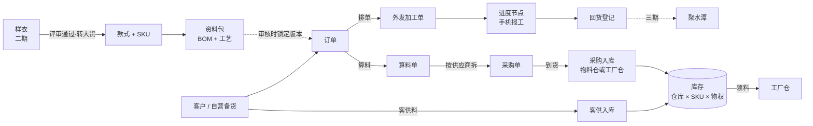
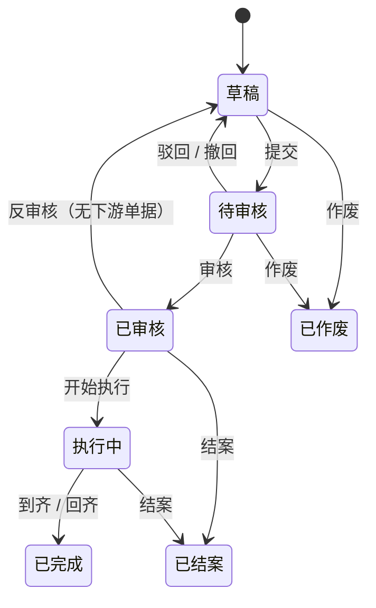
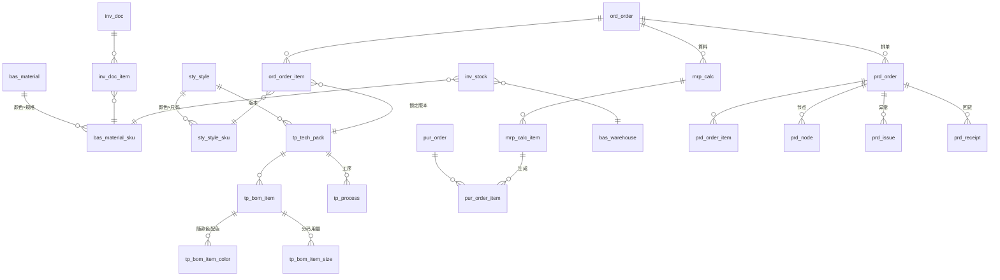

# 服装 SCM 产品需求文档（PRD）

| 项 | 内容 |
|---|---|
| 版本 | v0.4 草稿，2026-11-05 |
| 状态 | **待甲方确认**：§2 分期、§12 待决问题（每条都写了默认做法，不回复就按默认做） |
| 依据 | 甲方《服装SCM模块清单_需求确认表》（黄色 = 这次要做；没标黄 = 待定，以后再做，见 §2.5）；《领猫SCM模块字段清单》（11-03 采集，160 个页面、2985 列）；领猫原系统分析（10-01） |
| 原型 | `docs/原型/index.html`，浏览器直接打开，不用联网。所有模块（含待定的）都能点，单据之间真的联动；左下"意见"按页留言、圈位置，"意见汇总"导出 |
| 原件 | 两份 xlsx 和原系统分析在 `docs/private/`（含甲方企业信息，gitignore，**不进公开仓库**） |
| 不在本文 | 开发约定（仓库根目录 `CLAUDE.md`）、进度（`docs/进度.md`） |

## 变更记录

| 版本 | 日期 | 改了什么 |
|---|---|---|
| v0.1 | 2026-11-05 | 初稿：分期、9 个模块、数据模型、20 个待决问题 |
| v0.2 | 2026-11-05 | 没标黄的模块从"不做"改为"待定，以后再做"；新增 §2.5，写清一期先替它们记下哪些数据；13.09 低代码改为待定（建议不做） |
| v0.3 | 2026-11-05 | 部署改为甲方负责：改 §8 部署、备份、安全和 §11 的 HTTPS 风险；新增 Q21（上线前的试用环境），§2.4 加说明 |
| v0.4 | 2026-11-05 | Q21 加三问：服务器 CPU 架构、能不能访问 Docker Hub、有没有已备案的域名；§11 加"域名没备案"的风险 |

## 0. 怎么读

甲方和业务同事：读 §1 到 §4，每个模块读"做什么""规则""验收"三块，然后把 §12 的问题逐条答复。

开发：全读。§5 通用规则对所有模块生效，各模块里不再重复。§7 是表结构概要。

---

## 1. 背景与目标

### 1.1 甲方的业务

从两份表看，甲方是一家服装企业，业务有两条线：

- **自有款式**：设计、打样、评审，通过后转成大货款，给自营渠道备货。
- **贸易代工**：接品牌客户的订单（表里多处标【贸商核心】），按客户要求组织生产。料有自己采购的，也有客户提供的（客供料）。

两条线的大货都交给外部工厂做：工厂要么包工包料（相当于直接买成品），要么只收加工费（清加工），料由甲方采购后发过去。成品进聚水潭，再从那里发货。

涉及三个部门：开发（表里记作"开"）、生产（"产"）、财务（"财"）。

现在用的是领猫 SCM。它功能很全（19 组菜单、160 个页面），但大部分用不上。页面也慢：采购单页面冷加载要 60 秒以上，一个页面 20 多个按钮，外发加工订单列表有 45 列。

### 1.2 目标

一句话：把"款式 → 订单 → 算料采购 → 发料 → 外发生产 → 回货"这条主线搬进一个更快、更简单的系统，让料账和进度对得上。

一期（12-01）做到下面四条算成功：

1. 一张客户订单从录入到回货，全程在系统里走完，算料不用再开 Excel。
2. 任何时候都能回答：这张单的料齐了没有，在哪个工厂，做到哪一步，会不会延期。
3. 物料库存（含客供料、已经发到工厂的料）账实相符，每一次变动都有单据和日志。
4. 页面 1 秒内打开，列表默认不超过 12 列。

### 1.3 这次不做、以后再定的事

- 表里没标黄的模块：商品企划、核价与成本、质量管理、成品仓储与发货、财务结算，以及供应商管理里的客户商务条款、供应商绩效、合作历史与询价。**它们不是不做，是待定**：等主线跑起来、甲方确认要不要做和怎么做以后再排期。一期先替它们把要用的数据记下来，设计上留好口子，以后加进来不用推翻已有的（§2.5）。
- 低代码配置（13.09）：待定，建议不做。字段和流程要改，走"提需求 → 开发"，比做一套低代码便宜得多。
- 一期不做外部账号（工厂、客户登录）、不对接聚水潭、不做 PDA 扫码。这三项等 §12 的 Q01、Q02 有结论再排。

---

## 2. 范围与分期

### 2.1 怎么分的

| 分期 | 时间 | 放什么 |
|---|---|---|
| 一期 | 12-01 上线 | 黄色且 P0 |
| 二期 | 12 月内，每周发一次 | 黄色且 P1 |
| 三期 | 2027 年起 | 黄色且 P2；以及卡在待决问题上的 P0（聚水潭、外部账号、开放 API） |
| 待定 | 甲方确认后再排 | 没标黄的 32 条（§2.5）；13.09 低代码（建议不做） |

两种例外：

- **顺带**：很小、和一期页面放在一起顺手就做了的（供应商准入状态、黑名单与停用），提进一期。
- **简版**：P0 里工作量大的，拆成"一期简版 + 二期完整版"，下表写清简版做到哪。

为什么按 P 级排：甲方表里 P0 的定义是"没有它业务跑不起来"，P1 是"首版可以先用 Excel 或人工顶住"。今天是 11-05，离 12-01 只有 26 天，按 P 级排是唯一能按时上线的排法。

### 2.2 黄色范围逐条分期

黄色的 62 条：一期 40 条（含简版、顺带，以及已经有的 13.10），二期 17 条，三期或待定 5 条（含 13.09 低代码）。没标黄的 32 条见 §2.5。

**M01 基础资料与主数据**

| 编号 | 功能 | P | 分期 | 一期做到哪 / 说明 |
|---|---|---|---|---|
| 01.01 | 组织架构与多经营主体 | P0 | 一期简版 | 主体公司档案，每张单据带"主体"字段；按主体隔离数据放二期（§6.9） |
| 01.02 | 编码体系与单号规则 | P0 | 一期 | 款号、物料码、SKU 码、单号自动生成（§5.2）；款号规则待 Q05 |
| 01.03 | 物料主数据 | P0 | 一期 | 物料、颜色规格 SKU、供应商货号与色号、采购单位换算 |
| 01.04 | 品类/季节/年份/波段/风格 | P0 | 一期 | 品类树 + 字典 |
| 01.05 | 颜色尺码矩阵与 SKU 生成 | P0 | 一期 | 选颜色 × 尺码组，一键生成 |
| 01.06 | 仓库/货位/工厂/产线 | P0 | 一期简版 | 仓库（含"工厂仓"，§6.1.6）；工厂就是供应商里的一类；货位二期，产线三期 |
| 01.07 | 计量单位/币种/税率/账期 | P0 | 一期 | 字典；账期挂在供应商和客户上 |
| 01.08 | 基础数据变更日志 | P1 | 二期 | 一期已有操作日志（谁、什么时候、改了哪条）；二期补字段级"改前 → 改后" |

**款式管理**

| 编号 | 功能 | P | 分期 | 一期做到哪 / 说明 |
|---|---|---|---|---|
| 02.03 | 款式档案 | P0 | 一期 | |
| 02.04 | 款式 SKU / 吊牌与包装信息 | P0 | 一期简版 | SKU + 吊牌基础字段（吊牌价、品名、成分、执行标准、安全类别）；完整的吊牌水洗唛资料随 04.06 放二期 |
| 02.05 | 款式版本与变更记录 | P1 | 二期 | 一期资料包已经分版本（§6.4），二期补款式自身字段的改动记录 |
| 02.06 | 样品图库/素材库 | P2 | 三期 | 一期款式可以传多张图 |

**M03 研发打样**（整块二期，甲方表里这块全是 P1）

| 编号 | 功能 | P | 分期 | 说明 |
|---|---|---|---|---|
| 03.01 | 打样需求与派单 | P1 | 二期 | |
| 03.02 | 打样进度节点 | P1 | 二期 | |
| 03.03 | 样衣评审 | P1 | 二期 | |
| — | 样衣档案与版次管理 | — | 二期 | 表里这行没编号 |
| 03.04 | 样衣转大货节点 | P1 | 二期 | 一期款式直接新建；二期起可以从样衣转 |

**M04 BOM 与工艺资料包**

| 编号 | 功能 | P | 分期 | 一期做到哪 / 说明 |
|---|---|---|---|---|
| 04.01 | 大货 BOM（多版本/批次差异） | P0 | 一期 | 资料包分版本；订单审核时锁定版本 |
| 04.02 | 用量与损耗率 | P0 | 一期 | 单件用量、分码用量、损耗率；排版利用率只记录，不参与计算 |
| 04.03 | 工艺单 | P0 | 一期 | |
| 04.04 | 工序工价库与标准工时 | P0 | 一期简版 | 工艺单的工序行可以填工时和工价，合计成参考加工价；可复用的工价库放二期 |
| 04.05 | 尺寸表 | P1 | 二期 | |
| 04.06 | 吊牌/水洗唛/包装资料 | P1 | 二期 | |
| 04.07 | 资料包分发与版本权限 | P1 | 一期简版 + 三期 | 一期能打印、导出 PDF 发给工厂；在线共享要等外部账号（Q02） |

**M06 订单与排单**

| 编号 | 功能 | P | 分期 | 一期做到哪 / 说明 |
|---|---|---|---|---|
| 06.01 | 订单录入/导入/API 对接 | P0 | 一期简版 | 手工录入 + Excel 导入；API 三期 |
| 06.02 | 订单 SKU 明细、交期与送货要求 | P0 | 一期 | |
| 06.03 | 订单评审与交期承诺 | P0 | 一期简版 | 审核就是评审：填承诺交期，审核页显示齐料参考；产能评估随 08.02 放二期 |
| 06.04 | 排单/下单 | P0 | 一期 | 生成外发加工单；算料后生成采购单 |
| 06.05 | 翻单/补单 | P1 | 二期 | |
| 06.06 | 订单变更与取消留痕 | P0 | 一期 | 变更单 |
| 06.07 | 订单进度总览 | P1 | 二期 | 一期在订单详情里能看到下游加工单的进度；客户视角要外部账号，三期 |

**M07 物料管理**

| 编号 | 功能 | P | 分期 | 一期做到哪 / 说明 |
|---|---|---|---|---|
| 07.01 | 物料需求测算 | P0 | 一期 | 算料（§6.6.1） |
| 07.02 | 采购需求/请购与审批 | P0 | 一期简版 | 算料结果就是采购需求，采购单审核就是审批；独立的请购单二期 |
| 07.03 | 物料采购单 | P0 | 一期 | 分批到货 |
| 07.04 | 采购进度跟踪与到料预警 | P0 | 一期 | 到料跟踪页 |
| 07.05 | 客供料 vs 自购料区分与核销 | P0 | 一期简版 | 库存按"物权"分开；核销报表二期 |
| 07.06 | 物料入库/出库/退货（PDA 扫码）（对接聚水潭） | P0 | 一期简版 | 单据在本系统；PDA 三期；和聚水潭的关系待 Q01 |
| 07.07 | 物料进销存、货位库存与库存日志 | P0 | 一期简版 | 库存 + 日志；货位、进销存汇总表二期 |
| 07.08 | 领料/退料/调拨 | P0 | 一期 | |
| 07.09 | 委外发料与外发物料跟踪 | P1 | 二期 | 一期领料进"工厂仓"，已经能查到每个工厂手上有多少料 |
| 07.10 | 库存预警与呆滞料分析 | P2 | 三期 | 安全库存字段一期就有 |

**M08 生产与外发加工**

| 编号 | 功能 | P | 分期 | 一期做到哪 / 说明 |
|---|---|---|---|---|
| 08.01 | 外发加工单/成品采购单 | P0 | 一期 | 两种合成一张单，用"加工方式"区分 |
| 08.02 | 工厂产能与负荷 | P1 | 二期 | |
| 08.03 | 生产进度节点汇报 | P0 | 一期 | 计划开始、计划完成、实际开始、实际完成四个时点 |
| 08.04 | 二次加工/外协 | P1 | 二期 | |
| 08.05 | 移动端跟单报工 | P0 | 一期简版 | 跟单员用手机网页报工；工厂自己报要外部账号（Q02） |
| 08.06 | 货期预警与异常事件 | P0 | 一期 | |
| 08.07 | 发料与成品回收平衡 | P1 | 二期 | |
| 08.08 | 生产看板 | P0 | 一期 | |

**M12 供应商管理**（只有三条标黄）

| 编号 | 功能 | P | 分期 | 一期做到哪 / 说明 |
|---|---|---|---|---|
| 12.01 | 供应商档案与分类 | P0 | 一期 | |
| 12.02 | 准入与资质 | P1 | 一期简版（顺带）+ 三期 | 准入状态、证照附件（带有效期）；邀请注册、实名认证要外部账号，三期 |
| 12.05 | 黑名单与停用 | P2 | 一期（顺带） | |

**M13 系统权限、协同门户、报表与集成**

| 编号 | 功能 | P | 分期 | 一期做到哪 / 说明 |
|---|---|---|---|---|
| 13.01 | 组织/角色/菜单/字段/数据权限 | P0 | 一期简版 | 用户、角色、菜单、接口权限已经有了；一期加数据范围（本人/全部）；按主体隔离、字段权限放二期 |
| 13.02 | 外部协同账号 | P0 | 待 Q02 | |
| 13.03 | 审批流引擎 | P0 | 一期简版 | 固定单级审核（有审核权限的人审）；可配置的多级审批放二期 |
| 13.04 | 消息与待办 | P1 | 一期简版 | 首页待办；钉钉、企微推送二期 |
| 13.05 | 移动端 | P1 | 一期简版 | 只做手机报工页（08.05）；手机审批二期 |
| 13.06 | 报表看板 | P1 | 二期 | 一期有生产看板 |
| 13.07 | 业务报表与预警中心 | P1 | 二期 | 一期的预警分散在到料跟踪、生产看板、首页待办 |
| 13.08 | 开放 API 与集成 | P1 | 三期 | 待 Q01、Q04 |
| 13.09 | 低代码配置 | P2 | 待定（建议不做） | 见 §1.3 |
| 13.10 | 操作日志与数据留痕 | P1 | 已有 | 10-12 已上线 |

### 2.3 没标黄、但一期离不开的三件事

| 功能 | 为什么要 | 做到哪 |
|---|---|---|
| 客户档案 | 订单要选客户，客供料要记是哪个客户的 | 最小档案：编码、名称、联系人、结算方式（§6.1.8）。12.03 的价格协议、扣点待定（§2.5） |
| 回货登记 | 加工单要知道工厂交回了多少才能完成；订单要靠它判断做完没有 | 登记回货数和次品数（§6.7.5），不管成品库存（成品库存在聚水潭；成品仓储 M10 待定） |
| Excel 导入 | 上线时要把领猫里的物料、供应商、款式搬过来 | 物料、供应商、款式、客户、期初库存、订单六个模板（§10） |

### 2.4 上线节奏

| 日期 | 发什么 | 甲方做什么 |
|---|---|---|
| 11-07 | — | 确认 §2 和 §12，PRD 定稿 v1.0 |
| 11-14 | 第 1 次发版：基础资料、供应商、款式与 SKU、Excel 导入 | 开始录入、导入基础数据 |
| 11-21 | 第 2 次：资料包（BOM、工艺）、订单、排单生成加工单 | 给在做的款建资料包 |
| 11-28 | 第 3 次：算料、采购、出入库、库存、进度节点、回货、生产看板、手机报工 | 拿一张真实订单走一遍全流程 |
| 11-29 ~ 11-30 | 修试用发现的问题 | 导入在途订单和期初库存 |
| **12-01** | **一期上线** | 新订单开始在系统里走 |
| 12 月 | 二期，每周发一次：先研发打样，再其余 P1 | |

11-14 起甲方要在系统里试用、导入基础数据，需要一台已经部署好的服务器。部署由甲方那边负责，用哪台、谁来装、每周谁来升级，见 Q21。

### 2.5 没标黄的模块：待定，以后再做

甲方表里没标黄的 32 条不是不做，是等主线跑起来、甲方确认要不要做和怎么做以后再排期。现在先做两件事：

1. **数据先记下来**。这些模块大多是"拿已经发生的单据去算账、评分、对比"。历史数据事后补不回来，所以一期的单据要把它们以后要用的数记全：价格、金额、税率、实际日期、次品数、责任方。
2. **口子留好**。以后加这些模块时，已有的表只加列、不改列，已有的功能不用改流程。技术上怎么留，见 `docs/架构设计.md` §14。

| 模块 | 条目 | 一期先记下的数据、留的口子 | 等什么 |
|---|---|---|---|
| M02 商品企划 | 02.01 企划（主题、品类、价格带、数量）P2；02.02 企划任务与看板 P2 | 款式上的品类、季节、年份、波段、风格、吊牌价（§6.2）。企划做好以后，按这些口径对比"计划 vs 实际" | 甲方企划负责人确认需求 |
| M05 核价与成本 | 05.01 询报价与比价 P0；05.02 成本 BOM 测算 P0；05.03 核价单与报价单 P0；05.04 目标 vs 实际成本 P1；05.05 订单毛利测算 P0；05.06 价格档案与调价记录 P1 | BOM 行的用量、损耗率、参考单价；工艺单的工价；加工单的加工单价；采购单的成交价；订单行的销售单价；采购入库按成交价记单价。成本、毛利以后都能从这些算出来 | 一期主线先跑通 |
| M09 质量管理 | 09.01 来料检验 P1；09.02 产前样确认 P1；09.03 中检与尾期验货 P1；09.04 次品与返修 P1；09.05 质量扣款 P2；09.06 供应商质量档案 P2 | 回货的次品数；异常事件的类型（面料质量、做工质量）和责任方；进度节点模板可以加"产前样确认""验货"；仓库类型以后可以加"待检仓""不良品仓" | 甲方定质检流程 |
| M10 成品仓储与发货 | 10.01 成品入库 P0；10.02 条码与装箱 P1；10.03 成品库存 P0；10.04 调拨、退换货 P1；10.05 发货与物流 P1；10.06 聚水潭对接 P0；10.07 盘点 P2 | 回货单按 SKU 记数量、日期、收货仓；款式 SKU 码和条码（定编码规则时考虑和聚水潭的商品编码对得上，Q05） | Q01 |
| M11 财务结算 | 11.01 供应商对账 P0；11.02 客户对账与应收 P0；11.03 应付应收与付款计划 P0；11.04 发票 P0；11.05 扣款与索赔 P1；11.06 单款毛利结算 P1；11.07 预付款、定金、尾款 P1；11.08 结算状态共享 P2 | 采购单、加工单、订单都有单价、金额、税率、是否含税、结算方式；供应商、客户有账期；每次入库、回货记实际日期；单据被对账单引用以后不能再反审核（框架已支持） | 甲方财务流程、Q04 |
| M12 供应商管理（没标黄的部分） | 12.03 客户（品牌方）商务条款 P0；12.04 供应商绩效 P2；12.06 合作历史与询价记录 P2 | 客户档案（§6.1.8）以后加商务条款；绩效要的交期（约定交期 vs 实际到货、实际回货）、质量（次品率、质量异常）、价格（历史成交价）一期都有；合作历史就是供应商详情里的"往来单据" | 甲方确认考核指标 |

---

## 3. 用户与角色

| 角色 | 是谁 | 每天在系统里做什么 | 主要页面 |
|---|---|---|---|
| 超级管理员 | IT 或老板指定的人 | 建账号、分角色、维护字典 | 管理后台（已有） |
| 开发 | 设计师、版师 | 建款式，维护资料包；二期起建样衣、提打样 | 款式、资料包、研发打样 |
| 业务 | 业务员、订单员 | 录订单、导入订单、提变更 | 订单 |
| 生产跟单 | 生产跟单员 | 排单、下加工单、跟进度、手机报工、处理异常、登记回货 | 订单、外发加工、生产看板、手机报工 |
| 采购 | 面辅料采购员 | 算料、下采购单、跟到料 | 算料、采购单、到料跟踪 |
| 仓管 | 物料仓管理员 | 入库、领料发料、退料、调拨 | 出入库单、库存 |
| 财务 | 财务 | 一期只看采购单、加工单的金额（财务结算 M11 待定） | 采购单、加工单（只读） |
| 管理层 | 老板、主管 | 审核订单、采购单、加工单；看看板 | 首页、生产看板 |
| 外部 | 工厂、面辅料商、客户 | 三期（Q02） | — |

### 3.1 一期预置的角色模板

甲方可以在管理后台改。"看"= 能打开页面；"改"= 新建、编辑、提交；"审"= 审核、反审核、结案；"—"= 看不到。

| 模块 | 开发 | 业务 | 生产跟单 | 采购 | 仓管 | 财务 | 管理层 |
|---|---|---|---|---|---|---|---|
| 基础资料 | 改 | 看 | 看 | 改（物料） | 看 | 看 | 看 |
| 供应商 | 看 | 看 | 看 | 改 | 看 | 看 | 审（准入、拉黑） |
| 款式、资料包 | 改，审（资料包生效） | 看 | 看 | 看 | 看 | 看 | 看 |
| 订单 | 看 | 改 | 看 | 看 | — | 看 | 审 |
| 排单、加工单 | 看 | 看 | 改 | 看 | 看 | 看 | 审 |
| 算料、采购单 | — | 看 | 看 | 改 | 看 | 看 | 审 |
| 出入库、库存 | — | — | 看 | 看 | 改，审 | 看 | 看 |
| 进度、异常、回货 | — | 看 | 改 | 看 | 看 | — | 看 |

### 3.2 数据范围

每个角色设一个数据范围：

- **全部**：看所有单据。默认给管理层、财务、仓管。
- **本人**：只看自己相关的单据——制单人是自己，或者单据上的跟单员、采购员、业务员是自己。默认给业务、跟单、采购。

有"全部"范围的人，列表上方有"我的 / 全部"切换。

---

## 4. 业务全景

### 4.1 主线



### 4.2 单据之间怎么关联

| 从 | 到 | 怎么生成 | 回写什么 |
|---|---|---|---|
| 订单 | 外发加工单 | 订单详情点"排单" | 订单明细的已排产数 |
| 订单 | 算料单 | 订单详情或算料页点"算料"，可以多选订单 | — |
| 算料单 | 采购单 | 勾选行点"生成采购单"，按供应商自动拆成几张 | 算料行的已转采购量 |
| 采购单 | 采购入库单 | 采购单点"到货入库"，或新建入库单时选采购单 | 采购明细的已入库数；全部入齐后采购单变"已到齐" |
| 采购单 | 采购退货单 | 采购单点"退货" | 采购明细的已退货数 |
| 加工单 | 领料单 | 加工单点"领料"，按 BOM × 数量 − 已领 带出 | 加工单的领料状态 |
| 加工单 | 回货单 | 加工单点"登记回货" | 加工明细的已回货数、次品数；回齐后加工单变"已完成" |
| 订单变更单 | 订单 | 变更单审核通过后改订单 | 下游加工单、采购单显示"上游订单已变更" |

### 4.3 一张订单的一生（贯穿全文的例子）

后面各模块的验收都用这个例子，数字是真算过的。

客户"华东某服饰"下单：款 27CF001 女式风衣，3 个颜色 × 5 个尺码，共 1,200 件，要求 2027-03-20 交货。其中卡其色 400 件：S 80、M 120、L 120、XL 60、XXL 20。

1. **资料包**：大身面料"220g 斜纹棉"按款色配料（卡其款配卡其布）、分码用量（S 2.25、M 2.35、L 2.45、XL 2.55、XXL 2.65 米/件），损耗 3%，我方采购。
2. **订单审核**：锁定资料包 V2，承诺交期 03-20。
3. **算料**：卡其布毛需求 = 80×2.25 + 120×2.35 + 120×2.45 + 60×2.55 + 20×2.65 = 962 米，乘 1.03 = 990.86 米。物料仓有卡其布 120 米（自有），本次全部使用，净需求 870.86 米，向上取整 = **871 米**（最小包装 1 米，起订量 100 米）。
4. **采购**：生成采购单给面料商，871 米，交期 01-10。
5. **到货**：01-08 到 500 米，01-12 到 371 米。采购单先变"部分到货"，再变"已到齐"。到料跟踪里 01-11 这一行标红（逾期一天）。
6. **排单**：卡其 400 件给"某某制衣厂"，清加工，加工费 38 元/件，交期 03-10。
7. **领料**：从物料仓领 990.86 米卡其布到"某某制衣厂"工厂仓。
8. **进度**：跟单员在手机上报"裁剪完成 402 件""车缝完成 400 件"……
9. **回货**：03-08 回货 400 件，其中次品 4 件。加工单变"已完成"。三个颜色的加工单都完成后，订单"已完成"。

---

## 5. 通用规则（所有模块都适用）

### 5.1 单据的公共部分

每张单据的单头都有：单号、主体公司、状态、制单人、制单时间、审核人、审核时间、备注、附件；详情页都有"操作记录"页签（创建、提交、审核、驳回原因、变更……）。

**状态和动作**



| 状态 | 能做什么 |
|---|---|
| 草稿 | 改、删、提交、作废 |
| 待审核 | 审核（通过 / 驳回）、撤回（只有制单人）、作废 |
| 已审核 | 反审核（没有下游单据时）、生成下游单据、结案 |
| 执行中 | 继续生成下游单据、结案。各单据把"执行中"叫成自己的名字，如采购单叫"部分到货"、加工单叫"生产中" |
| 已完成、已结案 | 只读。有审核权限的人可以"取消结案" |
| 已作废 | 只读，单号不再使用 |

- **审核即过账**：出入库单审核时改库存；反审核时把库存改回去，库存不够改回就不让反审核。
- **不物理删除**：只有草稿能删（逻辑删除），其他状态只能作废或结案。
- **一期单级审核**：有该单据审核权限的人都能审。自己做的单能不能自己审，见 Q10，默认允许。

### 5.2 编码规则

| 对象 | 规则 | 例子 | 说明 |
|---|---|---|---|
| 单号 | 前缀 + 年月日 + 4 位流水（已有单号生成器，每天从 0001 开始） | CG202611050001 | 前缀：DD 订单、BG 订单变更、SL 算料、CG 采购、RK 入库、CK 出库、LL 领料、DB 调拨、JG 外发加工、HH 回货、DY 打样 |
| 款号 | 默认：年份后两位 + 季节码 + 品类码 + 3 位流水 | 27CF001（27 年春季 C、品类码 F = 风衣、第 1 款） | **待 Q05**：甲方现在用的规则；也可以手填，系统查重 |
| 样衣编号 | YY + 年月 + 4 位流水 | YY26110001 | 二期 |
| 物料编码 | 物料分类码 + 4 位流水 | ML0012（面料-梭织） | 待 Q05 |
| 款式 SKU 码 | 款号-颜色码-尺码 | 27CF001-KQ-M | 自动生成，不能改 |
| 物料 SKU 码 | 物料编码-颜色码[-规格码] | ML0012-KQ、FL0031-JS-15 | 自动生成，不能改 |
| 供应商编码 | GYS + 4 位流水 | GYS0008 | |
| 客户编码 | KH + 4 位流水 | KH0003 | |

### 5.3 数量、单位、金额

- 成品数量：整数，单位"件"。
- 物料数量：最多 3 位小数（米、码、公斤），显示时去掉末尾的 0。
- 单价 4 位小数，金额 2 位小数（四舍五入），税率按百分比。
- **单位换算**：物料有库存单位、采购单位和换算系数（1 采购单位 = n 库存单位）。比如面料按公斤买、按米用，1 公斤 = 3.2 米。采购单按采购单位下，入库时换算成库存单位记账。BOM 用量一律用库存单位。
- 币种：默认人民币。订单可以选外币，但一期不做汇率换算（财务结算 M11 待定）。

### 5.4 列表页

- 顶部：关键字搜索（单号、款号、名称……）+ 常用筛选（状态、日期范围、供应商或客户、跟单员）。
- 单号、款号可以一次查多个，用空格隔开（领猫用户的习惯）。
- 默认按制单时间倒序，每页 20 / 50 / 100 条。
- 默认列不超过 12 列，其余放详情页。
- 物料、款式、订单、采购单、库存可以导出 Excel（导出当前筛选结果）。
- 状态用标签显示：实线 = 定了（已审核、已完成），虚线 = 等人处理（草稿、待审核）或停用。

### 5.5 留痕

- **操作日志**（已有）：每次新增、修改、删除、审核，记录人、时间、接口、参数（密码打码）。
- **单据操作记录**：每张单据详情页的"操作记录"页签，按时间列出这张单发生过什么，驳回原因、变更原因都在这里。
- **字段级"改前 → 改后"**：二期（01.08）。

### 5.6 主数据的停用与引用

物料、物料 SKU、款式、款式 SKU、供应商、仓库、客户被单据用过以后不能删，只能停用。停用的不会出现在新单据的下拉框里，已有单据不受影响。

### 5.7 主体公司

每张单据带主体公司，默认取当前用户的默认主体。主数据（物料、款式、供应商……）一期各主体共用。按主体隔离数据放二期（见 Q13）。

### 5.8 图片和附件

沿用已有的上传功能。款式、物料、样衣可以传多张图，第一张是主图；单据可以挂附件。


---

## 6. 模块需求

每个模块按"做什么 → 页面 → 字段 → 规则 → 验收"写。字段表里"必填"一栏：● 必填，○ 选填，⚙ 系统自动。

### 6.1 基础资料（M01）

#### 6.1.1 主体公司

做什么：登记甲方名下做生意的公司或品牌主体。每张单据记是哪个主体做的，为以后按主体分账、隔离数据打底。

| 字段 | 必填 | 说明 |
|---|---|---|
| 编码 | ● | 2-6 位，唯一 |
| 名称 | ● | 公司全称 |
| 简称 | ● | 列表和单据上显示 |
| 统一社会信用代码 | ○ | |
| 地址、电话 | ○ | 打印采购单、加工单时用作抬头 |
| 状态 | ⚙ | 启用 / 停用 |

规则：至少有一个启用的主体。用户档案加"默认主体"，新建单据时自动带出。

#### 6.1.2 分类口径（品类、季节、年份、波段、风格……）

做什么：统一款式和物料的分类，报表才能按同一个口径比。

| 名称 | 形式 | 默认值（甲方可改） | 用在哪 |
|---|---|---|---|
| 品类 | 三级树，每级带 1 位编码 | 女装 > 外套 > 风衣 | 款式；款号里的品类码 |
| 季节 | 字典，带 1 位编码 | 春 C、夏 X、秋 Q、冬 D（编码待 Q05） | 款式、物料；款号里的季节码 |
| 年份 | 4 位数字 | 当年 | 款式、物料 |
| 波段 | 字典 | 第 1 波 ~ 第 6 波 | 款式 |
| 风格 | 字典 | 通勤、休闲、运动…… | 款式 |
| 品牌 | 字典 | 甲方自有品牌 | 款式、订单 |
| 系列 | 字典 | | 款式 |
| 性别 | 字典 | 女、男、童、中性 | 款式 |

规则：已经被款式用过的品类不能删，只能停用；品类编码一旦被款号用过就不能改。

#### 6.1.3 颜色与尺码组

做什么：服装特有的颜色 × 尺码矩阵。颜色和尺码统一建档，款式和物料选，不手打，SKU 码才不会乱。

**颜色**

| 字段 | 必填 | 说明 |
|---|---|---|
| 颜色编码 | ● | 2-3 位字母或数字，唯一，进 SKU 码（如 KQ = 卡其） |
| 颜色名称 | ● | 唯一 |
| 色系 | ○ | 字典：黑白灰、红、蓝、绿、黄、棕、紫…… |
| 色块 | ○ | 一个颜色值，只用于页面上显示小色块 |
| 状态 | ⚙ | 启用 / 停用 |

**尺码组**

| 字段 | 必填 | 说明 |
|---|---|---|
| 名称 | ● | 如"女装字母码""女装数字码""童装身高码""均码" |
| 尺码 | ● | 有顺序的列表，如 S、M、L、XL、XXL；尺码本身就是 SKU 码的一部分 |
| 状态 | ⚙ | 启用 / 停用 |

规则：已经有款式用的尺码组，只能在末尾追加尺码，不能删、不能改名、不能调顺序。

#### 6.1.4 物料分类

一棵树，两级就够：面料（梭织、针织、牛仔……）、辅料（拉链、纽扣、织带、线、衬、松紧……）、包材（包装袋、纸箱、吊牌、洗唛……）。每个节点 2 位字母编码，作为物料编码的前缀。

#### 6.1.5 物料档案

做什么：面料、辅料、包材统一建档。一个物料下面挂多个 SKU（颜色 × 规格），采购、库存、BOM 都落到 SKU 上。目标是"一物一码"。

页面：左边物料分类树，右边列表；点一行在右侧抽屉里编辑，抽屉下半部分是 SKU 子表。

**物料（主表）**

| 字段 | 必填 | 说明 | 领猫对应 |
|---|---|---|---|
| 物料编码 | ⚙ | 按分类自动生成（§5.2） | 物料编码 |
| 物料名称 | ● | 如"220g 斜纹棉" | 物料名称 |
| 分类 | ● | 物料分类树的叶子 | 分类 |
| 物料类型 | ● | 字典：面料、里料、辅料、包材、标签吊牌 | 类型 |
| 图片 | ○ | 多张 | 图片 |
| 库存单位 | ● | 字典：米、码、公斤、个、条、套、张…… | 单位 |
| 采购单位 | ● | 默认等于库存单位 | — |
| 换算系数 | ● | 1 采购单位 = n 库存单位，默认 1 | — |
| 门幅 | ○ | 厘米，面料用 | 门幅 |
| 克重 | ○ | g/㎡，面料用 | 克重 |
| 成分 | ○ | 如"100% 棉" | 物料成分 |
| 组织/纹理 | ○ | 如"斜纹""平纹" | 纹理 |
| 默认供应商 | ○ | 只能选合作中的供应商 | 供应商 |
| 供应商货号 | ○ | | 供应商货号 |
| 参考单价 | ○ | 按采购单位，含税；算料、采购单默认带出 | 成本价 |
| 起订量 | ○ | 按采购单位；算料时建议采购量不小于它 | — |
| 最小包装量 | ○ | 按采购单位，默认 1；建议采购量向上取整到它的倍数 | — |
| 采购周期 | ○ | 天；采购单默认交期 = 下单日 + 采购周期 | — |
| 年份、季节 | ○ | | 年份、季节 |
| 状态 | ⚙ | 启用 / 停用 | 状态 |
| 备注 | ○ | | 备注 |

**物料 SKU（子表）**

| 字段 | 必填 | 说明 |
|---|---|---|
| SKU 编码 | ⚙ | 物料编码-颜色码[-规格码] |
| 颜色 | ○ | 从颜色档案选；没有颜色的物料（如透明胶袋）可以空 |
| 供应商色号 | ○ | 供应商自己的色号，如"C-1032" |
| 规格 | ○ | 自由填，如拉链"15cm"、纽扣"18L"；填了就生成规格码 |
| 单价 | ○ | 不填就用物料的参考单价 |
| 安全库存 | ○ | 库存单位；三期做预警，一期先记 |
| 图片 | ○ | |
| 状态 | ⚙ | 启用 / 停用 |

规则：

1. **查重**：同一分类下名称相同，或同一供应商下供应商货号 + 色号相同，保存时提示"可能和 ML0012 重复，确定新建？"。
2. **批量加 SKU**：可以一次选多个颜色，每个颜色生成一个 SKU；规格同理。
3. 被采购单、库存、BOM 用过的 SKU 不能删，只能停用。
4. 物料停用后，它的 SKU 不能再选进新单据；已有库存照常可以出库。

验收：

1. 在"面料-梭织"下新建"220g 斜纹棉"，编码自动生成 ML 开头；一次选卡其、藏青、黑三色，生成三个 SKU，编码分别以 -KQ、-ZQ、-HE 结尾。
2. 再建一个同名物料，保存时出现查重提示。
3. 采购单位设"公斤"、库存单位"米"、换算系数 3.2，采购 100 公斤入库后库存加 320 米。

#### 6.1.6 仓库

做什么：明确货在哪。这里有一个关键设计——**工厂仓**。

| 字段 | 必填 | 说明 |
|---|---|---|
| 编码、名称 | ● | |
| 类型 | ● | 物料仓 / 成品仓 / 工厂仓 |
| 绑定加工厂 | 工厂仓必填 | 一个加工厂对应一个工厂仓 |
| 地址、负责人、电话 | ○ | |
| 状态 | ⚙ | 启用 / 停用 |

**为什么要工厂仓**：料发给工厂以后，还是甲方的料（或客户的料），只是放在工厂那里。把每个工厂当成一个"虚拟仓库"：

- 领料 = 从物料仓调到工厂仓，账上不少，只是换了地方；
- 面料直接从供应商发到工厂 = 采购入库时直接入工厂仓；
- 工厂之间转料 = 两个工厂仓之间调拨；
- 剩料退回 = 从工厂仓调回物料仓。

这样"每个工厂手上有多少料"（07.09、08.07 要的）是库存表上直接查得到的数，不用另外记一本账。二期做料账平衡时，只要再按回货数 × BOM 用量算出"应该用掉多少"，和工厂仓里剩的比就行。

规则：供应商分类里有"成衣厂"或"加工厂"的，新建时自动建一个同名工厂仓。

#### 6.1.7 字典

沿用已有的字典功能，一期预置下面这些（甲方可增改）：

| 字典 | 默认值 |
|---|---|
| 单位 | 米、码、公斤、个、条、套、张、卷、件 |
| 币种 | 人民币、美元、欧元、港币 |
| 税率 | 0%、1%、3%、6%、9%、13% |
| 结算方式 | 月结、货到付款、预付、银行转账、承兑 |
| 发票类型 | 专票、普票、不开票 |
| 物料类型 | 面料、里料、辅料、包材、标签吊牌 |
| 供应商分类 | 面料商、辅料商、成衣厂、加工厂、外协（印绣洗）、包材商、其他 |
| 订单类型 | 客户订单、自营备货、补单、翻单 |
| 加工方式 | 包工包料、清加工、半包 |
| 生产节点 | 到料、裁剪、车缝、后整、包装、入仓 |
| 异常类型 | 缺料、面料质量、做工质量、延期、工艺问题、其他 |
| BOM 部位 | 大身、里布、袋布、领、袖、拉链、纽扣、织带、主唛、洗唛、吊牌、包装袋 |

#### 6.1.8 客户（最小档案）

| 字段 | 必填 | 说明 |
|---|---|---|
| 编码 | ⚙ | KH + 4 位 |
| 名称、简称 | ● | |
| 联系人、电话、地址 | ○ | |
| 结算方式、账期（天） | ○ | |
| 状态 | ⚙ | 启用 / 停用 |
| 备注 | ○ | |

价格协议、扣点等商务条款（12.03）待定（§2.5），以后在客户档案上加。

---

### 6.2 款式（M02 款式管理）

做什么：款式是下单、生产、装箱取数的唯一来源。一个款式下挂颜色 × 尺码展开的 SKU，挂资料包（§6.4）。

页面：

- **款式列表**：可以切换图卡视图（服装看图找款快）和表格视图。表格列：主图、款号、名称、品类、年份/季节/波段、颜色数 × 尺码数、资料包状态、吊牌价、设计师、状态、更新时间。
- **款式详情**：页签"基本信息 / 颜色尺码 / 资料包 / 订单 / 操作记录"。

**款式字段**

| 字段 | 必填 | 说明 | 领猫对应 |
|---|---|---|---|
| 款号 | ● | 按规则生成，也可以手填（系统查重）；保存后不能改 | 款式编号 |
| 款式名称 | ● | | 款式名称 |
| 图片 | ○ | 多张，第一张为主图；可以传图稿、设计说明附件 | 图片 |
| 品牌 | ● | | 品牌 |
| 品类 | ● | 品类树叶子 | 产品分类 |
| 年份、季节 | ● | | 年份、季节 |
| 波段、风格、系列、性别 | ○ | | 同名 |
| 设计师、版师 | ○ | 选用户 | 设计师 |
| 来源 | ● | 自主开发 / 客户来样 / 选款 / 改款 | 来源 |
| 客户、客户款号 | ○ | 客户来样时填 | 客户简称 |
| 样衣编号 | ⚙ | 二期起从样衣转大货时自动带 | 样衣编号 |
| 尺码组 | ● | 有订单以后不能换 | — |
| 颜色 | ● | 多选 | — |
| 主力面料 | ○ | 选物料 | 主力面料 |
| 品名 | ○ | 吊牌上的品名，如"风衣" | 品名 |
| 成分 | ○ | 如"面料：100% 棉；里料：100% 聚酯纤维" | 成分 |
| 执行标准 | ○ | 字典，如"GB/T 2664-2017" | 执行标准 |
| 安全类别 | ○ | A 类 / B 类 / C 类 | 安全类别 |
| 吊牌价 | ○ | | 吊牌价 |
| 参考成本价 | ○ | 一期手填；二期可以从资料包算 | 成本价 |
| 默认加工厂 | ○ | 排单时默认带出 | 默认供应商 |
| 上市日期 | ○ | | 上市日期 |
| 状态 | ⚙ | 草稿 / 启用 / 停用 | 状态 |
| 资料包状态 | ⚙ | 无 / 草稿 / 已生效 | BOM 状态 |
| 备注 | ○ | | 备注 |

**款式 SKU**

| 字段 | 必填 | 说明 |
|---|---|---|
| SKU 码 | ⚙ | 款号-颜色码-尺码 |
| 颜色、尺码 | ⚙ | |
| 条码 | ○ | 一期手填或导入（条码管理随 M10 待定） |
| 吊牌价 | ○ | 默认等于款式吊牌价，可以单独改（大码加价） |
| 状态 | ⚙ | 启用 / 停用 |

规则：

1. **一键生成 SKU**：在"颜色尺码"页签选颜色、确认尺码组，下面实时出颜色 × 尺码的表格，点"生成"。以后加颜色只追加新 SKU，不动已有的。
2. 被订单用过的 SKU 不能删，只能停用；停用的颜色或尺码不能再下订单。
3. 款式是"草稿"时不能下订单；"停用"后不能下新订单。
4. 款式加了新颜色，而已生效资料包里有"随款色"的物料行，这个新颜色还没配料：款式页顶部提示"新颜色 酒红 未配料，订单不能下这个颜色"，直到资料包新版本生效。

验收：

1. 新建 27CF001，选卡其、藏青、黑 3 色和"女装字母码"（S-XXL），一键生成 15 个 SKU，SKU 码如 27CF001-KQ-M。
2. 给这个款下过订单以后，删除 27CF001-KQ-S 被拒绝，提示"已有订单使用，只能停用"。
3. 追加颜色"酒红"，只新增 5 个 SKU；款式页出现"新颜色未配料"提示。

---

### 6.3 研发打样（M03，二期）

做什么：样衣从需求到评审的全过程在线跑，评审通过后一键转成大货款式，样衣阶段的信息（打样工厂、面料来源、各版次意见）都保留下来。

**为什么样衣和款式分两张表**：大部分样衣最后会被淘汰，不该混进大货款式列表里；转大货时再生成款式，带上样衣的资料。领猫也是这么分的。

#### 6.3.1 样衣档案

| 字段 | 必填 | 说明 |
|---|---|---|
| 样衣编号 | ⚙ | YY + 年月 + 4 位 |
| 样衣名称 | ● | |
| 图片 | ○ | 多张 |
| 品牌、品类、年份、季节、波段 | ● | |
| 设计师、版师 | ○ | |
| 来源 | ● | 自主开发 / 客户来样 / 选款 |
| 客户、客户款号 | ○ | |
| 尺码组、颜色 | ○ | |
| 打样工厂 | ○ | 供应商 |
| 面料来源 | ○ | 面料供应商 + 文字描述（还没建物料档案的面料也能记） |
| 当前版次 | ⚙ | 第几版 |
| 预计开发完成日期 | ○ | |
| 预估吊牌价、预估成本 | ○ | |
| 状态 | ⚙ | 开发中 / 已通过 / 已淘汰 / 已转大货 |
| 转大货款号、转大货时间 | ⚙ | |

#### 6.3.2 打样单（一个版次一张）

| 字段 | 必填 | 说明 |
|---|---|---|
| 单号 | ⚙ | DY…… |
| 样衣 | ● | |
| 版次 | ⚙ | 第 n 版 |
| 打样类型 | ● | 初样 / 改版样 / 齐色齐码样 / 产前样 |
| 打样方式 | ● | 内部版房 / 外部工厂 |
| 打样工厂或版师 | ● | 外部选供应商，内部选人 |
| 需求日期 | ● | |
| 打样数量、颜色、尺码 | ● | |
| 改版原因 | 第 2 版起必填 | 默认带上一版的评审意见 |
| 要求说明、附件 | ○ | |
| 状态 | ⚙ | 待派单 / 打样中 / 待评审 / 已通过 / 需改版 / 已淘汰 / 已取消 |

**节点**：接单 → 纸样 → 裁剪 → 车版 → 送样（字典可改）。每个节点有计划日期、实际完成时间、负责人、备注。当前节点 = 第一个没完成的节点；过了计划日期没完成标红。列表上直接看得到"卡在谁那里"。

**评审**：评审时间、评审人（可多人）、结论（通过 / 改版 / 淘汰）、意见、图片。

- 通过 → 样衣变"已通过"，可以转大货；
- 改版 → 自动生成下一版打样单草稿，带上本版信息，改版原因 = 评审意见；
- 淘汰 → 样衣变"已淘汰"。

#### 6.3.3 样衣转大货

样衣"已通过"后点"转大货"：弹窗确认款号（按规则生成）、品类、季节等 → 生成款式，复制样衣的字段和图片；样衣有资料包的，复制成款式资料包 V1（草稿）；样衣记下转大货款号、时间、操作人，变"已转大货"。

一个样衣只转一个款（Q06）。

验收：

1. 样衣 YY26110001 打第 1 版，评审"改版"，自动生成第 2 版打样单，改版原因 = 第 1 版的评审意见。
2. 第 2 版评审通过，转大货生成 27CF001，样衣详情显示转大货款号，款式详情显示来源样衣编号。

---

### 6.4 资料包：BOM 与工艺（M04）

做什么：一个款"用什么料、用多少、怎么做"的完整说明。工厂按同一份资料做货，采购按它算料。

#### 6.4.1 资料包和版本

一个资料包 = 一个款式的一个版本，里面有 BOM（物料清单）、工艺单；二期加尺寸表、吊牌包装资料。

| 字段 | 必填 | 说明 |
|---|---|---|
| 款式 | ● | 二期起也可以挂在样衣上 |
| 版本号 | ⚙ | V1、V2……自动递增 |
| 状态 | ⚙ | 草稿 / 已生效 / 已作废 |
| 本版说明 | V2 起必填 | 这版改了什么 |
| 排版利用率 | ○ | %，只记录 |
| 参考加工价 | ⚙ | 工艺单工序工价合计 |
| 生效人、生效时间 | ⚙ | |

**版本规则**（这是 04.01"多版本/批次差异"的落点）：

1. 每个款同时最多一个"已生效"版本。新版本生效时，旧版本自动变"已作废"（还能看，不能改）。
2. 已生效的版本不能直接改。要改就点"修订"，复制出一个新草稿，改完再生效。
3. **订单审核时，每个订单行锁定这个款当时生效的版本**。以后资料包怎么改都不影响已审核的订单；这张订单要换新版本，走订单变更（§6.5.4）。这样同一个款的两批订单可以用不同的 BOM（批次差异），而且每批用的是哪版查得到。

#### 6.4.2 BOM 行

| 字段 | 必填 | 说明 |
|---|---|---|
| 序号 | ⚙ | 可拖动排序 |
| 部位 | ● | 字典：大身、里布、拉链…… |
| 物料 | ● | |
| 颜色方式 | ● | **固定**：所有款色都用同一个物料 SKU（如黑色拉链）；**随款色**：每个款色各配一个物料 SKU（卡其款配卡其布） |
| 物料 SKU / 配色 | ● | 固定：选一个 SKU；随款色：款式每个启用颜色各选一个 SKU |
| 用量方式 | ● | **统一**：所有尺码一个用量；**分码**：每个尺码一个用量 |
| 单件用量 | ● | 库存单位。统一填一个数，分码每码填一个 |
| 单位 | ⚙ | 物料的库存单位 |
| 损耗率 | ● | %，默认 0 |
| 物料来源 | ● | **我方采购** / **客供** / **加工厂自备**（包工包料时工厂自己买的料） |
| 供应商 | ○ | 默认带物料的默认供应商 |
| 参考单价 | ⚙ | 带物料 SKU 单价，可改 |
| 单件成本 | ⚙ | 用量 ×（1 + 损耗率）× 单价，按 M 码或统一用量算，仅供参考 |
| 备注 | ○ | 如"注意对格" |

页面：BOM 表格里，随款色的行可以展开成"款色 → 物料 SKU"小表；分码的行展开成"尺码 → 用量"小表。另外提供"按颜色展开"视图：选一个款色，列出这个颜色实际要用的每个物料 SKU 和各码用量——这就是发给工厂的那张表。

**生效前检查**（不通过不让生效，并指出哪一行）：

1. 至少一行 BOM；
2. 随款色的行，款式每个启用颜色都配了物料 SKU；
3. 分码的行，尺码组每个尺码都有用量；
4. 用到的物料和 SKU 都没有停用。

#### 6.4.3 工艺单

| 部分 | 内容 |
|---|---|
| 整体要求 | 文字：缝份、针距、做法、注意事项；可以插图 |
| 工序 | 每行：序号、工序类别（裁剪/车缝/整烫/后道/包装）、工序名称、工艺要求、图示（图片）、标准工时（秒）、工价（元）、备注 |
| 合计 | 总工时、参考加工价 = 工价合计 |

工价库（04.04 完整版）二期：常用工序和工价存成库，新建工艺单时挑选。

#### 6.4.4 打印资料包

一键生成可以打印、存 PDF 的页面：款式信息和图、颜色尺码表、BOM（按颜色展开）、工艺单。下加工单时随单发给工厂，一期就靠它代替"资料包在线分发"（04.07）。

#### 6.4.5 二期补充

- 尺寸表（04.05）：部位 × 尺码的成衣尺寸，带公差。
- 吊牌、水洗唛、包装资料（04.06）：洗涤说明、包装方式、装箱规格。
- 生产资料包：下加工单时把资料包复制一份到这张加工单上，可以按批次微调（领猫的"生产资料包"）。

验收（用 §4.3 的例子）：

1. 27CF001 资料包 V1 加一行"大身 / 220g 斜纹棉 / 随款色 / 分码 / 损耗 3% / 我方采购"，只给卡其、藏青配了布，没给黑色配：点"生效"被拒绝，提示"第 1 行：黑色未配料"。
2. 配齐后生效 V1；修订出 V2 改 M 码用量为 2.35 再生效，V1 自动变"已作废"。
3. 订单审核后，再修订出 V3 并生效：该订单详情里仍显示用的是 V2，按 V2 算料。
4. 打印资料包，选卡其色，大身一行显示物料 SKU"220g 斜纹棉-卡其"和 S-XXL 五个用量。


---

### 6.5 订单与排单（M06）

做什么：客户订单和自营备货单统一录进来，结构化到 SKU 和交期；审核时评审交期、锁定资料包；然后拆成给工厂的加工单和给供应商的采购单。

页面：订单列表；订单详情（页签：明细 / 下游单据 / 变更记录 / 附件 / 操作记录）；排单对话框；变更单。

#### 6.5.1 订单字段

**单头**

| 字段 | 必填 | 说明 | 领猫对应 |
|---|---|---|---|
| 订单号 | ⚙ | DD…… | 订单编号 |
| 主体公司 | ● | 默认取用户的默认主体 | 主体公司 |
| 订单类型 | ● | 客户订单 / 自营备货 / 补单 / 翻单 | 订单类型 |
| 客户 | 客户订单必填 | | 客户 |
| 客户订单号、合同号 | ○ | 客户那边的单号，可以按它搜 | 外部单号、合同号 |
| 品牌 | ○ | | 品牌 |
| 下单日期 | ● | 默认今天 | 制单日期 |
| 客户交期 | ● | 客户要求的交货日期 | — |
| 承诺交期 | 审核时必填 | 评审后答应客户的日期 | — |
| 业务员、跟单员 | ● | 跟单员决定这张单出现在谁的"我的"里 | 跟单员 |
| 币种 | ● | 默认人民币 | 币种 |
| 送货要求 | ○ | 送货地址、方式、包装要求（文字） | — |
| 总数量、总金额 | ⚙ | | 总数量、总金额 |
| 来源 | ⚙ | 手工 / Excel 导入 / 翻单（二期） | — |
| 状态 | ⚙ | 见 §6.5.3 | 状态 |
| 进度 | ⚙ | 已排产、齐料、已回货的汇总百分比 | — |
| 备注、附件 | ○ | | 备注 |

**明细**（一行一个 SKU）

| 字段 | 必填 | 说明 |
|---|---|---|
| 款式 | ● | 只能选"启用"的款，且资料包已生效 |
| 颜色、尺码 | ● | 即款式 SKU；只能选启用的 |
| 数量 | ● | 整数，> 0 |
| 单价、金额 | ○ | 金额 = 数量 × 单价 |
| 行交期 | ○ | 不填就用单头的客户交期；同一张单不同款交期不同时填 |
| 资料包版本 | ⚙ | 审核时锁定 |
| 已排产数、已回货数 | ⚙ | 下游回写 |
| 备注 | ○ | |

**录入方式：颜色 × 尺码矩阵**。选一个款，下面出一张表，行是颜色、列是尺码，格子里填数量，右边和底下自动合计。这是服装下单最自然的方式，一个款一张矩阵，多个款就加多张。保存时展开成一行一个 SKU。

#### 6.5.2 Excel 导入

模板一行一个 SKU：客户订单号、款号、颜色（名称或编码）、尺码、数量、单价、行交期。同一个客户订单号的行进同一张订单。

校验：款号、颜色、尺码都要存在且启用；数量是正整数。有任何一行错，整批不导入，返回错误清单（第几行、哪一列、什么问题）。

#### 6.5.3 状态

| 状态 | 什么时候 |
|---|---|
| 草稿 → 待审核 → 已审核 | 通用流程（§5.1） |
| 生产中 | 有了已审核的加工单 |
| 已完成 | 所有数量都已排产，所有加工单都已完成 |
| 已结案 | 手动结案（如客户不要剩下的了） |
| 已取消 | 审核前作废；审核后通过变更单取消 |

#### 6.5.4 审核即评审（06.03）

审核对话框显示三样东西，帮审核人判断交期能不能答应：

1. **资料包**：每个款当前生效的版本，审核后锁定；没有生效版本的款不让审。
2. **齐料参考**：按资料包粗算一遍物料需求，和现有库存比，列出"缺口最大的 5 种料"及其采购周期。
3. **在手负荷**：这个款的默认加工厂手上还有多少件在制（取自生产看板）。完整的产能评估二期做。

审核人填"承诺交期"后通过。

#### 6.5.5 排单（06.04）

已审核的订单点"排单"，对话框里每个款一块：

- 选加工厂（默认带款式的默认加工厂，只能选合作中的成衣厂或加工厂）；
- 加工方式（包工包料 / 清加工 / 半包）、加工单价、交期（默认 = 承诺交期 − 10 天，可改）；
- 每个 SKU 分配数量，默认 = 订单数量 − 已排产数；一个款可以拆给几个工厂，点"再加一个工厂"，数量分开填。

确定后生成加工单草稿：**一张加工单 = 一个加工厂 + 一个款式**（进度是按款跟的，一张单里放多个款，节点就报不清了）。

规则：同一 SKU 的已排产数合计不能超过订单数量 ×（1 + 溢装比例），向下取整，溢装比例默认 3%（Q09）。

#### 6.5.6 订单变更（06.06）

已审核的订单不能直接改，要提变更单。

| 字段 | 必填 | 说明 |
|---|---|---|
| 变更单号 | ⚙ | BG…… |
| 订单 | ● | |
| 变更类型 | ● | 可多选：数量、交期、配色配码（加减颜色尺码）、单价、资料包版本、取消订单 |
| 变更明细 | ⚙ | 每一处改动的"原 → 新"，如"27CF001-KQ-M：120 → 100""客户交期：03-20 → 03-25" |
| 原因 | ● | |
| 责任方 | ● | 客户 / 我方 / 工厂 / 供应商 |
| 费用说明 | ○ | 如"客户承担已裁片损失" |
| 状态 | ⚙ | 草稿 / 待审核 / 已审核 |

规则：

1. 变更单审核通过后才写回订单，订单的"变更记录"页签列出所有变更单。
2. 新数量小于已排产数时不让提交，提示"先调整加工单 JG……"。
3. 写回后，下游的加工单、采购单、算料单顶部出现黄色提示"上游订单 DD…… 于 11-20 变更：27CF001-KQ-M 数量 −20"，负责人点"已处理"后消失；首页待办里也有这一条。
4. 取消订单：没有下游单据就直接取消；有的话列出来，要先处理。

#### 6.5.7 二期

- 翻单/补单（06.05）：选一张历史订单"复制为新订单"，款、资料包、明细都带过来，改数量交期就行。
- 订单进度总览（06.07）：按订单看每个款的排产、齐料、各加工单当前节点、回货、剩余天数。一期在订单详情的"下游单据"页签里能看到这些单据和它们的状态。

验收（§4.3 的例子）：

1. 用矩阵录入 27CF001 三色五码共 1,200 件，保存后明细是 15 行。
2. 资料包未生效的款加进订单，提交时被拒绝。
3. 审核时填承诺交期 03-20，订单行显示锁定资料包 V2。
4. 排单：卡其 400 件给某某制衣厂，藏青、黑 800 件给另一家，生成两张加工单草稿；再给 27CF001-KQ-M 排 10 件被拒绝（订单 120 件，上限 120 × 1.03 = 123 件，最多还能排 3 件）。
5. 提变更单把 27CF001-KQ-M 从 120 改成 100，审核后订单数量变了，卡其那张加工单顶部出现变更提示。

---

### 6.6 物料（M07）

#### 6.6.1 算料（07.01）

做什么：选订单，一键算出要买什么料、买多少，替代现在的 Excel。

输入：一张或多张已审核的订单（只算还没取消的数量），每个订单行用它锁定的资料包版本。

**公式**（对每个物料 SKU、每种物权分别算）：

```
毛需求     = Σ（订单 SKU 数量 × 该 SKU 尺码对应的单件用量 ×（1 + 损耗率））
需求       = 毛需求 ×（1 + 备料比）                 备料比按物料类型设，默认 0
可用库存   = 物料仓里同物权的库存 − 其他未关闭算料单"计划使用库存"之和
本次使用库存 = 默认 min（可用库存，需求），可以手改小
本次使用在途 = 默认 0，可以手填（在途只列出来做参考，不自动扣，避免一批在途被两张单重复用）
净需求     = 需求 − 本次使用库存 − 本次使用在途
建议采购量 = 净需求 ÷ 换算系数（换成采购单位），向上取整到最小包装量的倍数，且不小于起订量；净需求 ≤ 0 时为 0
```

"同物权"：客户订单里物料来源 = 客供的行，只看这个客户的客供库存；其他行看自有库存。

**结果分三块**：

| 块 | 内容 |
|---|---|
| 我方采购 | 每行：物料 SKU、供应商、毛需求、需求、可用库存、本次使用库存、在途（参考）、本次使用在途、净需求、采购单位、建议采购量、参考单价、预计金额、已转采购量 |
| 待客户提供 | 客供料：需求、该客户客供库存、缺口。提醒业务去催客户 |
| 工厂自备 | 加工厂自备的料，只列出来，不算 |

动作：勾选"我方采购"里的行 → "生成采购单"，按供应商自动拆成几张采购单草稿，回写已转采购量。

**算料单**：每次算料存成一张算料单（SL……），记下当时的输入和结果，状态：草稿 → 已确认 → 已关闭。

- "已确认"的算料单，它的"本次使用库存"算作软占用——别的算料单算可用库存时会扣掉（不改库存表）。
- 订单的加工单都领完料，或者手动关闭，算料单变"已关闭"，占用释放。
- 订单变更后点"重新算料"：生成新算料单，和上一张对比列出每种料 + / −，旧的自动关闭。

一期不做硬锁库（库存锁给某张订单、别人领不走）。同一款给不同工厂、供料方式不同时，算料按资料包的"物料来源"算，特殊情况在结果里手动删行或改数（二期改成按加工单算）。

#### 6.6.2 采购单（07.02、07.03）

**单头**

| 字段 | 必填 | 说明 | 领猫对应 |
|---|---|---|---|
| 采购单号 | ⚙ | CG…… | 采购单号 |
| 主体公司 | ● | | — |
| 供应商 | ● | 只能选"合作中"的 | 供应商 |
| 采购类型 | ● | 订单采购 / 备货采购 / 打样采购 | 单据类型 |
| 采购员 | ● | | 跟单员 |
| 下单日期、交货日期 | ● | 交货日期默认 = 下单日 + 物料采购周期（取各行最长） | 制单日期 |
| 交货地点 | ● | 一个仓库：物料仓，或某个工厂仓（面料直发工厂） | 仓库 |
| 结算方式、税率、是否含税 | ● | 默认带供应商 | — |
| 总数量、总金额 | ⚙ | | 数量、金额 |
| 到货进度 | ⚙ | 已入库 / 采购数 | — |
| 状态 | ⚙ | 草稿 / 待审核 / 已审核 / 部分到货 / 已到齐 / 已结案 / 已作废 | 状态 |
| 备注、附件 | ○ | | 备注 |

**明细**

| 字段 | 必填 | 说明 |
|---|---|---|
| 物料 SKU | ● | 带出名称、颜色、规格、供应商货号、色号 |
| 物权 | ● | 自有 / 客户代采（记客户）；默认自有 |
| 采购单位、数量 | ● | |
| 单价、金额 | ● | 默认带物料 SKU 单价 |
| 行交期 | ○ | 不填用单头交货日期 |
| 来源 | ⚙ | 算料单行、订单号、款号（从算料生成时自动带） |
| 已入库、已退货、未入库 | ⚙ | 采购单位 |
| 预计到货日期、跟进备注 | ○ | 采购员跟进时更新，如"供应商说 11-18 发货" |

动作：提交、审核（审核即审批，07.02 简版）、打印、到货入库（生成入库单，带出未入库数量）、退货、结案。

规则：

1. 分批到货：一张采购单可以对应多张入库单，每次入库回写已入库数。入库数超过未入库数时，允许超收到溢收比例（默认 5%，Q09），再多不让。
2. 全部入齐（已入库 ≥ 采购数）→ 已到齐；有入库但没齐 → 部分到货；剩下不要了 → 结案。
3. 供应商被停用或拉黑后，它的未完成采购单列表上标"供应商已停用"，可以继续入库，不能新建。

#### 6.6.3 到料跟踪（07.04）

做什么：采购员每天打开看一眼，哪些料该到没到。

页面：一个列表，一行是一条未入齐的采购明细：采购单号、供应商、物料 SKU、关联订单/款号、采购数、已入库、未入库、交期、预计到货、剩余天数、跟进备注、状态。

| 状态 | 条件 | 显示 |
|---|---|---|
| 已逾期 | 今天 > 交期（有预计到货日期时用它） | 红 |
| 临期 | 交期 − 今天 ≤ 3 天 | 黄 |
| 正常 | 其他 | — |

可以直接在行上改"预计到货日期"和"跟进备注"。

**齐料状态**：订单和加工单上显示齐料状态，按它们关联的算料单算——算料结果"我方采购"每一行，已入库 + 本次使用库存 ≥ 需求就算齐。全部行齐了 = 齐料；部分 = 部分到料（显示 x/y 行）；都没到 = 未到料。

#### 6.6.4 客供料（07.05）

- **入库**：入库类型选"客供入库"，必须选客户，库存物权记为"客供-该客户"。
- **库存**：库存页多一列"物权"，可以按物权筛选；客供料和自有料数量分开，不会混用。
- **领料**：给某客户订单的加工单领料时，客供行只能从这个客户的客供库存里领。
- **核销报表**（二期）：每个客户：给了多少、用了多少（按回货数 × 用量）、退还多少、剩多少。

#### 6.6.5 出入库单（07.06、07.08）

一套"库存单据"，按类型区分：

| 类型 | 方向 | 从 → 到 | 源单 | 说明 |
|---|---|---|---|---|
| 采购入库 | 入 | 供应商 → 物料仓或工厂仓 | 采购单 | 回写采购单已入库 |
| 客供入库 | 入 | 客户 → 物料仓 | — | 必选客户，物权 = 客供 |
| 其他入库 | 入 | → 物料仓 | — | 原因必填：期初、盘盈、样品…… |
| 领料 | 移 | 物料仓 → 工厂仓 | 加工单 | 按 BOM 带出建议数 |
| 退料 | 移 | 工厂仓 → 物料仓 | 加工单（可选） | 工厂剩料退回 |
| 调拨 | 移 | 仓 → 仓 | — | 物料仓之间、工厂仓之间转料 |
| 采购退货 | 出 | 物料仓 → 供应商 | 采购单 | 回写采购单已退货 |
| 其他出库 | 出 | 物料仓 → | — | 原因必填：报废、盘亏、卖余料…… |

**单头**：单号（RK / CK / LL / DB）、类型、主体公司、源单、出仓、入仓、供应商或客户或加工厂、日期、供应商送货单号、物流单号、状态（草稿 / 已审核）、备注、附件。

**明细**：物料 SKU、物权、数量（库存单位）、采购单位数量（采购入库时显示）、单价、金额、缸号、卷数、备注。

**领料的建议数** = 加工单数量 × BOM 用量 ×（1 + 损耗率）− 已领数，只算物料来源 = 我方采购和客供的行。实际领的比建议多（超领），要填原因。

规则：

1. **审核即过账**：审核时改库存、写库存日志、回写源单；反审核时反过来，改不回来（比如领到工厂仓的料又被调走了）就不让反审核。
2. **库存不能为负**：出库、移库时某个 SKU 库存不够，整张单审核失败，并列出哪几行不够、差多少（Q08）。
3. **缸号**：面料按缸染色，同一种布不同缸会有色差。一期缸号记在入库明细和库存日志里，可以按缸号查流水；库存数量不按缸号分开（Q07）。

#### 6.6.6 库存与库存日志（07.07）

**库存**：维度 = 仓库 × 物料 SKU × 物权。

页面：上方按仓库类型分页签（物料仓 / 工厂仓 / 全部），列：仓库、物料编码、名称、颜色、规格、物权、数量、单位、安全库存、最近变动时间。可以切成"按物料汇总"看所有仓合计。点一行打开它的库存日志。

**库存日志**：每一次变动一行，只增不改。

| 字段 | 说明 |
|---|---|
| 时间 | |
| 单据类型、单号 | 点单号打开单据 |
| 仓库、物料 SKU、物权 | |
| 变动数量 | 入为正、出为负 |
| 变动后结存 | |
| 缸号 | |
| 操作人 | |

规则：库存数量只能由单据审核改，页面上不能直接改。并发时（两个人同时领同一种料）用条件更新保证不超领、不丢数。

二期：货位、进销存汇总表（期初、本期入、本期出、期末，按物料按月）。

验收（§4.3 的例子）：

1. 对订单算料，卡其布一行：毛需求 962、需求 990.86、可用库存 120、本次使用库存 120、净需求 870.86、建议采购 871 米。
2. 再对另一张也用卡其布的订单算料，它的可用库存是 0（120 米已被第一张占用）。
3. 生成采购单 871 米；01-08 入库 500 米 → 部分到货；01-11 到料跟踪里该行标红；01-12 入库 371 米 → 已到齐，到料跟踪里该行消失。
4. 领料单从物料仓领 990.86 米到某某制衣厂工厂仓：物料仓卡其布剩 0.14 米，工厂仓 990.86 米，库存日志两条。
5. 物料仓卡其布只剩 0.14 米时再领 1 米，审核失败，提示"220g 斜纹棉-卡其：库存 0.14，差 0.86"。
6. 客供入库某客户的里布 200 米，库存页物权显示"客供-华东某服饰"；给别的客户的加工单领这批里布，选不到。

---

### 6.7 生产与外发（M08）

#### 6.7.1 外发加工单（08.01）

做什么：给工厂下单在线化。包工包料（成品采购）和清加工合成一张单，用"加工方式"区分：

| 加工方式 | 料谁出 | 算料时 |
|---|---|---|
| 包工包料 | 工厂自己买，含在加工价里 | 只算资料包里标了"我方采购"的行（通常是主唛、吊牌、包装袋） |
| 清加工 | 全部由甲方（或客户）提供 | 全部算 |
| 半包 | 部分料工厂出 | 按资料包每行的物料来源 |

**单头**

| 字段 | 必填 | 说明 | 领猫对应 |
|---|---|---|---|
| 加工单号 | ⚙ | JG…… | 加工单号 |
| 主体公司 | ● | | 主体公司 |
| 加工厂 | ● | 合作中的成衣厂或加工厂 | 供应商 |
| 加工方式 | ● | | 采购类型 |
| 订单、款式 | ● | 从排单生成时自动带 | 需求单号、款式编号 |
| 资料包版本 | ⚙ | 带订单锁定的版本 | — |
| 下单日期、交货日期 | ● | | 制单日期、交付日期 |
| 预计交期 | ⚙ | 有异常改过交期时显示；原交期保留 | 新交期 |
| 加工单价 | ● | 元/件 | — |
| 总数量、总金额 | ⚙ | | 总数量、总金额 |
| 生产跟单 | ● | 决定谁在手机上能看到这张单 | 生产跟单 |
| 结算方式 | ● | 默认带供应商 | 结算方式 |
| 条款 | ○ | 质量要求、延期扣款、溢短装等文字，可以从模板带出 | — |
| 状态 | ⚙ | 见下 | 状态、生产状态 |
| 当前节点、进度 | ⚙ | | 生产进度 |
| 齐料状态、领料状态 | ⚙ | | 领料齐料状态 |
| 已回货、次品 | ⚙ | | — |
| 异常 | ⚙ | 有未关闭的异常时显示 | 异常状态 |
| 备注、附件 | ○ | | 备注 |

**明细**：颜色、尺码（SKU）、数量、已回货、次品、未回货。

**状态**：草稿 → 待审核 → 已下单（审核后）→ 生产中（第一个节点有了实际开始）→ 部分回货 → 已完成（累计回货 ≥ 数量 ×（1 − 短装比例），短装比例默认 3%）；另有已结案、已作废。

动作：提交、审核、打印（加工单 + 资料包）、领料、报进度、上报异常、登记回货、结案。

#### 6.7.2 进度节点（08.03）

- 节点模板来自字典：到料 → 裁剪 → 车缝 → 后整 → 包装 → 入仓（甲方可改名、增减），每个节点有默认天数。
- 加工单审核时生成节点，**从交货日期往前倒排**计划日期（如入仓 = 交期，包装 = 交期 − 1 天……），跟单员可以改。
- 每个节点记**四个时点**：计划开始、计划完成、实际开始、实际完成；另有完成数量（如裁剪 402 件）、汇报人、汇报时间、照片、备注。
- 节点一般按顺序报，跳着报时提示一下，不拦。

| 节点状态 | 条件 | 显示 |
|---|---|---|
| 已完成 | 有实际完成 | 绿 |
| 延期 | 今天 > 计划完成，还没实际完成；或实际完成 > 计划完成 | 红 |
| 临期 | 计划完成 − 今天 ≤ 2 天，还没完成 | 黄 |
| 未开始 / 进行中 | 其他 | 灰 / 蓝 |

#### 6.7.3 手机报工（08.05 简版）

跟单员在手机浏览器（含微信内置浏览器）登录，进"我的跟单"：

1. 列出生产跟单是自己、还没完成的加工单，按风险排序（逾期 → 临期 → 正常），每张显示款图、款号、工厂、数量、交期、当前节点；
2. 点进去选节点，填实际开始/完成时间（默认现在）、数量、拍照（最多 9 张）、备注，提交；
3. 也可以在这里上报异常。

页面宽度 360px 起要能正常用。工厂自己报工要外部账号，等 Q02。

#### 6.7.4 异常事件与货期预警（08.06）

**异常事件**

| 字段 | 必填 | 说明 |
|---|---|---|
| 加工单 | ● | |
| 类型 | ● | 字典：缺料、面料质量、做工质量、延期、工艺问题、其他 |
| 描述、照片 | ● | |
| 上报人、上报时间 | ⚙ | |
| 是否影响交期、预计新交期 | ○ | 填了新交期，加工单的"预计交期"跟着变，原交期保留 |
| 责任方 | ○ | 我方 / 工厂 / 供应商 / 客户 |
| 处理措施、处理人、处理时间 | 关闭时必填 | |
| 状态 | ⚙ | 待处理 / 处理中 / 已关闭 |

**货期预警**（系统算，不用人录）：

| 预警 | 条件 |
|---|---|
| 已逾期 | 今天 > 交货日期（或预计交期），还没完成 |
| 临期 | 交货日期 − 今天 ≤ 7 天，还没完成（天数可配置） |
| 节点延期 | 有节点延期 |
| 有异常 | 有没关闭的异常 |

预警显示在生产看板、加工单列表，以及跟单员的首页待办里。

#### 6.7.5 回货登记

做什么：工厂交货回来，登记交了多少、多少次品。成品库存在聚水潭，这里只为加工单和订单收尾。

| 字段 | 必填 | 说明 |
|---|---|---|
| 回货单号 | ⚙ | HH…… |
| 加工单 | ● | |
| 回货日期 | ● | |
| 收货仓库 | ○ | 成品仓（只记录，不记成品库存） |
| 物流单号 | ○ | |
| 明细 | ● | 每个 SKU：本次回货数（含次品）、其中次品数、备注 |

规则：

1. 每个 SKU 的累计回货数不能超过它的加工数量 ×（1 + 溢装比例），向下取整（Q09）。
2. 回写加工单明细的已回货、次品；达到完成条件 → 加工单"已完成"。
3. 订单的所有数量都已排产、所有加工单都已完成 → 订单"已完成"。
4. 次品怎么处理（返修、扣款）属于质量（M09）和结算（M11），待定；这里先把次品数记准，以后它们直接用。
5. 三期：回货审核后推送聚水潭生成入库单（Q01）。

#### 6.7.6 生产看板（08.08）

做什么：一屏看全局进度，先看到有问题的单。

- **顶部数字卡**：在制（生产中 + 部分回货）单数和件数、待产（已下单没开工）、临期、已逾期、本月已完成件数。点卡片筛选下面的列表。
- **列表**：加工单号、款图、款号、加工厂、数量、交期、剩余天数、节点进度条（每个节点一格，绿 = 完成、蓝 = 进行中、红 = 延期）、齐料、回货 %、异常。默认按风险排序。
- **按工厂看**：每个工厂一行：在制单数、在制件数、逾期单数。完整的产能负荷（08.02）二期做。
- 筛选：加工厂、跟单员、品牌、交期范围。

#### 6.7.7 二期

- 工厂产能与负荷（08.02）：工厂登记日产能，排单时显示这段时间的负荷。
- 二次加工、外协（08.04）：印花、绣花、洗水等，裁片或成衣发出去再收回。
- 发料与成品回收平衡（08.07）：每张加工单的料账——领了多少，按回货数 × BOM 用量应该用掉多少，退了多少，工厂仓里实际剩多少，差异多少。

验收（§4.3 的例子）：

1. 排单生成的加工单审核后，自动生成 6 个节点，入仓的计划完成 = 03-10，往前倒排。
2. 跟单员在手机上报"裁剪 实际完成 402 件"，电脑上加工单详情的节点时间线立刻显示，状态变"生产中"。
3. 车缝节点计划完成 02-25，到 02-26 还没报完成，节点标红，看板"节点延期"里能筛出来，跟单员首页待办里有这条。
4. 上报异常"面料色差"，填预计新交期 03-15，加工单显示预计交期 03-15（原交期 03-10 保留）；不填处理措施不能关闭。
5. 回货 400 件、其中次品 4 件，加工单变"已完成"；三色加工单都完成后，订单变"已完成"。
6. 卡其 M 码已回 120 件，再登记 10 件被拒绝（加工 120 件，上限 123 件）。

---

### 6.8 供应商（M12）

做什么：面料商、辅料商、成衣厂、加工厂统一建档；准入、停用、拉黑都有记录，有问题的供应商在下单时就被拦住。

页面：列表按分类分页签；点一行打开详情（基本信息 / 资质 / 往来单据 / 操作记录）。

| 字段 | 必填 | 说明 | 领猫对应 |
|---|---|---|---|
| 编码 | ⚙ | GYS + 4 位 | 编码 |
| 全称、简称 | ● | | 全称、简称 |
| 分类 | ● | 可多选：面料商、辅料商、成衣厂、加工厂、外协、包材商、其他 | 分类 |
| 等级 | ○ | A / B / C / D | 等级 |
| 状态 | ⚙ | 待准入 / 合作中 / 停用 / 黑名单 | 状态 |
| 擅长品类 | ○ | 多选，选款式品类 | — |
| 联系人、电话、微信、地址 | ○ | | 联系人、联系电话、公司地址 |
| 结算方式、账期（天） | ○ | | 结算方式 |
| 发票类型、税率 | ○ | | 发票类型、开票税点 |
| 开户行、账号 | ○ | | — |
| 负责采购员 | ○ | | 采购员 |
| 准入日期、准入人 | ⚙ | | 准入编号 |
| 黑名单原因、时间、操作人 | ⚙ | | — |
| 备注 | ○ | | 备注 |

**资质**（子表）：证照类型（营业执照、验厂报告、环保证明、其他）、文件、有效期至、备注。

**状态怎么变**：

| 动作 | 谁能做 | 从 → 到 | 要求 |
|---|---|---|---|
| 新建 | 采购 | → 待准入 | |
| 准入 | 有准入权限的人 | 待准入 → 合作中 | 没传营业执照时提示，不拦（Q19） |
| 停用 / 启用 | 采购 | 合作中 ⇄ 停用 | |
| 拉黑 | 有准入权限的人 | 任意 → 黑名单 | 原因必填；有未完成单据时列出来提示 |
| 解除黑名单 | 有准入权限的人 | 黑名单 → 停用 | 原因必填 |

**能不能被选进单据**：

| 状态 | 打样 | 采购单、加工单 |
|---|---|---|
| 待准入 | 可以 | 不可以（Q19） |
| 合作中 | 可以 | 可以 |
| 停用、黑名单 | 不可以 | 不可以 |

其他规则：证照 30 天内到期，首页提醒负责采购员；分类含成衣厂或加工厂时自动建工厂仓（§6.1.6）。

邀请注册、实名认证（12.02 完整版）要外部账号，三期。

验收：

1. 新建"某某制衣厂"（分类：成衣厂），状态待准入，自动多出一个"某某制衣厂"工厂仓；排单时选不到它。
2. 准入后排单能选到。
3. 拉黑时它有一张未完成加工单，弹出提示列出单号；拉黑后新建采购单、加工单都选不到它，那张未完成的加工单可以继续回货。

---

### 6.9 系统与首页（M13）

#### 6.9.1 已经有的（10-12 上线）

用户、角色、菜单、接口权限（`@PreAuthorize`，停用即失效）、操作日志、字典（带缓存）、单号生成、文件上传、管理后台只给超级管理员、部署流水线。

#### 6.9.2 一期要加的

1. **用户**：加默认主体公司、部门、岗位。
2. **角色**：加数据范围（全部 / 本人，§3.2）。
3. **审核权限点**：每种单据一个，如 `order:audit`、`purchase:audit`、`production:audit`、`stock:audit`、`techpack:publish`（资料包生效）、`supplier:admit`（准入、拉黑）。
4. **预置角色模板**：§3.1 那张表。
5. **首页待办**（13.04 简版），按当前用户的权限和身份显示：

| 待办 | 给谁 |
|---|---|
| 待我审核：订单 n、采购单 n、加工单 n、资料包 n | 有对应审核权限的人 |
| 我跟单的加工单：逾期 n、临期 n、节点延期 n | 生产跟单 |
| 到料逾期 n | 采购员（自己的采购单） |
| 上游订单已变更，待处理 n | 下游单据的负责人 |
| 供应商证照将到期 n | 负责采购员 |

点每一条打开对应列表，已经按条件筛好。另有快捷入口和"本周交期"列表。

#### 6.9.3 二期

- 按主体公司隔离数据（01.01 / 13.01 完整版，Q13）。
- 字段权限：如某些角色看不到单价、金额。
- 可配置审批流（13.03 完整版）：按单据类型、金额设多级审批。
- 消息推送（13.04）：钉钉、企业微信。
- 手机审批（13.05）。
- 报表看板（13.06）、预警中心（13.07）。


---

## 7. 数据模型概要

给开发看的。表名前缀按业务域分；所有表沿用现有约定：`id BIGINT` 自增主键，`create_by / create_time / update_by / update_time`，逻辑删除 `deleted`，唯一约束用 `WHERE deleted = false` 的部分索引，时间用 `TIMESTAMPTZ`。

### 7.1 核心关系



### 7.2 表清单

| 域 | 表 | 说明 | 分期 |
|---|---|---|---|
| 基础 | `bas_company` | 主体公司 | 一期 |
| | `bas_customer` | 客户 | 一期 |
| | `bas_category` | 款式品类树 | 一期 |
| | `bas_color` | 颜色 | 一期 |
| | `bas_size_group`、`bas_size_group_item` | 尺码组、有序尺码 | 一期 |
| | `bas_material_category` | 物料分类树 | 一期 |
| | `bas_material`、`bas_material_sku` | 物料、物料 SKU | 一期 |
| | `bas_warehouse` | 仓库（含工厂仓，`factory_id` 指向供应商） | 一期 |
| 供应商 | `sup_supplier`、`sup_supplier_category`、`sup_supplier_cert` | 供应商、分类（多选）、资质 | 一期 |
| 款式 | `sty_style`、`sty_style_sku`、`sty_style_image` | 款式、SKU、图片 | 一期 |
| 资料包 | `tp_tech_pack` | 资料包版本，`(style_id, version)` 唯一；同款只有一个已生效（部分唯一索引 `WHERE status = 已生效`） | 一期 |
| | `tp_bom_item`、`tp_bom_item_color`、`tp_bom_item_size` | BOM 行、随款色配色、分码用量 | 一期 |
| | `tp_process` | 工艺工序 | 一期 |
| 订单 | `ord_order`、`ord_order_item` | 订单、明细（`tech_pack_id` 审核时写入） | 一期 |
| | `ord_change`、`ord_change_item` | 变更单、改前改后 | 一期 |
| 算料 | `mrp_calc`、`mrp_calc_order`、`mrp_calc_item` | 算料单、包含的订单、结果行 | 一期 |
| 采购 | `pur_order`、`pur_order_item` | 采购单、明细（`calc_item_id` 追溯算料行） | 一期 |
| 库存 | `inv_doc`、`inv_doc_item` | 出入库单（类型见 §6.6.5） | 一期 |
| | `inv_stock` | 库存，`(warehouse_id, material_sku_id, owner_type, owner_id)` 唯一 | 一期 |
| | `inv_stock_log` | 库存日志，只插不改 | 一期 |
| 生产 | `prd_order`、`prd_order_item` | 外发加工单、明细 | 一期 |
| | `prd_node` | 进度节点（四时点） | 一期 |
| | `prd_node_report` | 节点汇报记录（谁、何时、数量、照片） | 一期 |
| | `prd_issue` | 异常事件 | 一期 |
| | `prd_receipt`、`prd_receipt_item` | 回货单、明细 | 一期 |
| 通用 | `biz_doc_log` | 单据操作记录（单据类型、单据 id、动作、备注、操作人、时间） | 一期 |
| | `biz_attachment` | 单据附件（单据类型、单据 id、文件） | 一期 |
| 研发 | `dev_sample`、`dev_sample_order`、`dev_sample_node`、`dev_sample_review` | 样衣、打样单、节点、评审 | 二期 |
| 系统 | `sys_user` 加 `default_company_id`、`dept`、`post`；`sys_role` 加 `data_scope` | | 一期 |

一期新表约 40 张。

### 7.3 几个实现要点

1. **库存并发**：出库用条件更新，`UPDATE inv_stock SET qty = qty - ? WHERE id = ? AND qty >= ?`，影响行数为 0 就说明库存不够或被别人抢先，整张单回滚。
2. **审核过账在一个事务里**：改单据状态、改库存、写日志、回写源单，要么全成要么全不成。
3. **软占用不落库存表**：可用库存 = 库存 − 其他已确认、未关闭算料单的"本次使用库存"之和，查询时算。
4. **快照**：订单行存 `tech_pack_id`；算料单存当时的计算结果；变更单存改前改后。都是为了"事后查得清"。
5. **金额和数量用 `NUMERIC`**，不用浮点：数量 `NUMERIC(14,3)`，单价 `NUMERIC(14,4)`，金额 `NUMERIC(14,2)`。

---

## 8. 非功能需求

| 项 | 要求 |
|---|---|
| 用户规模 | 内部 10-30 人，同时在线不超过 20 人（Q14） |
| 性能 | 列表首屏 1 秒内（单据 1 万张以内）；算料 100 个 SKU × 30 行 BOM 在 3 秒内 |
| 浏览器 | 电脑：Chrome、Edge 最新版；手机报工：iOS Safari、安卓 Chrome、微信内置浏览器 |
| 备份 | 部署包自带每天备份（`pg_dump`，保留 7 天），升级前自动再备一次；备份的异地存放由甲方安排 |
| 安全 | 账号密码 + JWT；停用即失效；操作日志。**公网访问必须有 HTTPS**：域名和证书由部署方配，部署手册里列为必做项 |
| 时间 | 一律东八区 |
| 数据 | 不物理删除；库存只能由单据改 |
| 部署 | 甲方那边负责部署。我们交付 Docker 部署包和部署手册。建议服务器 2 核 4G、40G 硬盘起，Linux + Docker；二期上消息推送、报表前再评估 |

---

## 9. 集成

### 9.1 聚水潭（Q01）

甲方表里在 07.06 写了"对接到聚水潭"，在 M10 写了"建议先自营系统推送到聚水潭"。要先定边界：

| 方案 | 做法 | 好处 | 代价 |
|---|---|---|---|
| A（建议） | 物料仓在本系统；成品在聚水潭。回货审核后推一张入库单给聚水潭 | 物料账和生产在一起，算料、领料不依赖外部系统 | 成品库存要去聚水潭看 |
| B | 物料也放聚水潭，本系统只发指令、定时拉库存 | 只有一套库存 | 算料、领料要等接口，聚水潭不认工厂仓、物权，客供料和工厂料账做不了 |
| C | 不对接，两边各录 | 零开发 | 重复录单，对不上账 |

一期按 C 过渡（回货后手工在聚水潭建入库），三期按 A 做接口。

### 9.2 订单来源

一期手工录入 + Excel 导入（§6.5.2）。客户系统 API 对接三期，要先知道是哪些客户、什么系统。

### 9.3 财务软件（Q04）

财务结算（M11）待定，一期二期都不对接财务软件。M11 排期时再定对接哪个、怎么对接。

---

## 10. 数据初始化

从领猫导出 Excel，按我们的模板整理后导入。一期提供六个模板：

| 模板 | 内容 | 什么时候导 |
|---|---|---|
| 客户 | 编码、名称、联系人…… | 11-14 起 |
| 供应商 | 含分类、结算方式、状态 | 11-14 起 |
| 物料 + SKU | 一行一个 SKU，物料信息重复填 | 11-14 起 |
| 款式 + SKU | 一行一个款，颜色用逗号分隔，尺码组填名称 | 11-14 起 |
| 期初库存 | 仓库、物料 SKU、物权、数量、缸号；导入后生成一张"其他入库（期初）" | 11-29 ~ 11-30 |
| 订单 | 同 §6.5.2 | 11-29 ~ 11-30 导在途订单 |

不迁移：历史单据（采购单、入库单、已完成的订单）、历史库存流水。资料包（BOM）不提供导入，在做的款手工建（每款十几行，比整理模板快）。

---

## 11. 风险

| 风险 | 后果 | 怎么办 |
|---|---|---|
| 时间紧：26 天、一期 40 条 | 12-01 做不完 | 每周发一版、甲方边用边提意见；落后时按这个顺序砍（砍掉的进二期）：手机报工 → 订单 Excel 导入 → 订单变更单（先改成直接改 + 操作记录）→ 工序工价 → 生产看板只留列表 → 客供料界面（物权字段保留）。主线（主数据、款式、资料包、订单、算料、采购、出入库、库存、加工单、节点、回货）不砍 |
| §12 的问题回复晚 | 返工 | 每条都给了默认做法，11-07 前没回复就按默认做 |
| 基础数据没准备好 | 12-01 上线了没法用 | 11-14 第一版就带导入，甲方提前整理 |
| 用户习惯领猫 | 不愿意换 | 字段名尽量沿用领猫的叫法（各字段表的"领猫对应"列）；原型先给关键用户看 |
| 部署环境没配 HTTPS | 密码明文传输 | 部署手册里列为必做项，上线前检查 |
| 域名没有 ICP 备案 | 大陆服务器上没备案的域名会被云厂商拦住，上线时用不了域名和 HTTPS | 备案通常要一到三周，11-07 走查时确认（Q21）；甲方已有备案的域名就用它的子域名 |

---

## 12. 待决问题

**每条都写了默认做法：11-07 前没有回复，就按默认做。**

| 编号 | 问题 | 影响 | 默认做法 | 谁答 |
|---|---|---|---|---|
| Q01 | 聚水潭边界：哪边是库存主数据？入库单谁推给谁？出库要不要回写？07.06-07.08 标绿是什么意思？ | 07.06、10.06、13.08 | 物料仓在本系统，成品在聚水潭；一期不对接，三期回货推入库（§9.1 方案 A） | 生产、财务 |
| Q02 | 工厂、客户要不要账号上系统？工厂要在线接单、报工、对账、预约送货吗？ | 13.02、04.07、08.05、12.02 | 一期没有外部账号，跟单员代报，资料包打印或发 PDF | 生产 |
| Q03 | 历史数据迁移哪些？（款号、物料、供应商、在途订单、未结账单） | 上线准备 | 按 §10：主数据 + 在途订单 + 期初库存，不迁历史单据 | 三方 |
| Q04 | 要不要对接金蝶、用友等财务软件？ | 13.08 | 一期二期不对接；财务结算 M11 待定（§2.5） | 财务 |
| Q05 | 款号、物料编码现在用什么规则？沿用吗？季节、品类的编码是什么？ | 01.02 | 按 §5.2 默认规则；也允许手填，系统查重 | 开发 |
| Q06 | 一个样衣会转成几个款吗？ | 二期 03.04 | 一个样衣只转一个款 | 开发 |
| Q07 | 面料库存要不要按缸号分开管？ | 07.07 | 缸号只记录在出入库明细，库存不按缸号分 | 生产 |
| Q08 | 允许负库存吗？（先发料后补单） | 07.06 | 不允许 | 生产、财务 |
| Q09 | 溢短装比例多少？超收、超回货要拦吗？ | 06.04、07.03、08.01 | 订单排产、回货允许 ±3%；采购入库允许超收 5%；超过拦住 | 生产 |
| Q10 | 哪些单据要审核？谁审？自己做的单能自己审吗？ | 13.03 | 订单、采购单、加工单、出入库单、资料包生效要审；单级；允许自己审 | 管理层 |
| Q11 | 面料直接从供应商发到工厂常见吗？ | §6.1.6 工厂仓 | 常见，采购单可以选工厂仓作为交货地点 | 生产 |
| Q12 | 包工包料时，哪些料由我方提供？（主唛、吊牌、包装袋？） | §6.6.1 算料 | 在资料包每行的"物料来源"里标 | 生产、开发 |
| Q13 | 现在有几个主体公司、几个品牌？不同主体的数据要互相看不见吗？ | 01.01、13.01 | 一期只记主体不隔离；二期按需要隔离 | 财务 |
| Q14 | 角色有哪些、各几个人？同时用的人有多少？ | §3、§8 | 按 §3 的角色，内部 10-30 人 | 管理层 |
| Q15 | 系统叫什么名字？ | 界面、打印抬头 | 暂用"服装 SCM"。不建议用"领猫"（是别人的产品名和商标） | 管理层 |
| Q16 | 客户订单一般是什么格式来的？（Excel、PDF、客户系统） | 06.01 | Excel，按 §6.5.2 模板 | 业务 |
| Q17 | 面料按什么单位买、按什么单位用？（公斤买米用？） | §5.3 | 物料上设采购单位、库存单位和换算系数 | 采购 |
| Q18 | 损耗率、备料比的默认值谁定、定多少？ | §6.6.1 | 损耗率在资料包每行填（默认 0）；备料比按物料类型，默认 0 | 开发、生产 |
| Q19 | 没准入的供应商能打样吗？能下大货采购单、加工单吗？准入要强制传营业执照吗？ | §6.8 | 能打样，不能下大货；营业执照提示不强制 | 生产、财务 |
| Q20 | 跟单员手机报工时，是一张加工单一个跟单员，还是可以多人？ | 08.05 | 一张单一个生产跟单 | 生产 |
| Q21 | 上线前的试用环境：11-14 起甲方试用、导入基础数据，用哪台服务器？谁来装，每周谁来升级？另外三件事影响安装包怎么打：服务器的 CPU 是 x86 还是 ARM？服务器能不能访问 Docker Hub？要从公网访问的话，有没有已经 ICP 备案的域名？ | §2.4、§8 | 甲方 11-13 前准备好一台服务器（2 核 4G、40G 硬盘起，x86_64，Linux + Docker），按部署手册装第一版，我们远程协助；之后每周升级一次。这台就是以后的正式环境，上线前清掉试用数据。安装包自带全部镜像，不依赖 Docker Hub。试用期用 IP + 端口，云安全组只放行公司的 IP；上线前换成已备案的域名 + HTTPS | 甲方 IT |

---

## 13. 附录

### 13.1 术语

| 术语 | 意思 |
|---|---|
| SKU | 最小库存单位。款式 SKU = 款 × 颜色 × 尺码；物料 SKU = 物料 × 颜色 × 规格 |
| BOM | 物料清单：做一件衣服用哪些料、各用多少 |
| 资料包 | BOM + 工艺单 + 尺寸表 + 吊牌包装资料的一个版本，发给工厂照着做 |
| 随款色 | BOM 里某种料的颜色跟着款式颜色变（卡其款配卡其布） |
| 分码用量 | 不同尺码用料不同（XL 比 S 多用布） |
| 损耗率 | 裁剪、排版、次品带来的额外用料比例 |
| 备料比 | 在需求之外多备的比例，防止缺料 |
| 物权 | 这批料归谁：自有，还是某个客户提供的（客供料） |
| 工厂仓 | 发到工厂的料记在一个以工厂命名的虚拟仓库里 |
| 包工包料 | 工厂自己买料、做成衣，按件收钱（相当于直接买成品） |
| 清加工 | 甲方提供全部料，工厂只收加工费 |
| 齐料 | 一张单要用的料都到了 |
| 缸号 | 面料按缸染色的批次号，不同缸可能有色差 |
| 溢短装 | 允许实际交货数量比订单多或少的比例 |
| 翻单 | 卖得好的款再下一次单 |
| 门幅、克重 | 面料的宽度（厘米）、每平方米重量（克） |

### 13.2 和领猫页面的对应

甲方同事熟悉领猫，下表方便对照。领猫里同一件事常常分在好几个页面，这里合并了。

| 本系统 | 领猫里的页面 |
|---|---|
| 物料档案 | 基础数据 › 物料信息 |
| 供应商 | 基础数据 › 供应商信息；合同管理 › 实名认证（三期） |
| 颜色尺码、品类、字典 | 配置中心 › 系统配置 |
| 款式档案 | 款式管理 › 款式信息、吊牌信息 |
| 资料包 | 款式管理 › 标准资料包；成品采购/外发加工 › 生产资料包 |
| 样衣与打样（二期） | 研发管理 › 样衣信息、打样需求、打样跟进、研发进度 |
| 订单、订单变更 | 订单管理 › 销售订单、订单需求、需求计划单 |
| 算料 | 物料采购 › 物料采购需求、物料采购计划、物料备料订单 |
| 采购单 | 物料采购 › 物料采购订单、物料采购退货 |
| 到料跟踪 | 物料采购 › 物料采购任务、物料齐料登记 |
| 出入库单 | 物料管理 › 物料入库单、物料出库单、物料调拨单、采购收货单；外发加工 › 物料领料订单、物料领料退货 |
| 库存、库存日志 | 物料管理 › 物料库存、物料库存日志 |
| 外发加工单 | 外发加工 › 外发加工订单；成品采购 › 成品采购订单、生产订单跟进 |
| 异常事件 | 成品采购/外发加工 › 事件汇报 |
| 回货登记 | 成品管理 › 成品入库单（只取"收了多少"这部分） |
| 生产看板 | 控制塔 › 生产交付大屏；成品采购 › 大货采购明细 |
| 用户、角色、日志 | 配置中心 › 用户管理、系统数据日志、系统业务日志 |

领猫里有、一期二期不做的：商品企划、选品、样衣拍摄与借还、款式询价报价、销售管理、物料销售、合同签订、成品库存与盘点、质检、财务、报表设计、接口队列。其中商品企划、询价报价、成品库存与盘点、质检、财务属于待定模块（§2.5）。
