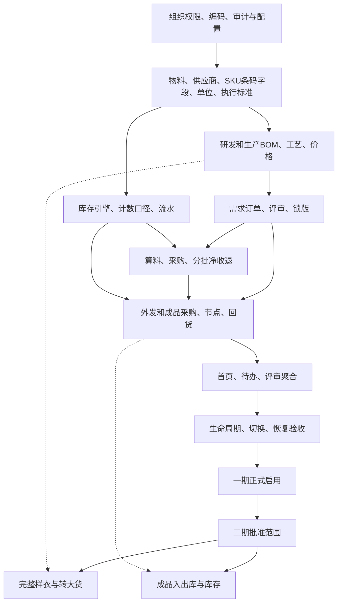

# 首期复现模块 PRD / RFC / API / DB / PLAN 完整性与合理性审查

## 1. 结论与审查基准

**建议保留现有模块化单体、SKU、版本化 BOM、单头/明细、库存余额/流水及领域动作设计；先修复整单保存的数据不变量，再补齐切换、盘点与执行后变更的业务规则。** 本报告没有提出重写核心业务或复制旧系统全部功能。上述基础已有正式设计和实现依据，见第 2 节；风险逐项见第 4–6 节。

| 项目 | 本次结果 |
|---|---|
| 日期 / 仓库 | 2026-11-17；`xiaoliangao/lingmao` |
| 默认开发分支 | GitHub 元数据与远端分支均为 `main` |
| 审查业务基线 | `48a9fcae9a9ed57f97aa1e2bd5a14dba0208fdb5`，包括已实现的生产后端 V25 |
| 提交分支 / 目标 | `docs/audit-prd-rfc-api-db` → `main` |
| 提交前增量 | `main` 更新至 `061559663a2f76c911b7ea276f35265c7caa95a6`，仅合入旧报告 [docs/reviews/architecture-audit.md](https://github.com/xiaoliangao/lingmao/blob/061559663a2f76c911b7ea276f35265c7caa95a6/docs/reviews/architecture-audit.md)；本分支已快进。业务代码、契约、依赖与验证基线相同 |
| 变更边界 | 仅新增本报告，一个文档 commit；所有 Diff 均为后续建议，不是本 PR 已执行的修改 |
| 线上证据 | 用户完成登录后，只读检查 28 个页面、4 个空白新增表单、标准 BOM 的多个分区；详见第 9 节 |
| 本轮运行验证 | 前端类型检查、生产构建通过；两个前端数据转换问题已用提取的真实源码与匿名对象复现 |
| 运行限制 | 后端编译被不完整 JDK 21 阻断，单元测试未执行；未运行数据库集成测试、部署或生产写操作 |

所有业务源文件行号均固定到上述 `48a9fca`，不随主分支变化。旧报告采用更早基线，**本报告不表示其中未复核的问题已关闭**；生产后端当前已落地，不能沿用旧报告“生产仅前端/mock”的阶段判断（[docs/进度.md:65–66](https://github.com/xiaoliangao/lingmao/blob/48a9fcae9a9ed57f97aa1e2bd5a14dba0208fdb5/docs/%E8%BF%9B%E5%BA%A6.md#L65-L66)）。

### 1.1 事实来源与缺失项

1. **实际收到的范围附件**：`服装SCM模块清单_需求确认表-1(1)(1).xlsx`，SHA-256 `085c6d30db9f6993c4e831aee368f82327c8caa4245130a4be705ba702e3f292`。完整检查三个工作表：`模块清单!A1:J95`、`待决问题!A1:G5`、`优先级说明与统计!A1:C16`。下文 `Cxx` 默认指 `模块清单!Cxx`。
2. **黄标解释**：8 个模块级合并 B 单元格覆盖 59 个功能行，另有 `C80/C81/C84` 三个直接黄标，共 62 行。`G2:J95` 首版/确认栏全空，F 列是建议优先级；不能将模块黄标当成 62 条逐项签署的一期承诺。附件统计页有失效公式，本文按原始单元格/样式重算，不采用缓存统计。
3. **缺少原始字段清单**：本轮没有取得《领猫SCM模块字段清单.xlsx》。仓库中 [docs/PRD.md:2281–2309](https://github.com/xiaoliangao/lingmao/blob/48a9fcae9a9ed57f97aa1e2bd5a14dba0208fdb5/docs/PRD.md#L2281-L2309)、[docs/数据库设计.md:2423–2782](https://github.com/xiaoliangao/lingmao/blob/48a9fcae9a9ed57f97aa1e2bd5a14dba0208fdb5/docs/%E6%95%B0%E6%8D%AE%E5%BA%93%E8%AE%BE%E8%AE%A1.md#L2423-L2782) 的旧系统字段/路由记录属于二手材料，不能写成对原工作簿 160 页、2985 字段的重新核验，也不能推断哪个原 Excel 页面“字段数为 0”。
4. **线上证据代号**：L00–L27 表示实际打开的页面；F01–F04 表示空白表单观察；M 表示仅发现菜单链接。记录的是字段与交互结构，未保存真实记录、企业信息、联系人、金额、Cookie、Token、凭据或截图。
5. **Network 限制**：尝试打开 DevTools 时浏览器明确提示组织策略禁止，已停止该路径；没有抓取请求体、响应 schema、错误码或提交校验。页面可正常浏览，这不是站点不可访问或验证码阻断。需要二次取证的项目列于第 10 节。

判定顺序：附件界定候选范围，线上结构提供复现对象的事实；仓库较新的明确业务确认决定本项目已批准的简化与分期；再对 PRD → RFC/DB → API → PLAN 交叉核对。**行业场景仅作为标注 `[待确认]` 的设计反例，不冒充线上已发生的事实。**

### 1.2 覆盖与证据强度

| 层次 | 已完成范围 | 不代表什么 |
|---|---|---|
| 产品 | `docs/PRD.md` 全文 2309 行；`docs/甲方确认清单.md` 全文 1157 行；根 README、CLAUDE、文档索引 | 不把旧清单空答复覆盖 PRD 新确认 |
| 领域设计 | `docs/架构设计.md` 全文；RFC README 与 001–009 全文；`docs/数据库设计.md` 全文 2782 行 | 规划表不等于已经迁移 |
| 契约 | API README 与 01–06 全文，包含末尾实现修订；对应 TS、DTO、Controller/Service/Mapper 定点追踪 | 不宣称所有 HTTP 接口已联调 |
| 数据库 | 25 个 Flyway 文件结构盘点；重点精读 V9/V13/V15/V19–V23/V25，并核尺码组等补充片段；静态计得 69 条 CREATE TABLE | 不是在本环境成功执行 25 个迁移 |
| 原型与代码 | 原型入口、业务源文件和正式页面的数据模型/状态/表单路径核对；699 个 Java 源文件参与编译尝试；前端全量类型/构建与类型风险扫描 | 不把代码盘点等同逐行审完全部第三方代码、全场景浏览器测试或无缺陷证明 |
| 计划 | 无独立 `PLAN.md`；实际计划在 [docs/架构设计.md:1119–1134](https://github.com/xiaoliangao/lingmao/blob/48a9fcae9a9ed57f97aa1e2bd5a14dba0208fdb5/docs/%E6%9E%B6%E6%9E%84%E8%AE%BE%E8%AE%A1.md#L1119-L1134)、`docs/进度.md`、PRD §2/§10/§11 | 不因文件名不同判“没有计划” |

## 2. 总体评估矩阵与应保留的设计

评级为本次工程判断：A＝契约、实现与当前验收证据闭合；B＝主干合理，仍需修正边界；C＝关键契约或发布门禁尚未闭合；D＝缺少可执行设计。它不是上线批准或测试通过率。

| 维度 | 评级 | 核心结论与证据 | 优先关联 |
|---|---|---|---|
| PRD | B | 模块/分期/状态已有细则；执行后减量、滚动盘点、工厂仓数值含义和切换旧单规则未闭合。[docs/PRD.md:1195–1215](https://github.com/xiaoliangao/lingmao/blob/48a9fcae9a9ed57f97aa1e2bd5a14dba0208fdb5/docs/PRD.md#L1195-L1215)、[docs/PRD.md:1461–1513](https://github.com/xiaoliangao/lingmao/blob/48a9fcae9a9ed57f97aa1e2bd5a14dba0208fdb5/docs/PRD.md#L1461-L1513)、[docs/PRD.md:1645](https://github.com/xiaoliangao/lingmao/blob/48a9fcae9a9ed57f97aa1e2bd5a14dba0208fdb5/docs/PRD.md#L1645)、[docs/PRD.md:2151–2161](https://github.com/xiaoliangao/lingmao/blob/48a9fcae9a9ed57f97aa1e2bd5a14dba0208fdb5/docs/PRD.md#L2151-L2161) | P0-01；P1-03/04/07；P2-09 |
| RFC | B | 模块化单体、事务、审批与权限具备可实现方案；后续成品尾数与助手草稿边界需要修订。[docs/架构设计.md:150–172](https://github.com/xiaoliangao/lingmao/blob/48a9fcae9a9ed57f97aa1e2bd5a14dba0208fdb5/docs/%E6%9E%B6%E6%9E%84%E8%AE%BE%E8%AE%A1.md#L150-L172)、[docs/架构设计.md:224–254](https://github.com/xiaoliangao/lingmao/blob/48a9fcae9a9ed57f97aa1e2bd5a14dba0208fdb5/docs/%E6%9E%B6%E6%9E%84%E8%AE%BE%E8%AE%A1.md#L224-L254)；[docs/rfc/008-成品.md:117–146](https://github.com/xiaoliangao/lingmao/blob/48a9fcae9a9ed57f97aa1e2bd5a14dba0208fdb5/docs/rfc/008-%E6%88%90%E5%93%81.md#L117-L146)；[docs/rfc/009-智能助手.md:149–171](https://github.com/xiaoliangao/lingmao/blob/48a9fcae9a9ed57f97aa1e2bd5a14dba0208fdb5/docs/rfc/009-%E6%99%BA%E8%83%BD%E5%8A%A9%E6%89%8B.md#L149-L171) | P1-01/08；P2-06/07 |
| DB | B | 已拆单头/行、SKU、BOM 版本和库存流水，没有把列表照搬为固定色码宽表；估值历史、计数截止点、解释快照和未来主体库存规则不足。[docs/数据库设计.md:1136–1268](https://github.com/xiaoliangao/lingmao/blob/48a9fcae9a9ed57f97aa1e2bd5a14dba0208fdb5/docs/%E6%95%B0%E6%8D%AE%E5%BA%93%E8%AE%BE%E8%AE%A1.md#L1136-L1268)、[docs/数据库设计.md:1432–1467](https://github.com/xiaoliangao/lingmao/blob/48a9fcae9a9ed57f97aa1e2bd5a14dba0208fdb5/docs/%E6%95%B0%E6%8D%AE%E5%BA%93%E8%AE%BE%E8%AE%A1.md#L1432-L1467)、[docs/数据库设计.md:1713–1792](https://github.com/xiaoliangao/lingmao/blob/48a9fcae9a9ed57f97aa1e2bd5a14dba0208fdb5/docs/%E6%95%B0%E6%8D%AE%E5%BA%93%E8%AE%BE%E8%AE%A1.md#L1713-L1792) | P1-03/06；P2-03/04 |
| API | C | 领域动作、version/CAS、批量关键字及状态统计已存在；整版成本字段授权、逐 SKU 往返和新增记数的重试身份仍有实质风险。[docs/api/README.md:65–83](https://github.com/xiaoliangao/lingmao/blob/48a9fcae9a9ed57f97aa1e2bd5a14dba0208fdb5/docs/api/README.md#L65-L83)、[docs/api/README.md:98–136](https://github.com/xiaoliangao/lingmao/blob/48a9fcae9a9ed57f97aa1e2bd5a14dba0208fdb5/docs/api/README.md#L98-L136)；P1-01/02/05 的完整调用链 | P1-01/02/05/08 |
| PLAN | C | 主依赖顺序合理，前后端可以按契约并行；缺跨模块生命周期、切换对账与当前验证状态的统一退出门槛。[docs/架构设计.md:1125–1130](https://github.com/xiaoliangao/lingmao/blob/48a9fcae9a9ed57f97aa1e2bd5a14dba0208fdb5/docs/%E6%9E%B6%E6%9E%84%E8%AE%BE%E8%AE%A1.md#L1125-L1130)；[docs/进度.md:65–66](https://github.com/xiaoliangao/lingmao/blob/48a9fcae9a9ed57f97aa1e2bd5a14dba0208fdb5/docs/%E8%BF%9B%E5%BA%A6.md#L65-L66)；[docs/PRD.md:1225–1229](https://github.com/xiaoliangao/lingmao/blob/48a9fcae9a9ed57f97aa1e2bd5a14dba0208fdb5/docs/PRD.md#L1225-L1229) | P0-01；第 8 节 |

以下不是缺陷，应作为后续改进的基础：

| 用户关注点 | 已有机制 / 有意取舍 | 仓库依据与线上/附件对照 |
|---|---|---|
| SPU/SKU、主子表、BOM | 款式/物料 SKU、单据行、颜色配料/分码、DEV/PROD 版本均独立建模；订单/生产锁版本 | [docs/数据库设计.md:794–848](https://github.com/xiaoliangao/lingmao/blob/48a9fcae9a9ed57f97aa1e2bd5a14dba0208fdb5/docs/%E6%95%B0%E6%8D%AE%E5%BA%93%E8%AE%BE%E8%AE%A1.md#L794-L848)、[docs/数据库设计.md:1136–1268](https://github.com/xiaoliangao/lingmao/blob/48a9fcae9a9ed57f97aa1e2bd5a14dba0208fdb5/docs/%E6%95%B0%E6%8D%AE%E5%BA%93%E8%AE%BE%E8%AE%A1.md#L1136-L1268)；L02/L05/L06；C4/C6/C21/C35 |
| 标准与订单级资料包 | 标准版本及订单引用已做；订单级可编辑生产资料包明确二期，不是未考虑 | [docs/PRD.md:925–963](https://github.com/xiaoliangao/lingmao/blob/48a9fcae9a9ed57f97aa1e2bd5a14dba0208fdb5/docs/PRD.md#L925-L963)、[docs/PRD.md:1088–1089](https://github.com/xiaoliangao/lingmao/blob/48a9fcae9a9ed57f97aa1e2bd5a14dba0208fdb5/docs/PRD.md#L1088-L1089)；L06 与 L19 分开。L19 详情尚未取证，不能据列表推断其快照算法 |
| 库存与占用 | 余额/追加流水分离、反审逆向记录、软占用独立；一期不硬锁库、货位恒 0、缸号默认不作库存维度均有明示 | [docs/PRD.md:1279–1283](https://github.com/xiaoliangao/lingmao/blob/48a9fcae9a9ed57f97aa1e2bd5a14dba0208fdb5/docs/PRD.md#L1279-L1283)、[docs/PRD.md:1405–1421](https://github.com/xiaoliangao/lingmao/blob/48a9fcae9a9ed57f97aa1e2bd5a14dba0208fdb5/docs/PRD.md#L1405-L1421)、[docs/PRD.md:2064](https://github.com/xiaoliangao/lingmao/blob/48a9fcae9a9ed57f97aa1e2bd5a14dba0208fdb5/docs/PRD.md#L2064)；[docs/数据库设计.md:1713–1758](https://github.com/xiaoliangao/lingmao/blob/48a9fcae9a9ed57f97aa1e2bd5a14dba0208fdb5/docs/%E6%95%B0%E6%8D%AE%E5%BA%93%E8%AE%BE%E8%AE%A1.md#L1713-L1758)；L13/L14；C41/C47 |
| 多单位与精度 | 库存量/用量/系数/单价/金额使用 NUMERIC 与 BigDecimal；BOM 单位、采购行单位/系数有快照 | [docs/数据库设计.md:49–54](https://github.com/xiaoliangao/lingmao/blob/48a9fcae9a9ed57f97aa1e2bd5a14dba0208fdb5/docs/%E6%95%B0%E6%8D%AE%E5%BA%93%E8%AE%BE%E8%AE%A1.md#L49-L54)、[docs/数据库设计.md:1219–1226](https://github.com/xiaoliangao/lingmao/blob/48a9fcae9a9ed57f97aa1e2bd5a14dba0208fdb5/docs/%E6%95%B0%E6%8D%AE%E5%BA%93%E8%AE%BE%E8%AE%A1.md#L1219-L1226)、[docs/数据库设计.md:1616–1619](https://github.com/xiaoliangao/lingmao/blob/48a9fcae9a9ed57f97aa1e2bd5a14dba0208fdb5/docs/%E6%95%B0%E6%8D%AE%E5%BA%93%E8%AE%BE%E8%AE%A1.md#L1616-L1619)；[docs/架构设计.md:658–660](https://github.com/xiaoliangao/lingmao/blob/48a9fcae9a9ed57f97aa1e2bd5a14dba0208fdb5/docs/%E6%9E%B6%E6%9E%84%E8%AE%BE%E8%AE%A1.md#L658-L660)；F01/F03/F04；Q17 已确认每物料一个系数 |
| 状态与业财 | 已有领域动作和业务/执行派生状态；完整财审/结算属后续范围，不能把线上全部财务按钮强塞一期 | [docs/api/README.md:109–132](https://github.com/xiaoliangao/lingmao/blob/48a9fcae9a9ed57f97aa1e2bd5a14dba0208fdb5/docs/api/README.md#L109-L132)；[docs/PRD.md:283–285](https://github.com/xiaoliangao/lingmao/blob/48a9fcae9a9ed57f97aa1e2bd5a14dba0208fdb5/docs/PRD.md#L283-L285)、[docs/PRD.md:1622–1629](https://github.com/xiaoliangao/lingmao/blob/48a9fcae9a9ed57f97aa1e2bd5a14dba0208fdb5/docs/PRD.md#L1622-L1629)；L11/L16/L17 的状态维度分离是后续对照依据 |
| 共路由业务区分 | 新系统生产 `OUTSOURCE/BUY` 共表、共节点/回货，按 kind、菜单路由和独立缓存区分业务；权限码共用 | [docs/api/05-生产.md:7–24](https://github.com/xiaoliangao/lingmao/blob/48a9fcae9a9ed57f97aa1e2bd5a14dba0208fdb5/docs/api/05-%E7%94%9F%E4%BA%A7.md#L7-L24)、[docs/api/05-生产.md:188–200](https://github.com/xiaoliangao/lingmao/blob/48a9fcae9a9ed57f97aa1e2bd5a14dba0208fdb5/docs/api/05-%E7%94%9F%E4%BA%A7.md#L188-L200)；[web/src/types/production.ts:12–21](https://github.com/xiaoliangao/lingmao/blob/48a9fcae9a9ed57f97aa1e2bd5a14dba0208fdb5/web/src/types/production.ts#L12-L21)；L18 已见外发/成品采购筛选 |
| 并发和错误 | 状态动作 CAS/version、库存条件更新、订单→生产锁序、回货逐 SKU 上限、1001–1005 结构错误已具备 | [docs/api/README.md:50–63](https://github.com/xiaoliangao/lingmao/blob/48a9fcae9a9ed57f97aa1e2bd5a14dba0208fdb5/docs/api/README.md#L50-L63)、[docs/api/README.md:115–132](https://github.com/xiaoliangao/lingmao/blob/48a9fcae9a9ed57f97aa1e2bd5a14dba0208fdb5/docs/api/README.md#L115-L132)；[src/main/java/com/lingmao/scm/module/production/service/impl/ProductionReceiptServiceImpl.java:148–235](https://github.com/xiaoliangao/lingmao/blob/48a9fcae9a9ed57f97aa1e2bd5a14dba0208fdb5/src/main/java/com/lingmao/scm/module/production/service/impl/ProductionReceiptServiceImpl.java#L148-L235)；P1-05 讨论不同的“新增重试”问题 |
| 权限与工程 | SELF/ALL、当前审批人详情例外、签名文件、环境配置隔离、严格 TS 和架构测试均已存在 | [docs/rfc/001-框架补齐.md:491–515](https://github.com/xiaoliangao/lingmao/blob/48a9fcae9a9ed57f97aa1e2bd5a14dba0208fdb5/docs/rfc/001-%E6%A1%86%E6%9E%B6%E8%A1%A5%E9%BD%90.md#L491-L515)、[docs/rfc/001-框架补齐.md:578–589](https://github.com/xiaoliangao/lingmao/blob/48a9fcae9a9ed57f97aa1e2bd5a14dba0208fdb5/docs/rfc/001-%E6%A1%86%E6%9E%B6%E8%A1%A5%E9%BD%90.md#L578-L589)；[docs/api/02-需求订单.md:434](https://github.com/xiaoliangao/lingmao/blob/48a9fcae9a9ed57f97aa1e2bd5a14dba0208fdb5/docs/api/02-%E9%9C%80%E6%B1%82%E8%AE%A2%E5%8D%95.md#L434)；[web/tsconfig.app.json:13–18](https://github.com/xiaoliangao/lingmao/blob/48a9fcae9a9ed57f97aa1e2bd5a14dba0208fdb5/web/tsconfig.app.json#L13-L18)。不把测试文件存在写成已运行通过 |
| 分期闭环 | 研发全流程二期；成品基础入库/发货二期；质检/完整财务/外部账号/JST 依批准分期 | [docs/PRD.md:2216](https://github.com/xiaoliangao/lingmao/blob/48a9fcae9a9ed57f97aa1e2bd5a14dba0208fdb5/docs/PRD.md#L2216)、[docs/PRD.md:2234–2236](https://github.com/xiaoliangao/lingmao/blob/48a9fcae9a9ed57f97aa1e2bd5a14dba0208fdb5/docs/PRD.md#L2234-L2236)、[docs/PRD.md:283–310](https://github.com/xiaoliangao/lingmao/blob/48a9fcae9a9ed57f97aa1e2bd5a14dba0208fdb5/docs/PRD.md#L283-L310)；附件 C16–20、C59–79、C87/C93，详见第 11 节 |

## 3. 分级口径与优先决策

P0 为上线前必须解除的阻塞门禁；P1 为可达的数据覆盖、关键流程/可靠性风险或重要设计缺口；P2 为局部一致性、扩展性及明确后续阶段的设计优化。**本轮没有证明已发生 P0 生产事故。P0-01 是有条件的切换决策门禁，不能改写成已证实的数据事故。**

最需要优先拍板的五项：

| 决策 | 推荐方向 | 关联证据 / 影响 |
|---|---|---|
| 1. 整单保存的保护边界 | 同意独立最小修复：成本由服务端授权；未成功加载的分块不覆盖；逐 SKU 原值无损往返 | P1-01/02；保留当前矩阵与资料包分区，不重做 UI |
| 2. 旧未结业务如何切换 | 选“旧单旧系统收尾、新单新系统”或“只迁未结余额及来源关系”，不要混用 | P0-01；决定期初库存中哪些量还能被新单使用 |
| 3. 盘点数对应哪个时点 | 选逐 SKU 短时停收发/重数，或计数截止流水归一化；禁止无条件保留旧实盘重拍账面 | P1-03；涉及过账规则与盘点字段，另起 RFC/迁移 |
| 4. 已执行订单是否支持余量变更 | 明确一期拒绝边界与处置记录；需要系统内接续时设计剩余量调整单，保留历史实绩 | P1-04；不能用放开反审核来代替调整流程 |
| 5. 历史金额/资料包重现到什么程度 | 上线前决定期初估值、不可变过账价、历史色码与 PDF 重打范围；未知成本保留未知 | P1-06、P2-01；这是数据留存边界，不要求一期做完整财务 |

## 4. P0 上线阻塞门禁

### P0-01｜[待确认] 旧未结业务切换没有可验收的余额桥接或分流规则

**所属维度：PRD / DB / PLAN。** 依据是 [docs/PRD.md:263](https://github.com/xiaoliangao/lingmao/blob/48a9fcae9a9ed57f97aa1e2bd5a14dba0208fdb5/docs/PRD.md#L263)、[docs/PRD.md:2158–2161](https://github.com/xiaoliangao/lingmao/blob/48a9fcae9a9ed57f97aa1e2bd5a14dba0208fdb5/docs/PRD.md#L2158-L2161)、[docs/PRD.md:2193](https://github.com/xiaoliangao/lingmao/blob/48a9fcae9a9ed57f97aa1e2bd5a14dba0208fdb5/docs/PRD.md#L2193)：新单开始走新系统，同时导期初数量和在途需求订单、不迁历史采购与流水；[docs/架构设计.md:1129](https://github.com/xiaoliangao/lingmao/blob/48a9fcae9a9ed57f97aa1e2bd5a14dba0208fdb5/docs/%E6%9E%B6%E6%9E%84%E8%AE%BE%E8%AE%A1.md#L1129) 的上线批次未给出未完采购/已排生产/已领料/已回货如何接续。附件 `待决问题!A4:G4` 无结论；C34/C41/C43/C46/C51；线上 L05/L08/L17 展示的来源单与累计量说明这些不是仅靠主档能表达的业务事实。

**匿名反例与边界：** 旧需求 100，已排 60、已回 20，还有未到采购。若整张旧需求按普通新单导入且累计量为 0，再算料排产，会把已执行部分再次当成需求。这是迁移设计风险，未在生产执行导入。无需迁全部历史；若明确只接全新业务，该阻塞可通过分流规则解除。

```diff
+ Q03 / 上线计划：记录切换时间、来源系统/原单身份、责任人和对账基准。
+ A 新单切换：旧未结业务在原系统收尾；导入旧单只读，不再生单；
+   旧单占有物料与新单公共可用量明确隔离。
+ B 余额接续：只迁剩余需求、已排/已回、未完采购净收退、工厂托管量、
+   有效占用及必要来源映射；不伪造或重放未取得的历史流水。
+ 定义重复导入、撤销重导、新旧系统截止收发和差异签认。
```

**验收 / 任务 T01：** 用“部分排产＋部分回货＋未到采购＋已领工厂料”合成案例，分别核对需求、在途、库存、占用守恒；重复执行不重复建单/加库存。产品负责人选择策略，数据负责人确认对账；未选定前不能把旧未结订单导入当作上线完成。

## 5. P1 业务遗漏、实现风险与一致性偏差

### P1-01｜成本分块读取失败或无字段权限时，整版保存仍可能覆盖成本

**所属维度：API / RFC / 实现。** C21–C27；核价虽非原黄标完整 M05，但 [docs/PRD.md:1033–1053](https://github.com/xiaoliangao/lingmao/blob/48a9fcae9a9ed57f97aa1e2bd5a14dba0208fdb5/docs/PRD.md#L1033-L1053) 已批准部分提前。[docs/api/01-资料包.md:68–75](https://github.com/xiaoliangao/lingmao/blob/48a9fcae9a9ed57f97aa1e2bd5a14dba0208fdb5/docs/api/01-%E8%B5%84%E6%96%99%E5%8C%85.md#L68-L75) 区分资料包编辑与成本权限，[docs/api/01-资料包.md:169–175](https://github.com/xiaoliangao/lingmao/blob/48a9fcae9a9ed57f97aa1e2bd5a14dba0208fdb5/docs/api/01-%E8%B5%84%E6%96%99%E5%8C%85.md#L169-L175) 规定 cost=null 不改；[src/main/java/com/lingmao/scm/module/techpack/dto/TechPackSaveReq.java:32–34](https://github.com/xiaoliangao/lingmao/blob/48a9fcae9a9ed57f97aa1e2bd5a14dba0208fdb5/src/main/java/com/lingmao/scm/module/techpack/dto/TechPackSaveReq.java#L32-L34) 承诺无成本权限“发了也不用”。线上 L06 证实资料包多分块编辑结构，未验证其权限实现；本问题来自仓库契约与源码。

**两条具体证据：**

- 读取失败：[web/src/views/style/style/TechPackTab.vue:139–172](https://github.com/xiaoliangao/lingmao/blob/48a9fcae9a9ed57f97aa1e2bd5a14dba0208fdb5/web/src/views/style/style/TechPackTab.vue#L139-L172) 捕获成本 GET 错误后用 OUTSOURCE/null/[] 初始化，主包成功就结束 loading；[web/src/views/style/style/TechPackTab.vue:307–323](https://github.com/xiaoliangao/lingmao/blob/48a9fcae9a9ed57f97aa1e2bd5a14dba0208fdb5/web/src/views/style/style/TechPackTab.vue#L307-L323) 只按权限提交非空 cost，不检查是否成功加载；[web/src/views/style/style/TechPackTab.vue:784](https://github.com/xiaoliangao/lingmao/blob/48a9fcae9a9ed57f97aa1e2bd5a14dba0208fdb5/web/src/views/style/style/TechPackTab.vue#L784) 保存按钮仅看 editable/dirty。仅改版本说明或尺寸也可能提交默认成本。
- 服务端授权：[src/main/java/com/lingmao/scm/module/techpack/controller/TechPackController.java:75–80](https://github.com/xiaoliangao/lingmao/blob/48a9fcae9a9ed57f97aa1e2bd5a14dba0208fdb5/src/main/java/com/lingmao/scm/module/techpack/controller/TechPackController.java#L75-L80) 只检查 pack:edit；[src/main/java/com/lingmao/scm/module/techpack/service/impl/TechPackServiceImpl.java:254–282](https://github.com/xiaoliangao/lingmao/blob/48a9fcae9a9ed57f97aa1e2bd5a14dba0208fdb5/src/main/java/com/lingmao/scm/module/techpack/service/impl/TechPackServiceImpl.java#L254-L282) 只按 cost 非空决定覆写。[src/main/java/com/lingmao/scm/module/techpack/service/impl/PackContent.java:119–130](https://github.com/xiaoliangao/lingmao/blob/48a9fcae9a9ed57f97aa1e2bd5a14dba0208fdb5/src/main/java/com/lingmao/scm/module/techpack/service/impl/PackContent.java#L119-L130)、[src/main/java/com/lingmao/scm/module/techpack/service/impl/PackContent.java:202–209](https://github.com/xiaoliangao/lingmao/blob/48a9fcae9a9ed57f97aa1e2bd5a14dba0208fdb5/src/main/java/com/lingmao/scm/module/techpack/service/impl/PackContent.java#L202-L209) 会清写费用。已检索请求体拦截/JSON 裁剪并追踪 PackForms、SecurityConfig 等路径，未发现替代的成本字段授权。前端主动发 null 不能代替该约束。

**已做的复现：** 从当前源码提取 loadCost/hydrate/buildSave，使用合成的 BUY 成本与失败 stub；仅改单头说明，得到 `cost={costMode:OUTSOURCE,buyPrice:null,items:[]}`。这是纯逻辑复现；服务端覆盖和权限问题为静态调用链结论，没有向线上或本地数据库发送保存请求。

```diff
+ API：区分成本未加载/加载失败/已加载为空；不能把失败等同于清空。
+ Service 在 toContent 之前统一裁定 authorizedCost；无成本权限时忽略并保留
+ 原成本（沿用现契约），或经确认统一返回403。单头/子表使用同一裁定。
+ UI：成本失败可重试；保存其他块时显式 cost=null 保留，或阻止整版保存。
```

**验收 / T02：** 仅 pack:edit 的合成身份发非空 cost，原成本不变；有权限但 GET 失败，仅改尺寸/说明不清空；主动清空仍按权限可用；版本冲突及子表失败全部回滚。独立修复 commit，保留现有分区交互。

### P1-02｜逐 SKU 合法价格、交期和备注被矩阵分组往返压平

**所属维度：PRD / API / 原型 / 实现。** C34/C35；L05 的颜色×尺码结构提供事实对照。[docs/PRD.md:1139–1156](https://github.com/xiaoliangao/lingmao/blob/48a9fcae9a9ed57f97aa1e2bd5a14dba0208fdb5/docs/PRD.md#L1139-L1156) 与 [docs/api/02-需求订单.md:273–278](https://github.com/xiaoliangao/lingmao/blob/48a9fcae9a9ed57f97aa1e2bd5a14dba0208fdb5/docs/api/02-%E9%9C%80%E6%B1%82%E8%AE%A2%E5%8D%95.md#L273-L278) 按 SKU 承载价格/交期；API [docs/api/02-需求订单.md:224](https://github.com/xiaoliangao/lingmao/blob/48a9fcae9a9ed57f97aa1e2bd5a14dba0208fdb5/docs/api/02-%E9%9C%80%E6%B1%82%E8%AE%A2%E5%8D%95.md#L224) 要求完整行提交，[docs/api/02-需求订单.md:225](https://github.com/xiaoliangao/lingmao/blob/48a9fcae9a9ed57f97aa1e2bd5a14dba0208fdb5/docs/api/02-%E9%9C%80%E6%B1%82%E8%AE%A2%E5%8D%95.md#L225) 又规定按款式/尺码分组编辑，未定义混合值和无损往返。[web/src/views/order/order/form.vue:43–52](https://github.com/xiaoliangao/lingmao/blob/48a9fcae9a9ed57f97aa1e2bd5a14dba0208fdb5/web/src/views/order/order/form.vue#L43-L52) 只保存款式级交期/备注与按尺码单价，[web/src/views/order/order/form.vue:155–168](https://github.com/xiaoliangao/lingmao/blob/48a9fcae9a9ed57f97aa1e2bd5a14dba0208fdb5/web/src/views/order/order/form.vue#L155-L168) 同码价格取后行、交期/备注取首行，[web/src/views/order/order/form.vue:190–196](https://github.com/xiaoliangao/lingmao/blob/48a9fcae9a9ed57f97aa1e2bd5a14dba0208fdb5/web/src/views/order/order/form.vue#L190-L196) 展开时覆写全部 SKU。旧原型同样如此：[docs/原型/src/5b-order.js:101–112](https://github.com/xiaoliangao/lingmao/blob/48a9fcae9a9ed57f97aa1e2bd5a14dba0208fdb5/docs/%E5%8E%9F%E5%9E%8B/src/5b-order.js#L101-L112)，[docs/原型/index.html:6884–6895](https://github.com/xiaoliangao/lingmao/blob/48a9fcae9a9ed57f97aa1e2bd5a14dba0208fdb5/docs/%E5%8E%9F%E5%9E%8B/index.html#L6884-L6895)。

后端能够保存独立行值（[src/main/java/com/lingmao/scm/module/order/service/impl/OrderServiceImpl.java:664–695](https://github.com/xiaoliangao/lingmao/blob/48a9fcae9a9ed57f97aa1e2bd5a14dba0208fdb5/src/main/java/com/lingmao/scm/module/order/service/impl/OrderServiceImpl.java#L664-L695)、[src/main/java/com/lingmao/scm/module/order/service/impl/OrderServiceImpl.java:1006–1015](https://github.com/xiaoliangao/lingmao/blob/48a9fcae9a9ed57f97aa1e2bd5a14dba0208fdb5/src/main/java/com/lingmao/scm/module/order/service/impl/OrderServiceImpl.java#L1006-L1015)），未限制异色同码必须同价。源码提取复现：红 M=10、交期甲；蓝 M=20、交期乙；仅改单头后构造出的两行都为 20、交期甲。不同备注通过 REST 合法前置输入会同样合并；Excel 模板没有行备注列，不能写成 Excel 备注丢失实测。

```diff
+ API02：分组只用于展示/主动批量编辑，未显式改动的行字段必须原样往返。
+ StyleBlock 保留 itemsBySku；混合价格/交期显示“不同值”。
+ 用户主动批量修改才更新目标行；buildItems 从逐SKU模型生成。
```

**验收 / T03：** 异色同码不同价/交期/备注，打开→只改头→保存全部保留；批量改价只改选定范围；多款、null 值、导入与 REST 两入口均覆盖。不要求重写矩阵 UI。

### P1-03｜[待确认] 盘点账面与实盘没有统一测量截止点

**所属维度：PRD / DB / API / 实现。** C47 与后续批准的物料盘点 [docs/PRD.md:242](https://github.com/xiaoliangao/lingmao/blob/48a9fcae9a9ed57f97aa1e2bd5a14dba0208fdb5/docs/PRD.md#L242)；L15 仅验证有盘点单页面，旧系统真实冻结策略未实测。[docs/PRD.md:1483–1508](https://github.com/xiaoliangao/lingmao/blob/48a9fcae9a9ed57f97aa1e2bd5a14dba0208fdb5/docs/PRD.md#L1483-L1508) 允许期间收发；[docs/数据库设计.md:1772](https://github.com/xiaoliangao/lingmao/blob/48a9fcae9a9ed57f97aa1e2bd5a14dba0208fdb5/docs/%E6%95%B0%E6%8D%AE%E5%BA%93%E8%AE%BE%E8%AE%A1.md#L1772)、[docs/数据库设计.md:1788–1792](https://github.com/xiaoliangao/lingmao/blob/48a9fcae9a9ed57f97aa1e2bd5a14dba0208fdb5/docs/%E6%95%B0%E6%8D%AE%E5%BA%93%E8%AE%BE%E8%AE%A1.md#L1788-L1792) 只有 book_time 与账面/实盘；[docs/api/04-库存.md:330–359](https://github.com/xiaoliangao/lingmao/blob/48a9fcae9a9ed57f97aa1e2bd5a14dba0208fdb5/docs/api/04-%E5%BA%93%E5%AD%98.md#L330-L359) 允许 refresh-book 保留旧实盘。[src/main/java/com/lingmao/scm/module/inventory/service/impl/CountServiceImpl.java:487–515](https://github.com/xiaoliangao/lingmao/blob/48a9fcae9a9ed57f97aa1e2bd5a14dba0208fdb5/src/main/java/com/lingmao/scm/module/inventory/service/impl/CountServiceImpl.java#L487-L515) 仅重拍账面，[src/main/java/com/lingmao/scm/module/inventory/service/impl/CountServiceImpl.java:580–583](https://github.com/xiaoliangao/lingmao/blob/48a9fcae9a9ed57f97aa1e2bd5a14dba0208fdb5/src/main/java/com/lingmao/scm/module/inventory/service/impl/CountServiceImpl.java#L580-L583) 按差额过账。

两个可推导反例：建单账面 100→数货前出 20→实盘 80，当前 80 再减差额 20 得 60；或先盘账/实均 100→出 20→重拍账面 80 而保留实盘 100，审核虚增 20。行锁/version 不能判断数值是否属于同一时点。现有 [src/test/java/com/lingmao/scm/module/inventory/service/impl/InventoryIT.java:213–226](https://github.com/xiaoliangao/lingmao/blob/48a9fcae9a9ed57f97aa1e2bd5a14dba0208fdb5/src/test/java/com/lingmao/scm/module/inventory/service/impl/InventoryIT.java#L213-L226) 未记录实盘测量时点，不能证明滚动盘点正确。

```diff
- 重取账面后保留已填实盘，建单后进出只提示。
+ 重取账面后实盘标为待复核；未确认新测量截止点不能提交。
+ 选择逐SKU短时停收发并重数，或 countedAt + cutoffLogId 归一化期间收发。
+ 导入/新增行也要遵循相同测量口径，单头bookTime不能代替所有行。
```

**验收 / T04：** 数货前/中/后收发、refresh、加行、导入、反审重盘；账实一致调整 0，真实短 1 只调 −1。先确认作业方式，再另提字段与算法修改，不能在本 PR 硬改库存。

### P1-04｜[待确认] 已执行生产单后的减量提示缺少后续处置规则

**所属维度：PRD / API / PLAN。** C39/C51/C53；L17/L18 看到生产状态、来源单与跟进结构。[docs/PRD.md:1203–1213](https://github.com/xiaoliangao/lingmao/blob/48a9fcae9a9ed57f97aa1e2bd5a14dba0208fdb5/docs/PRD.md#L1203-L1213) 允许订单变更并提示“先调整生产单”；但 [docs/api/05-生产.md:208](https://github.com/xiaoliangao/lingmao/blob/48a9fcae9a9ed57f97aa1e2bd5a14dba0208fdb5/docs/api/05-%E7%94%9F%E4%BA%A7.md#L208) 仅允许改草稿单头，[docs/api/05-生产.md:227–230](https://github.com/xiaoliangao/lingmao/blob/48a9fcae9a9ed57f97aa1e2bd5a14dba0208fdb5/docs/api/05-%E7%94%9F%E4%BA%A7.md#L227-L230) 有报工/领退/回货/异常时禁止反审，[docs/api/05-生产.md:399](https://github.com/xiaoliangao/lingmao/blob/48a9fcae9a9ed57f97aa1e2bd5a14dba0208fdb5/docs/api/05-%E7%94%9F%E4%BA%A7.md#L399) 结案不退已排。[src/main/java/com/lingmao/scm/module/production/service/impl/ProductionOrderServiceImpl.java:375–435](https://github.com/xiaoliangao/lingmao/blob/48a9fcae9a9ed57f97aa1e2bd5a14dba0208fdb5/src/main/java/com/lingmao/scm/module/production/service/impl/ProductionOrderServiceImpl.java#L375-L435)、[src/main/java/com/lingmao/scm/module/production/service/impl/ProductionOrderServiceImpl.java:496–553](https://github.com/xiaoliangao/lingmao/blob/48a9fcae9a9ed57f97aa1e2bd5a14dba0208fdb5/src/main/java/com/lingmao/scm/module/production/service/impl/ProductionOrderServiceImpl.java#L496-L553)、[src/main/java/com/lingmao/scm/module/production/service/impl/ProductionOrderServiceImpl.java:669–679](https://github.com/xiaoliangao/lingmao/blob/48a9fcae9a9ed57f97aa1e2bd5a14dba0208fdb5/src/main/java/com/lingmao/scm/module/production/service/impl/ProductionOrderServiceImpl.java#L669-L679) 与这些限制一致。

已排 100 且开始报工后，需求减至 80：现有保护正确拒绝覆盖实绩，但“先调整”没有下一步。订单变更审核已锁单并重新核查排产量（[src/main/java/com/lingmao/scm/module/order/service/impl/OrderServiceImpl.java:852–916](https://github.com/xiaoliangao/lingmao/blob/48a9fcae9a9ed57f97aa1e2bd5a14dba0208fdb5/src/main/java/com/lingmao/scm/module/order/service/impl/OrderServiceImpl.java#L852-L916)），不应删除该保护。BOM 换版后保留旧生产锁定版并通知负责人符合 [docs/PRD.md:963](https://github.com/xiaoliangao/lingmao/blob/48a9fcae9a9ed57f97aa1e2bd5a14dba0208fdb5/docs/PRD.md#L963)、[docs/PRD.md:1214](https://github.com/xiaoliangao/lingmao/blob/48a9fcae9a9ed57f97aa1e2bd5a14dba0208fdb5/docs/PRD.md#L1214)；新版本是否只用于后续未排量、已排未执行余量如何接续需另行确认，不能自动覆盖旧版。

```diff
+ 区分未执行与已执行：前者按现有撤回/反审条件作废重排。
+ 后者保留已执行量、领退料、回货与锁定版；一期不支持时明确拒绝范围、
+ 责任人与余量处置凭证，不提示不存在的编辑入口。
+ 如批准系统内变更，另设计剩余量调整动作/单据，逐项定义采购、占用、
+ 已领料、回货和新版本的归属，不覆盖原事实。
```

**验收 / T05：** 未执行减单可走通；部分执行、部分回货、换供应商/换版各有允许或拒绝结果及记录；不能通过放开反审、删除历史行来实现。

### P1-05｜新增回货与来源建单没有一次用户动作的重试身份

**所属维度：API / RFC / DB。** C44/C48/C51/C90；L08/L17 的分批数量结构是对照，不是线上重试实测。[docs/api/05-生产.md:326–331](https://github.com/xiaoliangao/lingmao/blob/48a9fcae9a9ed57f97aa1e2bd5a14dba0208fdb5/docs/api/05-%E7%94%9F%E4%BA%A7.md#L326-L331) 和 [docs/api/04-库存.md:236–240](https://github.com/xiaoliangao/lingmao/blob/48a9fcae9a9ed57f97aa1e2bd5a14dba0208fdb5/docs/api/04-%E5%BA%93%E5%AD%98.md#L236-L240) 支持一步新建并记数/过账；[src/main/java/com/lingmao/scm/module/production/dto/ReceiptReq.java:15–40](https://github.com/xiaoliangao/lingmao/blob/48a9fcae9a9ed57f97aa1e2bd5a14dba0208fdb5/src/main/java/com/lingmao/scm/module/production/dto/ReceiptReq.java#L15-L40) 无动作 ID；[src/main/java/com/lingmao/scm/module/production/service/impl/ProductionReceiptServiceImpl.java:148–235](https://github.com/xiaoliangao/lingmao/blob/48a9fcae9a9ed57f97aa1e2bd5a14dba0208fdb5/src/main/java/com/lingmao/scm/module/production/service/impl/ProductionReceiptServiceImpl.java#L148-L235)、[src/main/java/com/lingmao/scm/module/inventory/service/impl/InvDocServiceImpl.java:684–740](https://github.com/xiaoliangao/lingmao/blob/48a9fcae9a9ed57f97aa1e2bd5a14dba0208fdb5/src/main/java/com/lingmao/scm/module/inventory/service/impl/InvDocServiceImpl.java#L684-L740) 每次合法请求可新建；[web/src/views/production/order/ProdReceiveDialog.vue:128–145](https://github.com/xiaoliangao/lingmao/blob/48a9fcae9a9ed57f97aa1e2bd5a14dba0208fdb5/web/src/views/production/order/ProdReceiveDialog.vue#L128-L145) 失败后恢复按钮并保留表单。

匿名场景：100 件单据登记同一次 20 件已经提交、成功响应丢失；重试仍未超 103% 上限，可以累计到 40。两次真实分批 20 又必须允许，因此不能仅按内容相同去重。现有 CAS、事务和数量上限有效，但解决的是其他问题。

```diff
+ 对新建并记数接口引入 clientActionId：新动作生成，原动作重试复用。
+ 事务内按调用方/操作类型/actionId唯一保存请求摘要与结果；同键同体返原单，
+ 同键异体拒绝；失败回滚可重试。未知结果允许按actionId查询。
```

**验收 / T06：** 丢成功响应、同键并发、同键异体、真实第二批同量不同键、事务失败重试。保留现有状态 CAS，另起契约与迁移 PR，不引入全局中间件重写。

### P1-06｜未来成本重放承诺缺少期初估值与不可变过账价

**所属维度：RFC / DB / PRD。** C29/C31/C77 属未黄的完整成本/财务范围，本项不要求一期实现财务；但 [docs/PRD.md:276](https://github.com/xiaoliangao/lingmao/blob/48a9fcae9a9ed57f97aa1e2bd5a14dba0208fdb5/docs/PRD.md#L276) 承诺先记全后续数据，[docs/架构设计.md:974](https://github.com/xiaoliangao/lingmao/blob/48a9fcae9a9ed57f97aa1e2bd5a14dba0208fdb5/docs/%E6%9E%B6%E6%9E%84%E8%AE%BE%E8%AE%A1.md#L974) 承诺按库存流水重放移动加权成本。L14 的数量/多单位/单价/金额列只证明旧系统有这些展示维度。

[docs/PRD.md:2158–2161](https://github.com/xiaoliangao/lingmao/blob/48a9fcae9a9ed57f97aa1e2bd5a14dba0208fdb5/docs/PRD.md#L2158-L2161) 只导期初数量；[docs/数据库设计.md:1738–1743](https://github.com/xiaoliangao/lingmao/blob/48a9fcae9a9ed57f97aa1e2bd5a14dba0208fdb5/docs/%E6%95%B0%E6%8D%AE%E5%BA%93%E8%AE%BE%E8%AE%A1.md#L1738-L1743) 从源明细取价格，[docs/数据库设计.md:1788–1792](https://github.com/xiaoliangao/lingmao/blob/48a9fcae9a9ed57f97aa1e2bd5a14dba0208fdb5/docs/%E6%95%B0%E6%8D%AE%E5%BA%93%E8%AE%BE%E8%AE%A1.md#L1788-L1792) 期初无估值。[src/main/resources/db/migration/V21__inventory.sql:117–127](https://github.com/xiaoliangao/lingmao/blob/48a9fcae9a9ed57f97aa1e2bd5a14dba0208fdb5/src/main/resources/db/migration/V21__inventory.sql#L117-L127)、[src/main/resources/db/migration/V21__inventory.sql:142–160](https://github.com/xiaoliangao/lingmao/blob/48a9fcae9a9ed57f97aa1e2bd5a14dba0208fdb5/src/main/resources/db/migration/V21__inventory.sql#L142-L160) 未存期初估值/过账价快照。[src/main/java/com/lingmao/scm/module/inventory/service/impl/InvDocServiceImpl.java:475–491](https://github.com/xiaoliangao/lingmao/blob/48a9fcae9a9ed57f97aa1e2bd5a14dba0208fdb5/src/main/java/com/lingmao/scm/module/inventory/service/impl/InvDocServiceImpl.java#L475-L491)、[src/main/java/com/lingmao/scm/module/inventory/service/impl/InvDocServiceImpl.java:519–520](https://github.com/xiaoliangao/lingmao/blob/48a9fcae9a9ed57f97aa1e2bd5a14dba0208fdb5/src/main/java/com/lingmao/scm/module/inventory/service/impl/InvDocServiceImpl.java#L519-L520) 的 manualItems 路径允许手建其他入库等单据反审后沿用 id 修改价格，所以旧流水再关联该行会读到新价格；不泛指采购来源单可以任意改价。

```diff
- 日志完整，以后重放就能得到移动加权成本。
+ 数量可重放；金额追溯需要经确认的期初估值和不可变过账价/来源版本。
+ 如需保留历史成本：记录估值日期、库存单位、金额/单位成本、税运口径、
+ 来源凭证和确认人；未知为NULL，不当0。反审关联原过账事件。
+ 若不保留：明示成本可追溯起算日和不可恢复范围。
```

**验收 / T07：** 期初未知显示未估值；手建其他入库以 2 元过账→反审→同明细改 3 元重审，历史首笔仍有 2 元依据。实际核算模块继续按批准分期。

### P1-07｜[待确认] 首期工厂仓“实存”与二期才核耗的承诺冲突

**所属维度：PRD / DB / PLAN。** C47–C49/C57；L13 区分实际/可配/备料，未实测旧系统工厂耗用。[docs/PRD.md:68](https://github.com/xiaoliangao/lingmao/blob/48a9fcae9a9ed57f97aa1e2bd5a14dba0208fdb5/docs/PRD.md#L68)、[docs/PRD.md:178](https://github.com/xiaoliangao/lingmao/blob/48a9fcae9a9ed57f97aa1e2bd5a14dba0208fdb5/docs/PRD.md#L178) 期望工厂账实与手上料量；[docs/PRD.md:1372–1384](https://github.com/xiaoliangao/lingmao/blob/48a9fcae9a9ed57f97aa1e2bd5a14dba0208fdb5/docs/PRD.md#L1372-L1384) 定义收发退调，[docs/PRD.md:1613–1627](https://github.com/xiaoliangao/lingmao/blob/48a9fcae9a9ed57f97aa1e2bd5a14dba0208fdb5/docs/PRD.md#L1613-L1627) 回货只回写进度，[docs/PRD.md:1645](https://github.com/xiaoliangao/lingmao/blob/48a9fcae9a9ed57f97aa1e2bd5a14dba0208fdb5/docs/PRD.md#L1645) 明确料账平衡二期，[docs/PRD.md:1421](https://github.com/xiaoliangao/lingmao/blob/48a9fcae9a9ed57f97aa1e2bd5a14dba0208fdb5/docs/PRD.md#L1421) 库存只由库存单据/盘点改变。

领 100 米、实际用 80 米、无退料和盘点，账面仍 100；不能把它解释成实时未用实物 100。延期的料账平衡不是漏做，但一期展示含义需要收敛。

```diff
+ 首期工厂仓为净托管账面量；回货不自动推算耗料，不承诺实时未耗实物。
+ 展示最近盘点/调整时间，区分正常耗料调整与异常盘亏。
+ 若首期必须看实时剩余料，另行批准最小耗料登记；直达工厂、直接退供应商
+ 的归属和来源关系同时确认。不得把工厂托管余额纳入公共可配料。
```

**验收 / T08：** 领入、耗用、退料、盘点全过程数值解释一致；二期对冲加入后旧记录含义不改变。

### P1-08｜[待确认] 首页待办、SELF、当前审批人与详情入口缺统一访问矩阵

**所属维度：API / RFC / PLAN。** C86/C88/C89；L00 的待办/已办仅为结构对照，没有角色切换实测。[docs/api/06-首页.md:67](https://github.com/xiaoliangao/lingmao/blob/48a9fcae9a9ed57f97aa1e2bd5a14dba0208fdb5/docs/api/06-%E9%A6%96%E9%A1%B5.md#L67)、[docs/api/06-首页.md:94](https://github.com/xiaoliangao/lingmao/blob/48a9fcae9a9ed57f97aa1e2bd5a14dba0208fdb5/docs/api/06-%E9%A6%96%E9%A1%B5.md#L94)、[docs/api/06-首页.md:107](https://github.com/xiaoliangao/lingmao/blob/48a9fcae9a9ed57f97aa1e2bd5a14dba0208fdb5/docs/api/06-%E9%A6%96%E9%A1%B5.md#L107)、[docs/api/06-首页.md:156](https://github.com/xiaoliangao/lingmao/blob/48a9fcae9a9ed57f97aa1e2bd5a14dba0208fdb5/docs/api/06-%E9%A6%96%E9%A1%B5.md#L156) 将审核权限与全部提醒/待我审跳转相连；[docs/api/05-生产.md:188–204](https://github.com/xiaoliangao/lingmao/blob/48a9fcae9a9ed57f97aa1e2bd5a14dba0208fdb5/docs/api/05-%E7%94%9F%E4%BA%A7.md#L188-L204) 仍要求 SELF 归属。当前审批人详情例外已经实现，不能报成“审批人都打不开”：[src/main/java/com/lingmao/scm/module/production/service/impl/ProductionSupport.java:108–122](https://github.com/xiaoliangao/lingmao/blob/48a9fcae9a9ed57f97aa1e2bd5a14dba0208fdb5/src/main/java/com/lingmao/scm/module/production/service/impl/ProductionSupport.java#L108-L122)。

剩余边界：SELF+audit 可被首页契约要求看到别人已执行单的提醒，详情却无归属；非负责人当前级指定审批人可看详情，列表/计数仍按创建/跟单筛选（[src/main/resources/mapper/production/ProductionOrderMapper.xml:47–54](https://github.com/xiaoliangao/lingmao/blob/48a9fcae9a9ed57f97aa1e2bd5a14dba0208fdb5/src/main/resources/mapper/production/ProductionOrderMapper.xml#L47-L54)、[src/main/resources/mapper/production/ProductionOrderMapper.xml:130–136](https://github.com/xiaoliangao/lingmao/blob/48a9fcae9a9ed57f97aa1e2bd5a14dba0208fdb5/src/main/resources/mapper/production/ProductionOrderMapper.xml#L130-L136)）；待我审跳 `status=PENDING` 可能无结果；无模块 list 权限的指定审批人也缺入口规则（[src/main/java/com/lingmao/scm/module/production/controller/ProductionOrderController.java:99–103](https://github.com/xiaoliangao/lingmao/blob/48a9fcae9a9ed57f97aa1e2bd5a14dba0208fdb5/src/main/java/com/lingmao/scm/module/production/controller/ProductionOrderController.java#L99-L103)，[src/main/java/com/lingmao/scm/module/biz/service/impl/ApprovalRuleServiceImpl.java:85–101](https://github.com/xiaoliangao/lingmao/blob/48a9fcae9a9ed57f97aa1e2bd5a14dba0208fdb5/src/main/java/com/lingmao/scm/module/biz/service/impl/ApprovalRuleServiceImpl.java#L85-L101)）。API06 后端是下一步，**这是实施前契约缺口，不是已上线越权事故**（[docs/进度.md:66](https://github.com/xiaoliangao/lingmao/blob/48a9fcae9a9ed57f97aa1e2bd5a14dba0208fdb5/docs/%E8%BF%9B%E5%BA%A6.md#L66)）。

```diff
+ 区分模块访问、单据可见、当前审批授权、待办筛选、提醒处理五件事。
+ 普通待办取可见单据交集；待我审用 auditForMe 或专门列表，角标同过滤。
+ 指定审批人可选最小只读审批入口，或配置时校验必需模块权限；
+ 不用audit权限代替data:all，也不删除已实现的当前审批人例外。
```

**验收 / T09：** ALL、SELF跟单、SELF+audit、SELF非负责人当前审批人、无菜单指定人、仅 mobile 六种身份；待办→列表→详情→操作结果一致。

### P1-09｜实现、联调、发布和业务启用尚缺统一退出门槛

**所属维度：PLAN / PRD。** C36/C39/C41–C58/C86/C88/C95；线上取证仅覆盖结构，不能代替本项目验收。[docs/架构设计.md:930–938](https://github.com/xiaoliangao/lingmao/blob/48a9fcae9a9ed57f97aa1e2bd5a14dba0208fdb5/docs/%E6%9E%B6%E6%9E%84%E8%AE%BE%E8%AE%A1.md#L930-L938) 已有并发/过账/回写/PDF 测试要求，[docs/进度.md:60–65](https://github.com/xiaoliangao/lingmao/blob/48a9fcae9a9ed57f97aa1e2bd5a14dba0208fdb5/docs/%E8%BF%9B%E5%BA%A6.md#L60-L65) 也有历史测试记录；缺口不是“没有测试”，而是 [docs/架构设计.md:926](https://github.com/xiaoliangao/lingmao/blob/48a9fcae9a9ed57f97aa1e2bd5a14dba0208fdb5/docs/%E6%9E%B6%E6%9E%84%E8%AE%BE%E8%AE%A1.md#L926)、[docs/进度.md:189](https://github.com/xiaoliangao/lingmao/blob/48a9fcae9a9ed57f97aa1e2bd5a14dba0208fdb5/docs/%E8%BF%9B%E5%BA%A6.md#L189) 的“一张订单走完全流程”尚未收束为跨批生命周期验收矩阵。

[docs/进度.md:39](https://github.com/xiaoliangao/lingmao/blob/48a9fcae9a9ed57f97aa1e2bd5a14dba0208fdb5/docs/%E8%BF%9B%E5%BA%A6.md#L39) 允许联调不阻塞继续开发；[docs/进度.md:110](https://github.com/xiaoliangao/lingmao/blob/48a9fcae9a9ed57f97aa1e2bd5a14dba0208fdb5/docs/%E8%BF%9B%E5%BA%A6.md#L110)、[docs/进度.md:125](https://github.com/xiaoliangao/lingmao/blob/48a9fcae9a9ed57f97aa1e2bd5a14dba0208fdb5/docs/%E8%BF%9B%E5%BA%A6.md#L125)、[docs/进度.md:154](https://github.com/xiaoliangao/lingmao/blob/48a9fcae9a9ed57f97aa1e2bd5a14dba0208fdb5/docs/%E8%BF%9B%E5%BA%A6.md#L154) 仍有未完成联调/发版；[docs/进度.md:50–52](https://github.com/xiaoliangao/lingmao/blob/48a9fcae9a9ed57f97aa1e2bd5a14dba0208fdb5/docs/%E8%BF%9B%E5%BA%A6.md#L50-L52) 的真实资料包/手机操作、实际审批配置尚待闭合。[docs/PRD.md:481](https://github.com/xiaoliangao/lingmao/blob/48a9fcae9a9ed57f97aa1e2bd5a14dba0208fdb5/docs/PRD.md#L481)、[docs/PRD.md:2200](https://github.com/xiaoliangao/lingmao/blob/48a9fcae9a9ed57f97aa1e2bd5a14dba0208fdb5/docs/PRD.md#L2200) 写默认二级阈值，但 [src/main/resources/db/migration/V19__biz_notice_approval.sql:3–5](https://github.com/xiaoliangao/lingmao/blob/48a9fcae9a9ed57f97aa1e2bd5a14dba0208fdb5/src/main/resources/db/migration/V19__biz_notice_approval.sql#L3-L5) 明确不预置规则。开发继续是合理决定，不能自动等价成当前版本已验收。

```diff
- 端到端：登录 + 一张订单走完全流程。
+ 用第8节 L1–L8 生命周期矩阵收束现有测试：记录版本、角色、前置状态、
+ 正反动作、累计数/库存/权限、结果与证据；已有有效测试直接引用。
+ 进度分开记录实现、验证、发布、业务验收；未验证不能打通过。
+ 正式启用前确认实际审批阈值/审批人，完成切换对账、恢复和角色验收。
```

**验收 / T10：** 前端真接口、后端单测/隔离库 IT、角色联调、迁移恢复各有对应版本的结果；历史测试数字不顶替本轮结果。继续首页开发不受阻，发布与启用分别过门禁。第 8 节给出可直接实施的任务拆解。

## 6. P2 体验、文档一致性与扩展性优化

### P2-01｜[待确认] 历史锁版资料包重打仍使用当前颜色/尺码集合

**所属维度：PRD / API / DB。** C6/C12/C21/C25；L06 可见动态色码，未执行历史重打。[docs/PRD.md:545](https://github.com/xiaoliangao/lingmao/blob/48a9fcae9a9ed57f97aa1e2bd5a14dba0208fdb5/docs/PRD.md#L545)、[docs/PRD.md:824](https://github.com/xiaoliangao/lingmao/blob/48a9fcae9a9ed57f97aa1e2bd5a14dba0208fdb5/docs/PRD.md#L824) 允许停用已引用 SKU 且历史单据不受影响，[docs/PRD.md:1082](https://github.com/xiaoliangao/lingmao/blob/48a9fcae9a9ed57f97aa1e2bd5a14dba0208fdb5/docs/PRD.md#L1082) 要按锁定版打印；[docs/api/01-资料包.md:152–153](https://github.com/xiaoliangao/lingmao/blob/48a9fcae9a9ed57f97aa1e2bd5a14dba0208fdb5/docs/api/01-%E8%B5%84%E6%96%99%E5%8C%85.md#L152-L153)、[docs/api/01-资料包.md:254](https://github.com/xiaoliangao/lingmao/blob/48a9fcae9a9ed57f97aa1e2bd5a14dba0208fdb5/docs/api/01-%E8%B5%84%E6%96%99%E5%8C%85.md#L254) 却采用当前 owner 色码并拒绝停用颜色。实现符合该 API：[src/main/java/com/lingmao/scm/module/style/service/impl/StyleServiceImpl.java:537–552](https://github.com/xiaoliangao/lingmao/blob/48a9fcae9a9ed57f97aa1e2bd5a14dba0208fdb5/src/main/java/com/lingmao/scm/module/style/service/impl/StyleServiceImpl.java#L537-L552)、[src/main/java/com/lingmao/scm/module/techpack/service/impl/PackOwners.java:72–77](https://github.com/xiaoliangao/lingmao/blob/48a9fcae9a9ed57f97aa1e2bd5a14dba0208fdb5/src/main/java/com/lingmao/scm/module/techpack/service/impl/PackOwners.java#L72-L77)、[src/main/java/com/lingmao/scm/module/techpack/service/impl/TechPackPdfServiceImpl.java:92–104](https://github.com/xiaoliangao/lingmao/blob/48a9fcae9a9ed57f97aa1e2bd5a14dba0208fdb5/src/main/java/com/lingmao/scm/module/techpack/service/impl/TechPackPdfServiceImpl.java#L92-L104)、[src/main/java/com/lingmao/scm/module/techpack/service/impl/TechPackPdfServiceImpl.java:125–145](https://github.com/xiaoliangao/lingmao/blob/48a9fcae9a9ed57f97aa1e2bd5a14dba0208fdb5/src/main/java/com/lingmao/scm/module/techpack/service/impl/TechPackPdfServiceImpl.java#L125-L145)。[docs/数据库设计.md:1175–1189](https://github.com/xiaoliangao/lingmao/blob/48a9fcae9a9ed57f97aa1e2bd5a14dba0208fdb5/docs/%E6%95%B0%E6%8D%AE%E5%BA%93%E8%AE%BE%E8%AE%A1.md#L1175-L1189) 没有包版本的完整色码集合快照。

旧单锁 V1 的颜色后来被停用，指定该色重新生成 PDF 会被过滤/拒绝，全色输出也不再含该色。这里只推导重新生成路径，**不声称已保存的 PDF 文件被改写**。[docs/PRD.md:1803](https://github.com/xiaoliangao/lingmao/blob/48a9fcae9a9ed57f97aa1e2bd5a14dba0208fdb5/docs/PRD.md#L1803) 明确附加的工艺标准文件在导出时取当时内容，而已有包内默认文字/测量方法不随更新改变；不能扩大该附件例外到全部资料包正文，也不能把该例外本身报错。

```diff
+ 明确历史重打是否需还原当时色码：需要时固定版本颜色、尺码组/尺码集合
+ 与必要展示值；历史渲染读快照，新单仍只选启用SKU。
+ 若不做历史还原，则明确可重打范围及活动订单停用SKU的前置限制。
```

**验收 / T11：** 锁版后停用颜色、追加尺码、允许条件下换组，历史订单输出有可解释结果；不静默丢旧色码。先决策快照边界再改表/API。

### P2-02｜需求订单导出未复用状态页签筛选

**所属维度：API / 实现。** C34/C40；L05 证明存在业务状态筛选，未点击生产导出。[docs/PRD.md:530–535](https://github.com/xiaoliangao/lingmao/blob/48a9fcae9a9ed57f97aa1e2bd5a14dba0208fdb5/docs/PRD.md#L530-L535)、[docs/api/02-需求订单.md:283](https://github.com/xiaoliangao/lingmao/blob/48a9fcae9a9ed57f97aa1e2bd5a14dba0208fdb5/docs/api/02-%E9%9C%80%E6%B1%82%E8%AE%A2%E5%8D%95.md#L283) 要求按当前条件导出。[web/src/views/order/order/index.vue:82–100](https://github.com/xiaoliangao/lingmao/blob/48a9fcae9a9ed57f97aa1e2bd5a14dba0208fdb5/web/src/views/order/order/index.vue#L82-L100) 仅在列表 fetch 中将 statusTab 转为 status，[web/src/views/order/order/index.vue:243](https://github.com/xiaoliangao/lingmao/blob/48a9fcae9a9ed57f97aa1e2bd5a14dba0208fdb5/web/src/views/order/order/index.vue#L243) 直接调用 exportFile；[web/src/composables/useTable.ts:56–63](https://github.com/xiaoliangao/lingmao/blob/48a9fcae9a9ed57f97aa1e2bd5a14dba0208fdb5/web/src/composables/useTable.ts#L56-L63)、[web/src/composables/useTable.ts:87–95](https://github.com/xiaoliangao/lingmao/blob/48a9fcae9a9ed57f97aa1e2bd5a14dba0208fdb5/web/src/composables/useTable.ts#L87-L95) 缓存并发送未转换条件。[src/main/java/com/lingmao/scm/module/order/dto/OrderQuery.java:15–32](https://github.com/xiaoliangao/lingmao/blob/48a9fcae9a9ed57f97aa1e2bd5a14dba0208fdb5/src/main/java/com/lingmao/scm/module/order/dto/OrderQuery.java#L15-L32) 只认识 status，[src/main/java/com/lingmao/scm/module/order/controller/OrderController.java:213–216](https://github.com/xiaoliangao/lingmao/blob/48a9fcae9a9ed57f97aa1e2bd5a14dba0208fdb5/src/main/java/com/lingmao/scm/module/order/controller/OrderController.java#L213-L216) 的普通导出使用该 DTO。勾选 ID 导出 [web/src/views/order/order/index.vue:205–208](https://github.com/xiaoliangao/lingmao/blob/48a9fcae9a9ed57f97aa1e2bd5a14dba0208fdb5/web/src/views/order/order/index.vue#L205-L208) 是另一条路径，不纳入此结论。

```diff
+ 提取 toOrderQuery：列表和普通导出共用已规范化筛选；角标按既有契约
+ 去掉status再统计各状态（API02:197），不只统计当前页签。
+ 导出使用当前已应用的条件快照；清除页签后再导出不残留旧状态。
```

**验收 / T12：** DRAFT/PENDING/APPROVED 页签、品牌/跟单/日期组合条件分别比对列表与普通导出；角标按 [docs/api/02-需求订单.md:197](https://github.com/xiaoliangao/lingmao/blob/48a9fcae9a9ed57f97aa1e2bd5a14dba0208fdb5/docs/api/02-%E9%9C%80%E6%B1%82%E8%AE%A2%E5%8D%95.md#L197) 去掉status；ID 导出仍仅含选中行。此项是静态调用链结论，没有触发线上导出。

### P2-03｜MRP 分配口径与“可解释快照”的文档承诺不一致

**所属维度：PRD / DB / API。** C41–C44；L07/L10/L13 可见需求、占用与在途。[docs/PRD.md:1353](https://github.com/xiaoliangao/lingmao/blob/48a9fcae9a9ed57f97aa1e2bd5a14dba0208fdb5/docs/PRD.md#L1353) 仍按旧收货口径，[docs/PRD.md:1247–1251](https://github.com/xiaoliangao/lingmao/blob/48a9fcae9a9ed57f97aa1e2bd5a14dba0208fdb5/docs/PRD.md#L1247-L1251) 未写夹零；当前 [src/main/java/com/lingmao/scm/module/purchase/service/impl/SupplyBook.java:48–59](https://github.com/xiaoliangao/lingmao/blob/48a9fcae9a9ed57f97aa1e2bd5a14dba0208fdb5/src/main/java/com/lingmao/scm/module/purchase/service/impl/SupplyBook.java#L48-L59) 已按净收退换算，[src/main/java/com/lingmao/scm/module/purchase/service/impl/SupplyBook.java:93–106](https://github.com/xiaoliangao/lingmao/blob/48a9fcae9a9ed57f97aa1e2bd5a14dba0208fdb5/src/main/java/com/lingmao/scm/module/purchase/service/impl/SupplyBook.java#L93-L106) 对每条在途按 use.id 分配并逐次扣除，[src/main/java/com/lingmao/scm/module/purchase/service/impl/SupplyBook.java:159–161](https://github.com/xiaoliangao/lingmao/blob/48a9fcae9a9ed57f97aa1e2bd5a14dba0208fdb5/src/main/java/com/lingmao/scm/module/purchase/service/impl/SupplyBook.java#L159-L161) 夹零；[src/main/resources/db/migration/V23__purchase.sql:74](https://github.com/xiaoliangao/lingmao/blob/48a9fcae9a9ed57f97aa1e2bd5a14dba0208fdb5/src/main/resources/db/migration/V23__purchase.sql#L74) 有非负约束。**不能据旧正文声称实现重复占用或负采购建议。** use.id 是建行顺序，不必等于确认顺序，而 [src/main/java/com/lingmao/scm/module/purchase/service/impl/SupplyBook.java:24](https://github.com/xiaoliangao/lingmao/blob/48a9fcae9a9ed57f97aa1e2bd5a14dba0208fdb5/src/main/java/com/lingmao/scm/module/purchase/service/impl/SupplyBook.java#L24) 称其为“先确认”，需澄清。

[docs/数据库设计.md:1506](https://github.com/xiaoliangao/lingmao/blob/48a9fcae9a9ed57f97aa1e2bd5a14dba0208fdb5/docs/%E6%95%B0%E6%8D%AE%E5%BA%93%E8%AE%BE%E8%AE%A1.md#L1506) 将 input_snapshot 描述为包含当时库存/在途/其他占用；实际 [src/main/java/com/lingmao/scm/module/purchase/entity/MrpSnapshot.java:11–21](https://github.com/xiaoliangao/lingmao/blob/48a9fcae9a9ed57f97aa1e2bd5a14dba0208fdb5/src/main/java/com/lingmao/scm/module/purchase/entity/MrpSnapshot.java#L11-L21)、[src/main/java/com/lingmao/scm/module/purchase/service/impl/MrpEngine.java:114–119](https://github.com/xiaoliangao/lingmao/blob/48a9fcae9a9ed57f97aa1e2bd5a14dba0208fdb5/src/main/java/com/lingmao/scm/module/purchase/service/impl/MrpEngine.java#L114-L119) 只保留订单/锁定包/交期及迟到在途。结果行有汇总数，但不能重建当时其他订单占用的来源明细。

```diff
+ 正文写清净到货、退货恢复、已结案与非负口径，并明确共享在途分配顺序。
+ input_snapshot 改名/说明为当前实际保留范围；若要求逐项解释历史算料，
+ 增 snapshotSchemaVersion、algorithmVersion 及最小供应/占用分配证据。
+ 新算料草稿不关闭旧确认单；确认新单才原子替换（与当前实现记录一致）。
```

**验收 / T13：** 两单共用在途、反向顺序确认、部分到货→退货→补发、重算改挂可解释；历史原因不可恢复时明示，不从当前余额倒推旧结果。重算时点的当前依据为 [docs/进度.md:63](https://github.com/xiaoliangao/lingmao/blob/48a9fcae9a9ed57f97aa1e2bd5a14dba0208fdb5/docs/%E8%BF%9B%E5%BA%A6.md#L63)。

### P2-04｜[待确认] 二期主体隔离不能只给共享库存增加查询过滤

**所属维度：RFC / DB。** C2/C7/C47；L03/F03 有主体维度，未验证线上跨主体库存。[docs/PRD.md:549](https://github.com/xiaoliangao/lingmao/blob/48a9fcae9a9ed57f97aa1e2bd5a14dba0208fdb5/docs/PRD.md#L549)、[docs/PRD.md:2203](https://github.com/xiaoliangao/lingmao/blob/48a9fcae9a9ed57f97aa1e2bd5a14dba0208fdb5/docs/PRD.md#L2203) 已明确主体隔离二期；[docs/架构设计.md:189](https://github.com/xiaoliangao/lingmao/blob/48a9fcae9a9ed57f97aa1e2bd5a14dba0208fdb5/docs/%E6%9E%B6%E6%9E%84%E8%AE%BE%E8%AE%A1.md#L189)、[docs/架构设计.md:968](https://github.com/xiaoliangao/lingmao/blob/48a9fcae9a9ed57f97aa1e2bd5a14dba0208fdb5/docs/%E6%9E%B6%E6%9E%84%E8%AE%BE%E8%AE%A1.md#L968) 的数据范围过滤尚不能解释库存归属。[docs/数据库设计.md:858–871](https://github.com/xiaoliangao/lingmao/blob/48a9fcae9a9ed57f97aa1e2bd5a14dba0208fdb5/docs/%E6%95%B0%E6%8D%AE%E5%BA%93%E8%AE%BE%E8%AE%A1.md#L858-L871)、[docs/数据库设计.md:1726](https://github.com/xiaoliangao/lingmao/blob/48a9fcae9a9ed57f97aa1e2bd5a14dba0208fdb5/docs/%E6%95%B0%E6%8D%AE%E5%BA%93%E8%AE%BE%E8%AE%A1.md#L1726) 与 [src/main/resources/db/migration/V13__basic_material_warehouse.sql:70–91](https://github.com/xiaoliangao/lingmao/blob/48a9fcae9a9ed57f97aa1e2bd5a14dba0208fdb5/src/main/resources/db/migration/V13__basic_material_warehouse.sql#L70-L91)、[src/main/resources/db/migration/V21__inventory.sql:82](https://github.com/xiaoliangao/lingmao/blob/48a9fcae9a9ed57f97aa1e2bd5a14dba0208fdb5/src/main/resources/db/migration/V21__inventory.sql#L82) 允许仓库/余额跨主体共用；[src/main/resources/db/migration/V23__purchase.sql:11](https://github.com/xiaoliangao/lingmao/blob/48a9fcae9a9ed57f97aa1e2bd5a14dba0208fdb5/src/main/resources/db/migration/V23__purchase.sql#L11) 明示算料不分主体。流水可经单头追溯主体，不能说所有历史主体信息已丢失。

```diff
+ 二期前确定共享物理库的法人物权：继续公共库存，或主体专属仓，或余额键含主体。
+ 若拆分主体库存，补期初归属、跨主体调拨/在途/占用与合成对账规则；
+ DataScope 只控制访问，不自动完成所有权拆分。
```

**验收 / T14：** 同仓同 SKU 两主体收发、共享工厂、跨主体算料有明确定义，不能仅因隐藏单据便改变可用库存。组织主体与 SaaS 租户是不同概念；未经范围批准不加一套 tenant_id 重构。

### P2-05｜节点整表计划覆盖只有串行锁，没有陈旧计划检测

**所属维度：API / 实现。** C37/C53；L18 有节点/进度结构。[docs/api/05-生产.md:252–257](https://github.com/xiaoliangao/lingmao/blob/48a9fcae9a9ed57f97aa1e2bd5a14dba0208fdb5/docs/api/05-%E7%94%9F%E4%BA%A7.md#L252-L257) 以“只有跟单一人”为由不带 version；[src/main/java/com/lingmao/scm/module/production/service/impl/ProductionNodeServiceImpl.java:55–87](https://github.com/xiaoliangao/lingmao/blob/48a9fcae9a9ed57f97aa1e2bd5a14dba0208fdb5/src/main/java/com/lingmao/scm/module/production/service/impl/ProductionNodeServiceImpl.java#L55-L87) 锁单后覆盖整个计划。[src/main/java/com/lingmao/scm/module/production/controller/ProductionOrderController.java:230–235](https://github.com/xiaoliangao/lingmao/blob/48a9fcae9a9ed57f97aa1e2bd5a14dba0208fdb5/src/main/java/com/lingmao/scm/module/production/controller/ProductionOrderController.java#L230-L235) 依赖节点编辑权限，不保证只有一个会话；同一人两台设备也能后保存旧计划。

```diff
+ 节点计划独立 planRevision；整表保存比较客户端版本，冲突返回当前计划。
+ 或采用逐项 patch + 原值比较；不要将报工与计划改动无条件绑同一版本。
```

**验收 / T15：** 两个页面打开同一计划，先改 A、后旧表改 B，不默默覆盖 A；若业务接受最后写入胜出，应在契约明示，不能用行锁解释为无丢更新。

### P2-06｜[待确认·二期] 成品部分入库后，尾数没有来源闭环

**所属维度：RFC / PRD / API。** C65/C67/C69 未黄，但 [docs/PRD.md:2234](https://github.com/xiaoliangao/lingmao/blob/48a9fcae9a9ed57f97aa1e2bd5a14dba0208fdb5/docs/PRD.md#L2234) 后续批准基础成品二期；本项不是首期遗漏。[docs/rfc/008-成品.md:117–120](https://github.com/xiaoliangao/lingmao/blob/48a9fcae9a9ed57f97aa1e2bd5a14dba0208fdb5/docs/rfc/008-%E6%88%90%E5%93%81.md#L117-L120) 允许良品部分入库且一回货单只有一张有效入库；[docs/rfc/008-成品.md:305](https://github.com/xiaoliangao/lingmao/blob/48a9fcae9a9ed57f97aa1e2bd5a14dba0208fdb5/docs/rfc/008-%E6%88%90%E5%93%81.md#L305) 要先反审再改数；[docs/rfc/008-成品.md:146](https://github.com/xiaoliangao/lingmao/blob/48a9fcae9a9ed57f97aa1e2bd5a14dba0208fdb5/docs/rfc/008-%E6%88%90%E5%93%81.md#L146)、[docs/rfc/008-成品.md:297](https://github.com/xiaoliangao/lingmao/blob/48a9fcae9a9ed57f97aa1e2bd5a14dba0208fdb5/docs/rfc/008-%E6%88%90%E5%93%81.md#L297) 库存不足又禁止反审。合成例：回货良品 100，先入 60、再发 50，余 40 无法再从同源回货建单，原入库也不能冲回 60。线上本轮未验证成品仓流程，只以已批准 RFC 为判据。

```diff
+ 方案A：一回货一入库必须一次处理完良品，少入有明确差异去向。
+ 方案B：允许分次入库，按回货行维护剩余量/累计量和并发上限；
+ 去掉一回货一单约束时同步修正反审、作废、待办及来源回写。
```

**验收 / T16：** 先入部分并发货后补尾数、某 SKU 为 0 而其他已入、入库作废后的剩余恢复。二期开工前选择方案，不能用无来源“其他入库”静默补洞。

### P2-07｜[后续阶段] 助手“只存草稿”需要约束业务效果

**所属维度：RFC / API。** 助手并非附件已签署首期项；[docs/PRD.md:2235](https://github.com/xiaoliangao/lingmao/blob/48a9fcae9a9ed57f97aa1e2bd5a14dba0208fdb5/docs/PRD.md#L2235) 与 [docs/rfc/009-智能助手.md:3](https://github.com/xiaoliangao/lingmao/blob/48a9fcae9a9ed57f97aa1e2bd5a14dba0208fdb5/docs/rfc/009-%E6%99%BA%E8%83%BD%E5%8A%A9%E6%89%8B.md#L3) 明确一期/二期之后。本轮未访问线上助手。[docs/rfc/009-智能助手.md:150](https://github.com/xiaoliangao/lingmao/blob/48a9fcae9a9ed57f97aa1e2bd5a14dba0208fdb5/docs/rfc/009-%E6%99%BA%E8%83%BD%E5%8A%A9%E6%89%8B.md#L150)、[docs/rfc/009-智能助手.md:169–171](https://github.com/xiaoliangao/lingmao/blob/48a9fcae9a9ed57f97aa1e2bd5a14dba0208fdb5/docs/rfc/009-%E6%99%BA%E8%83%BD%E5%8A%A9%E6%89%8B.md#L169-L171) 要求识别报价只存录价草稿，但 [docs/rfc/006-价格档案.md:23](https://github.com/xiaoliangao/lingmao/blob/48a9fcae9a9ed57f97aa1e2bd5a14dba0208fdb5/docs/rfc/006-%E4%BB%B7%E6%A0%BC%E6%A1%A3%E6%A1%88.md#L23)、[docs/rfc/006-价格档案.md:33–47](https://github.com/xiaoliangao/lingmao/blob/48a9fcae9a9ed57f97aa1e2bd5a14dba0208fdb5/docs/rfc/006-%E4%BB%B7%E6%A0%BC%E6%A1%A3%E6%A1%88.md#L33-L47) 和 [docs/PRD.md:1849–1853](https://github.com/xiaoliangao/lingmao/blob/48a9fcae9a9ed57f97aa1e2bd5a14dba0208fdb5/docs/PRD.md#L1849-L1853) 的价格直接新增并参与现价，没有 DRAFT。另 [docs/api/03-算料采购.md:312–315](https://github.com/xiaoliangao/lingmao/blob/48a9fcae9a9ed57f97aa1e2bd5a14dba0208fdb5/docs/api/03-%E7%AE%97%E6%96%99%E9%87%87%E8%B4%AD.md#L312-L315) 的同一 fromPurchase 路径通过 post 参数既能存草稿也能过账，只按路径白名单不能保证不记账。

```diff
+ 识别结果先存 assistant 提案，用户正式确认后通过原价档动作录价。
+ 草稿工具 schema 固定 post=false，服务端按受限调用身份再次校验效果；
+ 只能新建/修改DRAFT，不能借参数、对象状态或间接动作过账。
+ 幂等复用T06原则；调用日志不等于防重。
```

**验收 / T17：** 识别、重试、取消均不改变现价或库存；伪造 post=true、修改已审核对象、间接批量入口被业务层拒绝。留待助手 RFC 定稿，不给一期价格域强加草稿状态。

### P2-08｜[后续阶段] 对接发件箱缺少“事件”与外部回执身份

**所属维度：DB / RFC / API。** C93/C70、`待决问题!A2:G2`；[docs/PRD.md:213](https://github.com/xiaoliangao/lingmao/blob/48a9fcae9a9ed57f97aa1e2bd5a14dba0208fdb5/docs/PRD.md#L213)、[docs/PRD.md:2098](https://github.com/xiaoliangao/lingmao/blob/48a9fcae9a9ed57f97aa1e2bd5a14dba0208fdb5/docs/PRD.md#L2098)、[docs/PRD.md:2191](https://github.com/xiaoliangao/lingmao/blob/48a9fcae9a9ed57f97aa1e2bd5a14dba0208fdb5/docs/PRD.md#L2191) 明确外部对接三期/待定。线上仅见接口队列菜单 M，未打开、更未发送。[docs/数据库设计.md:640–652](https://github.com/xiaoliangao/lingmao/blob/48a9fcae9a9ed57f97aa1e2bd5a14dba0208fdb5/docs/%E6%95%B0%E6%8D%AE%E5%BA%93%E8%AE%BE%E8%AE%A1.md#L640-L652) 规划 outbox，[docs/数据库设计.md:643](https://github.com/xiaoliangao/lingmao/blob/48a9fcae9a9ed57f97aa1e2bd5a14dba0208fdb5/docs/%E6%95%B0%E6%8D%AE%E5%BA%93%E8%AE%BE%E8%AE%A1.md#L643) 与 [docs/架构设计.md:993–996](https://github.com/xiaoliangao/lingmao/blob/48a9fcae9a9ed57f97aa1e2bd5a14dba0208fdb5/docs/%E6%9E%B6%E6%9E%84%E8%AE%BE%E8%AE%A1.md#L993-L996) 只说按业务 id 去重。相同业务 id 的审核、反审、重审及多 topic 不能都当同一事件；重试也不能每次生成一个新业务动作。已有主数据外部编码（[docs/数据库设计.md:2440](https://github.com/xiaoliangao/lingmao/blob/48a9fcae9a9ed57f97aa1e2bd5a14dba0208fdb5/docs/%E6%95%B0%E6%8D%AE%E5%BA%93%E8%AE%BE%E8%AE%A1.md#L2440)、[docs/数据库设计.md:2498](https://github.com/xiaoliangao/lingmao/blob/48a9fcae9a9ed57f97aa1e2bd5a14dba0208fdb5/docs/%E6%95%B0%E6%8D%AE%E5%BA%93%E8%AE%BE%E8%AE%A1.md#L2498)、[docs/数据库设计.md:2548](https://github.com/xiaoliangao/lingmao/blob/48a9fcae9a9ed57f97aa1e2bd5a14dba0208fdb5/docs/%E6%95%B0%E6%8D%AE%E5%BA%93%E8%AE%BE%E8%AE%A1.md#L2548)）不等同事件回执映射。

```diff
+ 对接RFC增加 eventId、topic、bizType/id、businessVersion/action、payloadVersion。
+ 同事件重试复用身份，新业务动作另建事件；唯一键包含topic/对象/版本/动作。
+ 映射 externalSystem、外部单据/回执、发送/确认状态；源单身份与显示单号分开。
```

**验收 / T18：** 发送成功响应丢失、并发重试、反审重审、两个 topic 均可正确幂等。此项不要求一期建 outbox 或接通外部系统。

### P2-09｜决策已更新，PRD / DB / 原型局部正文仍保留旧口径

**所属维度：PRD / DB / RFC / PLAN / 原型。** 对照 C2/C6/C21/C34/C41/C43/C51，以及实际确认记录；原字段原件缺失时不以旧表头摘录否定新决策。下表是已能定位的文档冲突，不代表对应代码都错误。

| 应修订位置 | 当前有效依据 | 建议 Diff |
|---|---|---|
| [docs/数据库设计.md:6](https://github.com/xiaoliangao/lingmao/blob/48a9fcae9a9ed57f97aa1e2bd5a14dba0208fdb5/docs/%E6%95%B0%E6%8D%AE%E5%BA%93%E8%AE%BE%E8%AE%A1.md#L6)、[docs/数据库设计.md:191](https://github.com/xiaoliangao/lingmao/blob/48a9fcae9a9ed57f97aa1e2bd5a14dba0208fdb5/docs/%E6%95%B0%E6%8D%AE%E5%BA%93%E8%AE%BE%E8%AE%A1.md#L191)、[docs/数据库设计.md:268–274](https://github.com/xiaoliangao/lingmao/blob/48a9fcae9a9ed57f97aa1e2bd5a14dba0208fdb5/docs/%E6%95%B0%E6%8D%AE%E5%BA%93%E8%AE%BE%E8%AE%A1.md#L268-L274) 仍称未迁移 | 同文件 [docs/数据库设计.md:27](https://github.com/xiaoliangao/lingmao/blob/48a9fcae9a9ed57f97aa1e2bd5a14dba0208fdb5/docs/%E6%95%B0%E6%8D%AE%E5%BA%93%E8%AE%BE%E8%AE%A1.md#L27)、V25 已落地 | 把模块表标已迁移版本；规划表明确未来阶段 |
| [docs/数据库设计.md:761](https://github.com/xiaoliangao/lingmao/blob/48a9fcae9a9ed57f97aa1e2bd5a14dba0208fdb5/docs/%E6%95%B0%E6%8D%AE%E5%BA%93%E8%AE%BE%E8%AE%A1.md#L761) 与 [docs/原型/src/7-pages-master.js:396–412](https://github.com/xiaoliangao/lingmao/blob/48a9fcae9a9ed57f97aa1e2bd5a14dba0208fdb5/docs/%E5%8E%9F%E5%9E%8B/src/7-pages-master.js#L396-L412) / [docs/原型/index.html:11249–11265](https://github.com/xiaoliangao/lingmao/blob/48a9fcae9a9ed57f97aa1e2bd5a14dba0208fdb5/docs/%E5%8E%9F%E5%9E%8B/index.html#L11249-L11265) 的尺码组锁定条件 | [docs/PRD.md:620](https://github.com/xiaoliangao/lingmao/blob/48a9fcae9a9ed57f97aa1e2bd5a14dba0208fdb5/docs/PRD.md#L620)；[src/main/resources/db/migration/V10__basic_base.sql:92–93](https://github.com/xiaoliangao/lingmao/blob/48a9fcae9a9ed57f97aa1e2bd5a14dba0208fdb5/src/main/resources/db/migration/V10__basic_base.sql#L92-L93) | 统一为创建后顺序/基准码不可改、可追加；不要沿用“被引用后才锁” |
| [docs/数据库设计.md:345](https://github.com/xiaoliangao/lingmao/blob/48a9fcae9a9ed57f97aa1e2bd5a14dba0208fdb5/docs/%E6%95%B0%E6%8D%AE%E5%BA%93%E8%AE%BE%E8%AE%A1.md#L345) 把 packing_mode 写字典 | 同文件 [docs/数据库设计.md:505](https://github.com/xiaoliangao/lingmao/blob/48a9fcae9a9ed57f97aa1e2bd5a14dba0208fdb5/docs/%E6%95%B0%E6%8D%AE%E5%BA%93%E8%AE%BE%E8%AE%A1.md#L505)；[src/main/resources/db/migration/V20__techpack.sql:7–15](https://github.com/xiaoliangao/lingmao/blob/48a9fcae9a9ed57f97aa1e2bd5a14dba0208fdb5/src/main/resources/db/migration/V20__techpack.sql#L7-L15) | 改为 sys_config 配置来源 |
| [docs/数据库设计.md:1500](https://github.com/xiaoliangao/lingmao/blob/48a9fcae9a9ed57f97aa1e2bd5a14dba0208fdb5/docs/%E6%95%B0%E6%8D%AE%E5%BA%93%E8%AE%BE%E8%AE%A1.md#L1500) 算料沿用主体非空公共列 | [src/main/resources/db/migration/V23__purchase.sql:11](https://github.com/xiaoliangao/lingmao/blob/48a9fcae9a9ed57f97aa1e2bd5a14dba0208fdb5/src/main/resources/db/migration/V23__purchase.sql#L11) | 标明算料不分主体的例外，未来归属见 P2-04 |
| [docs/数据库设计.md:1523](https://github.com/xiaoliangao/lingmao/blob/48a9fcae9a9ed57f97aa1e2bd5a14dba0208fdb5/docs/%E6%95%B0%E6%8D%AE%E5%BA%93%E8%AE%BE%E8%AE%A1.md#L1523) 确认后可改小本次占用 | [src/main/resources/db/migration/V23__purchase.sql:60](https://github.com/xiaoliangao/lingmao/blob/48a9fcae9a9ed57f97aa1e2bd5a14dba0208fdb5/src/main/resources/db/migration/V23__purchase.sql#L60) | 改“草稿确认前”；与确认后供应商/转采购动作分开 |
| [docs/数据库设计.md:1586–1587](https://github.com/xiaoliangao/lingmao/blob/48a9fcae9a9ed57f97aa1e2bd5a14dba0208fdb5/docs/%E6%95%B0%E6%8D%AE%E5%BA%93%E8%AE%BE%E8%AE%A1.md#L1586-L1587) 采购结算/税率写非空 | [src/main/resources/db/migration/V23__purchase.sql:82](https://github.com/xiaoliangao/lingmao/blob/48a9fcae9a9ed57f97aa1e2bd5a14dba0208fdb5/src/main/resources/db/migration/V23__purchase.sql#L82)、[src/main/resources/db/migration/V23__purchase.sql:94–95](https://github.com/xiaoliangao/lingmao/blob/48a9fcae9a9ed57f97aa1e2bd5a14dba0208fdb5/src/main/resources/db/migration/V23__purchase.sql#L94-L95) | 区分 DDL 可空与提交业务必填 |
| [docs/数据库设计.md:1864–1865](https://github.com/xiaoliangao/lingmao/blob/48a9fcae9a9ed57f97aa1e2bd5a14dba0208fdb5/docs/%E6%95%B0%E6%8D%AE%E5%BA%93%E8%AE%BE%E8%AE%A1.md#L1864-L1865) 节点计划可空 | [src/main/resources/db/migration/V25__production.sql:79–80](https://github.com/xiaoliangao/lingmao/blob/48a9fcae9a9ed57f97aa1e2bd5a14dba0208fdb5/src/main/resources/db/migration/V25__production.sql#L79-L80)、[src/main/resources/db/migration/V25__production.sql:89](https://github.com/xiaoliangao/lingmao/blob/48a9fcae9a9ed57f97aa1e2bd5a14dba0208fdb5/src/main/resources/db/migration/V25__production.sql#L89) | 改实际非空和日期顺序约束 |
| [docs/数据库设计.md:2456](https://github.com/xiaoliangao/lingmao/blob/48a9fcae9a9ed57f97aa1e2bd5a14dba0208fdb5/docs/%E6%95%B0%E6%8D%AE%E5%BA%93%E8%AE%BE%E8%AE%A1.md#L2456) 要换有权限账号重导发票类型；[docs/数据库设计.md:2487](https://github.com/xiaoliangao/lingmao/blob/48a9fcae9a9ed57f97aa1e2bd5a14dba0208fdb5/docs/%E6%95%B0%E6%8D%AE%E5%BA%93%E8%AE%BE%E8%AE%A1.md#L2487) 旧一行一SKU导入；[docs/数据库设计.md:2671](https://github.com/xiaoliangao/lingmao/blob/48a9fcae9a9ed57f97aa1e2bd5a14dba0208fdb5/docs/%E6%95%B0%E6%8D%AE%E5%BA%93%E8%AE%BE%E8%AE%A1.md#L2671) 损耗待定 | [docs/PRD.md:2225](https://github.com/xiaoliangao/lingmao/blob/48a9fcae9a9ed57f97aa1e2bd5a14dba0208fdb5/docs/PRD.md#L2225)、[docs/PRD.md:2156](https://github.com/xiaoliangao/lingmao/blob/48a9fcae9a9ed57f97aa1e2bd5a14dba0208fdb5/docs/PRD.md#L2156)、[docs/PRD.md:2221](https://github.com/xiaoliangao/lingmao/blob/48a9fcae9a9ed57f97aa1e2bd5a14dba0208fdb5/docs/PRD.md#L2221) | 分别改不重导、用已有基础资料且发票类型等上线后补；现行两sheet模板；Q31已确认。原字段摘录保留出处 |
| [docs/PRD.md:330](https://github.com/xiaoliangao/lingmao/blob/48a9fcae9a9ed57f97aa1e2bd5a14dba0208fdb5/docs/PRD.md#L330)、[docs/PRD.md:467](https://github.com/xiaoliangao/lingmao/blob/48a9fcae9a9ed57f97aa1e2bd5a14dba0208fdb5/docs/PRD.md#L467) 审核/结案总则；[docs/api/04-库存.md:46](https://github.com/xiaoliangao/lingmao/blob/48a9fcae9a9ed57f97aa1e2bd5a14dba0208fdb5/docs/api/04-%E5%BA%93%E5%AD%98.md#L46)、[docs/api/04-库存.md:52](https://github.com/xiaoliangao/lingmao/blob/48a9fcae9a9ed57f97aa1e2bd5a14dba0208fdb5/docs/api/04-%E5%BA%93%E5%AD%98.md#L52) 旧状态表 | [docs/PRD.md:341–342](https://github.com/xiaoliangao/lingmao/blob/48a9fcae9a9ed57f97aa1e2bd5a14dba0208fdb5/docs/PRD.md#L341-L342)、[docs/PRD.md:1778](https://github.com/xiaoliangao/lingmao/blob/48a9fcae9a9ed57f97aa1e2bd5a14dba0208fdb5/docs/PRD.md#L1778)；[docs/api/04-库存.md:103–120](https://github.com/xiaoliangao/lingmao/blob/48a9fcae9a9ed57f97aa1e2bd5a14dba0208fdb5/docs/api/04-%E5%BA%93%E5%AD%98.md#L103-L120)、[docs/api/04-库存.md:454](https://github.com/xiaoliangao/lingmao/blob/48a9fcae9a9ed57f97aa1e2bd5a14dba0208fdb5/docs/api/04-%E5%BA%93%E5%AD%98.md#L454) | 通用说明按单据类型分开；库存补 VOIDED，不把审核都叫结案 |
| [docs/PRD.md:939](https://github.com/xiaoliangao/lingmao/blob/48a9fcae9a9ed57f97aa1e2bd5a14dba0208fdb5/docs/PRD.md#L939) 双阶段BOM仍标待定 | [docs/PRD.md:2214](https://github.com/xiaoliangao/lingmao/blob/48a9fcae9a9ed57f97aa1e2bd5a14dba0208fdb5/docs/PRD.md#L2214) Q24 已确认 | 旧问题标已确认并链接结论，保留历史日期 |
| [docs/PRD.md:1143](https://github.com/xiaoliangao/lingmao/blob/48a9fcae9a9ed57f97aa1e2bd5a14dba0208fdb5/docs/PRD.md#L1143) 草稿选款就要求有效BOM | [docs/PRD.md:1225](https://github.com/xiaoliangao/lingmao/blob/48a9fcae9a9ed57f97aa1e2bd5a14dba0208fdb5/docs/PRD.md#L1225)；[docs/api/02-需求订单.md:215](https://github.com/xiaoliangao/lingmao/blob/48a9fcae9a9ed57f97aa1e2bd5a14dba0208fdb5/docs/api/02-%E9%9C%80%E6%B1%82%E8%AE%A2%E5%8D%95.md#L215)、[docs/api/02-需求订单.md:226](https://github.com/xiaoliangao/lingmao/blob/48a9fcae9a9ed57f97aa1e2bd5a14dba0208fdb5/docs/api/02-%E9%9C%80%E6%B1%82%E8%AE%A2%E5%8D%95.md#L226)、[docs/api/02-需求订单.md:278](https://github.com/xiaoliangao/lingmao/blob/48a9fcae9a9ed57f97aa1e2bd5a14dba0208fdb5/docs/api/02-%E9%9C%80%E6%B1%82%E8%AE%A2%E5%8D%95.md#L278) | 草稿允许、提交拦截，与当前决定一致 |
| [docs/PRD.md:1228–1229](https://github.com/xiaoliangao/lingmao/blob/48a9fcae9a9ed57f97aa1e2bd5a14dba0208fdb5/docs/PRD.md#L1228-L1229) 已排120后减为100应成功 | [docs/PRD.md:1213](https://github.com/xiaoliangao/lingmao/blob/48a9fcae9a9ed57f97aa1e2bd5a14dba0208fdb5/docs/PRD.md#L1213) 不得低于已排 | 补未执行单先调整的前置条件；执行后的路径见P1-04，不删服务端保护 |
| [docs/PRD.md:421](https://github.com/xiaoliangao/lingmao/blob/48a9fcae9a9ed57f97aa1e2bd5a14dba0208fdb5/docs/PRD.md#L421)、[docs/PRD.md:1427](https://github.com/xiaoliangao/lingmao/blob/48a9fcae9a9ed57f97aa1e2bd5a14dba0208fdb5/docs/PRD.md#L1427) 将未含损耗的 962 称“毛需求” | [docs/PRD.md:1245](https://github.com/xiaoliangao/lingmao/blob/48a9fcae9a9ed57f97aa1e2bd5a14dba0208fdb5/docs/PRD.md#L1245) 定义毛需求包含损耗，同例应为 990.86 | 将未含损耗量、损耗后毛需求和储备量分列；示例明确储备0，不机械换成默认3% |
| [docs/PRD.md:88–100](https://github.com/xiaoliangao/lingmao/blob/48a9fcae9a9ed57f97aa1e2bd5a14dba0208fdb5/docs/PRD.md#L88-L100)、[docs/PRD.md:2169–2174](https://github.com/xiaoliangao/lingmao/blob/48a9fcae9a9ed57f97aa1e2bd5a14dba0208fdb5/docs/PRD.md#L2169-L2174) 旧日期/降级；[docs/进度.md:207–209](https://github.com/xiaoliangao/lingmao/blob/48a9fcae9a9ed57f97aa1e2bd5a14dba0208fdb5/docs/%E8%BF%9B%E5%BA%A6.md#L207-L209) 二期周次 | [docs/架构设计.md:1239–1241](https://github.com/xiaoliangao/lingmao/blob/48a9fcae9a9ed57f97aa1e2bd5a14dba0208fdb5/docs/%E6%9E%B6%E6%9E%84%E8%AE%BE%E8%AE%A1.md#L1239-L1241) D12；[docs/进度.md:115–117](https://github.com/xiaoliangao/lingmao/blob/48a9fcae9a9ed57f97aa1e2bd5a14dba0208fdb5/docs/%E8%BF%9B%E5%BA%A6.md#L115-L117) | 标旧日期历史，现行中旬目标与二期具体周次统一；后者待确认 |
| [docs/PRD.md:2169](https://github.com/xiaoliangao/lingmao/blob/48a9fcae9a9ed57f97aa1e2bd5a14dba0208fdb5/docs/PRD.md#L2169) 旧赶工预案允许直接改订单加日志 | [docs/PRD.md:963](https://github.com/xiaoliangao/lingmao/blob/48a9fcae9a9ed57f97aa1e2bd5a14dba0208fdb5/docs/PRD.md#L963)、[docs/PRD.md:1197](https://github.com/xiaoliangao/lingmao/blob/48a9fcae9a9ed57f97aa1e2bd5a14dba0208fdb5/docs/PRD.md#L1197)、[docs/PRD.md:1212](https://github.com/xiaoliangao/lingmao/blob/48a9fcae9a9ed57f97aa1e2bd5a14dba0208fdb5/docs/PRD.md#L1212)；[docs/进度.md:62](https://github.com/xiaoliangao/lingmao/blob/48a9fcae9a9ed57f97aa1e2bd5a14dba0208fdb5/docs/%E8%BF%9B%E5%BA%A6.md#L62)、[docs/进度.md:168](https://github.com/xiaoliangao/lingmao/blob/48a9fcae9a9ed57f97aa1e2bd5a14dba0208fdb5/docs/%E8%BF%9B%E5%BA%A6.md#L168) 已实现变更单 | 撤销过期预案；以后精简界面也保留审批生效、版本和下游约束；无现行绕过路径证据 |
| [docs/进度.md:3](https://github.com/xiaoliangao/lingmao/blob/48a9fcae9a9ed57f97aa1e2bd5a14dba0208fdb5/docs/%E8%BF%9B%E5%BA%A6.md#L3) ✅＝完成并发版，但 [docs/进度.md:132–141](https://github.com/xiaoliangao/lingmao/blob/48a9fcae9a9ed57f97aa1e2bd5a14dba0208fdb5/docs/%E8%BF%9B%E5%BA%A6.md#L132-L141) 完成、[docs/进度.md:154](https://github.com/xiaoliangao/lingmao/blob/48a9fcae9a9ed57f97aa1e2bd5a14dba0208fdb5/docs/%E8%BF%9B%E5%BA%A6.md#L154) 发版未做；RFC索引状态未同步 | [docs/进度.md:160](https://github.com/xiaoliangao/lingmao/blob/48a9fcae9a9ed57f97aa1e2bd5a14dba0208fdb5/docs/%E8%BF%9B%E5%BA%A6.md#L160) 以实现记状态；[docs/rfc/README.md:11](https://github.com/xiaoliangao/lingmao/blob/48a9fcae9a9ed57f97aa1e2bd5a14dba0208fdb5/docs/rfc/README.md#L11)、[docs/rfc/README.md:29–34](https://github.com/xiaoliangao/lingmao/blob/48a9fcae9a9ed57f97aa1e2bd5a14dba0208fdb5/docs/rfc/README.md#L29-L34) | 拆实现/验证/发布/验收列；RFC分“已批准/已合入/运行已验证” |

**验收 / T19：** 逐项只改过时文字/引用；保留新旧决策日期和责任依据，不再制造第二份平行 PRD。首页待做、后端已实现的当前状态仍按 [docs/进度.md:65–66](https://github.com/xiaoliangao/lingmao/blob/48a9fcae9a9ed57f97aa1e2bd5a14dba0208fdb5/docs/%E8%BF%9B%E5%BA%A6.md#L65-L66)；历史缺陷没有回归证据不得标关闭。

### P2-10｜单价输入控件两位精度与四位契约不一致

**所属维度：PRD / API / 实现。** C21/C34/C35/C37；F03 与 L06 只证实有单价字段，不证明旧系统精度。[docs/PRD.md:520–525](https://github.com/xiaoliangao/lingmao/blob/48a9fcae9a9ed57f97aa1e2bd5a14dba0208fdb5/docs/PRD.md#L520-L525)、[docs/数据库设计.md:49–55](https://github.com/xiaoliangao/lingmao/blob/48a9fcae9a9ed57f97aa1e2bd5a14dba0208fdb5/docs/%E6%95%B0%E6%8D%AE%E5%BA%93%E8%AE%BE%E8%AE%A1.md#L49-L55) 规定单价四位、金额两位。[web/src/views/order/order/form.vue:356–364](https://github.com/xiaoliangao/lingmao/blob/48a9fcae9a9ed57f97aa1e2bd5a14dba0208fdb5/web/src/views/order/order/form.vue#L356-L364)、[web/src/views/order/order/form.vue:381](https://github.com/xiaoliangao/lingmao/blob/48a9fcae9a9ed57f97aa1e2bd5a14dba0208fdb5/web/src/views/order/order/form.vue#L381)，[web/src/views/order/order/OrderChangeDialog.vue:275–277](https://github.com/xiaoliangao/lingmao/blob/48a9fcae9a9ed57f97aa1e2bd5a14dba0208fdb5/web/src/views/order/order/OrderChangeDialog.vue#L275-L277)，[web/src/views/order/order/OrderScheduleDialog.vue:277–280](https://github.com/xiaoliangao/lingmao/blob/48a9fcae9a9ed57f97aa1e2bd5a14dba0208fdb5/web/src/views/order/order/OrderScheduleDialog.vue#L277-L280)，[web/src/views/style/style/TechPackTab.vue:1122–1131](https://github.com/xiaoliangao/lingmao/blob/48a9fcae9a9ed57f97aa1e2bd5a14dba0208fdb5/web/src/views/style/style/TechPackTab.vue#L1122-L1131) 的单价输入却设置 precision=2；相应 [src/main/resources/db/migration/V22__order.sql:54](https://github.com/xiaoliangao/lingmao/blob/48a9fcae9a9ed57f97aa1e2bd5a14dba0208fdb5/src/main/resources/db/migration/V22__order.sql#L54)、[src/main/resources/db/migration/V25__production.sql:21](https://github.com/xiaoliangao/lingmao/blob/48a9fcae9a9ed57f97aa1e2bd5a14dba0208fdb5/src/main/resources/db/migration/V25__production.sql#L21)、[src/main/resources/db/migration/V20__techpack.sql:30](https://github.com/xiaoliangao/lingmao/blob/48a9fcae9a9ed57f97aa1e2bd5a14dba0208fdb5/src/main/resources/db/migration/V20__techpack.sql#L30) 为 NUMERIC(14,4)。

本地依赖 Element Plus 2.14.7 的取整函数提取验证：12.3456 在 precision=2 时为 12.35。它是控件纯函数验证，不等价于所有已导入数值仅打开页面就被写回。

```diff
- 单价输入 precision=2；默认价提示 formatMoney。
+ 明确的单价输入 precision=4，提示 formatPrice；统一 PRICE_SCALE。
+ 金额、税率等仍按各自契约，不能全局机械改四位。
```

**验收 / T20：** 手输四位、默认价、导入后只改其他字段、主动改价四条路径；后端继续按 HALF_UP 重算两位金额。

### P2-11｜订单值域缺少派生金额容量检查

**所属维度：API / DB / 实现。** C34/C35；F02 的单价/数量/金额结构对照，未在生产输入边界数。[src/main/java/com/lingmao/scm/module/order/dto/OrderItemReq.java:19–24](https://github.com/xiaoliangao/lingmao/blob/48a9fcae9a9ed57f97aa1e2bd5a14dba0208fdb5/src/main/java/com/lingmao/scm/module/order/dto/OrderItemReq.java#L19-L24) 只限定件数正整数/单价非负；[src/main/java/com/lingmao/scm/module/order/service/impl/OrderServiceImpl.java:383–384](https://github.com/xiaoliangao/lingmao/blob/48a9fcae9a9ed57f97aa1e2bd5a14dba0208fdb5/src/main/java/com/lingmao/scm/module/order/service/impl/OrderServiceImpl.java#L383-L384)、[src/main/java/com/lingmao/scm/module/order/service/impl/OrderServiceImpl.java:689–690](https://github.com/xiaoliangao/lingmao/blob/48a9fcae9a9ed57f97aa1e2bd5a14dba0208fdb5/src/main/java/com/lingmao/scm/module/order/service/impl/OrderServiceImpl.java#L689-L690) 求行额/总额，没有数据库容量检查；[src/main/resources/db/migration/V22__order.sql:24](https://github.com/xiaoliangao/lingmao/blob/48a9fcae9a9ed57f97aa1e2bd5a14dba0208fdb5/src/main/resources/db/migration/V22__order.sql#L24)、[src/main/resources/db/migration/V22__order.sql:54–55](https://github.com/xiaoliangao/lingmao/blob/48a9fcae9a9ed57f97aa1e2bd5a14dba0208fdb5/src/main/resources/db/migration/V22__order.sql#L54-L55) 列为 NUMERIC(14,2)/(14,4)。[docs/api/README.md:52](https://github.com/xiaoliangao/lingmao/blob/48a9fcae9a9ed57f97aa1e2bd5a14dba0208fdb5/docs/api/README.md#L52) 要格式错误返回400，数据库异常兜底 [src/main/java/com/lingmao/scm/common/exception/GlobalExceptionHandler.java:184–188](https://github.com/xiaoliangao/lingmao/blob/48a9fcae9a9ed57f97aa1e2bd5a14dba0208fdb5/src/main/java/com/lingmao/scm/common/exception/GlobalExceptionHandler.java#L184-L188)、[src/main/java/com/lingmao/scm/common/exception/GlobalExceptionHandler.java:209–212](https://github.com/xiaoliangao/lingmao/blob/48a9fcae9a9ed57f97aa1e2bd5a14dba0208fdb5/src/main/java/com/lingmao/scm/common/exception/GlobalExceptionHandler.java#L209-L212) 不能代替行级提示。

合成边界用 Decimal 计算：合法四位单价 9999999999.9999 × 101 件＝1009999999999.99，超过金额列上限；单价 10000000000 本身也超整数容量。未向数据库写入，不声称真实业务已出现。已有 [src/main/java/com/lingmao/scm/common/num/Num.java:7–18](https://github.com/xiaoliangao/lingmao/blob/48a9fcae9a9ed57f97aa1e2bd5a14dba0208fdb5/src/main/java/com/lingmao/scm/common/num/Num.java#L7-L18)、[src/main/java/com/lingmao/scm/common/num/Num.java:37–58](https://github.com/xiaoliangao/lingmao/blob/48a9fcae9a9ed57f97aa1e2bd5a14dba0208fdb5/src/main/java/com/lingmao/scm/common/num/Num.java#L37-L58) 的 BigDecimal/取整是正确基础；价格与采购 DTO 有 @Digits，不能报全项目没精度约束。

```diff
+ API明确归一/取整时点、单位值/行额/总额容量；订单单价补上限。
+ 写库前验证行额及总额，返回定位到行的400错误，事务无部分保存。
```

**验收 / T21：** 最大合法值、刚超界、单行合法但汇总超界、四舍五入后跨界。无需据此把所有前端数值改字符串或重写为 decimal 库；当前后端入账仍以 BigDecimal 结果为准。

### P2-12｜恢复校验不能假定当前库行数只增不减

**所属维度：RFC / PLAN。** 依据 [docs/PRD.md:2077](https://github.com/xiaoliangao/lingmao/blob/48a9fcae9a9ed57f97aa1e2bd5a14dba0208fdb5/docs/PRD.md#L2077)、[docs/PRD.md:2211](https://github.com/xiaoliangao/lingmao/blob/48a9fcae9a9ed57f97aa1e2bd5a14dba0208fdb5/docs/PRD.md#L2211) 的恢复要求，C95 仅作留痕关联；无线上恢复测试。[docs/rfc/002-交付部署包.md:183–185](https://github.com/xiaoliangao/lingmao/blob/48a9fcae9a9ed57f97aa1e2bd5a14dba0208fdb5/docs/rfc/002-%E4%BA%A4%E4%BB%98%E9%83%A8%E7%BD%B2%E5%8C%85.md#L183-L185) 要按“线上只会比备份多”比较恢复行数，和 [docs/rfc/003-基础资料.md:24](https://github.com/xiaoliangao/lingmao/blob/48a9fcae9a9ed57f97aa1e2bd5a14dba0208fdb5/docs/rfc/003-%E5%9F%BA%E7%A1%80%E8%B5%84%E6%96%99.md#L24)、[docs/rfc/005-款式.md:63](https://github.com/xiaoliangao/lingmao/blob/48a9fcae9a9ed57f97aa1e2bd5a14dba0208fdb5/docs/rfc/005-%E6%AC%BE%E5%BC%8F.md#L63) 的合法未引用主数据删除冲突。备份后合法删除，备份行数自然可能更多。

```diff
- 恢复表行数与当前线上比较；线上只能更多。
+ 校验pg_restore结果、结构/约束与同一备份快照的清单；当前线上行数仅诊断。
+ 若清单记录逐表数量，应与备份来自一致快照，不与不断变化的当前库等同。
```

**验收 / T22：** 备份后合法删一条未引用数据，备份仍被正确判有效。RFC002 后文已有历史恢复成功记录（[docs/rfc/002-交付部署包.md:287–372](https://github.com/xiaoliangao/lingmao/blob/48a9fcae9a9ed57f97aa1e2bd5a14dba0208fdb5/docs/rfc/002-%E4%BA%A4%E4%BB%98%E9%83%A8%E7%BD%B2%E5%8C%85.md#L287-L372)），不能沿用前文“从未跑过”的旧状态；最低 Docker/Compose 版本与干净云机验证仍按 [docs/rfc/002-交付部署包.md:325–328](https://github.com/xiaoliangao/lingmao/blob/48a9fcae9a9ed57f97aa1e2bd5a14dba0208fdb5/docs/rfc/002-%E4%BA%A4%E4%BB%98%E9%83%A8%E7%BD%B2%E5%8C%85.md#L325-L328)、[docs/rfc/002-交付部署包.md:362](https://github.com/xiaoliangao/lingmao/blob/48a9fcae9a9ed57f97aa1e2bd5a14dba0208fdb5/docs/rfc/002-%E4%BA%A4%E4%BB%98%E9%83%A8%E7%BD%B2%E5%8C%85.md#L362) 留门禁。

### P2-13｜批量查询功能齐备，复合谓词的容量验收尚待执行

**所属维度：DB / API / PLAN。** C4/C12/C34；L02 明示空格分隔多编码。[docs/PRD.md:531](https://github.com/xiaoliangao/lingmao/blob/48a9fcae9a9ed57f97aa1e2bd5a14dba0208fdb5/docs/PRD.md#L531)、[docs/api/README.md:69](https://github.com/xiaoliangao/lingmao/blob/48a9fcae9a9ed57f97aa1e2bd5a14dba0208fdb5/docs/api/README.md#L69)、[web/src/utils/keywords.ts:7–29](https://github.com/xiaoliangao/lingmao/blob/48a9fcae9a9ed57f97aa1e2bd5a14dba0208fdb5/web/src/utils/keywords.ts#L7-L29) 与 [src/main/java/com/lingmao/scm/common/page/Keywords.java:24–49](https://github.com/xiaoliangao/lingmao/blob/48a9fcae9a9ed57f97aa1e2bd5a14dba0208fdb5/src/main/java/com/lingmao/scm/common/page/Keywords.java#L24-L49) 已实现多分隔符、去重、上限200，Mapper 使用绑定参数。[src/main/resources/mapper/basic/MaterialMapper.xml:24–30](https://github.com/xiaoliangao/lingmao/blob/48a9fcae9a9ed57f97aa1e2bd5a14dba0208fdb5/src/main/resources/mapper/basic/MaterialMapper.xml#L24-L30)、[src/main/resources/mapper/style/StyleMapper.xml:28–30](https://github.com/xiaoliangao/lingmao/blob/48a9fcae9a9ed57f97aa1e2bd5a14dba0208fdb5/src/main/resources/mapper/style/StyleMapper.xml#L28-L30)、[src/main/resources/mapper/order/OrderMapper.xml:32–41](https://github.com/xiaoliangao/lingmao/blob/48a9fcae9a9ed57f97aa1e2bd5a14dba0208fdb5/src/main/resources/mapper/order/OrderMapper.xml#L32-L41) 使用 ILIKE 与 upper(code/no) IN 的 OR；原列索引见 [src/main/resources/db/migration/V13__basic_material_warehouse.sql:38](https://github.com/xiaoliangao/lingmao/blob/48a9fcae9a9ed57f97aa1e2bd5a14dba0208fdb5/src/main/resources/db/migration/V13__basic_material_warehouse.sql#L38)、[src/main/resources/db/migration/V13__basic_material_warehouse.sql:63](https://github.com/xiaoliangao/lingmao/blob/48a9fcae9a9ed57f97aa1e2bd5a14dba0208fdb5/src/main/resources/db/migration/V13__basic_material_warehouse.sql#L63)，[src/main/resources/db/migration/V14__style.sql:45](https://github.com/xiaoliangao/lingmao/blob/48a9fcae9a9ed57f97aa1e2bd5a14dba0208fdb5/src/main/resources/db/migration/V14__style.sql#L45)、[src/main/resources/db/migration/V14__style.sql:86](https://github.com/xiaoliangao/lingmao/blob/48a9fcae9a9ed57f97aa1e2bd5a14dba0208fdb5/src/main/resources/db/migration/V14__style.sql#L86)，[src/main/resources/db/migration/V22__order.sql:36](https://github.com/xiaoliangao/lingmao/blob/48a9fcae9a9ed57f97aa1e2bd5a14dba0208fdb5/src/main/resources/db/migration/V22__order.sql#L36)、[src/main/resources/db/migration/V22__order.sql:43](https://github.com/xiaoliangao/lingmao/blob/48a9fcae9a9ed57f97aa1e2bd5a14dba0208fdb5/src/main/resources/db/migration/V22__order.sql#L43)。

**没有本轮执行计划/压测证据，不能判“必慢”或 SLA 已失败。** [docs/PRD.md:2075](https://github.com/xiaoliangao/lingmao/blob/48a9fcae9a9ed57f97aa1e2bd5a14dba0208fdb5/docs/PRD.md#L2075) 的一万单首屏1秒需要验收，而普通索引存在不能直接证明整个 OR 谓词用到了索引。

```diff
+ 性能验收加入1万单、单码/200码/名称含空格、状态+时间+主体组合查询。
+ 按EXPLAIN与响应时间决定规范化表达式/组合索引或等价查询拆分；
+ 加一个upper索引后仍要看整句包含分支，避免只优化半条谓词。
```

**验收 / T23：** 保存数据规模、条件、执行计划和端到端耗时；按实际查询选择索引，控制写入与索引维护成本。本 PR 不臆测生产基数、不改索引。

## 7. 隐藏场景补全清单

以下分清“已规定但需验收”和“规则待确认”。合成反例用于发现边界，不是从线上复制的订单或金额；未批准的行业功能不自动变成一期需求。

| 场景 | 当前依据 / 线上或附件对照 | 要补的规则或验收 |
|---|---|---|
| 分批到货→退货→补发→结案/取消结案 | [docs/PRD.md:1323–1325](https://github.com/xiaoliangao/lingmao/blob/48a9fcae9a9ed57f97aa1e2bd5a14dba0208fdb5/docs/PRD.md#L1323-L1325)、[docs/PRD.md:2229](https://github.com/xiaoliangao/lingmao/blob/48a9fcae9a9ed57f97aa1e2bd5a14dba0208fdb5/docs/PRD.md#L2229)；C43/C44；L08/L09 | **已确认**补发回原单、按净收退恢复未到量；用L4验收，勿另造退货后新单默认规则 |
| 一码全缺、其他码超回，总数达到97% | [docs/api/05-生产.md:132–133](https://github.com/xiaoliangao/lingmao/blob/48a9fcae9a9ed57f97aa1e2bd5a14dba0208fdb5/docs/api/05-%E7%94%9F%E4%BA%A7.md#L132-L133)、[docs/api/05-生产.md:386](https://github.com/xiaoliangao/lingmao/blob/48a9fcae9a9ed57f97aa1e2bd5a14dba0208fdb5/docs/api/05-%E7%94%9F%E4%BA%A7.md#L386)；[docs/PRD.md:2199](https://github.com/xiaoliangao/lingmao/blob/48a9fcae9a9ed57f97aa1e2bd5a14dba0208fdb5/docs/PRD.md#L2199)；C35/C51 | 当前自动完成按整单97%阈值、结案为人工动作；`[待确认]` 是否要逐SKU缺码提示/例外确认。采购超收5%已确认，排单/回货±3%仍待答，不得混成同一阈值 |
| 缸号/卷号/匹数与单位变更 | [docs/PRD.md:2197](https://github.com/xiaoliangao/lingmao/blob/48a9fcae9a9ed57f97aa1e2bd5a14dba0208fdb5/docs/PRD.md#L2197)、[docs/PRD.md:2207](https://github.com/xiaoliangao/lingmao/blob/48a9fcae9a9ed57f97aa1e2bd5a14dba0208fdb5/docs/PRD.md#L2207)；C4/C8/C47；F01/F04/L14 | Q17已定每物料一个系数，采购行保留历史系数；不能另发明按缸动态出米率。Q07需在期初前定，卷/匹跟踪与标签关系缺原字段/详情证据，单独待确认 |
| MOQ、整包倍数与换算后尾差 | [docs/PRD.md:1252](https://github.com/xiaoliangao/lingmao/blob/48a9fcae9a9ed57f97aa1e2bd5a14dba0208fdb5/docs/PRD.md#L1252)；C41/C43；F01有MOQ | **已规定**采购单位上同时满足包装倍数和MOQ：净需5、MOQ10、整包6应为12而非10；纳入L3验收。与旧架构审查P2-02重叠，本轮不自动关闭其实现问题 |
| 含税含运价、辅料随尺码换规格 | [docs/PRD.md:2223](https://github.com/xiaoliangao/lingmao/blob/48a9fcae9a9ed57f97aa1e2bd5a14dba0208fdb5/docs/PRD.md#L2223)、[docs/PRD.md:2228](https://github.com/xiaoliangao/lingmao/blob/48a9fcae9a9ed57f97aa1e2bd5a14dba0208fdb5/docs/PRD.md#L2228)；C22/C24；L06/F03 | 已批准价格默认与基码成本口径；覆盖不同尺码映射、无匹配SKU、单位系数变化、保存/重算四位单价，关联T02/T03/T20 |
| 外币需求订单触发金额审批 | [docs/PRD.md:480–481](https://github.com/xiaoliangao/lingmao/blob/48a9fcae9a9ed57f97aa1e2bd5a14dba0208fdb5/docs/PRD.md#L480-L481)、[docs/PRD.md:526](https://github.com/xiaoliangao/lingmao/blob/48a9fcae9a9ed57f97aa1e2bd5a14dba0208fdb5/docs/PRD.md#L526)、[docs/PRD.md:1131](https://github.com/xiaoliangao/lingmao/blob/48a9fcae9a9ed57f97aa1e2bd5a14dba0208fdb5/docs/PRD.md#L1131)；[docs/架构设计.md:370–400](https://github.com/xiaoliangao/lingmao/blob/48a9fcae9a9ed57f97aa1e2bd5a14dba0208fdb5/docs/%E6%9E%B6%E6%9E%84%E8%AE%BE%E8%AE%A1.md#L370-L400)；C8/C88 | `[待确认]` 阈值仅CNY、按币种设置或该单不适用，须明确；不能直接拿不同币种名义金额比较，也不擅自新增汇率核算模块 |
| 一次领料跨多个订单、工厂直收/直退 | [docs/PRD.md:1372–1384](https://github.com/xiaoliangao/lingmao/blob/48a9fcae9a9ed57f97aa1e2bd5a14dba0208fdb5/docs/PRD.md#L1372-L1384)、[docs/PRD.md:2201](https://github.com/xiaoliangao/lingmao/blob/48a9fcae9a9ed57f97aa1e2bd5a14dba0208fdb5/docs/PRD.md#L2201)；C45/C48/C49/C57；L12/L13 | 区分我方采购/客供/工厂料与托管余额；现有来源保护先保留，未定义耗用按T08决策，不能因回货自动假定按标准BOM真实消耗 |
| 已领料/已回货后换供应商或减量 | [docs/PRD.md:1212–1215](https://github.com/xiaoliangao/lingmao/blob/48a9fcae9a9ed57f97aa1e2bd5a14dba0208fdb5/docs/PRD.md#L1212-L1215)；C39/C51；L16有变更供应商列 | 该列不证明允许任意改主体；按T05确认旧实绩归属、剩余量、差异处理和权限，不覆盖已执行事实 |
| 先盘后出库、边盘边收货、重取账面、导入盘点 | [docs/api/04-库存.md:330–359](https://github.com/xiaoliangao/lingmao/blob/48a9fcae9a9ed57f97aa1e2bd5a14dba0208fdb5/docs/api/04-%E5%BA%93%E5%AD%98.md#L330-L359)；C47；L15 | T04统一计数时点；数据库事务锁不能替代物理测量时点 |
| 同一次收货响应丢失与真实第二批同量 | [docs/api/05-生产.md:326–331](https://github.com/xiaoliangao/lingmao/blob/48a9fcae9a9ed57f97aa1e2bd5a14dba0208fdb5/docs/api/05-%E7%94%9F%E4%BA%A7.md#L326-L331)；C43/C51/C90；L08/L17 | T06按动作身份区分；内容相同不必等于重复业务 |
| 自由标签、风格字典、吊牌资料 | [docs/数据库设计.md:181–187](https://github.com/xiaoliangao/lingmao/blob/48a9fcae9a9ed57f97aa1e2bd5a14dba0208fdb5/docs/%E6%95%B0%E6%8D%AE%E5%BA%93%E8%AE%BE%E8%AE%A1.md#L181-L187)、[docs/数据库设计.md:823](https://github.com/xiaoliangao/lingmao/blob/48a9fcae9a9ed57f97aa1e2bd5a14dba0208fdb5/docs/%E6%95%B0%E6%8D%AE%E5%BA%93%E8%AE%BE%E8%AE%A1.md#L823)、[docs/数据库设计.md:1104](https://github.com/xiaoliangao/lingmao/blob/48a9fcae9a9ed57f97aa1e2bd5a14dba0208fdb5/docs/%E6%95%B0%E6%8D%AE%E5%BA%93%E8%AE%BE%E8%AE%A1.md#L1104)、[docs/数据库设计.md:1345–1359](https://github.com/xiaoliangao/lingmao/blob/48a9fcae9a9ed57f97aa1e2bd5a14dba0208fdb5/docs/%E6%95%B0%E6%8D%AE%E5%BA%93%E8%AE%BE%E8%AE%A1.md#L1345-L1359)；C5/C13/C26；L02/L03/L04/L24 | 三者分开。旧标签目前可只读存legacy_attrs；`[范围待确认]` 公共标签库是否需多选、批量赋标/筛选。若批准，再增tag及各域关系表/唯一键/反查索引，当前证据不支持一期强制M2M重构 |
| DataLog/ObjLogs 是否等同新审计日志 | [docs/数据库设计.md:455–475](https://github.com/xiaoliangao/lingmao/blob/48a9fcae9a9ed57f97aa1e2bd5a14dba0208fdb5/docs/%E6%95%B0%E6%8D%AE%E5%BA%93%E8%AE%BE%E8%AE%A1.md#L455-L475)、[docs/数据库设计.md:538–555](https://github.com/xiaoliangao/lingmao/blob/48a9fcae9a9ed57f97aa1e2bd5a14dba0208fdb5/docs/%E6%95%B0%E6%8D%AE%E5%BA%93%E8%AE%BE%E8%AE%A1.md#L538-L555)、[docs/数据库设计.md:1730–1758](https://github.com/xiaoliangao/lingmao/blob/48a9fcae9a9ed57f97aa1e2bd5a14dba0208fdb5/docs/%E6%95%B0%E6%8D%AE%E5%BA%93%E8%AE%BE%E8%AE%A1.md#L1730-L1758)；C9/C95；L26/L27 | 当前分别是请求日志、业务动作日志、库存流水；字段before/after属后续，不把“有日志”说成能重建任何对象。原历史不迁见 [docs/PRD.md:2161](https://github.com/xiaoliangao/lingmao/blob/48a9fcae9a9ed57f97aa1e2bd5a14dba0208fdb5/docs/PRD.md#L2161)，无需搬真实日志正文 |
| 样衣菜单停用后通用资料包直连；节点负责人只获SELF | [docs/rfc/007-研发打样.md:237–238](https://github.com/xiaoliangao/lingmao/blob/48a9fcae9a9ed57f97aa1e2bd5a14dba0208fdb5/docs/rfc/007-%E7%A0%94%E5%8F%91%E6%89%93%E6%A0%B7.md#L237-L238)、[docs/rfc/007-研发打样.md:254](https://github.com/xiaoliangao/lingmao/blob/48a9fcae9a9ed57f97aa1e2bd5a14dba0208fdb5/docs/rfc/007-%E7%A0%94%E5%8F%91%E6%89%93%E6%A0%B7.md#L254)、[docs/rfc/007-研发打样.md:298–308](https://github.com/xiaoliangao/lingmao/blob/48a9fcae9a9ed57f97aa1e2bd5a14dba0208fdb5/docs/rfc/007-%E7%A0%94%E5%8F%91%E6%89%93%E6%A0%B7.md#L298-L308)、[docs/rfc/007-研发打样.md:319](https://github.com/xiaoliangao/lingmao/blob/48a9fcae9a9ed57f97aa1e2bd5a14dba0208fdb5/docs/rfc/007-%E7%A0%94%E5%8F%91%E6%89%93%E6%A0%B7.md#L319)、[docs/rfc/007-研发打样.md:329–341](https://github.com/xiaoliangao/lingmao/blob/48a9fcae9a9ed57f97aa1e2bd5a14dba0208fdb5/docs/rfc/007-%E7%A0%94%E5%8F%91%E6%89%93%E6%A0%B7.md#L329-L341)；C17/C27/C86 | 二期开工前明确owner访问检查；任务分配给有访问权的人，或给该对象最小授权。转大货后按款式规则；不把未来规则缺口报成一期已发生越权 |
| 良品部分入库后发货，再补余量 | [docs/rfc/008-成品.md:117–146](https://github.com/xiaoliangao/lingmao/blob/48a9fcae9a9ed57f97aa1e2bd5a14dba0208fdb5/docs/rfc/008-%E6%88%90%E5%93%81.md#L117-L146)；C65/C69，后续批准 | 按T16选择一次完整处理或支持累计余量；退换货/质检不自动并入二期基础成品 |
| 负库存/撤销过账、同源重审与日期跨期 | [docs/PRD.md:2198](https://github.com/xiaoliangao/lingmao/blob/48a9fcae9a9ed57f97aa1e2bd5a14dba0208fdb5/docs/PRD.md#L2198)；[docs/api/04-库存.md:103–120](https://github.com/xiaoliangao/lingmao/blob/48a9fcae9a9ed57f97aa1e2bd5a14dba0208fdb5/docs/api/04-%E5%BA%93%E5%AD%98.md#L103-L120)；C46/C47 | 现有不允许负库存、逆向流水保护保留；跨财务封账期的冲销在财务阶段补领域动作，不能为未来财审在一期裸改业务status |
| 外部旧单/事件身份与打印次数 | [docs/数据库设计.md:640–652](https://github.com/xiaoliangao/lingmao/blob/48a9fcae9a9ed57f97aa1e2bd5a14dba0208fdb5/docs/%E6%95%B0%E6%8D%AE%E5%BA%93%E8%AE%BE%E8%AE%A1.md#L640-L652)、[docs/数据库设计.md:2440](https://github.com/xiaoliangao/lingmao/blob/48a9fcae9a9ed57f97aa1e2bd5a14dba0208fdb5/docs/%E6%95%B0%E6%8D%AE%E5%BA%93%E8%AE%BE%E8%AE%A1.md#L2440)；[docs/PRD.md:1082](https://github.com/xiaoliangao/lingmao/blob/48a9fcae9a9ed57f97aa1e2bd5a14dba0208fdb5/docs/PRD.md#L1082)；C3/C34/C93；L08/L11/L14 | 来源重复导入按T01，对接重试按T18。线上可见打印次数不证明所有导出都计次；是否复现“生成/下载/成功打印”哪种计数，待Network/业务确认后定义独立动作 |

## 8. PLAN 调整建议与可交付任务

### 8.1 依赖拓扑

现有顺序基本正确：[docs/架构设计.md:106–159](https://github.com/xiaoliangao/lingmao/blob/48a9fcae9a9ed57f97aa1e2bd5a14dba0208fdb5/docs/%E6%9E%B6%E6%9E%84%E8%AE%BE%E8%AE%A1.md#L106-L159)、[docs/架构设计.md:1125–1129](https://github.com/xiaoliangao/lingmao/blob/48a9fcae9a9ed57f97aa1e2bd5a14dba0208fdb5/docs/%E6%9E%B6%E6%9E%84%E8%AE%BE%E8%AE%A1.md#L1125-L1129)，当前生产已实现、首页/评审聚合下一步（[docs/进度.md:65–66](https://github.com/xiaoliangao/lingmao/blob/48a9fcae9a9ed57f97aa1e2bd5a14dba0208fdb5/docs/%E8%BF%9B%E5%BA%A6.md#L65-L66)）。下面箭头表示**能力交付依赖**，不是 Java import 方向；库存引擎与资料包可并行，领域模块仍按既有依赖规则解耦。



完整样衣不是一期双阶段 BOM 的前置：[docs/PRD.md:2214](https://github.com/xiaoliangao/lingmao/blob/48a9fcae9a9ed57f97aa1e2bd5a14dba0208fdb5/docs/PRD.md#L2214)、[docs/PRD.md:2216](https://github.com/xiaoliangao/lingmao/blob/48a9fcae9a9ed57f97aa1e2bd5a14dba0208fdb5/docs/PRD.md#L2216) 与 [docs/rfc/007-研发打样.md:283–294](https://github.com/xiaoliangao/lingmao/blob/48a9fcae9a9ed57f97aa1e2bd5a14dba0208fdb5/docs/rfc/007-%E7%A0%94%E5%8F%91%E6%89%93%E6%A0%B7.md#L283-L294) 已确定这一点。二期样衣和成品可分别交付，具体先后/日期沿现行计划确认；后续质检与财务必须在稳定的源单、数量、过账和引用规则之上接入，不能倒逼一期复制旧系统全部菜单（[docs/PRD.md:282–285](https://github.com/xiaoliangao/lingmao/blob/48a9fcae9a9ed57f97aa1e2bd5a14dba0208fdb5/docs/PRD.md#L282-L285)、[docs/rfc/008-成品.md:319–323](https://github.com/xiaoliangao/lingmao/blob/48a9fcae9a9ed57f97aa1e2bd5a14dba0208fdb5/docs/rfc/008-%E6%88%90%E5%93%81.md#L319-L323)）。

### 8.2 分阶段拆解

S0–S5 是建议任务阶段，不是新日期承诺。业务审批只影响相关变更，不阻塞其余已授权开发。

| 阶段 | 可并行任务 / 交付物 | 依赖与退出标准 | 负责角色建议 |
|---|---|---|---|
| S0 文档基准 | T19 修旧口径；PRD/RFC/进度拆批准/实现/验证/发布；列材料缺口 | 新旧决策可追溯；范围按第11节，不重写原需求 | 产品＋架构 |
| S1 最小正确性修复 | T02成本权限/失败保存、T03逐SKU往返；可另做T12筛选、T20精度、T21容量 | 按每项合成验收，各自小commit；接口不变时前后端可独立修，需改变契约时先定schema | 前后端负责人 |
| S1 既定下一步 | 首页/评审聚合＋T09统一角色与跳转矩阵 | `docs/api/06-首页.md`＋[docs/进度.md:66](https://github.com/xiaoliangao/lingmao/blob/48a9fcae9a9ed57f97aa1e2bd5a14dba0208fdb5/docs/%E8%BF%9B%E5%BA%A6.md#L66)；真接口与角色对照，不把mock当已联调 | 后端聚合、前端页面并行 |
| S1 规则决策 | T01旧单切换、T04盘点、T05执行后余量、T07历史估值、T11历史包重打 | 分别选方案、记录不变量及拒绝边界；表/API变更另起RFC和迁移PR | 业务负责人＋架构 |
| S2 候选版本验证 | T06重试身份、T15节点陈旧写；L1–L8生命周期；T23容量执行计划 | 对实际候选提交运行类型/构建、单测、隔离IT、UI；已有测试复用，只补风险缺口 | QA＋开发 |
| S2 试迁移和恢复 | T01来源映射/对账，T22同快照备份校验，图片和上传目录验证 | [docs/架构设计.md:887](https://github.com/xiaoliangao/lingmao/blob/48a9fcae9a9ed57f97aa1e2bd5a14dba0208fdb5/docs/%E6%9E%B6%E6%9E%84%E8%AE%BE%E8%AE%A1.md#L887)、[docs/架构设计.md:1233–1235](https://github.com/xiaoliangao/lingmao/blob/48a9fcae9a9ed57f97aa1e2bd5a14dba0208fdb5/docs/%E6%9E%B6%E6%9E%84%E8%AE%BE%E8%AE%A1.md#L1233-L1235)；[docs/rfc/002-交付部署包.md:224–228](https://github.com/xiaoliangao/lingmao/blob/48a9fcae9a9ed57f97aa1e2bd5a14dba0208fdb5/docs/rfc/002-%E4%BA%A4%E4%BB%98%E9%83%A8%E7%BD%B2%E5%8C%85.md#L224-L228)；不混淆试验单清理与真实未结业务 | 数据/运维＋业务 |
| S3 正式启用 | T10门禁：实际权限/审批配置、切换截止、剩余问题签认 | L1–L8、恢复、库存/在途/来源核对完成；负责人批准，明确回退点 | 业务负责人＋运维 |
| S4 二期 | T14主体归属、T16成品尾数、完整样衣owner与节点权限 | 保留已批准范围；新域向下复用，不让一期反向依赖dev/fg | 各领域负责人 |
| S5 待定后续 | T17助手、T18外部事件；质检/完整财务/合同/风险等按批准排期 | 先需求/授权、再RFC/API/迁移/验收；不提前搭建 | 产品＋对应领域负责人 |

表中 T01–T23 分别对应第 4–6 节的具体 Diff 与验收，不把一个“重构库存”大任务交给开发猜实现。`T13` MRP可解释快照与`T08`工厂仓口径，在S1先澄清承诺；需要新增字段/算法时再拆独立变更。

### 8.3 生命周期验收矩阵

把已有 RFC/测试用例登记到同一张表，而不是重复写一套镜像测试。每行应记录候选 commit、匿名输入、角色/前置状态、运行层、实际结果/证据、未闭合问题；此表是**后续验收要求，本轮未勾通过**。

| 编号 | 路径与不变量 | 依据 | 出口 |
|---|---|---|---|
| L1 | BOM建版→生效→订单锁版→修订→历史PDF | [docs/PRD.md:955–963](https://github.com/xiaoliangao/lingmao/blob/48a9fcae9a9ed57f97aa1e2bd5a14dba0208fdb5/docs/PRD.md#L955-L963)、[docs/PRD.md:1093–1098](https://github.com/xiaoliangao/lingmao/blob/48a9fcae9a9ed57f97aa1e2bd5a14dba0208fdb5/docs/PRD.md#L1093-L1098)；C21/C27 | 旧单不漂移，无权成本不出现；T02/T11风险已处理 |
| L2 | 提交→当前级审核/驳回/撤回→重提/反审 | [docs/PRD.md:481–493](https://github.com/xiaoliangao/lingmao/blob/48a9fcae9a9ed57f97aa1e2bd5a14dba0208fdb5/docs/PRD.md#L481-L493)；[docs/架构设计.md:931](https://github.com/xiaoliangao/lingmao/blob/48a9fcae9a9ed57f97aa1e2bd5a14dba0208fdb5/docs/%E6%9E%B6%E6%9E%84%E8%AE%BE%E8%AE%A1.md#L931)；C36/C88 | 提交快照不被后来规则改变；非当前级不能越级；角色入口一致 |
| L3 | 两单共用库存/在途→确认→重算→转采购 | [docs/PRD.md:1240](https://github.com/xiaoliangao/lingmao/blob/48a9fcae9a9ed57f97aa1e2bd5a14dba0208fdb5/docs/PRD.md#L1240)、[docs/PRD.md:1260–1262](https://github.com/xiaoliangao/lingmao/blob/48a9fcae9a9ed57f97aa1e2bd5a14dba0208fdb5/docs/PRD.md#L1260-L1262)；[docs/进度.md:63](https://github.com/xiaoliangao/lingmao/blob/48a9fcae9a9ed57f97aa1e2bd5a14dba0208fdb5/docs/%E8%BF%9B%E5%BA%A6.md#L63)；C41/C42 | 一份供应只分配一次；确认新算料才替换旧占用；按净收退解释 |
| L4 | 采购分批到→退→补→结案/取消结案 | [docs/PRD.md:1323–1325](https://github.com/xiaoliangao/lingmao/blob/48a9fcae9a9ed57f97aa1e2bd5a14dba0208fdb5/docs/PRD.md#L1323-L1325)、[docs/PRD.md:1429](https://github.com/xiaoliangao/lingmao/blob/48a9fcae9a9ed57f97aa1e2bd5a14dba0208fdb5/docs/PRD.md#L1429)、[docs/PRD.md:2229](https://github.com/xiaoliangao/lingmao/blob/48a9fcae9a9ed57f97aa1e2bd5a14dba0208fdb5/docs/PRD.md#L2229)；C43/C44 | 净到货、未到、齐料与占用同步；同次新建重试不重复 |
| L5 | 库存收发/领退/调拨→反审/重审/作废→盘点 | [docs/PRD.md:1399–1401](https://github.com/xiaoliangao/lingmao/blob/48a9fcae9a9ed57f97aa1e2bd5a14dba0208fdb5/docs/PRD.md#L1399-L1401)、[docs/PRD.md:1497–1502](https://github.com/xiaoliangao/lingmao/blob/48a9fcae9a9ed57f97aa1e2bd5a14dba0208fdb5/docs/PRD.md#L1497-L1502)；[docs/架构设计.md:930–935](https://github.com/xiaoliangao/lingmao/blob/48a9fcae9a9ed57f97aa1e2bd5a14dba0208fdb5/docs/%E6%9E%B6%E6%9E%84%E8%AE%BE%E8%AE%A1.md#L930-L935)；C46–C49 | 余额＝有效流水，来源累计正确，计数截止一致，历史凭证可解释 |
| L6 | OUTSOURCE/BUY排产→节点/异常→分批回货→作废/结案 | [docs/PRD.md:1557–1559](https://github.com/xiaoliangao/lingmao/blob/48a9fcae9a9ed57f97aa1e2bd5a14dba0208fdb5/docs/PRD.md#L1557-L1559)、[docs/PRD.md:1626](https://github.com/xiaoliangao/lingmao/blob/48a9fcae9a9ed57f97aa1e2bd5a14dba0208fdb5/docs/PRD.md#L1626)、[docs/PRD.md:1649–1654](https://github.com/xiaoliangao/lingmao/blob/48a9fcae9a9ed57f97aa1e2bd5a14dba0208fdb5/docs/PRD.md#L1649-L1654)；[docs/进度.md:65](https://github.com/xiaoliangao/lingmao/blob/48a9fcae9a9ed57f97aa1e2bd5a14dba0208fdb5/docs/%E8%BF%9B%E5%BA%A6.md#L65)；C51–C58 | 两类型保护一致，逐SKU数量/需求累计正确，并发上限和重试身份不冲突 |
| L7 | 无下游/已执行的订单减量、取消、换版 | [docs/PRD.md:1203](https://github.com/xiaoliangao/lingmao/blob/48a9fcae9a9ed57f97aa1e2bd5a14dba0208fdb5/docs/PRD.md#L1203)、[docs/PRD.md:1212–1215](https://github.com/xiaoliangao/lingmao/blob/48a9fcae9a9ed57f97aa1e2bd5a14dba0208fdb5/docs/PRD.md#L1212-L1215)、[docs/PRD.md:1228–1229](https://github.com/xiaoliangao/lingmao/blob/48a9fcae9a9ed57f97aa1e2bd5a14dba0208fdb5/docs/PRD.md#L1228-L1229)；C39 | 明确允许与保护性拒绝，后者提供真实处置指引，不能删除约束通过用例 |
| L8 | 列表/详情→首页待办→角标/筛选/汇总→移动操作 | [docs/PRD.md:330–353](https://github.com/xiaoliangao/lingmao/blob/48a9fcae9a9ed57f97aa1e2bd5a14dba0208fdb5/docs/PRD.md#L330-L353)、[docs/PRD.md:483](https://github.com/xiaoliangao/lingmao/blob/48a9fcae9a9ed57f97aa1e2bd5a14dba0208fdb5/docs/PRD.md#L483)、[docs/PRD.md:1778](https://github.com/xiaoliangao/lingmao/blob/48a9fcae9a9ed57f97aa1e2bd5a14dba0208fdb5/docs/PRD.md#L1778)；[docs/api/06-首页.md:67–107](https://github.com/xiaoliangao/lingmao/blob/48a9fcae9a9ed57f97aa1e2bd5a14dba0208fdb5/docs/api/06-%E9%A6%96%E9%A1%B5.md#L67-L107)；C86/C89/C90 | 同一身份/条件的数字可互证；当前审批人和无菜单人员边界清楚 |

发布门禁还应保留 RFC002 已声明的最低 Docker 24 / Compose 2.20 和干净云机演练留项（[docs/rfc/002-交付部署包.md:325–328](https://github.com/xiaoliangao/lingmao/blob/48a9fcae9a9ed57f97aa1e2bd5a14dba0208fdb5/docs/rfc/002-%E4%BA%A4%E4%BB%98%E9%83%A8%E7%BD%B2%E5%8C%85.md#L325-L328)、[docs/rfc/002-交付部署包.md:362](https://github.com/xiaoliangao/lingmao/blob/48a9fcae9a9ed57f97aa1e2bd5a14dba0208fdb5/docs/rfc/002-%E4%BA%A4%E4%BB%98%E9%83%A8%E7%BD%B2%E5%8C%85.md#L362)）；历史 Docker Desktop 演练不能等同原生目标环境全验收。本报告未安装、迁移或部署生产系统。

## 9. 线上只读取证与路由清单

取证日期 2026-11-17，用户已登录的参考系统。**“线上已核”只指实际打开并读到相应结构，不是写操作或全模块验收。** 28 个独立页面不包含 4 个空白表单，也不重复计算共享路由；所有表单退出并关闭。没有点击保存、提交、审核、反审、财审、结案、删除、作废、导出、打印或推送。

### 9.1 已打开的页面

| ID | 路由（均为线上结构已核） | 实际读到的结构 / 证据边界 |
|---|---|---|
| L00 | `/Admin/Dashboard` | 年度筛选、研发卡片、趋势/预警图、通知/待办/已办；未验统计公式 |
| L01 | `/Admin/BasicData/Index` | 基础配置分组：颜色/尺码/规格/分类/工艺/执行标准等；曾提示PrintTable Ajax错误，不能说全部配置成功加载 |
| L02 | `/Admin/Material/Index` | 分类树、状态/物料主档/单位/标签列；高级查询明确多个物料编码以空格分隔 |
| L03 | `/Admin/Supplier/Index` | 正常/冻结、供应商/合同页签、主体/结算/税点/准入/标签/外部编码列；未取联系方式或合同值 |
| L04 | `/Admin/Product/Index` | 类目树、BOM状态、款/样衣编号、标签和维护列；未编辑 |
| L05 | `/Admin/ReqOrder/Index` | 业务状态、生产类型、BOM/样衣齐套、内外单号；选行显示颜色×尺码矩阵、单价/合计 |
| L06 | `/Admin/PdtBom/Index` | 款式主从结构、全部/未填写/已填写/已审核；打开尺寸/物料/工艺/工序工价等章节 |
| L07 | `/Admin/MtReq/Index` | 明细/汇总/询价/库存锁页签；需求、计划、已采/剩余、可配量、损耗、供应商 |
| L08 | `/Admin/MtPurchase/Purchase` | 明细/附件/付款信息、入库/退货/未入库、打印/入库次数；只观察审核/结案/一键入库等按钮 |
| L09 | `/Admin/MtPurchase/PurchaseReturn` | 退货状态/来源采购/会计日期/仓库/数量金额/次数；未开退货新增或详情 |
| L10 | `/Admin/MtReq/MtPlan` | 采购计划、款式物料、BOM状态/BOM锁定/清单填写状态分别列出；未验证算式 |
| L11 | `/Admin/MtStorage/MaterialIn` | 业务/财审/结算状态独立；会计日期、关联单、码单/物流/打印；新增另见F04 |
| L12 | `/Admin/MtStorage/MaterialOut` | 业务/财审状态、关联单/采购单、仓库/物流；仅列表 |
| L13 | `/Admin/MtStorageLog/Stock` | 实际库存、可配、调拨在途、备料/已耗备料、单位/颜色规格/仓库；只留结构 |
| L14 | `/Admin/MtStorageLog/StockLog` | 数量/多单位数量、单价/金额、来源单、操作/会计日期、批次筛选；不证明后端不可变 |
| L15 | `/Admin/MtStorage/MtInventory` | 盘点状态/单号/日期/仓库/数量/审核信息；未观察计数截止算法 |
| L16 | `/Admin/PdtMake/PdtPurchase` | 卡片/列表/明细、SKU/税价/净收退、审核/财审/结案/领料/齐料/退货入口、变更供应商时间列 |
| L17 | `/Admin/PdtMake/OutSource` | 同类主子表、异常/回料状态；已审核单号进入共享跟进页；新增未展开可审查表单 |
| L18 | `/Admin/PdtMakeFollow/Index` | 跟进/总看板、卡片/列表；明确有外发/成品采购类型筛选，订单状态与生产状态分开 |
| L19 | `/Admin/PdtMakeBom/Index` | 生产资料包独立列表、批次/来源单/采购单/状态；**没有打开订单级BOM详情** |
| L20 | `/Admin/PdtMake/ReturnMake` | 共享退货类型/来源/次数；子表色码/SKU/税价/数量；未执行退货 |
| L21 | `/Admin/GbCode/Index` | 国标码、品牌、状态及使用筛选；仅列表 |
| L22 | `/Admin/SampleDev/Index` | 打样需求卡片/列表切换、品牌/进度/编号查询；未开单据详情 |
| L23 | `/Admin/SampleFollow/Index` | 来源、设计师、等级、状态、打样次数、当前进度/合格；未操作节点 |
| L24 | `/Admin/SampleClothing/Index` | 类目树、打样/冻结/淘汰、标签、版型/颜色主档；仅列表 |
| L25 | `/Admin/PdtMakeDelay/Index` | 事件类型、描述、来源单、生产类型、原因/申请/审核信息；未新增 |
| L26 | `/Admin/DataLog/Index` | 对象/操作/人/时间与筛选；未读变化正文，不确认完整before/after |
| L27 | `/Admin/ObjLogs/Index` | 日志类型、单据/页签/对象编码、操作/备注/人/时间；不保留真实日志正文 |

### 9.2 空白表单与 BOM 章节

| ID | 表单路径 | 已观察结构 |
|---|---|---|
| F01 | `/Admin/Material/Edit` | 单头、颜色/规格子表、多单位页签；类型/分类/名称/默认仓库/供应商/单位星号；损耗、经纬缩、MOQ、卷重/纸筒等 |
| F02 | `/Admin/ReqOrder/Edit/` | 单头日期/跟单/类型/仓库/内部号；款式子表、交期/渠道/备注、颜色/图片/单价、动态尺码列 |
| F03 | `/Admin/MtPurchase/PurchaseEdit` | 单头供应商/仓库/会计日期/合同/结算/主体；物料SKU行、单位/单价/税率/含税价/数量/金额/交期，部分星号 |
| F04 | `/Admin/MtStorage/MaterialEdit` | 日期/类型/仓库/来源单/码单/物流；物料行、规格/成分、入库单位/单价/通知数/暂存数/入库数/金额 |

空白表单未填业务内容；可见星号只作为 UI 标记，不等于服务器必填校验。L06 标准 BOM 另观察到：尺寸部位/方法/误差/档差/纸样值/动态尺码及洗水入口；物料来源/供应商/单位/用量/损耗、颜色映射与分码；工艺类别/做法/裁剪/后道/验收描述；工序组/供应商/工价/工时/倍率/节点/前置检查/角色。保存、锁定、确认按钮都仅观察，**未测试任何联动计算或冻结效果**。

### 9.3 仅菜单已见，未打开页面

这些是 M 证据，不计为线上页面实测：`/Admin/MtStorage/MaterialAllot`、`/Admin/MtStorage/MaterialAdjust`、`/Admin/MtStoreLoc/MaterialInventory`、`/Admin/MtStoreLoc/MaterialInventoryLog`、`/Admin/ReqOrder/MtStorecCalcIndex`、`/Admin/NewMtPurchase/Index`、`/Admin/MtPurchase/SaleReturn`、`/Admin/SecondProcess/Index`、`/Admin/PdtProc/Index`、`/Admin/ApiQueue/Index`、`/Admin/SampleLook/LookIndex`、`/Admin/SampleLook/MtLookIndex`、`/Admin/TimeShaft/Research`。

成品采购与外发菜单共享 L18/L19/L20/L25 路由；L18 的类型筛选已观察，其他共享页的隐藏参数/后台枚举未抓包。仓库分流按 API05 的 kind 规则审查，不由共享路由推断不存在业务区分。

## 10. 待补原件、详情与二次抓包清单

本轮完成可取得材料的全量设计审查，但**尚不能完成原字段清单的逐页逐字段验收**。不需要为此暂停其余扫描；以下是待补证清单，不是已经认定的实现缺陷。

| 优先级 | 待补项 | 本轮已知 / 缺少什么 | 取得后要关闭的结论 |
|---|---|---|---|
| 高 | 原《领猫SCM模块字段清单.xlsx》 | 当前仅范围确认表；缺一级/二级路由、表头、查询条件、字段数原件 | 将第9节实际路由与原sheet/行逐一对齐；核实真正“0字段页”，保留版本/哈希 |
| 高 | 生产资料包详情 L19，外发/成品采购新增或查看明细 | 只读到列表/跟进，没读到完整订单级包 | 标准包复制、单据快照、版本锁定、色码/BOM差异的结构；不执行编辑生效 |
| 高 | 核心单据主子表的脱敏Network样本 | DevTools被组织策略阻止；F01–F04和L06只有可见结构 | 参数名/类型/枚举、ID层次、空值、分页/汇总、错误结构、版本/幂等；剔除认证与业务值后再入设计 |
| 高 | 盘点测量/冻结与退补/短溢装操作规则 | 已见列表和动作按钮，未触发任何动作 | 由非生产测试环境或操作说明确认前置条件/拒绝原因；不在只读生产账号上试审核/反审 |
| 中 | 看板/配置树/卡片非标页 | L00/L01/L06/L18/L22已读结构；未知原Excel是否0字段 | 补完整导航/空态/查询/布局状态。BasicData的Ajax提示只记技术限制，不能判业务缺陷 |
| 中 | 多单位、缸/卷/匹、税价与工序倍率联动 | F01/F03/F04及L06有字段；未输入、未验公式 | 只核schema/只读结果或脱敏测试示例；已确认Q17继续有效，例外须明确批准 |
| 中 | 公共标签库与DataLog/ObjLogs详情 | 标签列和日志结构已见；关系基数/编辑权限/字段差异未见 | 区分单值风格、自由标签、包装吊牌；确定是否需通用标签关系及字段审计 |
| 中 | 各角色状态Tab/按钮与汇总 | 只有当前登录身份；未切换角色、未验计数公式 | 生成可见性/可执行性/数据范围矩阵；不把按钮可见写成授权验证通过 |
| 低 | 打印计次、批量导入/多编码查询、异常逆向 | 可见计次及空间分隔查询；未导出/导入/打印 | 明确计次触发点、混合分隔规范、失败回执/重试；全部用测试环境，不向外部推送 |

如果后续仍不能取得 Network，保留“未验证”，用公开于项目的 schema、脱敏样本或业务说明补证；不得绕过浏览器组织策略，也不得由按钮名称猜造旧系统接口。

## 11. 附件范围与仓库逐模块映射

下表覆盖黄标涉及的全部 **62 个功能行**；同一行合并的是同域核对，不改变附件原粒度。全部做了**范围确认表＋仓库静态核对**；L/F 仅增加已说明的线上结构证据，M 只有菜单，破折号表示没有该功能的线上证据。原字段清单原件不在本轮材料内，所以不能将静态核对表述为原表头逐字段通过。

| 附件坐标 / 功能 | 仓库已批准边界与定位 | 线上证据 |
|---|---|---|
| C2/C3 组织主体、编码规则 | 一期主体记录与编码，主体隔离二期；[docs/PRD.md:114–115](https://github.com/xiaoliangao/lingmao/blob/48a9fcae9a9ed57f97aa1e2bd5a14dba0208fdb5/docs/PRD.md#L114-L115)、[docs/PRD.md:2195](https://github.com/xiaoliangao/lingmao/blob/48a9fcae9a9ed57f97aa1e2bd5a14dba0208fdb5/docs/PRD.md#L2195)、[docs/PRD.md:2203](https://github.com/xiaoliangao/lingmao/blob/48a9fcae9a9ed57f97aa1e2bd5a14dba0208fdb5/docs/PRD.md#L2203)；RFC001/003 | L01只观察配置结构，编码算法静态核对 |
| C4/C5 物料、分类字典 | 一期主档、颜色规格、单位；[docs/PRD.md:116–117](https://github.com/xiaoliangao/lingmao/blob/48a9fcae9a9ed57f97aa1e2bd5a14dba0208fdb5/docs/PRD.md#L116-L117)；[docs/rfc/003-基础资料.md:104–150](https://github.com/xiaoliangao/lingmao/blob/48a9fcae9a9ed57f97aa1e2bd5a14dba0208fdb5/docs/rfc/003-%E5%9F%BA%E7%A1%80%E8%B5%84%E6%96%99.md#L104-L150) | L01/L02/F01 |
| C6/C7/C8 色码SKU、仓库/工厂、单位参数 | 一期SKU/工厂仓/字典，货位二期、产线三期；[docs/PRD.md:118–120](https://github.com/xiaoliangao/lingmao/blob/48a9fcae9a9ed57f97aa1e2bd5a14dba0208fdb5/docs/PRD.md#L118-L120)、[docs/PRD.md:2207](https://github.com/xiaoliangao/lingmao/blob/48a9fcae9a9ed57f97aa1e2bd5a14dba0208fdb5/docs/PRD.md#L2207) | L01/L13/F01；货位仅M |
| C9 基础数据变更日志 | 操作日志一期、字段diff二期；[docs/PRD.md:121](https://github.com/xiaoliangao/lingmao/blob/48a9fcae9a9ed57f97aa1e2bd5a14dba0208fdb5/docs/PRD.md#L121) | L26/L27结构 |
| C12/C13 款式主档、SKU/吊牌基础 | 一期主档/SKU/基础吊牌字段；[docs/PRD.md:127–128](https://github.com/xiaoliangao/lingmao/blob/48a9fcae9a9ed57f97aa1e2bd5a14dba0208fdb5/docs/PRD.md#L127-L128)；RFC005 | L04/L21 |
| C14/C15 款式变更、图库 | 款式字段历史二期、图库三期；一期多图/资料包版本不等同完整图库；[docs/PRD.md:129–130](https://github.com/xiaoliangao/lingmao/blob/48a9fcae9a9ed57f97aa1e2bd5a14dba0208fdb5/docs/PRD.md#L129-L130) | 图库M；其余静态 |
| C16–C20 打样需求、节点、评审、版次、转大货 | 完整样衣二期，非一期前置；[docs/PRD.md:132–140](https://github.com/xiaoliangao/lingmao/blob/48a9fcae9a9ed57f97aa1e2bd5a14dba0208fdb5/docs/PRD.md#L132-L140)、[docs/PRD.md:2216](https://github.com/xiaoliangao/lingmao/blob/48a9fcae9a9ed57f97aa1e2bd5a14dba0208fdb5/docs/PRD.md#L2216)；RFC007 | L22/L23/L24；研发进度M |
| C21/C22 BOM版本、用量/损耗 | 一期DEV/PROD、分码、锁生产版；[docs/PRD.md:146–147](https://github.com/xiaoliangao/lingmao/blob/48a9fcae9a9ed57f97aa1e2bd5a14dba0208fdb5/docs/PRD.md#L146-L147)、[docs/PRD.md:2214](https://github.com/xiaoliangao/lingmao/blob/48a9fcae9a9ed57f97aa1e2bd5a14dba0208fdb5/docs/PRD.md#L2214)；API01/03 | L06/L10；L19只有生产包列表 |
| C23/C24/C25 工艺、工序价/工时、尺寸 | 一期工艺指示/内部工价/尺寸；可复用工价库二期；[docs/PRD.md:148–150](https://github.com/xiaoliangao/lingmao/blob/48a9fcae9a9ed57f97aa1e2bd5a14dba0208fdb5/docs/PRD.md#L148-L150) | L06章节 |
| C26/C27 包装资料、分发权限 | 完整吊牌/洗唛二期；一期PDF，在线共享后续；[docs/PRD.md:151–152](https://github.com/xiaoliangao/lingmao/blob/48a9fcae9a9ed57f97aa1e2bd5a14dba0208fdb5/docs/PRD.md#L151-L152)、[docs/PRD.md:2192](https://github.com/xiaoliangao/lingmao/blob/48a9fcae9a9ed57f97aa1e2bd5a14dba0208fdb5/docs/PRD.md#L2192) | L06结构；未打印/分享 |
| C34/C35 订单录入导入、SKU交期 | 一期手工/Excel，外部API三期；[docs/PRD.md:158–159](https://github.com/xiaoliangao/lingmao/blob/48a9fcae9a9ed57f97aa1e2bd5a14dba0208fdb5/docs/PRD.md#L158-L159)；API02 | L05/F02 |
| C36/C37 评审、排单 | 一期审核评审/拆分生产或采购；产能评估二期；[docs/PRD.md:160–161](https://github.com/xiaoliangao/lingmao/blob/48a9fcae9a9ed57f97aa1e2bd5a14dba0208fdb5/docs/PRD.md#L160-L161) | L05/L16/L17 |
| C38/C39/C40 翻补单、变更、总览 | 变更一期，翻补/总览二期；一期详情有下游进度；[docs/PRD.md:162–164](https://github.com/xiaoliangao/lingmao/blob/48a9fcae9a9ed57f97aa1e2bd5a14dba0208fdb5/docs/PRD.md#L162-L164) | L05/L18 |
| C41/C42 算料、请购审批 | 一期算料即需求、采购审核，独立请购二期；[docs/PRD.md:170–171](https://github.com/xiaoliangao/lingmao/blob/48a9fcae9a9ed57f97aa1e2bd5a14dba0208fdb5/docs/PRD.md#L170-L171)；API03 | L07/L10 |
| C43/C44 采购、到料跟踪 | 一期分批到/净退补，待到料并进入库；[docs/PRD.md:172–173](https://github.com/xiaoliangao/lingmao/blob/48a9fcae9a9ed57f97aa1e2bd5a14dba0208fdb5/docs/PRD.md#L172-L173)、[docs/PRD.md:2229](https://github.com/xiaoliangao/lingmao/blob/48a9fcae9a9ed57f97aa1e2bd5a14dba0208fdb5/docs/PRD.md#L2229) | L08/L09/L11/F03/F04 |
| C45 客供与自购 | TRADE默认关闭、一期收起；[docs/PRD.md:174](https://github.com/xiaoliangao/lingmao/blob/48a9fcae9a9ed57f97aa1e2bd5a14dba0208fdb5/docs/PRD.md#L174) | 未作客供流程实测 |
| C46/C47/C48 收发退、库存日志、领退调拨 | 一期库存/日志/物料盘点；PDA三期、货位二期；[docs/PRD.md:175–177](https://github.com/xiaoliangao/lingmao/blob/48a9fcae9a9ed57f97aa1e2bd5a14dba0208fdb5/docs/PRD.md#L175-L177)、[docs/PRD.md:242](https://github.com/xiaoliangao/lingmao/blob/48a9fcae9a9ed57f97aa1e2bd5a14dba0208fdb5/docs/PRD.md#L242)；API04 | L11–L15/F04；领退调拨M |
| C49/C50 外发料、预警/呆滞 | 工厂料跟踪二期；一期托管库存与最小库存提醒、呆滞三期；[docs/PRD.md:178–179](https://github.com/xiaoliangao/lingmao/blob/48a9fcae9a9ed57f97aa1e2bd5a14dba0208fdb5/docs/PRD.md#L178-L179) | L13/L18；耗料实绩未核 |
| C51 外发加工/成品采购 | 一期两类型/菜单共用生产能力；[docs/PRD.md:185](https://github.com/xiaoliangao/lingmao/blob/48a9fcae9a9ed57f97aa1e2bd5a14dba0208fdb5/docs/PRD.md#L185)；API05 | L16/L17/L18/L20 |
| C52/C54/C57 产能、二次加工、料账平衡 | 明确二期；[docs/PRD.md:186](https://github.com/xiaoliangao/lingmao/blob/48a9fcae9a9ed57f97aa1e2bd5a14dba0208fdb5/docs/PRD.md#L186)、[docs/PRD.md:188](https://github.com/xiaoliangao/lingmao/blob/48a9fcae9a9ed57f97aa1e2bd5a14dba0208fdb5/docs/PRD.md#L188)、[docs/PRD.md:191](https://github.com/xiaoliangao/lingmao/blob/48a9fcae9a9ed57f97aa1e2bd5a14dba0208fdb5/docs/PRD.md#L191) | 二次加工M；未实测产能/对冲 |
| C53/C55/C56/C58 节点、手机报工、异常、看板 | 一期跟单代报/节点/异常/看板；[docs/PRD.md:187](https://github.com/xiaoliangao/lingmao/blob/48a9fcae9a9ed57f97aa1e2bd5a14dba0208fdb5/docs/PRD.md#L187)、[docs/PRD.md:189–192](https://github.com/xiaoliangao/lingmao/blob/48a9fcae9a9ed57f97aa1e2bd5a14dba0208fdb5/docs/PRD.md#L189-L192) | L18/L25；未实测手机报工动作 |
| C80/C81/C84 供应商、准入资质、黑名单 | 一期档案/准入/关键字段审批/黑名单；邀请实名三期；[docs/PRD.md:198–200](https://github.com/xiaoliangao/lingmao/blob/48a9fcae9a9ed57f97aa1e2bd5a14dba0208fdb5/docs/PRD.md#L198-L200)；RFC004 | L03；未执行准入或查看私密字段 |
| C86/C88 权限、审批引擎 | 一期SELF/ALL、多级金额审批；主体隔离/一般字段权限/会签后续；[docs/PRD.md:206](https://github.com/xiaoliangao/lingmao/blob/48a9fcae9a9ed57f97aa1e2bd5a14dba0208fdb5/docs/PRD.md#L206)、[docs/PRD.md:208](https://github.com/xiaoliangao/lingmao/blob/48a9fcae9a9ed57f97aa1e2bd5a14dba0208fdb5/docs/PRD.md#L208)；特殊成本/银行权限已有契约 | 只做仓库静态权限核对；线上无角色切换 |
| C87 外部账号 | 一期不做，跟单代报；[docs/PRD.md:207](https://github.com/xiaoliangao/lingmao/blob/48a9fcae9a9ed57f97aa1e2bd5a14dba0208fdb5/docs/PRD.md#L207)、[docs/PRD.md:2192](https://github.com/xiaoliangao/lingmao/blob/48a9fcae9a9ed57f97aa1e2bd5a14dba0208fdb5/docs/PRD.md#L2192) | — |
| C89/C90 消息/待办、移动端 | 一期站内首页/手机报工；外部推送/手机审批二期；[docs/PRD.md:209–210](https://github.com/xiaoliangao/lingmao/blob/48a9fcae9a9ed57f97aa1e2bd5a14dba0208fdb5/docs/PRD.md#L209-L210)；API06 | L00；手机/推送未实测 |
| C91/C92 报表看板、预警中心 | 一期已有生产看板与分散提醒，统一中心二期；[docs/PRD.md:211–212](https://github.com/xiaoliangao/lingmao/blob/48a9fcae9a9ed57f97aa1e2bd5a14dba0208fdb5/docs/PRD.md#L211-L212) | L00/L18 |
| C93/C94 外部API、低代码 | 三期集成；低代码待定；[docs/PRD.md:213–214](https://github.com/xiaoliangao/lingmao/blob/48a9fcae9a9ed57f97aa1e2bd5a14dba0208fdb5/docs/PRD.md#L213-L214) | 接口队列M；低代码未核 |
| C95 操作日志 | 已有日志；[docs/PRD.md:215](https://github.com/xiaoliangao/lingmao/blob/48a9fcae9a9ed57f97aa1e2bd5a14dba0208fdb5/docs/PRD.md#L215)；[docs/数据库设计.md:455–475](https://github.com/xiaoliangao/lingmao/blob/48a9fcae9a9ed57f97aa1e2bd5a14dba0208fdb5/docs/%E6%95%B0%E6%8D%AE%E5%BA%93%E8%AE%BE%E8%AE%A1.md#L455-L475)、[docs/数据库设计.md:538–555](https://github.com/xiaoliangao/lingmao/blob/48a9fcae9a9ed57f97aa1e2bd5a14dba0208fdb5/docs/%E6%95%B0%E6%8D%AE%E5%BA%93%E8%AE%BE%E8%AE%A1.md#L538-L555) | L26/L27结构 |

**32 个未黄功能行也已读，不当成自动删除：** C10–C11企划、C28–C33成本、C59–C64质检、C65–C71成品、C72–C79财务、C82/C83/C85供应商扩展。相应分期见 [docs/PRD.md:274–310](https://github.com/xiaoliangao/lingmao/blob/48a9fcae9a9ed57f97aa1e2bd5a14dba0208fdb5/docs/PRD.md#L274-L310)。后来明确提前的价格档案/核价按 [docs/PRD.md:223–237](https://github.com/xiaoliangao/lingmao/blob/48a9fcae9a9ed57f97aa1e2bd5a14dba0208fdb5/docs/PRD.md#L223-L237) 计一期；成品基础入出库/库存按 [docs/PRD.md:243](https://github.com/xiaoliangao/lingmao/blob/48a9fcae9a9ed57f97aa1e2bd5a14dba0208fdb5/docs/PRD.md#L243)、[docs/PRD.md:2234](https://github.com/xiaoliangao/lingmao/blob/48a9fcae9a9ed57f97aa1e2bd5a14dba0208fdb5/docs/PRD.md#L2234) 计二期；不把整个未黄模块都自动前移。

附件四个待决问题（`待决问题!A2:G5`）的答复栏为空；仓库已有 Q01/Q02/Q03/Q04 等默认或新决策时以其明确记录为当前设计，仍未闭合的分别进入 T01、T14、T18 与后续财务任务，不中途等待补答。

### 11.1 工程与类型质量扫描摘要

| 项 | 当前证据 | 审查判断 |
|---|---|---|
| TS与类型边界 | [web/tsconfig.app.json:15–22](https://github.com/xiaoliangao/lingmao/blob/48a9fcae9a9ed57f97aa1e2bd5a14dba0208fdb5/web/tsconfig.app.json#L15-L22) 开strict/noUnused；[web/src/utils/request.ts:14–16](https://github.com/xiaoliangao/lingmao/blob/48a9fcae9a9ed57f97aa1e2bd5a14dba0208fdb5/web/src/utils/request.ts#L14-L16) 仅Axios声明的两个any默认；[web/src/utils/request.ts:135–150](https://github.com/xiaoliangao/lingmao/blob/48a9fcae9a9ed57f97aa1e2bd5a14dba0208fdb5/web/src/utils/request.ts#L135-L150)校验统一envelope | 未见业务大面积any或禁用检查；泛型不是逐字段运行时schema，不能将类型检查当请求验收 |
| 模块与请求职责 | `web/src/api`、`web/src/types`、`web/src/composables` 分开；[web/src/router/index.ts:42](https://github.com/xiaoliangao/lingmao/blob/48a9fcae9a9ed57f97aa1e2bd5a14dba0208fdb5/web/src/router/index.ts#L42)、[web/src/router/index.ts:55–88](https://github.com/xiaoliangao/lingmao/blob/48a9fcae9a9ed57f97aa1e2bd5a14dba0208fdb5/web/src/router/index.ts#L55-L88) 挂载页面；[docs/架构设计.md:118–159](https://github.com/xiaoliangao/lingmao/blob/48a9fcae9a9ed57f97aa1e2bd5a14dba0208fdb5/docs/%E6%9E%B6%E6%9E%84%E8%AE%BE%E8%AE%A1.md#L118-L159) 限定领域依赖 | 保留现有分层；实际问题T02/T03可局部修，不由文件大就推导核心应重写 |
| 实现阶段与mock | [web/src/main.ts:64–66](https://github.com/xiaoliangao/lingmao/blob/48a9fcae9a9ed57f97aa1e2bd5a14dba0208fdb5/web/src/main.ts#L64-L66) 仅DEV且VITE_MOCK启用；mock目录仅index/home/board；[docs/进度.md:65–66](https://github.com/xiaoliangao/lingmao/blob/48a9fcae9a9ed57f97aa1e2bd5a14dba0208fdb5/docs/%E8%BF%9B%E5%BA%A6.md#L65-L66) | 生产后端已实现，首页尚待接真接口；不把所有业务说成mock |
| 环境隔离 | [src/main/resources/application.yaml:7–15](https://github.com/xiaoliangao/lingmao/blob/48a9fcae9a9ed57f97aa1e2bd5a14dba0208fdb5/src/main/resources/application.yaml#L7-L15)、[src/main/resources/application.yaml:27–31](https://github.com/xiaoliangao/lingmao/blob/48a9fcae9a9ed57f97aa1e2bd5a14dba0208fdb5/src/main/resources/application.yaml#L27-L31)、[src/main/resources/application.yaml:62–70](https://github.com/xiaoliangao/lingmao/blob/48a9fcae9a9ed57f97aa1e2bd5a14dba0208fdb5/src/main/resources/application.yaml#L62-L70)；[src/main/resources/application-prod.yaml:9–17](https://github.com/xiaoliangao/lingmao/blob/48a9fcae9a9ed57f97aa1e2bd5a14dba0208fdb5/src/main/resources/application-prod.yaml#L9-L17)；[deploy/package/compose.yml:59](https://github.com/xiaoliangao/lingmao/blob/48a9fcae9a9ed57f97aa1e2bd5a14dba0208fdb5/deploy/package/compose.yml#L59)、[deploy/package/compose.yml:63](https://github.com/xiaoliangao/lingmao/blob/48a9fcae9a9ed57f97aa1e2bd5a14dba0208fdb5/deploy/package/compose.yml#L63) | 已有环境占位/生产文档关闭/必需变量检查；本轮未读取实际部署凭据，不能证明现场配置全部正确 |
| 构建依赖 | [web/package.json:6–24](https://github.com/xiaoliangao/lingmao/blob/48a9fcae9a9ed57f97aa1e2bd5a14dba0208fdb5/web/package.json#L6-L24)、[web/vite.config.ts:7–33](https://github.com/xiaoliangao/lingmao/blob/48a9fcae9a9ed57f97aa1e2bd5a14dba0208fdb5/web/vite.config.ts#L7-L33)；[pom.xml:224–231](https://github.com/xiaoliangao/lingmao/blob/48a9fcae9a9ed57f97aa1e2bd5a14dba0208fdb5/pom.xml#L224-L231) | 构建含类型检查，未配置独立lint脚本；测试与IT入口不同，本轮实测见下节 |

静态盘点：业务基线48a9fca共1130个跟踪文件，交付基线0615596新增旧审查报告后为1131；前端108个Vue/57个TS/3个CSS。这用于说明覆盖规模，不表示所有文件逐行人工安全认证。没有为了本报告安装升级依赖、改锁文件或关闭严格检查。

## 12. 本轮工具链验证与变更范围

### 12.1 实际执行结果

验证源码基线 `48a9fca`。之后快进 `0615596` 仅新增旧审查文档，业务/配置/锁文件内容相同；本 PR 再新增本报告，因此不以重复构建制造更多“通过次数”。项目命令依据：[web/package.json:6–11](https://github.com/xiaoliangao/lingmao/blob/48a9fcae9a9ed57f97aa1e2bd5a14dba0208fdb5/web/package.json#L6-L11)、[README.md:12–19](https://github.com/xiaoliangao/lingmao/blob/48a9fcae9a9ed57f97aa1e2bd5a14dba0208fdb5/README.md#L12-L19)、[CLAUDE.md:68](https://github.com/xiaoliangao/lingmao/blob/48a9fcae9a9ed57f97aa1e2bd5a14dba0208fdb5/CLAUDE.md#L68)、[pom.xml:224–231](https://github.com/xiaoliangao/lingmao/blob/48a9fcae9a9ed57f97aa1e2bd5a14dba0208fdb5/pom.xml#L224-L231)。

| 目录 | 实际命令 | 退出码 | 状态 / 含义 |
|---|---|---:|---|
| web | `pnpm exec vue-tsc -b --force` | 1 | **环境受限无法验证**：pnpm在进入类型检查前报ERR_PNPM_IGNORED_BUILDS |
| web | `pnpm run build` | 1 | **环境受限无法验证**：同一入口策略阻断，没有执行项目构建 |
| web | `node node_modules/vue-tsc/bin/vue-tsc.js -b --force` | 0 | **通过**：本地依赖直接完成全量类型检查 |
| web | `npm run build` | 0 | **通过**：执行原脚本vue-tsc -b与vite build，正常生成产物 |
| 根目录 | `./mvnw --offline --batch-mode -DskipTests compile` | 1 | **环境受限无法验证**：编译环境不完整，release version 21 not supported |
| 根目录 | `./mvnw --offline --batch-mode test` | 1 | **环境受限无法验证**：停在相同编译阶段；本轮测试执行数为0 |
| web | 独立lint / test | — | **未配置/未运行**：package没有该script，不编造通过结果 |
| 根目录 | 数据库IT / verify / 部署 | — | **未运行**：没有可用后端编译结果，也没有启动业务数据库或部署环境 |

环境：Node24.22.1、npm11.9.0、pnpm11.25.0、Maven wrapper3.9.16、Java Runtime21.0.13；缺少可用javac/ct.sym。两条Maven命令进入699个源文件编译后停止，没有取得Java源码类型错误诊断；不能据此宣称后端代码通过，也不能把它归因成已证实的仓库编译缺陷。

依赖复用前核验 package.json 与 pnpm-lock.yaml 和已安装版本一致；没有升级/改依赖，没有批准esbuild安装脚本或改变pnpm策略。已有依赖可执行，故用Node/npm运行原项目检查。Vite7.3.7处理2045个模块，`web/dist/`生成172文件、2,518,231字节，HTML引用的5个资源均存在。后端没有class/jar/测试报告产物；仓库进度里历史单元测试/IT数字不算本轮成绩。

### 12.2 定点逻辑验证与限制

- **已通过：** 提取实际前端loadCost/hydrate/buildSave及订单分组/展开函数，用匿名对象验证P1-01成本失败payload、P1-02逐SKU值被压平；提取已安装控件纯函数验证P2-10两位取整；用Decimal计算P2-11容量反例。
- **没有做：** Vue完整挂载、保存HTTP、数据库写入、生产动作或性能压测。静态授权/事务链并非运行时复现，后续验收已逐项列出。
- **文档交付范围：** `docs/reviews/scm-full-audit.md`一个新增文件、一个独立commit；不改业务源码、迁移、原PRD/RFC/API正文、包配置或锁文件；报告中的Diff均为待决方案。
- **敏感材料：** 报告只保留附件功能/单元格定位、路由/字段/状态名称和匿名反例；不包含登录身份、认证信息、真实联系人、合同价款、业务记录或线上截图。原工作簿及临时检查材料不随PR提交。

本报告与已有架构审查互补：后者的历史基线和发现保留在 [docs/reviews/architecture-audit.md](https://github.com/xiaoliangao/lingmao/blob/061559663a2f76c911b7ea276f35265c7caa95a6/docs/reviews/architecture-audit.md)。本轮只更新“生产已实现、首页下一步”的阶段事实（[docs/进度.md:65–66](https://github.com/xiaoliangao/lingmao/blob/48a9fcae9a9ed57f97aa1e2bd5a14dba0208fdb5/docs/%E8%BF%9B%E5%BA%A6.md#L65-L66)）；其余历史问题未经逐项回归不自动关闭。
