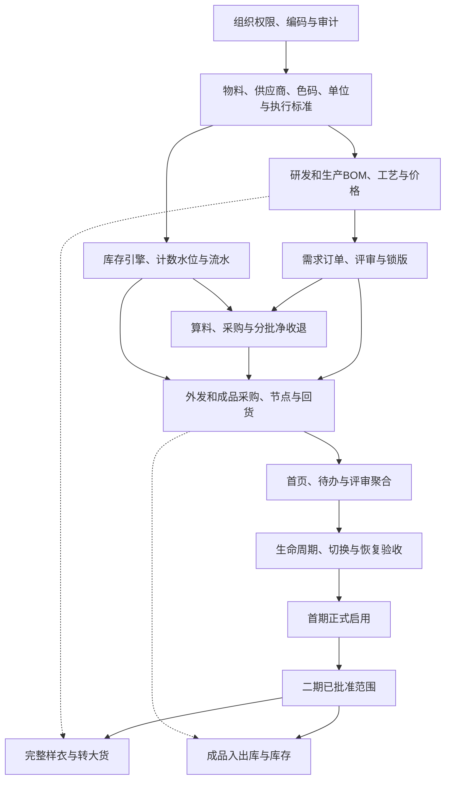
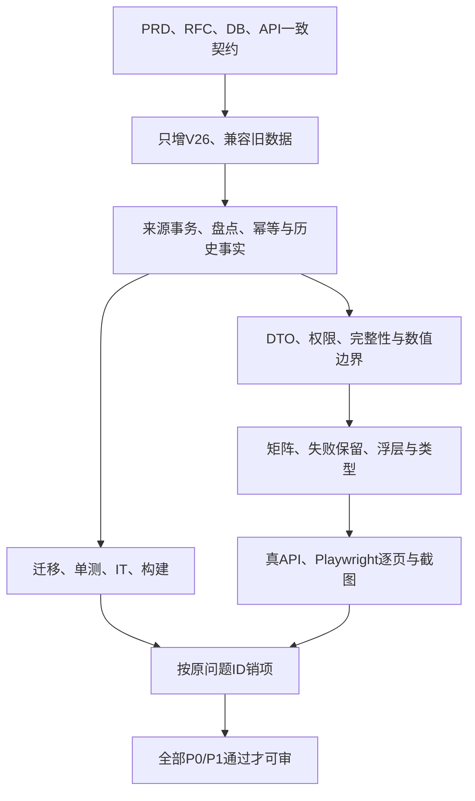

# RFC 010：首期审查整改契约

日期：2026-11-17。依据：[PR #2](https://github.com/xiaoliangao/lingmao/pull/2)、[PR #3](https://github.com/xiaoliangao/lingmao/pull/3) 及两份 `docs/reviews/` 审查报告。状态：本次整改选定的实施方案；运行验收状态单列，不以“方案已定”代替测试通过。

本次用户已授权按审查结论自主取舍并实施。保留首期范围、既有视觉、模块化单体与部署入口；不实现完整样衣、财审/结算、订单级可编辑BOM、外部账号、低代码或外部集成。`docs/PRD.md` 已批准的简化优先于旧原型完整菜单。原字段清单原件仍未取得，按两份报告的证据边界工作，不编造公共标签库的关系模型。

## 1. 切换策略与不可恢复数据

PR3 P0-01 采用审查方案 A：**旧未结业务由原系统收尾，新系统只承接切换后的全新需求**。不把旧需求的全部数量当作新单重新导入、算料或排产；取消原“直接导在途需求订单”的安排。仅迁主数据和经核对的新系统可用期初库存。

切换负责人记录截止时点、旧单范围、旧业务专用实物/工厂托管料/在途与新单可用库存的分界。旧采购在途不是期初实存；旧业务占用的实物不同时成为新订单公共可配量。旧单收尾后的剩余物料交接到新系统，按真实交割做有来源备注的其他入库，沿用现有审批、日志与反审规则；同一交割由唯一责任人登记并核对源单，禁止两边各加一次。

上线清单必须包含：切换截止记录、未结单清单（在私有交付材料）、按仓/SKU核对的公共期初、旧业务后续收发登记责任、重复导入防控、差异签认与回退点。未核对不得启用真实旧单接续；首期不建设余额迁移引擎。合成例：需求100、已排60、已回20、旧采购在途30，均留原系统；新系统新增需求只来自截止后的新业务，30不加入期初实存。

历史期初不具备可信价格时保留 UNKNOWN；不能把未知成本写0，或承诺未来仅凭数量恢复全部金额。正式切换操作和真实数据签认不由本次代码任务执行。

## 2. 库存事务与盘点

### 2.1 双向过账

库存单头状态CAS、来源校验/累计回写、余额、流水、操作日志在同一事务。**正向和逆向均先做来源校验及累计回写，再改库存余额/流水**；后续库存不足等异常使整笔事务回滚。来源处理器不能在库存锁之后再获取采购/MRP等上游锁。多个来源头/明细按ID排序，库存键按统一键排序。

采购每个来源行在锁内合并本次delta，正反向都验证 `0 <= nextReceived - nextReturned <= maxReceived`。退货后已补收的单不能直接撤销原退货突破上限，先按业务次序撤销补收；失败时所有状态/数量/流水不变。MRP确认先收集包括旧算料改挂行在内的采购头，统一预锁，再移动明细和更新version。

### 2.2 盘点的测量边界

选择短窗口重数策略，不新增长事务或仓库冻结功能：

- `inv_stock.movement_revision` 为每个库存键的递增变动版本，一次原子过账/反过账只要产生该键的库存流水就递增一次（同键多行合并，不表示流水条数），不能用余额相等判断没动过。
- `inv_count_item.book_revision` 与 book_qty 在同一键锁内读取；完整键为仓库、SKU、物权、物权方、货位。一期 OWN/0/0 的约定不变；无余额行先保证行存在再锁。
- 实物计数从拍账到提交期间应无对应SKU收发。提交在相同键锁内核对版本，任一变化返回1002，要求重取账面并重新数货；进出各一次而净量不变也会失效。
- 重取账面只重拍有过变动的行（book_revision 为 NULL 或和现在不一致），这些行清空 counted_qty、要重数；没动过的行实盘留着（11-17 合并时改：原来是整单清空，全仓盘点一笔进出就得全部重数）。新增/导入行遵循同一口径。DAILY文件首次出现的新SKU仅加行拍账、实盘留空并提示重新计数，不能把拍账前的文件实盘视为有效；已有行导入不刷新水位，OPENING仍按零余额及水位校验。旧行 book_revision=NULL 必须重取；旧PENDING单先退回草稿重取，不能默认0放行。
- 提交后差额已确认，之后正常收发允许；审核在当时余额上应用已确认差额。反审回草稿时实盘留着，book_revision 对齐到反过账后的当前值：提交时确认的差额仍然成立（提交以后的进出账上、货上都有），改错一个数能直接再提交；回草稿以后又有变动的行照样拦（11-17 合并时改：原来反审核清空全部实盘）。

这闭合“数货前出20”和“重拍账面保留旧实盘”的反例；没有自动声称实物作业者确实遵循了计数流程。

### 2.3 价值事实

V26给 `inv_stock_log` 追加 unit_price、amount、stock_unit、currency、valuation_status、reversal_of_log_id。数值用NUMERIC，Java用BigDecimal；RECORDED仅表示原始过账价/金额已留存，不是完成移动加权核算。逆向事件引用原流水，复用原价/单位/币种并反向金额；源明细后来改价不能改写历史事件。无法估值的期初/盘点及旧流水为UNKNOWN，不从当前源价倒填历史。

工厂仓一期含义统一为**净托管账面量**：领入−退回/调出＋经审核调整；回货不自动按BOM扣真实耗料。界面和说明不称实时未耗实物；料账平衡继续二期，工厂仓不进入公共可用库存。

## 3. 新增动作幂等与并发

`ReceiptReq`、`InvDocFromSourceReq` 增加必填UUID `clientActionId`。前端一次用户动作生成，网络失败/结果未知时保留原请求体和ID重试，不因修改表单静默生成新ID；先确认前次结果，或明确开始“重新登记”的新动作。成功后、换来源或明确开始新动作才生成新ID。不得仅凭内容相同判断重复业务，也不得每次点击重试生成新ID。

`biz_action_request` 按 `(user_id, operation, client_action_id)` 唯一；请求摘要包含业务类型、来源ID和全部有效请求数据，result保存原有接口的返回结构。认领、业务写入、结果完成处于同一事务：同键同请求返回原结果，同键异请求报1002，事务失败不留下成功占位。原有CAS、数量上限与权限不取消；幂等命中仍检查当前调用身份。

节点整计划使用独立 `prd_order.plan_revision`。`ProductionDetailVO.planRevision`、`NodePlanReq.planRevision` 与 `PUT /api/production-orders/{id}/nodes` 返回 `{planRevision}` 对齐；比较成功才更新，旧计划报1002。报工不递增计划版本，避免无关冲突。两个设备的同一用户也受此保护。

## 4. BOM、成本和跨域读取

### 4.1 成本与编辑保存

服务端在解析/转换整包内容前裁定成本权限：无成本权限忽略cost并保留原成本（沿用现契约）；有权限但cost=null亦保留；成功加载后明确发送空内容才表示清空。单头成本模式、成品单价和费用子表使用同一授权决定。

前端独立记录未授权/加载中/成功/失败，且带packId或请求代次。只有当前版本成功加载的成本可序列化非null；失败可重试，保存其他块用null保留。迟到响应不能污染另一版本。未加载不等于空数据，未知汇总不显示假0。

### 4.2 指定SKU就绪与历史包

资料包域对 `packId + styleSkuIds` 提供完整性检查：启用状态、颜色、随码/随色码配料与分码用量。订单提交、各级审核、变更和MRP统一使用，逐实际SKU检查，不扩大成所有颜色与尺码的笛卡尔积。新订单提交、审核用严格口径（款式颜色SKU、物料、物料SKU停用也拦）；已审核订单的MRP和变更单只查配料、用量配齐，下单以后才停用的不拦（11-17 合并时改：否则停用一个辅料，引用它的在做订单全都算不了料、提不了变更）。新生效版有owner_snapshot时，新增色码须先修订生效，使可用SKU与历史PDF版次集合一致；旧无快照版的统一用量/统一配料不能仅因追加尺码被无理由拒绝。缺项明确到款色码/物料行，要求修订生产版；不自动换旧订单锁版。

新生效包在 `tp_tech_pack.owner_snapshot` 冻结schemaVersion、所有者展示信息、sizeGroupId/baseSize、有序sizes及colors(id/code/name/hex)。历史PDF按冻结色码生成，新单可选SKU仍按当前启用规则。已生效旧包无快照时标LEGACY，保留必要引用/停用色码作兼容渲染，不伪造历史快照；页面和PDF不另加提示（11-17 合并时去掉：PDF 要发给工厂）。附加工艺标准文件仍按PRD既有例外取导出当时内容，不改变包内已存文字。

标准BOM和订单锁定版本分开；首期锁定不可变生产版本已构成引用快照，订单级可编辑资料包仍二期，不复制一套未排期业务。

### 4.3 MRP限定读取例外

为避免本轮跨多模块搬迁，明确 `MrpCalcMapper.xml` 和 `SupplyMapper.xml` 是purchase的只读算料投影：允许批量读取已审核订单数量/锁定包/交期、BOM配料用量和库存实存，禁止写上游表。业务可用性与SKU完整性仍由上游Service检查，purchase仅负责净供应、软占用及分配。上游改列/状态/完整性规则时必须跑算料契约测试；一般业务Mapper不继承该例外。数据范围沿原有可算订单权限，仓管来源预填是独立已授权作业视图，不自动授予采购普通列表或财务数据权限。

input_snapshot 明确只保存订单数量/锁定包/交期及迟到在途；聚合结果不声称能重放他单全部占用。共享在途分配按use.id确定顺序（建行顺序，不称确认先后），净到货计退货，建议量夹零。解释全部历史占用需要后续批准，当前不扩JSON快照。

## 5. 订单与前端交互

- SKU行字段是唯一持久化粒度。款/尺码分组仅用于展示与显式批改；混合值标“多个值”，未修改行的单价/交期/备注原样往返。0数量格不提交，null的主动清空与未修改区别处理。
- 正常订单变更仍须新数量不小于已排量。未执行生产单按现有条件撤回/反审/作废再重排；已执行单明确拒绝直接减到已排量以下，并列出阻塞单/已执行量和可用的结案、原因留痕、后续新单处置。结案不退已排，不冒充已经支持余量调整单；BOM通知不自动更改既有锁版。
- dirty表单在KeepAlive激活不hydrate；干净页面可刷新。1002后保留本地草稿，提供明确重载/放弃入口，不只换version强行覆盖最新单。未完成上传不能随保存默默丢弃；保存等待或禁用并提示，迟到上传不得串到已关闭重开的表单。
- 列表和导出共用规范化查询，导出使用已成功展示的条件快照；角标统计按原契约去status，所选ID仍受既有筛选/权限。多编码支持空格/逗号等既有分隔，最多200个（11-18 用户定，撤回本轮收紧到100）。
- 默认业务日和快捷区间统一东八区纯日期；显示日期既有格式不改。登录回跳仅接受单字符串、单斜线开头且解析后同源的内部path/query/hash，拒绝外站、反斜线和控制字符；保留登录后全页重载。
- 单价输入四位，金额两位；数据库/后端精确数值计算，前端即时预览不作为入账依据。写库前校验单价、行额、总额容量，超界返回400并定位行，不靠数据库500兜底。 成品件数的跨块、跨行及单据累计使用long中间值，并校验INTEGER容量；103%允许上限同时受INTEGER上限限制。
- BOM补只读款色主图与当前行料卡，hover/键盘焦点切换；无图/未配料/加载失败有空态，不重做编辑表格或图上编号。公共标签按已有附加属性只读展示，区别风格与吊牌；共享标签库的编辑/多选/筛选仍缺范围证据，不新建未批准域。

## 6. 审批与首页访问矩阵

普通列表/KPI/提醒按DataScope；audit不等于data:all。订单、采购、生产列表新增 `auditForMe=true`，取当前审批级和调用人的交集，当前指定审批人不因SELF非负责人被普通归属过滤掉；计数使用同一口径，首页待审跳转带此参数。

规则配置时及提交取审批快照时，校验指定人启用且有对应模块list权限；现有动态菜单/详情路由需要该权限，不新增一套绕过菜单的路由。已提交快照保留，后续被撤去list的审批人由管理员恢复权限，或按现有撤回/重提流程调整；不得自动授权data:all。已有当前级对象审批例外继续有效，但不代替模块访问前提。

首页完整聚合是原计划下一步，不在整改中新造整个模块。API06同步本矩阵；已实现模块的列表/详情/审批先验证。无数据/失败不返回或显示硬编码业务数值。

## 7. 后续阶段的设计修正

以下仅修订RFC/约束，不创建后续域：

| 问题 | 本次选定边界 |
|---|---|
| 二期主体库存归属 | 访问隔离不是物权拆分；启用前选公共库存/专属仓/主体余额键并核期初，不能只加DataScope |
| 二期成品尾数 | 11-17 用户定分次入库：一张回货单可以有几张成品入库单，每行累计（不含作废，草稿也算）不超过良品数，建单、改单、审核都在回货单锁内重算剩余量；剩余良品 > 0 的回货单留在待入库。详细见 RFC 008 §3.3 |
| 后续助手 | 识别先存独立提案，未确认不写现价；草稿工具固定post=false且服务端按受限身份拒绝任何过账效果 |
| 外部对接 | 事件ID区分动作/版本/topic；同事件重试复用，外部单据/回执独立映射，不只按bizId去重 |
| 备份 | restrict不限制远程命令；使用低权限账户、只读导出目录及强制受限命令，不开root登录。恢复按同快照证据核验，当前行数下降可能是合法删除 |

## 8. 交付拓扑与退出标准

### 8.1 首期模块交付依赖

采用 `docs/reviews/scm-full-audit.md` §8.1 的模块依赖，作为 `docs/进度.md` 的当前退出顺序。箭头表示能力交付依赖，不改变 Java 包依赖规则；主数据就绪后，资料包与库存引擎可以并行。完整样衣不是首期双阶段 BOM 的前置，二期成品库存和后续财审结算继续原分期。

| 阶段 | 交付与退出条件 |
|---|---|
| 契约与基础 | PRD、DB、DTO/API字段和错误码一致；组织权限、主数据及编码可供下游调用 |
| 资料包与库存并行 | 实际SKU完整性、锁版与历史上下文验证；正反过账、盘点水位、不可变流水验证 |
| 交易与生产联调 | 需求→算料→采购→收退→外发/成品采购→节点/回货，验证分批、重试、逆向和角色边界；按原报告L1–L7留证 |
| 聚合与首期验收 | 首页/评审真实聚合按API06和同一权限矩阵交付，不能用404明确提示代替功能完成；再完成L8、实际业务验收和切换/恢复签认 |
| 后续阶段 | 仅在批准范围内实现完整样衣、成品仓及后续质检财务；不得借本次整改提前扩建 |

本次整改只验证已有模块与原问题相关的链路；完整首页/评审聚合仍是原计划下一步。C14的审批入口、C18的失败提示通过，不等于上述“聚合与首期验收”阶段通过。

### 8.2 本次整改提交与验证依赖

一个整改分支，提交依次为契约/DB、后端、前端与联调；必要修订独立小commit，不回改执行过的迁移。V26发布须停旧写实例后迁移并启用新版本，不允许新旧应用长期并行写入（旧程序不会维护movement_revision）。`.github/workflows/ci.yml` 面向通用push/PR，ubuntu-latest安装依赖、迁移/单测/IT、严格TS、Lint、行为测试、生产构建、启动健康/API/UI冒烟；不用临时分支名。

日志、截图、临时导出只进忽略目录与CI产物。关键前后截图人工打开核对；模拟网络失败明确标为故障注入，普通正向必须用真API。每个原报告ID记录通过/未通过/云端无法验证、修复SHA与证据。后续范围项可记“文档契约通过、实现按原分期”，不能冒充已上线功能；未通过的P0/P1使PR保持draft。
