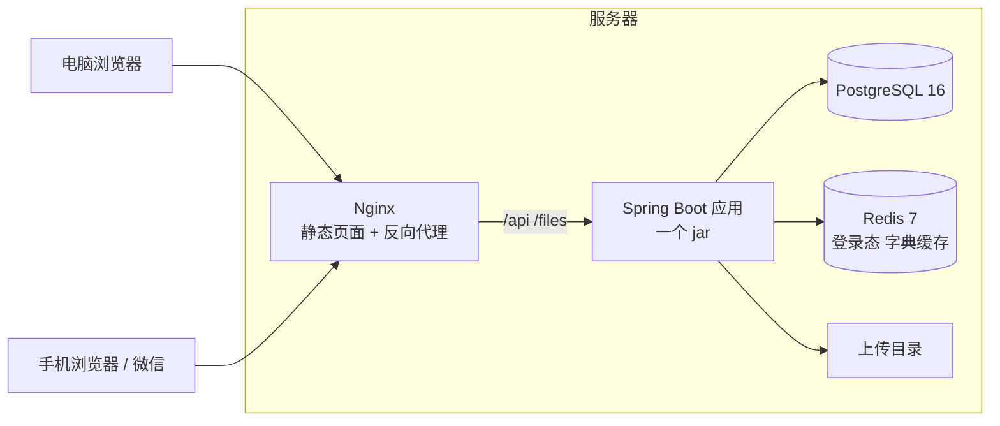
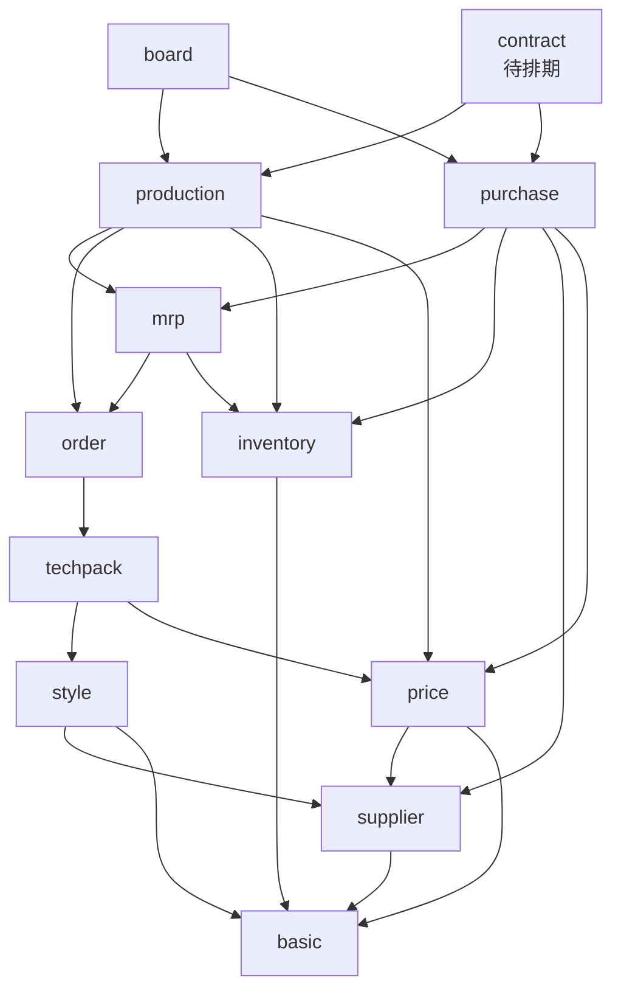

# 架构设计

v0.3 草案，2026-11-11。

PRD 管"做什么"，本文管"怎么做"。§16 的 D1-D4 是用户 11-05 定的，D5-D8 是用户 11-11 定的，其余是 Claude 的决定，有异议直接提。`CLAUDE.md` 的"技术约定"是本文的摘要，两边对不上时以本文为准，并同步改 `CLAUDE.md`。

## 变更记录

| 日期 | 版本 | 改了什么 |
|---|---|---|
| 11-05 | v0.1 | 初稿；§14 按"没标黄的模块是待定、不是不做"写了预留；记录 D1-D4：本机 Docker 开发、甲方那边部署、旧服务器不再用、直接提交 main |
| 11-05 | v0.2 | 随 RFC 001、002 草案调整：§4.3 版本号改用显式条件，"由动作改"的列标 `NEVER`；§4.5 单号表改成通用的 `seq_key`，主数据编码也能用；§7.1 单据公共接口挂到各单据下面；§7.3 加 503；§12.2 上传文件不在本机另做副本；§13 集成测试用 `*IT` + `mvn verify`；§15 分 A、B 两批 |
| 11-11 | v0.3 | 随 PRD v0.5（甲方 11-11 反馈）：§3 加 `price`、`contract` 两个域；§4.5 加款号和设计师编号；新增 §4.6 供应商准入和改动审批、§4.7 资料包的阶段；§5.4 软占用算上在途和已转采购；新增 §5.5 价格档案；§6 JSONB 的用途；§8 新权限；新增 §12.7 外部服务；§13 加两项集成测试；§14 加 TRADE 开关、企查查、合同、OCR、agent 接入（§14.4-§14.8）；§15 加 11-11 新加的落在哪次发版；§16 加 A13-A17、D5-D8 |

---

## 1. 约束和原则

先把约束摆出来，后面每个决定都是从这里推出来的。

| 约束 | 具体 |
|---|---|
| 工期 | 26 天，一期 40 条，11-14 / 11-21 / 11-28 三次发版，12-01 上线 |
| 人 | Claude 写，用户审 |
| 规模 | 内部 10-30 人，同时在线 ≤ 20，单据 1 万张以内（PRD §8） |
| 部署 | 甲方那边部署，服务器、域名、HTTPS 由他们负责；我们交付部署包和手册（§12）。开发在本机 Docker |
| 数据 | 库存、数量、金额必须对，每个数都要查得到来源 |
| 迁移 | 哪个环境里有了甲方的真实数据，从那时起只增不改（§12.3） |

五条原则：

1. **一个应用，按业务域分包**（模块化单体）。不拆服务，不上消息队列，不做分布式事务。
2. **正确性交给数据库**：事务、唯一索引、外键、条件更新。不在 Java 里"先查再改"。
3. **显式**：数据范围、状态转换、回写都写在 Service 里，读代码就知道发生了什么；不用拦截器偷偷改 SQL。
4. **能算出来的就不存**。要存的（带上限校验的累计数）只能由一个地方改。
5. **公共机制只写一次**：单据状态、单号、操作记录、附件、库存过账、导入导出都在框架里，业务模块套用。

---

## 2. 总体形态



只有一个后端进程。20 个人用，一个进程绰绰有余。审核过账要在一个事务里同时改库存、改采购单、写日志：单体里就是一个 `@Transactional`，拆成几个服务就得做分布式事务。

前端打包成静态文件由 Nginx 发，`/api`、`/files` 转给应用。同源，不用处理跨域。HTTPS 由部署方在最前面的入口做，应用和这个 Nginx 都不管证书。

不加的东西：消息队列、Elasticsearch、注册中心、网关、读写分离。人数和数据量都用不上，还会让甲方的部署和维护变复杂。

以后会多几个外部依赖：企查查、OCR（第三方接口或自己部署的 MinerU），以及来调系统接口的 agent。它们都不在主流程上，一期（12-01）一个都不用；接进来的办法见 §12.7、§14.5-§14.8。

---

## 3. 业务域和依赖方向

### 3.1 分包

后端每个业务域一个包 `com.lingmao.scm.module.<域>`，包里的分层不变（controller → service → mapper → entity，dto 独立）。

| 包 | 表前缀 | 管什么 | PRD |
|---|---|---|---|
| `system` | `sys_` | 用户、角色、菜单、字典、操作日志、文件 | §6.9 |
| `biz` | `biz_` | 单据公共能力：操作记录、附件、变更提醒、引用查询 | §5.1、§5.5 |
| `basic` | `bas_` | 主体公司、客户（TRADE 关时只有表，§14.4）、品类、颜色、尺码组、物料分类、物料 + SKU、仓库 | §6.1 |
| `supplier` | `sup_` | 供应商、分类、资质、准入审批和待批改动（§4.6）、黑名单；风险快照（待排期，§14.5） | §6.8 |
| `price` | `prc_` | 价格档案：物料价、加工价（§5.5） | §6.10 |
| `style` | `sty_` | 款式、款式 SKU、款式图、款号生成 | §6.2 |
| `techpack` | `tp_` | 资料包版本和阶段（研发 / 生产）、BOM、工艺 | §6.4 |
| `order` | `ord_` | 订单、订单变更单 | §6.5 |
| `inventory` | `inv_` | 出入库单、库存、库存日志、过账引擎 | §6.6.4 ~ §6.6.6 |
| `mrp` | `mrp_` | 算料单、软占用、齐料状态 | §6.6.1、§6.6.3 |
| `purchase` | `pur_` | 采购单、到料跟踪 | §6.6.2、§6.6.3 |
| `production` | `prd_` | 排单、加工单、节点、报工、异常、回货、生产看板 | §6.5.5、§6.7 |
| `contract`（待排期） | `ctr_` | 合同模板、合同（§14.6） | §6.11 |
| `board` | — | 首页待办、订单审核对话框这类跨域的只读查询 | §6.5.4、§6.9.2 |
| `dev`（二期） | `dev_` | 样衣、打样 | §6.3 |

`common` 放和业务无关的框架代码：返回体、分页、异常、单号、单据状态机、数字工具、Excel。它不能依赖任何 `module`。

有五处和 PRD 的章节不是一一对应的：

- **排单放在 production**：按钮在订单详情里，但它生成的是加工单。production 依赖 order，反过来不行。
- **齐料状态放在 mrp**：PRD §6.6.3 规定按算料单算。
- **工厂仓由 supplier 建**：建供应商时 supplier 调 basic 的仓库服务自动建（PRD §6.1.6）。仓库表的 `factory_id`、物料表的默认供应商只是外键引用，basic 的 Java 代码不调 supplier。仓库页面不能手工建工厂仓。
- **价格档案单独一个域**：写它的是采购单、加工单的审核，读它的是生产 BOM、采购单、排单。放在这些域下面、主数据上面，大家都能调它。它属于 PRD 的 M05 核价，但不能放进以后的 `cost` 域：核价要读订单、采购、生产的数，在最上层；价格档案要被采购、生产调用，在下层，放一起就成环了。物料、供应商、款式详情页里的"价格"页签，由前端直接调 `price` 的接口，basic、supplier、style 不调它。
- **合同在采购、生产上面**：合同从采购单、加工单取数，是它们的下游；它实现 `ReferrerProvider`，有效合同在，源单就不能反审核（§4.4）。

### 3.2 依赖只能朝一个方向

图里 A → B 表示"A 可以调用 B"。每个业务域都可以用 `system`、`biz`、`common`，图里不画。



规则：

1. 依赖是一张没有环的图：**后发生的单据依赖先发生的单据，单据依赖主数据**，反过来不行。
2. 跨域只调对方的 Service，不碰对方的 Mapper。同一个域里可以直接用兄弟表的 Mapper（沿用）。
3. 每张表只有一个"主人"域，只有主人能写它。
4. 列表要显示别的域的名称、编码时，可以在自己的 Mapper XML 里 JOIN 那张表，只读、只取显示字段；要做业务判断（状态对不对、够不够）必须调对方的 Service。
5. 用 ArchUnit 写成测试：域之间不能有环、controller 不能直接用 mapper、`common` 不依赖 `module`。违反了测试就红。

### 3.3 上游要知道下游的事怎么办

依赖只能从下游指向上游，但业务上经常需要反过来。固定用下面四种办法，不临时发明：

| 需要 | 例子 | 办法 |
|---|---|---|
| 下游改上游的累计数 | 入库回写采购单"已入库"；排单回写订单"已排产" | 下游在自己的事务里调上游 Service 的回写方法（§5.3） |
| 通用引擎回调具体业务 | 出入库单审核后回写源单（采购单、加工单） | 引擎定义接口，业务域实现（`StockSourceHandler`，§5.2） |
| 上游要知道"谁引用了我" | 反审核前查有没有下游；取消订单；拉黑供应商时列出未完成单据；主数据用过不能删；"下游单据"页签；订单变更后给下游出黄条 | 每个业务域实现一个 `ReferrerProvider`，报告"我这里有哪些单据引用了它"（§4.4） |
| 页面要拼几个域的数据 | 首页待办；订单审核对话框（齐料参考、工厂在手负荷） | 放 `board`，它在最上层、只读，是唯一能直接写跨域 SQL 的地方。也可以前端分两次取（订单列表的齐料列另调 mrp 的接口） |

不用 Spring 事件。上面这些都是同步的、要拿结果的、要在同一个事务里完成的调用，用接口比用事件好追踪：在 IDEA 里点一下就能跳到所有实现。

---

## 4. 单据框架

订单、变更单、算料单、采购单、出入库单、加工单、回货单都套这一套。

### 4.1 单头和明细

每张单据 = 一张单头表 + 一到几张明细表。

单头公共列：

| 列 | 说明 |
|---|---|
| `no` | 单号，全表唯一。不带 `deleted` 条件：作废、删除的单号也不再用 |
| `company_id` | 主体公司，非空，默认取制单人的默认主体。一期不按它隔离；二期要隔离时不用补数据 |
| `status` | 状态（§4.2） |
| `audit_by`、`audit_time` | 审核人、审核时间 |
| `version` | 乐观锁（§4.3） |
| `remark` | 备注 |
| `create_by` … `deleted` | 沿用 `BaseEntity` |

明细表：`id`、单头 id、`seq`（行号）和业务字段，没有 `deleted`，跟着单头走。

**明细上存交易时的值**。单价、换算系数、采购单位、用量、损耗率这些"当时按什么算的"存在明细行上，以后改了物料档案不影响旧单。名称、编码这类只用来显示的，查询时 JOIN 现查。

**草稿保存 = 整单覆盖**。前端每次提交整张单（单头 + 全部明细），后端删掉旧明细、插入新明细。这比逐行比对增删改简单得多；草稿的明细还没被任何单据引用，换了 id 没关系。审核以后明细不再变（要变走变更单），下游引用的都是审核后的行，外键也会拦住误删。

### 4.2 状态机

主单据共用一套状态（PRD §5.1）。库里存英文名，页面按单据类型显示中文，比如采购单的"执行中"显示成"部分到货"：

`DRAFT` 草稿 → `PENDING` 待审核 → `APPROVED` 已审核 → `RUNNING` 执行中 → `DONE` 已完成；另有 `CLOSED` 已结案、`VOIDED` 已作废。

允许的转换写成一张表（`common.doc.StatusFlow`），一个动作一行：

| 动作 | 从 | 到 | 谁触发 |
|---|---|---|---|
| submit 提交 | DRAFT | PENDING | 用户 |
| withdraw 撤回、reject 驳回 | PENDING | DRAFT | 用户（驳回要填原因） |
| audit 审核 | PENDING | APPROVED | 用户 |
| unaudit 反审核 | APPROVED | DRAFT | 用户，没有下游单据时 |
| start 开始执行 | APPROVED | RUNNING | 系统：第一次入库、第一个节点开工…… |
| finish 完成 | RUNNING | DONE | 系统：到齐、回齐 |
| close 结案 | APPROVED、RUNNING | CLOSED | 用户 |
| reopen 取消结案 | CLOSED | 按累计数重新算 | 用户 |
| void 作废 | DRAFT、PENDING | VOIDED | 用户 |

各单据只用这张表的一部分。出入库单只有草稿和已审核（PRD §6.6.5），审核直接从 DRAFT 到 APPROVED；订单多一个"经变更单取消"（→ VOIDED，页面显示"已取消"）。资料包（草稿 / 已生效 / 已作废）、算料单（草稿 / 已确认 / 已关闭）、供应商（待准入 / 准入审批中 / 合作中 / 停用 / 黑名单，§4.6）、异常（待处理 / 处理中 / 已关闭）、合同（已生成 / 已签回 / 已作废）的状态不一样，各用自己的枚举，但同样写成转换表、用同一个工具类。

**改状态一律"比较并交换"**：

```java
int n = orderMapper.update(new Order(), Wrappers.<Order>lambdaUpdate()
        .set(Order::getStatus, DocStatus.APPROVED)
        .set(Order::getAuditBy, userId)
        .set(Order::getAuditTime, now)
        .eq(Order::getId, id)
        .eq(Order::getStatus, DocStatus.PENDING));   // 还是"待审核"才改
if (n == 0) {
    throw new BizException(1002, "单据状态已变化，请刷新后再试");
}
```

两个人同时点审核，只有一个能成功；双击也只生效一次。第一个参数传 `new Order()` 而不是 `null`：传 `null` 时 MyBatis-Plus 的自动填充不生效，`update_by`、`update_time` 不会更新。

为什么状态存字符串（`VARCHAR(16)`）而不是数字：SQL 和日志里一眼能看懂，不用查对照表。为什么不用 PostgreSQL 的 `ENUM` 类型或 `CHECK` 约束：以后加状态要改类型或删约束，和"迁移只增不改"冲突。合法性由 Java 枚举和转换表保证。

**按钮由后端算**。详情接口返回 `actions: ["submit", "void"]`，等于"状态允许 ∩ 用户有权限 ∩ 业务条件"，前端照着显示按钮，不在 TypeScript 里再写一遍状态规则。点了以后后端照样再校验一遍。

### 4.3 两个人同时改一张草稿

不处理的话，后保存的人会把先保存的人的修改整个覆盖掉。

单头加 `version` 列：打开单据时拿到 `version`，保存时带回来，条件写成 `id = ? AND status = 'DRAFT' AND version = ?`，同时 `version = version + 1`；对不上就保存失败（1002），提示"这张单已被别人修改，请刷新"。状态动作也让 `version + 1`，开着旧页面的人保存不了。

不用 MyBatis-Plus 的乐观锁插件：它对不同的更新方法行为不一样，要记住哪些管、哪些不管；写在条件里，读代码就看得到（原则 3）。

状态、审核人、审核时间、版本号、回写的累计数这些"由动作改"的列，实体上标 `@TableField(updateStrategy = FieldStrategy.NEVER)`：保存永远不写它们，只有动作的条件更新能改。不然一个人保存旧页面，会把别人刚审核、刚拉黑的状态改回去。详见 RFC 001 §4。

只加在单据单头上。主数据不加：两个人同时改同一个物料的概率太低，不值得让每个表单都带 version。

### 4.4 单据公共能力（`biz` 域）

| 能力 | 表 | 用法 |
|---|---|---|
| 操作记录 | `biz_doc_log` | 每个动作写一行：单据类型、单据 id、动作、备注（驳回原因、变更原因）、操作人、时间。详情页"操作记录"页签 |
| 附件 | `biz_attachment` | 单据类型 + 单据 id + 文件。所有单据共用一套上传、列表、删除接口 |
| 变更提醒 | `biz_doc_notice`（PRD §7.2 之外新加） | 上游变了（订单变更单审核），给每张下游单据插一条：提醒谁、说了什么、谁处理的、什么时候。下游详情页顶部的黄条和首页待办都读它 |
| 引用查询 | — | `ReferrerProvider`，见下 |

```java
/** 每个业务域实现一个：报告本域里有哪些单据引用了 (type, id)，作废的不算 */
public interface ReferrerProvider {
    List<DocRef> referrers(BizType type, long id);
}

public record DocRef(BizType type, long id, String no, String status, Long ownerId) {}
```

`biz` 里的 `ReferenceService` 把所有实现收集起来（Spring 注入 `List<ReferrerProvider>`）。一个接口用在六个地方：反审核前检查、取消订单前检查、拉黑供应商时列出未完成单据、主数据删除前检查（PRD §5.6：用过的只能停用）、"下游单据"页签、变更提醒发给谁。上游域不用知道下游有哪些域。

`BizType` 是全系统单据和主数据类型的枚举（`ORDER`、`PURCHASE_ORDER`、`MATERIAL_SKU`……），带单号前缀和中文名，放在 `common.doc`。

### 4.5 单号

改成由 PostgreSQL 生成，不再用 Redis：

```sql
CREATE TABLE sys_serial (
    seq_key     VARCHAR(32) PRIMARY KEY,   -- 按天的：前缀 + 日期，如 CG20261105；不分天的：前缀，如 GYS
    seq         INT         NOT NULL,
    update_time TIMESTAMPTZ NOT NULL DEFAULT now()
);

-- 取号：第一次插入 1，之后每次 +1，一条语句完成
INSERT INTO sys_serial (seq_key, seq) VALUES (?, 1)
ON CONFLICT (seq_key) DO UPDATE SET seq = sys_serial.seq + 1, update_time = now()
RETURNING seq;
```

为什么换：

- **Redis 里的计数丢了，单号就会重复**。Redis 重启时没持久化、有人删了 key，当天的流水号就从 0001 重新开始。单号是给人看、印在纸上的，重复了比缺号麻烦得多。
- **跟着事务走**。在建单的同一个事务里取号，建单失败号也一起回滚，单号连续不跳。代价是同一种单据同一天的建单要排队（行锁持有到事务提交），20 个人用感觉不到。
- Redis 从此只放丢了也不要紧的东西（§9）。

`SerialNoGenerator.daily("CG")` 出单号 `CG202611050001`，`next("GYS", 4)` 出主数据编码 `GYS0008`（RFC 001 §6）。各单据表的 `no` 列加唯一索引兜底。

**款号**（PRD §5.2，11-11 定）：大类 + yyMMdd + 设计师编号 + 2 位流水，如 `FS2611080701`。

- 流水按"大类 + 日期 + 设计师"计数，和单号一个做法：`seq_key` = `FS26110807`，调 `next("FS26110807", 2)` 得到 `FS2611080701`。在建款的事务里取号，建款失败号也回滚。
- 超过 99 抛 1000"今天的流水用完了，请手填款号"。
- 取到的号已经被手填的款号占了（有人手填过 `FS2611080703`），就再取下一个（RFC 001 §6 说的"撞号再取"）。`sty_style.code` 的部分唯一索引兜底。
- 日期取注入的 `Clock`（RFC 001 §6.2），不写 `LocalDate.now()`。
- 大类是字典（`style_class`），编码被款号用过就不能改：改字典项时查一下 `sty_style` 有没有用它开头的自动编号款。

**设计师编号** `sys_user.designer_no`：`VARCHAR(2)`，两位数字，**全表唯一**（不带 `deleted` 条件，删掉、离职的人的编号也不再给别人）。另加 `designer_no_locked BOOLEAN`：第一次用它生成款号时，`style` 调 system 的 `UserService.lockDesignerNo(userId)` 置 true（同一个事务，条件更新）；之后保存用户时，锁了的编号不能改、不能清空。用"锁"这一列而不是每次去查款式表，是因为 system 不能依赖 style（§3.2）。

### 4.6 供应商准入和改动审批

PRD §6.8.2。供应商是主数据，不是单据，但准入照单据框架的审批做（单级）：

- 状态：`PENDING_ADMIT` 待准入 → `ADMITTING` 准入审批中 → `ACTIVE` 合作中；另有 `DISABLED` 停用、`BLACKLISTED` 黑名单。照 §4.2 写成转换表，动作是 submit（申请准入）、withdraw、reject、audit（通过）、disable、enable、blacklist、unblacklist，改状态一律比较并交换。
- 申请准入前的检查（信用代码、营业执照、联系人、开户行和账号）在 submit 里做，一次列出缺的全部项，返回 1000 + 缺项清单。
- **不能自己批**：audit、reject 时比较申请人 `admit_apply_by` 和当前用户，相同就拒绝。这是业务规则，写在 Service 里，不靠权限码。
- 审批中不能改：保存的条件里带 `status <> 'ADMITTING'`；资质子表的增删也查这个状态。
- 每个动作写 `biz_doc_log`（`BizType.SUPPLIER`），驳回原因在备注里。
- 只有导入能直接建成 `ACTIVE`：新建接口里状态不收参数，固定 `PENDING_ADMIT`；导入接口要 `supplier:supplier:admit`。

**关键字段改动**用一张待批改动表，不直接改供应商：

```sql
CREATE TABLE sup_supplier_change (
    id           BIGINT GENERATED ALWAYS AS IDENTITY PRIMARY KEY,
    supplier_id  BIGINT      NOT NULL REFERENCES sup_supplier (id),
    changes      JSONB       NOT NULL,   -- [{field, label, before, after}]
    status       VARCHAR(16) NOT NULL,   -- PENDING / APPROVED / REJECTED / WITHDRAWN
    apply_by     BIGINT      NOT NULL,
    apply_time   TIMESTAMPTZ NOT NULL,
    audit_by     BIGINT,
    audit_time   TIMESTAMPTZ,
    reject_reason VARCHAR(500)
    -- create_by … update_time 沿用
);
CREATE UNIQUE INDEX uk_sup_change_pending ON sup_supplier_change (supplier_id) WHERE status = 'PENDING';
```

- 保存合作中、停用的供应商时，Service 把请求拆成两份：非关键字段直接更新；关键字段和当前值比，有变化就插一条 `PENDING`。部分唯一索引保证一家只有一份待批。关键字段在实体上标 `@TableField(updateStrategy = FieldStrategy.NEVER)`（§4.3），普通保存永远改不到它们。
- 批准：一个事务里，比较并交换 `PENDING → APPROVED`，再按 `changes` 把新值写进 `sup_supplier`。写之前核对 `before` 还等于当前值，不等就 1002"资料已经变了，请重新提交"。同样不能自己批。
- 首页待办"供应商待审批"= `ADMITTING` 的供应商 + `PENDING` 的改动，排除申请人是自己的。

### 4.7 资料包的阶段

PRD §6.4.1，待 Q24（默认做）。不分两套表，在 `tp_tech_pack` 上加一列：

- `stage VARCHAR(16)`：`DEV` 研发 / `PROD` 生产。版本号按阶段各自递增：`UNIQUE (style_id, stage, version)`；同款同阶段只有一个已生效：`UNIQUE (style_id, stage) WHERE status = 'EFFECTIVE'`。
- `source_pack_id`：生产 BOM 从哪个研发 BOM 复制来的（可空）。"转生产 BOM"= 复制研发版的 BOM 行、配色、分码用量、工序，生成生产 V1 草稿；参考单价按价格档案重新取（§5.5）。
- 订单审核锁版本时，只认 `stage = 'PROD'` 的已生效版本；Service 里查，`ord_order_item.tech_pack_id` 的外键管不到阶段。
- 二期样衣要挂研发 BOM 时，按 §14.2 加可空的 `sample_id`。那时还没转大货的样衣没有款式，`style_id` 要放宽成可空：只放宽、不收紧，回滚到旧版本照样能跑，不违反 §12.3。

为什么不另建一套"研发 BOM"表：两个阶段的结构完全一样（BOM 行、随款色、分码、工序），分表就要写两遍同样的代码；用一列区分，查询、打印、复制都只有一套。

---

## 5. 库存与回写

### 5.1 库存模型

- `inv_stock`：一行 = 仓库 × 物料 SKU × 物权，`UNIQUE (warehouse_id, material_sku_id, owner_type, owner_id)`。物权是自有（`owner_id = 0`）或客供（`owner_id` = 客户 id）。用 0 不用 NULL：唯一索引里 NULL 和 NULL 不算重复，会出现两行。TRADE 关时（§14.4）全是自有，物权列照留。
- `inv_stock_log`：每次变动一行，只插不改：单据类型、单据 id、明细 id、仓库、SKU、物权、变动数、变动后结存、缸号、操作人、时间。
- **库存只能由出入库单审核改**（PRD §8）。没有"直接改库存"的接口，期初也是一张"其他入库（期初）"单。
- 工厂仓就是 `bas_warehouse` 里类型为工厂仓的仓库，领料就是物料仓 → 工厂仓的移库。

### 5.2 过账引擎

出入库单审核时，先用 §4.2 的比较并交换把状态改成已审核。这一步顺带锁住了这张单，同一张单不会被审两次、库存不会加两遍。然后交给 `inventory` 的 `StockLedger` 一次处理整张单：

1. 把明细变成"变动"：入库 +数量，出库 −数量，移库是出仓一条 −、入仓一条 +。
2. 相同的（仓库, SKU, 物权）合并，再**按这个组合排序**。两张单同时审核、都动到 A、B 两种料时，大家都先锁 A 再锁 B，不会互相等死（死锁）。
3. 逐条执行：先保证这行库存存在，再条件更新。

```sql
INSERT INTO inv_stock (warehouse_id, material_sku_id, owner_type, owner_id, qty)
VALUES (#{wh}, #{sku}, #{ownerType}, #{ownerId}, 0)
ON CONFLICT (warehouse_id, material_sku_id, owner_type, owner_id) DO NOTHING;

UPDATE inv_stock
   SET qty = qty + #{delta}, update_time = now()
 WHERE warehouse_id = #{wh} AND material_sku_id = #{sku}
   AND owner_type = #{ownerType} AND owner_id = #{ownerId}
   AND qty + #{delta} >= 0        -- 不允许负库存（Q08）
RETURNING qty;                    -- 变动后结存，写进库存日志
```

4. 没返回行的就是库存不够。**不在第一条不够时就停**：整张单都试一遍，收集所有不够的行，最后一起抛 `BizException(1001, "库存不足", 缺料清单)`。事务回滚，前面已经扣成功的也一起撤销。页面上列出哪几行不够、差多少（PRD §6.6.5）。
5. 写库存日志，调源单回写（§5.3），写操作记录。以上全部在一个事务里。

为什么这样不会超领、不会丢数：PostgreSQL 的 `UPDATE` 会锁住这一行，另一个事务要改同一行得等前一个提交；等到以后，`WHERE qty + delta >= 0` 用的是**最新的** qty 重新判断。所以"判断够不够"和"扣减"是一个不可分割的动作，Java 里不需要先查后改，也不需要 `version`。

反审核 = 同一套引擎走相反的变动。领到工厂仓的料又被调走了、扣不回来，就不让反审核（PRD §6.6.5）。

这条 `UPDATE … RETURNING` 要拿返回值，所以在 Mapper 里用 `@Select` 写，并且必须加 `@Options(flushCache = Options.FlushCachePolicy.TRUE)`。不加的话，同一个事务里参数相同的第二次调用会直接返回 MyBatis 一级缓存里的旧结果，根本不执行 UPDATE。

**源单回写用接口反转依赖**。`inventory` 不认识采购单和加工单，它定义接口，由上层的域实现：

```java
public interface StockSourceHandler {
    BizType sourceType();                                  // PURCHASE_ORDER、PRODUCTION_ORDER
    void onPosted(InvDoc doc, List<InvDocItem> items);     // 审核：回写源单，超收在这里拦
    void onUnposted(InvDoc doc, List<InvDocItem> items);   // 反审核：撤销回写
}
```

`purchase` 实现采购入库、采购退货的回写；`production` 实现领料、退料的回写。

### 5.3 回写的累计数

PRD §4.2 "回写什么"那一列（已排产、已转采购、已入库、已退货、已领、已回货、次品）存在**上游的明细行上**，由下游调上游 Service 的方法改，一条条件更新完成"累加 + 上限校验"：

```sql
UPDATE pur_order_item
   SET received_qty = received_qty + #{q}
 WHERE id = #{id}
   AND received_qty + #{q} >= 0
   AND received_qty + #{q} <= qty * (100 + #{overPct}) / 100   -- 超收上限 5%（Q09）
```

影响行数为 0 就是超了上限，抛 1004，说明是哪一行、上限多少。件数的上限按 PRD 向下取整（`FLOOR(qty * (100 + pct) / 100)`，订单 120 件上限 123 件），物料不取整。

为什么存下来而不是每次现算：

- 上限校验要和累加一起原子完成。一条条件 UPDATE 最简单可靠；现算要先锁行、再汇总、再判断。
- 依赖方向：订单详情要显示"已排产"，如果现算就得去查 production 的表，order 就反过来依赖 production 了。存在订单行上，order 只读自己的表。

怎么防止数对不上：

- 累计数**只能由上游 Service 的一个方法改**，下游只调它，不自己写 SQL。
- 每种累计数写一条对账 SQL（累计数 vs 下游单据汇总），放进集成测试，发版前跑。

上游的状态由上游自己根据累计数算：采购明细全部入齐 → 已到齐；有入库但没齐 → 部分到货。下游不直接改上游的状态。

一次回写可能连着好几层，都在同一个事务里：

> 采购入库单审核 → 库存 +871 → 采购明细已入库 +871（采购单变"已到齐"）→ 算料行已入库 +871（齐料状态变"齐料"）

### 5.4 软占用

算料的可用量（PRD §6.6.1、§7.3 第 3 条）查询时算，不写库存表。11-11 起把在途算进来（甲方要备料）：

```
可用库存 = 物料仓库存 − 别的算料单占着的库存
可用在途 = Σ 赶得上的采购行（未入库 − 别的算料单占着的）
```

"别的算料单"= 其他已确认、没关闭的算料单。它们占着的，按来源分三份：

| 占用 | 到货前算 | 到货后算 |
|---|---|---|
| 本次使用库存 | — | 占着的库存 |
| 本次使用在途（记在 `mrp_calc_transit`：算料行 × 采购行 × 数量） | 那条采购行上占着的在途 | 占着的库存 |
| 它自己生成的采购行（送物料仓的，按 `calc_item_id` 认） | 整条采购行都占着 | 占着的库存 |

占着的库存再减去它的订单从物料仓领走的。"已领"由 production 在领料过账时调 mrp 的回写方法记到算料行上（§3.3 第一种办法），mrp 不去查加工单。

为什么要把"它自己生成的采购行"也算进去：原来只扣本次使用库存。A 单算料、买了 871 米，到货以后物料仓多了 871 米，B 单一算，这 871 米全是可用库存——A 单的料被 B 单算走了。

**依赖方向**：在途是 purchase 的数，要料日期（加工单"裁剪"节点的计划开始）是 production 的数，而 purchase、production 都依赖 mrp（§3.2），mrp 不能反过来调它们。按 §3.3 的第二种办法，mrp 定义接口、上层实现：

```java
/** purchase 实现：交货地点是物料仓、已审核没入齐的采购行 */
public interface TransitSource {
    List<TransitLine> openLines(Collection<Long> materialSkuIds);
}
public record TransitLine(long purchaseItemId, long materialSkuId, BigDecimal openQty,   // 未入库，库存单位
                          LocalDate eta, Long calcItemId) {}                            // eta：预计到货，没有用交期

/** production 实现：订单的要料日期；没排单的返回 null，由 mrp 按承诺交期倒推 */
public interface NeedDateSource {
    Map<Long, LocalDate> cutStartOf(Collection<Long> orderIds);
}
```

到料跟踪（purchase）要显示要料日期时，调 mrp 的 `needDateOfPurchaseItems(ids)`：订单采购的行按 `calc_item_id` 找算料单，备货采购的行按 `mrp_calc_transit` 找用它的算料单，mrp 再问 `NeedDateSource`。

补货提醒（PRD §6.6.7）也在 mrp 算：物料仓库存 + 全部在途 − 别的算料单占着的，和安全库存比。首页待办的数由 board 读；"生成备货采购单"在 purchase，调 mrp 取建议数。

漏洞：两个人同时确认两张算料单，都用了同一批 120 米（或同一条在途），就重复占用了。解决：确认时加一把事务级的 PostgreSQL 咨询锁（`pg_advisory_xact_lock`），让"确认"这个动作排队；确认前用最新数据再算一遍可用库存和可用在途，变了就提示"可用量已变化，请重新计算"。只有确认排队，别的操作不受影响。

### 5.5 价格档案

PRD §6.10。一张只插不改的表 `prc_price`，在 `price` 域（§3.1）：

| 列 | 说明 |
|---|---|
| `type` | `MATERIAL` 物料价 / `PROCESS` 加工价 |
| `supplier_id` | 供应商或工厂 |
| `material_id`、`material_sku_id` | 物料价用；`material_sku_id` 可空 = 这个物料所有颜色 |
| `style_id`、`process_mode` | 加工价用 |
| `price`、`tax_pct`、`tax_included` | 单价口径和单据一样 |
| `effective_date` | 生效日期（`DATE`） |
| `reason` | 调价原因 |
| `source_type`、`source_id`、`source_no` | 来源单据；手工录的为空 |
| `voided`、`void_reason` | 录错了作废，不删 |
| `create_by`、`create_time` | 沿用 |

- **现价**：`WHERE … AND effective_date <= ? AND NOT voided ORDER BY effective_date DESC, id DESC LIMIT 1`。物料价先按 SKU 查，没有再按物料（`material_sku_id IS NULL`）查。索引 `(type, supplier_id, material_id, effective_date)`、`(type, supplier_id, style_id, process_mode, effective_date)`。
- **默认取价**：采购单新增行、排单生成加工单、生产 BOM 新增行和"转生产 BOM"时调 `PriceService.current(...)`。没有就退回到物料 SKU 单价、物料参考单价。
- **单据改价**：明细上存 `price_source_id`（默认取到的那条）和改价原因。审核时在同一个事务里，对单价和现价不一样的行插一条档案（来源 = 这张单，生效日期 = 下单日期）。反审核不删档案：价格确实谈过，档案只增不改；要撤销就作废那条。
- 为什么只插不改：价格历史本身就是要看的东西（"同一个工厂的价格调过几次"），改了就没有历史了。和库存日志一个道理。

---

## 6. 数据库约定

| 项 | 约定 | 为什么 |
|---|---|---|
| 主键 | `BIGINT GENERATED ALWAYS AS IDENTITY` | 沿用 V1。自增 id 远小于 2^53，前端直接当数字用，不用像雪花 id 那样转字符串 |
| 命名 | 域前缀 + 单数 + 下划线（`pur_order_item`），外键列 `xxx_id` | 沿用 |
| 审计列 | `create_by / create_time / update_by / update_time` 自动填充 | 现在只填了时间，`create_by`、`update_by` 一直是空的，框架阶段补上 |
| 逻辑删除 | 主数据和单头有 `deleted`；明细表没有 | 明细跟着单头 |
| 唯一 | 编码：部分唯一索引 `WHERE deleted = false`；单号：全表唯一；资料包：同款只能有一个已生效（`WHERE status = 'EFFECTIVE'`） | |
| 外键 | 都加，不级联（默认 `RESTRICT`），外键列都建索引 | 写错 id 当场报错，被引用的行删不掉。只有一个库、并发很低，"互联网公司不用外键"的那些理由在这里不成立 |
| 数量、金额 | 数量 `NUMERIC(14,3)`，单价 `NUMERIC(14,4)`，金额 `NUMERIC(14,2)`，Java 用 `BigDecimal` | PRD §7.3 |
| 百分比 | 存百分数（3 表示 3%），列名带 `_pct`：`loss_pct`、`tax_pct` | 页面上就这么填；名字说清单位，避免一处存 0.03、一处存 3 |
| 取整 | 集中在 `common.num.Num`：金额四舍五入 2 位；建议采购量向上取整到最小包装；件数上限向下取整 | 规则只写一次，用 PRD 的例子做单测 |
| 日期 | 业务日期（下单日、交期、计划日期）`DATE` ↔ `LocalDate`；发生时间 `TIMESTAMPTZ` ↔ `OffsetDateTime` | 交期没有时分秒；存成时间戳，时区换算时会差一天 |
| 实际日期 | 到货、回货、报工这类单据记"实际发生的日期"（默认今天，可以改），和录入时间 `create_time` 分开 | 补录昨天到的货很常见；以后算绩效、结算、逾期都按实际日期（§14） |
| 今天 | 注入 `Clock`（东八区），不直接写 `LocalDate.now()` | 逾期、临期、节点延期都依赖"今天"，测试里把时钟固定住才测得了 |
| 状态 | `VARCHAR(16)` 存枚举名 | §4.2 |
| JSONB | 只用于快照：算料单当时的输入、变更单和供应商待批改动的改前改后、操作记录的附加信息；以后的风险快照明细和原始返回、OCR 识别结果 | 要查询、要约束的业务字段都用普通列 |
| 迁移 | 一个功能一个 `V<n>__<域>_<内容>.sql`。菜单、按钮权限、字典、角色模板也用迁移插入（`ON CONFLICT DO NOTHING`） | 每个环境都一样，不靠手工点 |

---

## 7. 接口约定

### 7.1 路径

| 用途 | 写法 |
|---|---|
| 列表、详情、新建、保存草稿、删除 | `GET /api/purchase-orders`、`GET /api/purchase-orders/{id}`、`POST`、`PUT /{id}`、`DELETE /{id}` |
| 状态动作 | `POST /api/purchase-orders/{id}/submit`，同样有 withdraw、reject、audit、unaudit、close、reopen、void |
| 由上游生成下游 | 接口放在下游资源上：`POST /api/production-orders/schedule`（排单）、`POST /api/purchase-orders/from-mrp`、`POST /api/inventory-docs/from-purchase/{id}` |
| 导入导出 | `GET /api/xxx/import-template`、`POST /api/xxx/import`、`GET /api/xxx/export`（筛选参数和列表一样） |
| 单据公共 | 挂在各单据下面：`GET /api/orders/{id}/logs`、`/attachments`、`/references`、`/notices`。权限和数据范围由单据自己把关（RFC 001 §14） |

资源名用复数，多个单词用中划线。

### 7.2 DTO

| 类 | 用途 |
|---|---|
| `XxxQuery` | 列表筛选，继承 `PageQuery`。`keyword` 里有空格就按多个单号精确查（PRD §5.4） |
| `XxxSaveReq` | 新建和保存草稿：单头 + 全部明细 + `version` |
| `XxxVO` | 列表的一行 |
| `XxxDetailVO` | 详情：单头 + 明细 + 算出来的字段 + `actions` |
| `XxxAuditReq` 等 | 动作带的参数，如审核填承诺交期、驳回填原因 |

实体里不加 `@TableField(exist = false)` 的展示字段，展示用 VO。转换手写静态方法 `XxxVO.from(...)`，不引 MapStruct。

### 7.3 返回和错误

沿用 `R { code, msg, data }`。业务错误码：

| code | 意思 | data 里带什么 |
|---|---|---|
| 1000 | 一般业务错误 | — |
| 1001 | 库存不足 | 缺料清单：哪一行、库存多少、差多少 |
| 1002 | 状态已变化，或单据被别人改过 | — |
| 1003 | 导入校验没通过 | 错误清单：第几行、哪一列、什么问题 |
| 1004 | 超出上限（超排、超收、超回货） | 哪几行、上限多少 |
| 1005 | 有下游单据，不能反审核、取消或删除 | `DocRef` 列表 |

`BizException` 加一个可选的 `data`，`R.fail` 把它带上；前端对 1001、1003、1004、1005 弹一个表格，其他的弹消息。另外补上 404（不存在，或者不在你的数据范围里，不区分）、405（方法不对，bug 006）和 503（系统升级或重启中，由 Nginx 返回，RFC 002 §7）。异常和 code 的完整对照见 RFC 001 §5。

**错误编号**。每个请求生成一个短 id（traceId），写进这次请求的每一行日志和响应头 `X-Trace-Id`；500 时页面显示"出错了，错误编号 xxxx"。用户把编号发过来，在服务器上一条 grep 就能找到那次请求的全部日志。

JSON 里的 `BigDecimal` 按普通小数输出。合计、金额一律后端算：前端算的只用来在输入时即时显示，保存时后端重算，不信前端传来的合计。

---

## 8. 权限与数据范围

**功能权限**沿用 `sys_menu` + `@PreAuthorize("hasAuthority('...')")`。权限码是 `<域>:<资源>:<动作>`，和 system 现有的写法一样，PRD §6.9.2 的 `order:audit` 落成 `order:order:audit`。每种单据的动作从 `list / add / edit / delete / submit / audit / close / void / export / import` 里按需取。菜单、按钮和 PRD §3.1 的角色模板都用迁移插入。

**数据范围**（PRD §3.2）：角色加 `data_scope`（`ALL` / `SELF`），用户取所有角色里最大的那个。加载权限时如果是 ALL，就多给一个 `data:all` 权限，不用另外查库。

不用 MyBatis-Plus 的数据权限插件：它在 SQL 执行前偷偷加条件，复杂 SQL 上容易加错，读代码也看不出来。用一个显式的工具：

```java
DataScope scope = dataScope.current(query.isMine());   // "我的 / 全部"切换
scope.apply(wrapper, Order::getCreateBy, Order::getSalesId, Order::getMerchandiserId);
// SELF 时相当于：AND (create_by = 我 OR sales_id = 我 OR merchandiser_id = 我)
```

列表、详情、导出都要过它；详情不在范围里返回 404。每个有数据范围的模块写一个测试：SELF 的用户看不到别人的单。

**11-11 新加的权限码**（PRD §6.9.2 里的短写法，如 `price:edit`、`contract:create`，照上面的规则落成三段式）：

| 权限码 | 管什么 | 分期 |
|---|---|---|
| `supplier:supplier:admit` | 准入审批（通过、驳回）、关键字段改动审批、拉黑和解除、导入合作中的供应商 | 一期 |
| `price:price:add`、`price:price:void` | 在价格档案里直接录价、作废录错的 | 一期 |
| `supplier:risk:query` | 看风险页签、"现在查一次" | 待排期 |
| `contract:template:*` | 合同模板的导入、更新、停用 | 待排期 |
| `contract:contract:add`、`:void`、`:sign` | 生成合同、作废、上传签回件 | 待排期 |

"自己提的不能自己批"不是权限，是 Service 里的规则（§4.6）。agent 用的账号也走这套权限（§14.8）。

主体公司一期只记录、不隔离（Q13）。二期要隔离时在 `DataScope` 里加一个主体条件，单头上已经有 `company_id`。

**文件**：`/files/**` 现在不用登录就能访问，靠的是文件名是随机 UUID、猜不到。一期保持不变：`` 标签带不了登录 token，换成签名地址要改所有返回文件地址的接口。营业执照这类资质文件，如果甲方在意，二期改成带过期时间的签名地址。

---

## 9. Redis 放什么

只放丢了也没关系的东西：

| 用途 | key | 丢了会怎样 |
|---|---|---|
| 登录态 | `login:token:{jti}` | 所有人重新登录一次 |
| 字典缓存 | `dict:*` | 下次从库里读 |
| 登录失败计数 | `login:fail:{用户名}` | 计数清零 |

单号移到 PostgreSQL（§4.5）。以后往 Redis 里加东西之前先问一句：丢了会不会错账？会就不放。

---

## 10. 前端

### 10.1 页面组织

- **列表页跟菜单走**（已有）：`views/<域>/<资源>/index.vue`，甲方可以在菜单管理里改名、排序、隐藏。
- **详情页跟代码走**：`/orders/new`、`/orders/:id` 这类静态路由，有列表页的权限才能进。查看和编辑是同一个页面，草稿且有权限时可编辑。每张单一个页签，切到别的页签再回来，正在填的内容还在。
- **打印页** `/print/<单据>/:id`：不带侧边栏，A4 样式，调 `window.print()`；"存 PDF"用浏览器自带的。资料包打印先选颜色，再按颜色展开 BOM。
- **手机页** `/m/*`：单独的轻布局，只有我的跟单、报工、上报异常，360px 宽能用。不引移动端组件库：时间用原生 `<input type="datetime-local">`，拍照用 `<input type="file" accept="image/*">`，手机上弹出来的就是系统自带的时间滚轮和相机，比组件库顺手。登录后屏幕窄就自动进 `/m`。

### 10.2 先写好的公共件

业务页面都由这些拼出来，第一次发版前写好：

| 件 | 干什么 |
|---|---|
| `useTable` | 列表的查询条件、分页、加载状态、重置、"我的 / 全部"、导出 |
| `DocHeader`、`DocActions` | 单号、状态标签；按 `actions` 显示按钮；确认框和原因输入 |
| `DocTabs` | 下游单据、附件、操作记录三个页签 |
| `NoticeBar` | "上游已变更"的黄条和"已处理"按钮 |
| `SkuMatrix` | 颜色 × 尺码矩阵输入，带行列合计。订单、排单、回货、BOM 分码用量都用它 |
| 选择器 | 物料 SKU、款式、供应商（按状态过滤）、仓库、用户、字典 |
| `ImportDialog` | 下载模板 → 上传 → 有错就列表显示 |
| `BizErrorDialog` | 显示 1001 / 1003 / 1004 / 1005 带回来的清单 |
| `formatQty` 等 | 数量去掉末尾的 0（PRD §5.3）、金额千分位、日期 |

TypeScript 类型按域手写在 `types/<域>.ts`，和后端 VO 对应。Pinia 只放跨页面的状态（用户、页签、字典），页面自己的状态放在页面里。

### 10.3 图片

手机拍的照片一张 3-8MB，一次报工最多 9 张。上传前在浏览器里用 canvas 压到长边 1600px、JPEG 质量 0.8（约 300KB）。后端对 jpg、png 再生成一张长边 320px 的缩略图，列表、看板、手机卡片用缩略图。

### 10.4 名字

界面标题、打印抬头不出现"领猫"（PRD Q15，暂用"服装 SCM"）。现在浏览器标签页标题还是"领猫 SCM"，框架阶段改掉。代码包名、库名、容器名是内部标识，用户看不到，改的代价大，不改。

---

## 11. 导入导出

用 Apache POI，不用 EasyExcel。EasyExcel 2025 年 9 月已经停止维护；接替它的 FastExcel 改名 Apache Fesod，还在孵化，接口还在变。我们的文件都是几千行，POI 直接读写足够，也最稳。

**导入**：模板由后端生成，表头和校验规则在同一个地方。上传后先把所有行校验一遍，有任何错就整批不导，返回全部错误（第几行、哪一列、什么问题）；全对才在一个事务里写入。单个文件 5000 行以内，同步处理，不做后台任务。

**导出**：和列表用同一个 Query；用 POI 的 SXSSF 流式写（内存里只留 100 行），上限 5 万行。前端带着登录 token 用 blob 下载。

参考：[EasyExcel 归档与迁移到 Fesod](https://www.besthub.dev/articles/goodbye-easyexcel-migrate-to-apache-fesod-for-better-memory-efficiency-apache-support-affef7e2a722)、[Java Excel 库对比](https://www.pistack.xyz/posts/2026-08-28-java-excel-libraries-apache-poi-easyexcel-fastexcel-comparison/)

---

## 12. 部署与运维

甲方那边负责部署（§16 D2、D3）。我们交付部署包和手册，具体做法在交付 RFC 里定；这里只定原则。

### 12.1 交付什么

- **部署包**：一份 docker compose，包括应用、Nginx（前端静态文件 + 反向代理）、PostgreSQL 16、Redis 7。配置全部走 `.env`，密钥在首次安装时生成，不进仓库，也不写进手册。
- **部署手册**：安装、升级、备份和恢复、HTTPS 怎么接、常见问题。
- **接口文档**：Swagger 导出的 `openapi.json`。

建议的服务器：2 核 4G、40G 硬盘起，Linux + Docker。估算：应用 0.5-1GB，PostgreSQL 0.5GB 左右，Redis、Nginx 各几十 MB，其余留给系统和文件缓存。二期上报表、消息推送前再评估（PRD §8）。

镜像用 Debian 系的官方镜像（`postgres:16`、`redis:7`、`nginx`），不用 alpine：不知道部署方服务器的系统和内核版本，Debian 系兼容面最宽。10-12 在一台老内核服务器上踩过 alpine 起不来的坑。

### 12.2 备份

- 部署包自带备份：每天凌晨 `pg_dump -Fc`，留 7 天。上传的文件只增不删，本机不另做副本，异地同步时连同上传目录一起（RFC 002 §8）。
- **每次升级前自动备份一次**：迁移在应用启动时执行，执行了就回不去。
- 备份和数据在同一台机器上，机器坏了一起没。异地存放（另一台机器、对象存储）由部署方安排，手册里写清楚为什么必须做。
- 交付前做一次恢复演练：把备份恢复到一个临时库，核对行数。没恢复过的备份不算备份。
- 哪个环境里有了甲方的真实数据，哪个环境当天就开备份。

### 12.3 升级和回滚

升级 = 换上新版本的镜像、重启应用，迁移自动执行。

迁移只往前走。应用回滚 = 换回上一个版本，前提是迁移只加不改（加表、加可空列、加索引）。所以要改结构时分两次发：先加新的、代码切过去；下一次再停用旧的。哪个环境里有了甲方的真实数据，从那时起就按这条来。

迁移本身出了错，用升级前的备份恢复。所以升级放在晚上，或者甲方不用系统的时候。

### 12.4 试用数据

如果上线前甲方就在以后的正式环境上试用（PRD Q21），11-29 导期初库存和在途订单之前，和甲方约好：清空所有单据和库存，保留主数据，然后再导入。清理用一个一次性脚本，执行前先备份。

### 12.5 日志和排错

- 每行日志带 traceId（§7.3）；超过 1 秒的请求记一条 warn。
- 不上 Prometheus、Grafana、ELK：20 个人用不上，还要部署方多维护几样东西。看 `docker compose logs` 就够了。

### 12.6 安全

- **公网访问必须有 HTTPS**：部署方在入口配域名和证书，手册里列为必做项。应用从反向代理传来的 `X-Forwarded-*` 头里取真实的协议和客户端 IP。
- 同一个账号连续登录失败 5 次，锁 15 分钟（Redis 计数）；密码至少 8 位。
- 生产环境关掉 Swagger（已经关了）。
- SQL 只用 `#{}` 和 Wrapper，不拼 `${}`；列表的排序字段走白名单。

### 12.7 外部服务

一期（12-01）的部署包不访问外网。下面这些排上期以后才要，到时候部署手册加一节"外部服务"（RFC 002 的手册规则：不写地址和密钥，只写变量名和怎么换）。

| 服务 | 什么时候要 | 网络 | 配置（`.env`） |
|---|---|---|---|
| 企查查开放平台 | 风险排查（待排期）走直连时 | 应用服务器能出网访问企查查的接口（HTTPS） | `QCC_APP_KEY`、`QCC_SECRET_KEY` |
| 第三方 OCR | M11 对账（待定）走第三方时 | 应用服务器能出网访问服务商 | `OCR_PROVIDER`、`OCR_API_KEY`、`OCR_ENDPOINT` |
| MinerU 自部署 | 同上，走自部署时 | 内网一台 GPU 服务器，应用能访问它的 HTTP 接口；不放进我们的 compose（要 GPU 驱动，和应用服务器分开） | `OCR_PROVIDER`、`OCR_ENDPOINT` |
| agent | 企查查走 agent、OCR 给 agent 用 | agent 从外面调系统的接口，和浏览器一样经过 Nginx 和 HTTPS | agent 账号的令牌放在 agent 那边，系统里只存它的摘要（§14.8） |

- **Key 和其他密钥一样放 `.env`**：不进仓库、不写进手册、不打进镜像。换 Key 改 `.env` 重启应用。
- **外部服务挂了不拖累主流程**：都不在业务事务里同步调（和 §14.3 发件箱同一个道理）。调用设超时（连接 5 秒、读 30 秒），失败记下来、能重试；不因为企查查或 OCR 不通，就让准入、审批、对账页面打不开。
- **出网要部署方配合**：甲方服务器的安全组、防火墙要放行这几个出口；手册里写清楚放行哪些域名。

---

## 13. 测试

| 层 | 工具 | 测什么 | 什么时候跑 |
|---|---|---|---|
| 单元 | JUnit 5 + Mockito | 每个模块 2-4 条主要规则 | 每次提交；发版时 `mvn package` 自动跑 |
| 接口 | `@WebMvcTest` | 权限、参数校验、返回格式，每个 controller 一个 | 同上 |
| 架构 | ArchUnit | 域之间无环、controller 不碰 mapper、common 不依赖 module | 同上 |
| 数据库集成 | 本机 Docker 里的 PostgreSQL 16（`scm_test` 库），测试类以 `IT` 结尾，`mvn verify` 跑 | 过账引擎（含两个线程同时领同一批料）、状态并发、单号、回写上限、对账 SQL、算料 | 发版前 |
| 端到端 | Playwright | 登录 + 一张订单走完全流程 | 上线前 |

PRD 每个模块的"验收"清单就是测试用例。§4.3 那张订单的数——962 → 990.86 → 871 米、超排只剩 3 件、库存差 0.86——都写成断言。

数据库集成测试为什么不能用 Mockito：条件更新、`ON CONFLICT`、`RETURNING`、部分唯一索引、行锁，这些恰恰是最容易出错的地方，只有真数据库测得出来。

它跑在本机 Docker 的 `scm_test` 库上，每次测试前清空重建；清空前先检查库名必须以 `_test` 结尾，防止清错库。不用 Testcontainers：本机已经有 Docker 里的 PostgreSQL，没必要每次再起一个容器，配置和数据也都留在 SCM 目录里（§16 D1）。

11-11 新加的进集成测试的：款号流水（同一个设计师同一天几个线程同时建款，号不重、不跳；碰上手填占用的号会跳过）；软占用含在途（两张算料单同时确认，抢同一条在途，只有一张能占到）。

---

## 14. 给以后留的口子

### 14.1 怎么留

以后要做的有三类：二期（黄色 P1，12 月）、三期（P2 和卡在 Q01、Q02 上的）、待定（没标黄的六个模块，PRD §2.5）。11-11 又多了两类：待排期（合同、企查查，PRD Q22）和收起（贸易代工，PRD §2.6）。对它们都按四条预留：

1. **数据先记全**。成本、结算、绩效、质量这些模块，干的都是"拿已经发生的单据去算账、评分、对比"。历史数据事后补不回来，所以单价、金额、税率、实际日期（到货日、回货日，不是录单时间）、次品数、责任方，一期就要记在单据上。
2. **边界先占好**。每个待定模块先定好包名和表前缀（§14.2）；单据公共能力（操作记录、附件、引用查询、状态机）新模块直接用。
3. **通用机制让新模块"加进来"，不用"改进去"**：
   - 新单据引用了已有单据，就实现一个 `ReferrerProvider`，已有单据的反审核、删除检查自动生效。比如对账单引用了采购入库单，入库单就不能再反审核，采购和库存的代码一行不用改；
   - 新的出入库类型（质检退货、成品入库）实现 `StockSourceHandler`；
   - 新的数据范围（按主体、按工厂）在 `DataScope` 里加条件；
   - 要推给外部系统的（聚水潭、财务软件、消息）走发件箱（§14.3）。
4. **不提前写空代码**：不建空表、空接口、空页面。用不上的代码会过时、会误导人，还得跟着维护；等真做的时候需求更清楚，那时再设计。

检验预留得好不好：以后加一个模块时，**已有的表只加不改，已有的代码只加实现、不改调用方**。

### 14.2 各模块留了什么

| 以后要做 | 分期 | 包 / 表前缀 | 现在已经留好的 |
|---|---|---|---|
| 研发打样 | 二期 | `dev` / `dev_` | 资料包现在挂在款式上，以后也能挂样衣：`tp_tech_pack` 加一个可空的 `sample_id`；研发 / 生产阶段一期就有（§4.7），样衣的 BOM 就是研发 BOM |
| 按主体隔离（Q13） | 二期 | — | 单头都有 `company_id`；`DataScope` 加一个条件 |
| 字段级改前改后 | 二期 | — | `biz_doc_log` 加一个 `JSONB` 列存差异 |
| 可配置审批流 | 二期 | — | 审核只有 `audit` 一个入口，换成审批流不影响别的状态 |
| 消息推送 | 二期 | — | 发件箱（§14.3） |
| 报表 | 二期起 | `board` | 只读 SQL；慢了再上物化视图 |
| 商品企划 M02 | 待定 | `plan` / `pln_` | 款式的品类、季节、年份、波段、风格、吊牌价；款式以后加一个可空的 `plan_id` |
| 核价与成本 M05 | 待定 | `cost` / `cst_` | BOM 的用量、损耗、参考单价，研发 BOM 和生产 BOM 分开存（§4.7）；05.06 价格档案 11-11 已经提前做了（`price` 域，§5.5），核价直接读它；工价；加工单价；采购成交价；订单销售价。采购入库按成交价记单价（换算到库存单位），库存日志完整、按时间有序，以后能按时间重放算出移动加权成本。所以现在不用维护库存金额 |
| 质量管理 M09 | 待定 | `quality` / `qc_` | 回货次品数；异常的类型和责任方；节点模板可以加"产前样确认""验货"。待检、不良品**用仓库表达**：加仓库类型"待检仓""不良品仓"，靠调拨流转，不给库存加"质量状态"维度，库存表不用改 |
| 成品仓储与发货 M10 | 待定（Q01） | `fg` / `fg_` | 回货单按 SKU 记数量、日期、收货仓。成品库存如果放本系统：另建成品库存表，过账引擎按表参数化后复用，物料库存不动；如果放聚水潭：走发件箱推送 |
| 财务结算 M11 | 待定 | `settle` / `stl_` | 采购、加工、订单都有单价、金额、税率、是否含税、结算方式；供应商有账期；实际日期都有；入库单头记了供应商送货单号。对账单引用单据后，被引用的单据自动不能反审核。对账进度（已对账数量、金额）以后在源单明细上**加列**，不改现有的列。供应商对账用 OCR 识别对方的对账单（§14.7） |
| 客户商务条款、供应商绩效、合作历史 M12 | 待定 | 在 `basic`、`supplier` 里加表 | 客户档案（TRADE 开以后）加一张条款子表；绩效从已有单据和价格档案算（约定交期 vs 实际、次品率、成交价）；合作历史就是 `ReferrerProvider` 查出来的往来单据 |
| 贸易代工（客户、客供料） | 收起（PRD §2.6） | `basic` 等 | TRADE 开关、客户表、客户和物权字段、枚举里的保留值（§14.4） |
| 供应商风险排查（企查查） | 待排期（Q22） | `supplier` / `sup_` | 信用代码一期就有、查重、校验；准入审批的流程一期就有（§4.6）。`RiskProvider` 和快照表见 §14.5 |
| 合同 | 待排期（Q22） | `contract` / `ctr_` | 采购单、加工单、供应商档案上合同要用的数一期都有；文件存储现成；`ReferrerProvider` 现成（§14.6） |
| OCR 对账 | 待定（随 M11） | `settle` | §14.7 |
| 外部账号（工厂） | 三期（Q02） | `system` | 用户加类型；`DataScope` 加"本工厂"条件（TRADE 开以后再加"本客户"） |
| 开放 API、聚水潭、agent | 三期（Q01）；agent 随企查查、OCR | — | 发件箱；对外接口单独一组路径和令牌，不复用内部登录。agent 走同一套（§14.8） |
| 低代码 13.09 | 待定（建议不做） | — | 类型、节点、原因都做成字典，甲方能自己加 |

### 14.3 发件箱

以后要往外推的东西（聚水潭入库单、财务凭证、钉钉消息），不在业务事务里直接调外部接口。直接调的话，外部接口慢了、挂了，审核就跟着失败；或者审核成功了，推送却丢了。

做法：

- 一张 `biz_outbox` 表：类型、业务 id、内容（`JSONB`）、状态、重试次数、下次重试时间。
- 业务在**同一个事务**里插一条。回货审核成功了，就一定有一条待推送；审核回滚了，这条也没有。
- 一个定时任务取出待推送的去发：成功标记完成；失败隔一段时间重试；多次失败进首页待办，让人处理。
- 对方要能按业务 id 去重（或者推之前先查一下），重试不会重复建单。

一期不建这张表（§14.1 第 4 条），第一个要往外推的功能做的时候再建。

### 14.4 贸易代工：TRADE 开关

PRD §2.6。甲方一期只做自有款式；客户、客户订单、客供料收起来，以后不准备用，但要接代工时能把界面加回来，表不用改。

**开关**：配置项 `scm.trade.enabled`，部署配置里是 `SCM_TRADE_ENABLED`，默认 `false`。只在一个地方读（`TradeFeature`），别处都问它。

- **后端**：关着时拒绝保留值，返回 400："客户订单"（`ord_order.type = CUSTOMER`）、BOM 物料来源"客供"（`CUSTOMER_SUPPLIED`）、出入库类型"客供入库"（`CUSTOMER_IN`）、非自有的物权。字典和下拉选项的接口也把这些值滤掉。
- **前端**：登录后拿到的系统信息里带这个开关。一期的页面按"关"来做，不渲染客户和物权；以后补界面时，客户和物权相关的列、字段、选项都挂在这个开关下面。
- **菜单**：客户菜单一期不插。以后做客户页面时用迁移插入，`sys_menu` 加一列标成代工菜单，菜单接口按开关过滤，开关关着就不返回（和 V7 的 `admin_only` 一个做法）。

**数据层现在就留**，建这些表时一起建：

| 表 | 留的 | 一期的值 |
|---|---|---|
| `bas_customer` | 整张表：编码、名称、联系人、结算方式、账期 | 空表 |
| `ord_order` | `customer_id`（可空，外键）、`customer_order_no` | 空 |
| `sty_style` | `customer_id`（可空，外键）、`customer_style_no` | 空 |
| `pur_order_item`、`inv_doc_item`、`inv_stock`、`inv_stock_log` | `owner_type`、`owner_id` | `OWN`、0 |
| 枚举 | 订单类型 `CUSTOMER`、BOM 来源 `CUSTOMER_SUPPLIED`、出入库类型 `CUSTOMER_IN`、物权 `CUSTOMER` | 不出现 |

为什么现在就留，而不是等要用时再加列：

- **库存的唯一键里有物权**（§5.1）。以后再加，就得改唯一索引和过账引擎的合并、排序键，不是"只加列"了（§12.3）。这一条是真省事的。
- 其余几列、几个枚举值和它一起留，成本是几个可空列。客户表一期就建，是因为 `customer_id` 要有外键指向它（§6 外键都加）。这是 §14.1 第 4 条"不建空表"的例外，理由就是上面两条。

**一期不写**：客户的接口和页面、客供入库、按物权算料和领料、客供核销。真要接代工的那天一起写，都挂在 `TradeFeature` 下面。

### 14.5 供应商风险：企查查（待排期）

PRD §6.8.3、§9.4。取数可以换，规则只有一份。

```java
/** 取一家企业的风险。实现：直连企查查开放平台；agent 模式下系统不主动取，由 agent 推送 */
public interface RiskProvider {
    RiskFetch fetch(String creditCode);
}

/** 标准化以后的结果：每条风险有稳定的 key（类型 + 案号 / 文书号 / 登记日期），用来和上次比 */
public record RiskFetch(List<RiskItem> items, String raw) {}
public record RiskItem(String key, String type, String title, LocalDate date, String detail) {}
```

**两种取数，进同一个入口**：

| 方式 | 谁取 | 怎么进系统 |
|---|---|---|
| 直连 | 系统里的 `QccRiskProvider` 调企查查开放平台 | 定时任务、"现在查一次"都直接调它，拿到结果交给 `RiskService.record` |
| agent（11-11 用户定先走这条） | 一个 agent 通过 MCP 从企查查取数 | 系统的定时任务只把该查的供应商放进"待查"列表；agent 拉 `GET /api/risk-checks/pending`，取完数调 `POST /api/suppliers/{id}/risk-snapshots`，送标准化的条目和原始返回。"现在查一次"也是放进待查列表 |

用哪种是配置项 `scm.risk.mode`（`api` / `agent`）。

**规则只在 `RiskService.record` 里**：按字典把条目类型映射成等级（取最高的一档）；和这家上一次成功的快照按 `key` 比，算出新增；写快照；有新增就让待办出现。agent 只送"查到了什么"，不送等级、不送新增，两种取数的口径就一样。

**快照表** `sup_risk_snapshot`，只插不改（除了"已知悉"两列）：

| 列 | 说明 |
|---|---|
| `supplier_id`、`check_time` | |
| `trigger` | `ADMIT` 申请准入 / `WEEKLY` 每周复查 / `MANUAL` 手动 |
| `source` | `API` / `AGENT` |
| `status` | `OK` / `FAILED`，失败的记原因，不参与比对 |
| `level` | `NONE` 无风险 / `WATCH` 关注 / `HIGH` 高风险 |
| `items` | 风险明细，`JSONB` |
| `raw` | 原始返回，`JSONB`，出了争议能对 |
| `added` | 和上一次比新增的条目，`JSONB` |
| `ack_by`、`ack_time` | 点"已知悉"的人和时间 |

- **定时任务**：`@Scheduled`，每周一凌晨，只查合作中、有信用代码的。只有一个应用进程（§2），不用分布式锁。逐家查，一家失败不影响下一家；两次之间停一会儿，不触发对方限流。
- **不在业务事务里调外部**：申请准入的事务提交以后（`TransactionSynchronization.afterCommit`）再查，查失败记一条 `FAILED`，准入照常走。
- **同一家当天查过**，"现在查一次"直接返回当天那条，不再调用（按次收费，PRD Q23）。
- **待办**：board 读"最新一条成功快照有新增、还没知悉"的供应商。
- **Key**：直连时放 `.env`（§12.7）；agent 模式下 Key 在 agent 那边，系统不碰。

### 14.6 合同（待排期）

PRD §6.11。

- **模板引擎**：docx 模板 + `{{占位符}}` 填值，明细是表格里按行循环。候选 poi-tl（基于 POI，项目已经用 POI 做 Excel，§11；支持文本、表格行循环），做的时候再比一比、定下来。不用它的话，自己用 POI 替换也行，难点是 Word 常把一个 `{{乙方}}` 拆成好几段 run，要先合并再替换。
- **表**：`ctr_template`（名称、适用单据、状态）、`ctr_template_version`（模板、版本号、文件、占位符清单、状态）、`ctr_contract`（合同号 HT…、来源单据类型和 id、供应商、模板版本 id、签订日期、金额、生成的文件、签回件、签回日期、状态、作废原因）。
- **文件**：模板、生成的合同、签回件都走现有的文件上传存储（§12.2 的上传目录，备份时一起），表里只存文件引用。
- **正文不变**：合同记模板版本 id，而且生成时就把 Word 存下来；以后模板改了、供应商资料改了，下载的还是当时那份。不在下载时重新渲染。
- **占位符校验**：上传模板时解析出全部占位符，和系统认识的清单比，有不认识的就拒绝保存并列出来。认识的清单在代码里一份（占位符 → 取值方法），模板页上展示的也是它。
- **一张单据只有一份有效合同**：`UNIQUE (source_type, source_id) WHERE status <> 'VOIDED'`。
- **和源单的关系**：`contract` 实现 `ReferrerProvider`，有效合同在，采购单、加工单就不能反审核（§4.4），采购、生产的代码不用改。
- **预览**：列出每个占位符的值和明细表，不做 Word 转 PDF 或 HTML 的在线预览（那要在部署包里装 LibreOffice，镜像大好几百 MB）。生成后下载 Word 看全文。
- 电子签章不做。

### 14.7 OCR 对账（M11，待定）

PRD §9.5。M11 排期时再细化，现在先定接口的形状。

```java
/** 把一份文件识别成版面结构：表格、文字块。不带业务含义 */
public interface OcrProvider {
    OcrResult parse(FileRef file);
}
```

- **两个实现**：`MinerUOcrProvider` 调自部署的 MinerU（HTTP 接口，另一台 GPU 服务器）；第三方 API 一个服务商一个实现。配置项 `OCR_PROVIDER` 选用哪个（§12.7）。走哪条路是 PRD Q27。
- **识别和理解分开**：OCR 只负责"图 → 表格"。从表格里认出单号、日期、款号或品名、数量、单价、金额这些列，在系统里做（列名对照 + 人确认），换 OCR 提供方不影响这一步。
- **异步**：MinerU 没有 GPU 时一页可能要几十秒以上，第三方接口也可能慢。上传后建一个识别任务（表里记状态），后台跑，页面轮询，不占着请求线程。
- **存什么**：原件（上传存储）、识别结果 JSON、认出来的行、人改过的地方（改前改后）、比对结果。都留着，事后查得到。
- **比对**：按单号对采购入库、采购退货、回货的明细，结果四类：一致、数量或金额不一致、对方有我方没有、我方有对方没有。对账单引用这些单据以后，它们自动不能反审核（`ReferrerProvider`，§14.1）。
- **给 agent 用**：识别和比对各做成一个 MCP 工具（§14.8），agent 拿来批量识别、解释差异。工具只是接口的包装，规则还在系统里。

### 14.8 agent 接入（MCP）

企查查走 agent（§14.5）、OCR 给 agent 用（§14.7），都是 agent 调系统。统一按下面做，和 §14.2"开放 API"一行是同一套：

- **专门的账号**：agent 用一个专门的系统账号（用户类型 agent），角色只给它要用的权限，比如只有"读待查列表、写风险快照"。带长期令牌，不用人的账号密码；令牌在管理后台能吊销，系统里只存它的摘要。
- **工具是接口的薄包装**：一个 MCP 工具对应一个已有接口，权限、数据范围、参数校验都走接口本身，MCP 这层不另写业务逻辑。agent 能做的，就是这个账号用接口能做的。
- **留痕**：agent 的每次调用和人一样写操作日志，操作人是那个 agent 账号。
- **MCP 服务放哪**：两个候选，做的时候再定——在应用里起一个 MCP 端点（如 Spring AI 的 MCP Server，看那时对 Spring Boot 4 的支持）；或者单独一个小进程，把接口包成工具，应用不用改。

---

## 15. 落地顺序

框架先补齐，再按 `docs/进度.md` 的三次发版做业务。细节见 RFC 001（框架）和 RFC 002（部署包）。

**A 批，第 1 次发版（11-14）前**：

1. 数据库集成测试的基座；ArchUnit
2. 修 bug 001-009；审计列自动填充补全（`create_by`、`update_by`）；保存能清空字段
3. 错误码和 `BizException.data`、traceId、400 / 405
4. 单号改 PostgreSQL；`Clock`
5. 登录加固、自己改密码；角色的数据范围字段
6. POI 导入导出工具；缩略图
7. 前端公共件（列表、导入、错误清单、格式化）、标题改名
8. 部署包：compose、备份脚本、部署手册（甲方装试用环境要用，PRD Q21）

**B 批，订单开工前**：`common.doc`（`BizType`、`StatusFlow`、`DocRef`、`ReferrerProvider`）；`biz` 域（操作记录、附件、变更提醒、引用查询）；`DataScope`；`Num`；前端单据公共件。第 1 次发版只有主数据，这些等第一张单据用到时再写（§14.1 第 4 条）。

**随第一个用到的功能做**：用户默认主体（基础资料）、打印布局（资料包打印）、手机布局（手机报工）。

**11-11 新加的，跟着用到它的那次发版**：

| 发版 | 加什么 |
|---|---|
| 11-14 | 设计师编号和款号生成（§4.5）；供应商信用代码、准入审批、待批改动（§4.6）；TRADE 开关的后端校验（§14.4） |
| 11-21 | 资料包的阶段（§4.7，Q24 要在这之前定）；价格档案（§5.5）随排单生成加工单先用上 |
| 11-28 | 采购单取价和改价记档案；软占用含在途、`mrp_calc_transit`、要料日期、补货提醒、到料赶不上开裁（§5.4） |
| 待排期 | 企查查（§14.5）、合同（§14.6）；OCR 跟着 M11（§14.7） |

---

## 16. 决策清单

| # | 决定 | 状态 |
|---|---|---|
| A1 | 模块化单体，按业务域分包，依赖无环，ArchUnit 守着（§3） | Claude 定 |
| A2 | 反向的需要只用四种办法：回写方法、引擎接口、引用查询、board（§3.3） | Claude 定 |
| A3 | 单据：状态转换表 + 比较并交换；草稿整单覆盖；单头乐观锁（§4） | Claude 定 |
| A4 | 单号改由 PostgreSQL 生成（§4.5） | Claude 定 |
| A5 | 库存：条件更新、按组合排序、一次报全缺料；源单回写走接口（§5.2） | Claude 定 |
| A6 | 累计数存在上游明细上，只能由上游 Service 改，带对账测试（§5.3） | Claude 定 |
| A7 | 外键都加、不级联；状态存字符串；百分比存百分数（§6） | Claude 定 |
| A8 | 数据范围显式过滤，不用插件（§8） | Claude 定 |
| A9 | Excel 用 POI（§11） | Claude 定 |
| A10 | 手机页用原生控件，不引组件库（§10.1） | Claude 定 |
| A11 | 备份 11-14 前上，每次发版前再备一次（§12.2） | Claude 定 |
| A12 | 以后的模块（含没标黄的待定模块）：数据先记全、边界先占好、靠通用机制加进来，不提前写空代码（§14） | Claude 定 |
| A13 | 研发 BOM、生产 BOM 用一张表加 `stage` 区分，不另建一套表（§4.7） | Claude 定 |
| A14 | 价格档案单独一个 `price` 域，只插不改；软占用把在途和已转采购算进来，mrp 用接口取在途和要料日期（§5.4、§5.5） | Claude 定 |
| A15 | 供应商关键字段改动走待批改动表，批准时核对改前值（§4.6） | Claude 定 |
| A16 | 外部服务（企查查、OCR）不在业务事务里同步调，失败只记录不拦业务；Key 放 `.env`（§12.7） | Claude 定 |
| A17 | 合同：docx 模板 + 占位符，生成时就存下 Word，正文以后不变；不做在线 Word 预览（§14.6） | Claude 定 |
| D1 | 开发环境：本机 Docker，配置和数据都在 SCM 目录里 | 用户定（11-05） |
| D2 | HTTPS：甲方那边部署时负责，本机开发不用管 | 用户定（11-05） |
| D3 | 旧服务器不再用于本项目 | 用户定（11-05） |
| D4 | 直接提交 main，提交后推送 | 用户定（11-05） |
| D5 | 客户、客供料收起来，用 TRADE 开关管，默认关；表结构留口子（§14.4） | 用户定（11-11） |
| D6 | 款号 = 大类 + yyMMdd + 设计师编号 + 2 位流水（§4.5） | 用户定（11-11） |
| D7 | 企查查：agent 通过 MCP 取数；比对、待办、通知只在系统里做（§14.5） | 用户定（11-11）；`RiskProvider` 可换成直连是 Claude 加的 |
| D8 | 接入 OCR 识别工厂对账单，agent 也能调；MinerU 自部署和第三方 API 两条路都留着，走哪条待 PRD Q27（§14.7） | 用户定（11-11） |

### D1 开发环境：本机 Docker

`dev/compose.yml` 起 PostgreSQL 和 Redis：配置就是这个文件，数据在 `dev/data/`（gitignore），都在 SCM 目录里。开发完两条命令清干净：`docker compose -f dev/compose.yml down --rmi all`（删容器和镜像），`rm -rf dev/data`（删数据）。

Docker 自己的镜像和虚拟磁盘不在 SCM 里：镜像用上面的 `--rmi all` 删，虚拟磁盘跟着 Docker Desktop 走。集成测试用同一个 PostgreSQL 里的 `scm_test` 库（§13）。

### D2、D3 部署：甲方那边负责

旧服务器不再用于本项目。我们交付部署包和手册（§12）；服务器、域名、HTTPS、备份的异地存放由部署方负责。

由此多出一个问题：11-14 起甲方要试用、导基础数据，用哪台服务器、谁来装，见 PRD Q21。

### D4 审代码：直接提交 main

每做完一个模块就提交、推送，并在对话里讲清楚；用户看 `git log` 和 diff 提意见，Claude 追加提交来修改。

### D5 TRADE：收起来，不删

甲方说客户档案按现在的业务用不上，要不要去掉待讨论；用户定：收起来，以后不准备用。不直接删，是因为库存的唯一键里有物权，以后真要接代工，再加物权就得改唯一索引和过账引擎；现在业务表都还没建，留几列几乎不花成本。界面一期不做，省下的时间给 11-11 新加的几块。

### D6 款号带设计师编号

甲方要求 SKU 编码里有设计师编码。款式 SKU 码是"款号-颜色码-尺码"，所以把设计师编号放进款号，SKU 就自然带上了，不用另造一套 SKU 规则。流水按"大类 + 日期 + 设计师"计数，复用 `sys_serial`，和单号一个做法；一个设计师一天最多 99 款，够用。季节码、品类码不再进款号：款号短一点，季节、品类改了也不牵连款号。代价：款号里看不出季节和品类，要看款式档案。

### D7 企查查：规则在系统里，取数可换

用户定用 agent 通过 MCP 维护风险预警：agent 通过 MCP 取数，我们不用去写企查查接口的签名、分页这些细节，以后还能让 agent 帮着解读风险。但"什么算高风险、和上次比新增了什么、给谁发待办"必须只有一份，放在系统里，不能每次由 agent 临场判断，否则两次的口径可能不一样，也没法审计。所以系统定义 `RiskProvider` 和写快照的接口：agent 只送"查到了什么"，规则系统算；甲方那边要是没有条件跑 agent，换成直连实现，规则不动。

### D8 OCR 两条路都留

工厂对账单是图片、PDF，格式各家不一样，手工录入是对账最费时间的地方。MinerU 自部署：数据不出甲方服务器、不按页付费，但纯 CPU 很慢，要一台 GPU 服务器，甲方 IT 多维护一样东西；第三方 API：接上就能用，但按页付费，对账单要传给服务商，应用服务器要能出网。两条的取舍要甲方定（PRD Q27），所以接口按 `OcrProvider` 留两个实现，识别结果之后的处理（认列、比对）放在系统里，和用哪家 OCR 无关。M11 本身还是待定，这一块不进一期。
