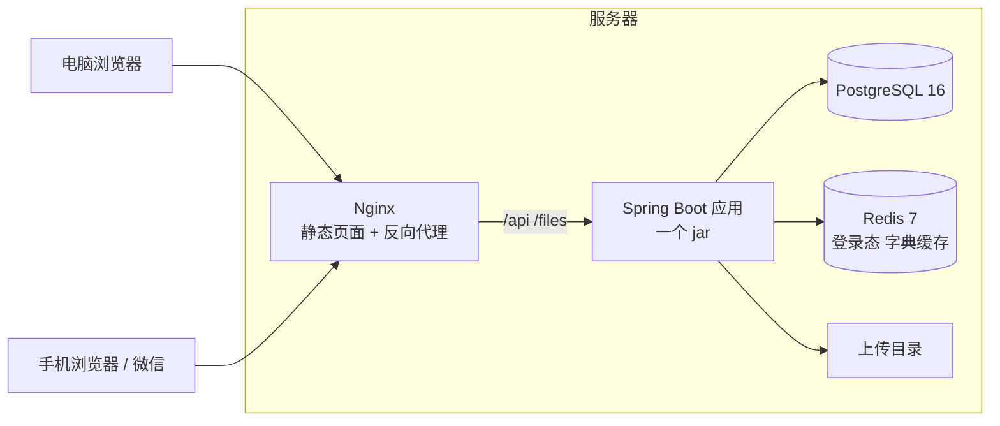
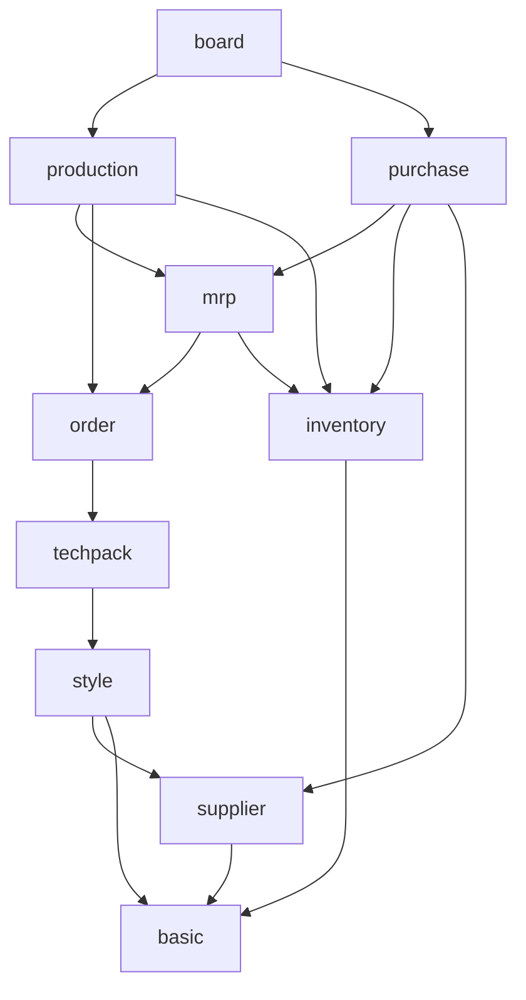

# 架构设计

v0.1 草案，2026-11-05。

PRD 管"做什么"，本文管"怎么做"。§16 的四件事等用户拍板，其余是 Claude 的决定，有异议直接提。`CLAUDE.md` 的"技术约定"是本文的摘要，两边对不上时以本文为准，并同步改 `CLAUDE.md`。

## 变更记录

| 日期 | 版本 | 改了什么 |
|---|---|---|
| 11-05 | v0.1 | 初稿；§14 按"没标黄的模块是待定、不是不做"写了预留 |

---

## 1. 约束和原则

先把约束摆出来，后面每个决定都是从这里推出来的。

| 约束 | 具体 |
|---|---|
| 工期 | 26 天，一期 40 条，11-14 / 11-21 / 11-28 三次发版，12-01 上线 |
| 人 | Claude 写，用户审 |
| 规模 | 内部 10-30 人，同时在线 ≤ 20，单据 1 万张以内（PRD §8） |
| 机器 | 一台 2GB 内存的服务器，上面还跑着别的项目；现在没有 HTTPS |
| 数据 | 库存、数量、金额必须对，每个数都要查得到来源 |
| 迁移 | 有真实数据以后只增不改。11-14 起甲方就往生产库导主数据，所以实际从 11-14 起就要这样（§12.4） |

五条原则：

1. **一个应用，按业务域分包**（模块化单体）。不拆服务，不上消息队列，不做分布式事务。
2. **正确性交给数据库**：事务、唯一索引、外键、条件更新。不在 Java 里"先查再改"。
3. **显式**：数据范围、状态转换、回写都写在 Service 里，读代码就知道发生了什么；不用拦截器偷偷改 SQL。
4. **能算出来的就不存**。要存的（带上限校验的累计数）只能由一个地方改。
5. **公共机制只写一次**：单据状态、单号、操作记录、附件、库存过账、导入导出都在框架里，业务模块套用。

---

## 2. 总体形态



只有一个后端进程。20 个人用，一个进程绰绰有余。审核过账要在一个事务里同时改库存、改采购单、写日志：单体里就是一个 `@Transactional`，拆成几个服务就得做分布式事务。

前端打包成静态文件由 Nginx 发，`/api`、`/files` 转给应用。同源，不用处理跨域。

不加的东西：消息队列、Elasticsearch、注册中心、网关、读写分离。人数和数据量都用不上，2GB 内存也放不下。

---

## 3. 业务域和依赖方向

### 3.1 分包

后端每个业务域一个包 `com.lingmao.scm.module.<域>`，包里的分层不变（controller → service → mapper → entity，dto 独立）。

| 包 | 表前缀 | 管什么 | PRD |
|---|---|---|---|
| `system` | `sys_` | 用户、角色、菜单、字典、操作日志、文件 | §6.9 |
| `biz` | `biz_` | 单据公共能力：操作记录、附件、变更提醒、引用查询 | §5.1、§5.5 |
| `basic` | `bas_` | 主体公司、客户、品类、颜色、尺码组、物料分类、物料 + SKU、仓库 | §6.1 |
| `supplier` | `sup_` | 供应商、分类、资质、准入和黑名单 | §6.8 |
| `style` | `sty_` | 款式、款式 SKU、款式图 | §6.2 |
| `techpack` | `tp_` | 资料包版本、BOM、工艺 | §6.4 |
| `order` | `ord_` | 订单、订单变更单 | §6.5 |
| `inventory` | `inv_` | 出入库单、库存、库存日志、过账引擎 | §6.6.4 ~ §6.6.6 |
| `mrp` | `mrp_` | 算料单、软占用、齐料状态 | §6.6.1、§6.6.3 |
| `purchase` | `pur_` | 采购单、到料跟踪 | §6.6.2、§6.6.3 |
| `production` | `prd_` | 排单、加工单、节点、报工、异常、回货、生产看板 | §6.5.5、§6.7 |
| `board` | — | 首页待办、订单审核对话框这类跨域的只读查询 | §6.5.4、§6.9.2 |
| `dev`（二期） | `dev_` | 样衣、打样 | §6.3 |

`common` 放和业务无关的框架代码：返回体、分页、异常、单号、单据状态机、数字工具、Excel。它不能依赖任何 `module`。

有三处和 PRD 的章节不是一一对应的：

- **排单放在 production**：按钮在订单详情里，但它生成的是加工单。production 依赖 order，反过来不行。
- **齐料状态放在 mrp**：PRD §6.6.3 规定按算料单算。
- **工厂仓由 supplier 建**：建供应商时 supplier 调 basic 的仓库服务自动建（PRD §6.1.6）。仓库表的 `factory_id`、物料表的默认供应商只是外键引用，basic 的 Java 代码不调 supplier。仓库页面不能手工建工厂仓。

### 3.2 依赖只能朝一个方向

图里 A → B 表示"A 可以调用 B"。每个业务域都可以用 `system`、`biz`、`common`，图里不画。



规则：

1. 依赖是一张没有环的图：**后发生的单据依赖先发生的单据，单据依赖主数据**，反过来不行。
2. 跨域只调对方的 Service，不碰对方的 Mapper。同一个域里可以直接用兄弟表的 Mapper（沿用）。
3. 每张表只有一个"主人"域，只有主人能写它。
4. 列表要显示别的域的名称、编码时，可以在自己的 Mapper XML 里 JOIN 那张表，只读、只取显示字段；要做业务判断（状态对不对、够不够）必须调对方的 Service。
5. 用 ArchUnit 写成测试：域之间不能有环、controller 不能直接用 mapper、`common` 不依赖 `module`。违反了测试就红。

### 3.3 上游要知道下游的事怎么办

依赖只能从下游指向上游，但业务上经常需要反过来。固定用下面四种办法，不临时发明：

| 需要 | 例子 | 办法 |
|---|---|---|
| 下游改上游的累计数 | 入库回写采购单"已入库"；排单回写订单"已排产" | 下游在自己的事务里调上游 Service 的回写方法（§5.3） |
| 通用引擎回调具体业务 | 出入库单审核后回写源单（采购单、加工单） | 引擎定义接口，业务域实现（`StockSourceHandler`，§5.2） |
| 上游要知道"谁引用了我" | 反审核前查有没有下游；取消订单；拉黑供应商时列出未完成单据；主数据用过不能删；"下游单据"页签；订单变更后给下游出黄条 | 每个业务域实现一个 `ReferrerProvider`，报告"我这里有哪些单据引用了它"（§4.4） |
| 页面要拼几个域的数据 | 首页待办；订单审核对话框（齐料参考、工厂在手负荷） | 放 `board`，它在最上层、只读，是唯一能直接写跨域 SQL 的地方。也可以前端分两次取（订单列表的齐料列另调 mrp 的接口） |

不用 Spring 事件。上面这些都是同步的、要拿结果的、要在同一个事务里完成的调用，用接口比用事件好追踪：在 IDEA 里点一下就能跳到所有实现。

---

## 4. 单据框架

订单、变更单、算料单、采购单、出入库单、加工单、回货单都套这一套。

### 4.1 单头和明细

每张单据 = 一张单头表 + 一到几张明细表。

单头公共列：

| 列 | 说明 |
|---|---|
| `no` | 单号，全表唯一。不带 `deleted` 条件：作废、删除的单号也不再用 |
| `company_id` | 主体公司，非空，默认取制单人的默认主体。一期不按它隔离；二期要隔离时不用补数据 |
| `status` | 状态（§4.2） |
| `audit_by`、`audit_time` | 审核人、审核时间 |
| `version` | 乐观锁（§4.3） |
| `remark` | 备注 |
| `create_by` … `deleted` | 沿用 `BaseEntity` |

明细表：`id`、单头 id、`seq`（行号）和业务字段，没有 `deleted`，跟着单头走。

**明细上存交易时的值**。单价、换算系数、采购单位、用量、损耗率这些"当时按什么算的"存在明细行上，以后改了物料档案不影响旧单。名称、编码这类只用来显示的，查询时 JOIN 现查。

**草稿保存 = 整单覆盖**。前端每次提交整张单（单头 + 全部明细），后端删掉旧明细、插入新明细。这比逐行比对增删改简单得多；草稿的明细还没被任何单据引用，换了 id 没关系。审核以后明细不再变（要变走变更单），下游引用的都是审核后的行，外键也会拦住误删。

### 4.2 状态机

主单据共用一套状态（PRD §5.1）。库里存英文名，页面按单据类型显示中文，比如采购单的"执行中"显示成"部分到货"：

`DRAFT` 草稿 → `PENDING` 待审核 → `APPROVED` 已审核 → `RUNNING` 执行中 → `DONE` 已完成；另有 `CLOSED` 已结案、`VOIDED` 已作废。

允许的转换写成一张表（`common.doc.StatusFlow`），一个动作一行：

| 动作 | 从 | 到 | 谁触发 |
|---|---|---|---|
| submit 提交 | DRAFT | PENDING | 用户 |
| withdraw 撤回、reject 驳回 | PENDING | DRAFT | 用户（驳回要填原因） |
| audit 审核 | PENDING | APPROVED | 用户 |
| unaudit 反审核 | APPROVED | DRAFT | 用户，没有下游单据时 |
| start 开始执行 | APPROVED | RUNNING | 系统：第一次入库、第一个节点开工…… |
| finish 完成 | RUNNING | DONE | 系统：到齐、回齐 |
| close 结案 | APPROVED、RUNNING | CLOSED | 用户 |
| reopen 取消结案 | CLOSED | 按累计数重新算 | 用户 |
| void 作废 | DRAFT、PENDING | VOIDED | 用户 |

各单据只用这张表的一部分。出入库单只有草稿和已审核（PRD §6.6.5），审核直接从 DRAFT 到 APPROVED；订单多一个"经变更单取消"（→ VOIDED，页面显示"已取消"）。资料包（草稿 / 已生效 / 已作废）、算料单（草稿 / 已确认 / 已关闭）、供应商（待准入 / 合作中 / 停用 / 黑名单）、异常（待处理 / 处理中 / 已关闭）的状态不一样，各用自己的枚举，但同样写成转换表、用同一个工具类。

**改状态一律"比较并交换"**：

```java
int n = orderMapper.update(new Order(), Wrappers.<Order>lambdaUpdate()
        .set(Order::getStatus, DocStatus.APPROVED)
        .set(Order::getAuditBy, userId)
        .set(Order::getAuditTime, now)
        .eq(Order::getId, id)
        .eq(Order::getStatus, DocStatus.PENDING));   // 还是"待审核"才改
if (n == 0) {
    throw new BizException(1002, "单据状态已变化，请刷新后再试");
}
```

两个人同时点审核，只有一个能成功；双击也只生效一次。第一个参数传 `new Order()` 而不是 `null`：传 `null` 时 MyBatis-Plus 的自动填充不生效，`update_by`、`update_time` 不会更新。

为什么状态存字符串（`VARCHAR(16)`）而不是数字：SQL 和日志里一眼能看懂，不用查对照表。为什么不用 PostgreSQL 的 `ENUM` 类型或 `CHECK` 约束：以后加状态要改类型或删约束，和"迁移只增不改"冲突。合法性由 Java 枚举和转换表保证。

**按钮由后端算**。详情接口返回 `actions: ["submit", "void"]`，等于"状态允许 ∩ 用户有权限 ∩ 业务条件"，前端照着显示按钮，不在 TypeScript 里再写一遍状态规则。点了以后后端照样再校验一遍。

### 4.3 两个人同时改一张草稿

不处理的话，后保存的人会把先保存的人的修改整个覆盖掉。

单头加 `version` 列（`@Version` + MyBatis-Plus 乐观锁插件）：打开单据时拿到 `version`，保存时带回来，和库里的不一样就保存失败，提示"这张单已被别人修改，请刷新"。

只加在单据单头上。主数据不加：两个人同时改同一个物料的概率太低，不值得让每个表单都带 version。

### 4.4 单据公共能力（`biz` 域）

| 能力 | 表 | 用法 |
|---|---|---|
| 操作记录 | `biz_doc_log` | 每个动作写一行：单据类型、单据 id、动作、备注（驳回原因、变更原因）、操作人、时间。详情页"操作记录"页签 |
| 附件 | `biz_attachment` | 单据类型 + 单据 id + 文件。所有单据共用一套上传、列表、删除接口 |
| 变更提醒 | `biz_doc_notice`（PRD §7.2 之外新加） | 上游变了（订单变更单审核），给每张下游单据插一条：提醒谁、说了什么、谁处理的、什么时候。下游详情页顶部的黄条和首页待办都读它 |
| 引用查询 | — | `ReferrerProvider`，见下 |

```java
/** 每个业务域实现一个：报告本域里有哪些单据引用了 (type, id)，作废的不算 */
public interface ReferrerProvider {
    List<DocRef> referrers(BizType type, long id);
}

public record DocRef(BizType type, long id, String no, String status, Long ownerId) {}
```

`biz` 里的 `ReferenceService` 把所有实现收集起来（Spring 注入 `List<ReferrerProvider>`）。一个接口用在六个地方：反审核前检查、取消订单前检查、拉黑供应商时列出未完成单据、主数据删除前检查（PRD §5.6：用过的只能停用）、"下游单据"页签、变更提醒发给谁。上游域不用知道下游有哪些域。

`BizType` 是全系统单据和主数据类型的枚举（`ORDER`、`PURCHASE_ORDER`、`MATERIAL_SKU`……），带单号前缀和中文名，放在 `common.doc`。

### 4.5 单号

改成由 PostgreSQL 生成，不再用 Redis：

```sql
CREATE TABLE sys_serial (
    prefix   VARCHAR(8) NOT NULL,
    biz_date DATE       NOT NULL,
    seq      INT        NOT NULL,
    PRIMARY KEY (prefix, biz_date)
);

-- 取号：当天第一次插入 1，之后每次 +1，一条语句完成
INSERT INTO sys_serial (prefix, biz_date, seq) VALUES (?, ?, 1)
ON CONFLICT (prefix, biz_date) DO UPDATE SET seq = sys_serial.seq + 1
RETURNING seq;
```

为什么换：

- **Redis 里的计数丢了，单号就会重复**。Redis 重启时没持久化、有人删了 key，当天的流水号就从 0001 重新开始。单号是给人看、印在纸上的，重复了比缺号麻烦得多。
- **跟着事务走**。在建单的同一个事务里取号，建单失败号也一起回滚，单号连续不跳。代价是同一种单据同一天的建单要排队（行锁持有到事务提交），20 个人用感觉不到。
- Redis 从此只放丢了也不要紧的东西（§9）。

`SerialNoGenerator.next(prefix)` 的用法不变，只换实现。各单据表的 `no` 列加唯一索引兜底。

---

## 5. 库存与回写

### 5.1 库存模型

- `inv_stock`：一行 = 仓库 × 物料 SKU × 物权，`UNIQUE (warehouse_id, material_sku_id, owner_type, owner_id)`。物权是自有（`owner_id = 0`）或客供（`owner_id` = 客户 id）。用 0 不用 NULL：唯一索引里 NULL 和 NULL 不算重复，会出现两行。
- `inv_stock_log`：每次变动一行，只插不改：单据类型、单据 id、明细 id、仓库、SKU、物权、变动数、变动后结存、缸号、操作人、时间。
- **库存只能由出入库单审核改**（PRD §8）。没有"直接改库存"的接口，期初也是一张"其他入库（期初）"单。
- 工厂仓就是 `bas_warehouse` 里类型为工厂仓的仓库，领料就是物料仓 → 工厂仓的移库。

### 5.2 过账引擎

出入库单审核时，先用 §4.2 的比较并交换把状态改成已审核。这一步顺带锁住了这张单，同一张单不会被审两次、库存不会加两遍。然后交给 `inventory` 的 `StockLedger` 一次处理整张单：

1. 把明细变成"变动"：入库 +数量，出库 −数量，移库是出仓一条 −、入仓一条 +。
2. 相同的（仓库, SKU, 物权）合并，再**按这个组合排序**。两张单同时审核、都动到 A、B 两种料时，大家都先锁 A 再锁 B，不会互相等死（死锁）。
3. 逐条执行：先保证这行库存存在，再条件更新。

```sql
INSERT INTO inv_stock (warehouse_id, material_sku_id, owner_type, owner_id, qty)
VALUES (#{wh}, #{sku}, #{ownerType}, #{ownerId}, 0)
ON CONFLICT (warehouse_id, material_sku_id, owner_type, owner_id) DO NOTHING;

UPDATE inv_stock
   SET qty = qty + #{delta}, update_time = now()
 WHERE warehouse_id = #{wh} AND material_sku_id = #{sku}
   AND owner_type = #{ownerType} AND owner_id = #{ownerId}
   AND qty + #{delta} >= 0        -- 不允许负库存（Q08）
RETURNING qty;                    -- 变动后结存，写进库存日志
```

4. 没返回行的就是库存不够。**不在第一条不够时就停**：整张单都试一遍，收集所有不够的行，最后一起抛 `BizException(1001, "库存不足", 缺料清单)`。事务回滚，前面已经扣成功的也一起撤销。页面上列出哪几行不够、差多少（PRD §6.6.5）。
5. 写库存日志，调源单回写（§5.3），写操作记录。以上全部在一个事务里。

为什么这样不会超领、不会丢数：PostgreSQL 的 `UPDATE` 会锁住这一行，另一个事务要改同一行得等前一个提交；等到以后，`WHERE qty + delta >= 0` 用的是**最新的** qty 重新判断。所以"判断够不够"和"扣减"是一个不可分割的动作，Java 里不需要先查后改，也不需要 `version`。

反审核 = 同一套引擎走相反的变动。领到工厂仓的料又被调走了、扣不回来，就不让反审核（PRD §6.6.5）。

这条 `UPDATE … RETURNING` 要拿返回值，所以在 Mapper 里用 `@Select` 写，并且必须加 `@Options(flushCache = Options.FlushCachePolicy.TRUE)`。不加的话，同一个事务里参数相同的第二次调用会直接返回 MyBatis 一级缓存里的旧结果，根本不执行 UPDATE。

**源单回写用接口反转依赖**。`inventory` 不认识采购单和加工单，它定义接口，由上层的域实现：

```java
public interface StockSourceHandler {
    BizType sourceType();                                  // PURCHASE_ORDER、PRODUCTION_ORDER
    void onPosted(InvDoc doc, List<InvDocItem> items);     // 审核：回写源单，超收在这里拦
    void onUnposted(InvDoc doc, List<InvDocItem> items);   // 反审核：撤销回写
}
```

`purchase` 实现采购入库、采购退货的回写；`production` 实现领料、退料的回写。

### 5.3 回写的累计数

PRD §4.2 "回写什么"那一列（已排产、已转采购、已入库、已退货、已领、已回货、次品）存在**上游的明细行上**，由下游调上游 Service 的方法改，一条条件更新完成"累加 + 上限校验"：

```sql
UPDATE pur_order_item
   SET received_qty = received_qty + #{q}
 WHERE id = #{id}
   AND received_qty + #{q} >= 0
   AND received_qty + #{q} <= qty * (100 + #{overPct}) / 100   -- 超收上限 5%（Q09）
```

影响行数为 0 就是超了上限，抛 1004，说明是哪一行、上限多少。件数的上限按 PRD 向下取整（`FLOOR(qty * (100 + pct) / 100)`，订单 120 件上限 123 件），物料不取整。

为什么存下来而不是每次现算：

- 上限校验要和累加一起原子完成。一条条件 UPDATE 最简单可靠；现算要先锁行、再汇总、再判断。
- 依赖方向：订单详情要显示"已排产"，如果现算就得去查 production 的表，order 就反过来依赖 production 了。存在订单行上，order 只读自己的表。

怎么防止数对不上：

- 累计数**只能由上游 Service 的一个方法改**，下游只调它，不自己写 SQL。
- 每种累计数写一条对账 SQL（累计数 vs 下游单据汇总），放进集成测试，发版前跑。

上游的状态由上游自己根据累计数算：采购明细全部入齐 → 已到齐；有入库但没齐 → 部分到货。下游不直接改上游的状态。

一次回写可能连着好几层，都在同一个事务里：

> 采购入库单审核 → 库存 +871 → 采购明细已入库 +871（采购单变"已到齐"）→ 算料行已入库 +871（齐料状态变"齐料"）

### 5.4 软占用

算料的"可用库存"（PRD §6.6.1、§7.3 第 3 条）查询时算，不写库存表：

```
可用 = 物料仓里同物权的库存 − 其他"已确认"算料单的"本次使用库存"之和
```

漏洞：两个人同时确认两张算料单，都用了同一批 120 米，就重复占用了。解决：确认时加一把事务级的 PostgreSQL 咨询锁（`pg_advisory_xact_lock`），让"确认"这个动作排队；确认前用最新数据再算一遍可用库存，变了就提示"可用库存已变化，请重新计算"。只有确认排队，别的操作不受影响。

---

## 6. 数据库约定

| 项 | 约定 | 为什么 |
|---|---|---|
| 主键 | `BIGINT GENERATED ALWAYS AS IDENTITY` | 沿用 V1。自增 id 远小于 2^53，前端直接当数字用，不用像雪花 id 那样转字符串 |
| 命名 | 域前缀 + 单数 + 下划线（`pur_order_item`），外键列 `xxx_id` | 沿用 |
| 审计列 | `create_by / create_time / update_by / update_time` 自动填充 | 现在只填了时间，`create_by`、`update_by` 一直是空的，框架阶段补上 |
| 逻辑删除 | 主数据和单头有 `deleted`；明细表没有 | 明细跟着单头 |
| 唯一 | 编码：部分唯一索引 `WHERE deleted = false`；单号：全表唯一；资料包：同款只能有一个已生效（`WHERE status = 'EFFECTIVE'`） | |
| 外键 | 都加，不级联（默认 `RESTRICT`），外键列都建索引 | 写错 id 当场报错，被引用的行删不掉。只有一个库、并发很低，"互联网公司不用外键"的那些理由在这里不成立 |
| 数量、金额 | 数量 `NUMERIC(14,3)`，单价 `NUMERIC(14,4)`，金额 `NUMERIC(14,2)`，Java 用 `BigDecimal` | PRD §7.3 |
| 百分比 | 存百分数（3 表示 3%），列名带 `_pct`：`loss_pct`、`tax_pct` | 页面上就这么填；名字说清单位，避免一处存 0.03、一处存 3 |
| 取整 | 集中在 `common.num.Num`：金额四舍五入 2 位；建议采购量向上取整到最小包装；件数上限向下取整 | 规则只写一次，用 PRD 的例子做单测 |
| 日期 | 业务日期（下单日、交期、计划日期）`DATE` ↔ `LocalDate`；发生时间 `TIMESTAMPTZ` ↔ `OffsetDateTime` | 交期没有时分秒；存成时间戳，时区换算时会差一天 |
| 实际日期 | 到货、回货、报工这类单据记"实际发生的日期"（默认今天，可以改），和录入时间 `create_time` 分开 | 补录昨天到的货很常见；以后算绩效、结算、逾期都按实际日期（§14） |
| 今天 | 注入 `Clock`（东八区），不直接写 `LocalDate.now()` | 逾期、临期、节点延期都依赖"今天"，测试里把时钟固定住才测得了 |
| 状态 | `VARCHAR(16)` 存枚举名 | §4.2 |
| JSONB | 只用于快照：算料单当时的输入、变更单的改前改后、操作记录的附加信息 | 要查询、要约束的业务字段都用普通列 |
| 迁移 | 一个功能一个 `V<n>__<域>_<内容>.sql`。菜单、按钮权限、字典、角色模板也用迁移插入（`ON CONFLICT DO NOTHING`） | 每个环境都一样，不靠手工点 |

---

## 7. 接口约定

### 7.1 路径

| 用途 | 写法 |
|---|---|
| 列表、详情、新建、保存草稿、删除 | `GET /api/purchase-orders`、`GET /api/purchase-orders/{id}`、`POST`、`PUT /{id}`、`DELETE /{id}` |
| 状态动作 | `POST /api/purchase-orders/{id}/submit`，同样有 withdraw、reject、audit、unaudit、close、reopen、void |
| 由上游生成下游 | 接口放在下游资源上：`POST /api/production-orders/schedule`（排单）、`POST /api/purchase-orders/from-mrp`、`POST /api/inventory-docs/from-purchase/{id}` |
| 导入导出 | `GET /api/xxx/import-template`、`POST /api/xxx/import`、`GET /api/xxx/export`（筛选参数和列表一样） |
| 单据公共 | `GET /api/doc-logs?type=&id=`、`/api/attachments`、`/api/doc-notices`、`GET /api/references?type=&id=` |

资源名用复数，多个单词用中划线。

### 7.2 DTO

| 类 | 用途 |
|---|---|
| `XxxQuery` | 列表筛选，继承 `PageQuery`。`keyword` 里有空格就按多个单号精确查（PRD §5.4） |
| `XxxSaveReq` | 新建和保存草稿：单头 + 全部明细 + `version` |
| `XxxVO` | 列表的一行 |
| `XxxDetailVO` | 详情：单头 + 明细 + 算出来的字段 + `actions` |
| `XxxAuditReq` 等 | 动作带的参数，如审核填承诺交期、驳回填原因 |

实体里不加 `@TableField(exist = false)` 的展示字段，展示用 VO。转换手写静态方法 `XxxVO.from(...)`，不引 MapStruct。

### 7.3 返回和错误

沿用 `R { code, msg, data }`。业务错误码：

| code | 意思 | data 里带什么 |
|---|---|---|
| 1000 | 一般业务错误 | — |
| 1001 | 库存不足 | 缺料清单：哪一行、库存多少、差多少 |
| 1002 | 状态已变化，或单据被别人改过 | — |
| 1003 | 导入校验没通过 | 错误清单：第几行、哪一列、什么问题 |
| 1004 | 超出上限（超排、超收、超回货） | 哪几行、上限多少 |
| 1005 | 有下游单据，不能反审核、取消或删除 | `DocRef` 列表 |

`BizException` 加一个可选的 `data`，`R.fail` 把它带上；前端对 1001、1003、1004、1005 弹一个表格，其他的弹消息。另外补上 404（不存在，或者不在你的数据范围里，不区分）和 405（方法不对，bug 006）。

**错误编号**。每个请求生成一个短 id（traceId），写进这次请求的每一行日志和响应头 `X-Trace-Id`；500 时页面显示"出错了，错误编号 xxxx"。用户把编号发过来，在服务器上一条 grep 就能找到那次请求的全部日志。

JSON 里的 `BigDecimal` 按普通小数输出。合计、金额一律后端算：前端算的只用来在输入时即时显示，保存时后端重算，不信前端传来的合计。

---

## 8. 权限与数据范围

**功能权限**沿用 `sys_menu` + `@PreAuthorize("hasAuthority('...')")`。权限码是 `<域>:<资源>:<动作>`，和 system 现有的写法一样，PRD §6.9.2 的 `order:audit` 落成 `order:order:audit`。每种单据的动作从 `list / add / edit / delete / submit / audit / close / void / export / import` 里按需取。菜单、按钮和 PRD §3.1 的角色模板都用迁移插入。

**数据范围**（PRD §3.2）：角色加 `data_scope`（`ALL` / `SELF`），用户取所有角色里最大的那个。加载权限时如果是 ALL，就多给一个 `data:all` 权限，不用另外查库。

不用 MyBatis-Plus 的数据权限插件：它在 SQL 执行前偷偷加条件，复杂 SQL 上容易加错，读代码也看不出来。用一个显式的工具：

```java
DataScope scope = dataScope.current(query.isMine());   // "我的 / 全部"切换
scope.apply(wrapper, Order::getCreateBy, Order::getSalesId, Order::getMerchandiserId);
// SELF 时相当于：AND (create_by = 我 OR sales_id = 我 OR merchandiser_id = 我)
```

列表、详情、导出都要过它；详情不在范围里返回 404。每个有数据范围的模块写一个测试：SELF 的用户看不到别人的单。

主体公司一期只记录、不隔离（Q13）。二期要隔离时在 `DataScope` 里加一个主体条件，单头上已经有 `company_id`。

**文件**：`/files/**` 现在不用登录就能访问，靠的是文件名是随机 UUID、猜不到。一期保持不变：`` 标签带不了登录 token，换成签名地址要改所有返回文件地址的接口。营业执照这类资质文件，如果甲方在意，二期改成带过期时间的签名地址。

---

## 9. Redis 放什么

只放丢了也没关系的东西：

| 用途 | key | 丢了会怎样 |
|---|---|---|
| 登录态 | `login:token:{jti}` | 所有人重新登录一次 |
| 字典缓存 | `dict:*` | 下次从库里读 |
| 登录失败计数 | `login:fail:{用户名}` | 计数清零 |

单号移到 PostgreSQL（§4.5）。以后往 Redis 里加东西之前先问一句：丢了会不会错账？会就不放。

---

## 10. 前端

### 10.1 页面组织

- **列表页跟菜单走**（已有）：`views/<域>/<资源>/index.vue`，甲方可以在菜单管理里改名、排序、隐藏。
- **详情页跟代码走**：`/orders/new`、`/orders/:id` 这类静态路由，有列表页的权限才能进。查看和编辑是同一个页面，草稿且有权限时可编辑。每张单一个页签，切到别的页签再回来，正在填的内容还在。
- **打印页** `/print/<单据>/:id`：不带侧边栏，A4 样式，调 `window.print()`；"存 PDF"用浏览器自带的。资料包打印先选颜色，再按颜色展开 BOM。
- **手机页** `/m/*`：单独的轻布局，只有我的跟单、报工、上报异常，360px 宽能用。不引移动端组件库：时间用原生 `<input type="datetime-local">`，拍照用 `<input type="file" accept="image/*">`，手机上弹出来的就是系统自带的时间滚轮和相机，比组件库顺手。登录后屏幕窄就自动进 `/m`。

### 10.2 先写好的公共件

业务页面都由这些拼出来，第一次发版前写好：

| 件 | 干什么 |
|---|---|
| `useTable` | 列表的查询条件、分页、加载状态、重置、"我的 / 全部"、导出 |
| `DocHeader`、`DocActions` | 单号、状态标签；按 `actions` 显示按钮；确认框和原因输入 |
| `DocTabs` | 下游单据、附件、操作记录三个页签 |
| `NoticeBar` | "上游已变更"的黄条和"已处理"按钮 |
| `SkuMatrix` | 颜色 × 尺码矩阵输入，带行列合计。订单、排单、回货、BOM 分码用量都用它 |
| 选择器 | 物料 SKU、款式、供应商（按状态过滤）、仓库、用户、字典 |
| `ImportDialog` | 下载模板 → 上传 → 有错就列表显示 |
| `BizErrorDialog` | 显示 1001 / 1003 / 1004 / 1005 带回来的清单 |
| `formatQty` 等 | 数量去掉末尾的 0（PRD §5.3）、金额千分位、日期 |

TypeScript 类型按域手写在 `types/<域>.ts`，和后端 VO 对应。Pinia 只放跨页面的状态（用户、页签、字典），页面自己的状态放在页面里。

### 10.3 图片

手机拍的照片一张 3-8MB，一次报工最多 9 张。上传前在浏览器里用 canvas 压到长边 1600px、JPEG 质量 0.8（约 300KB）。后端对 jpg、png 再生成一张长边 320px 的缩略图，列表、看板、手机卡片用缩略图。

### 10.4 名字

界面标题、打印抬头不出现"领猫"（PRD Q15，暂用"服装 SCM"）。现在浏览器标签页标题还是"领猫 SCM"，框架阶段改掉。代码包名、库名、容器名是内部标识，用户看不到，改的代价大，不改。

---

## 11. 导入导出

用 Apache POI，不用 EasyExcel。EasyExcel 2025 年 9 月已经停止维护；接替它的 FastExcel 改名 Apache Fesod，还在孵化，接口还在变。我们的文件都是几千行，POI 直接读写足够，也最稳。

**导入**：模板由后端生成，表头和校验规则在同一个地方。上传后先把所有行校验一遍，有任何错就整批不导，返回全部错误（第几行、哪一列、什么问题）；全对才在一个事务里写入。单个文件 5000 行以内，同步处理，不做后台任务。

**导出**：和列表用同一个 Query；用 POI 的 SXSSF 流式写（内存里只留 100 行），上限 5 万行。前端带着登录 token 用 blob 下载。

参考：[EasyExcel 归档与迁移到 Fesod](https://www.besthub.dev/articles/goodbye-easyexcel-migrate-to-apache-fesod-for-better-memory-efficiency-apache-support-affef7e2a722)、[Java Excel 库对比](https://www.pistack.xyz/posts/2026-08-28-java-excel-libraries-apache-poi-easyexcel-fastexcel-comparison/)

---

## 12. 部署与运维

### 12.1 内存

11-05 实测（lingmao 的容器都停着）：服务器 2GB 内存加 2GB swap，别的项目占约 420MB，可用约 1GB。

| 容器 | 限制 | 估计实际占用 |
|---|---|---|
| app | 512MB（堆最多 384MB） | 300-400MB |
| PostgreSQL（开发库和生产库在同一个实例） | — | 约 100MB |
| Redis | — | < 20MB |
| Nginx | 64MB | < 10MB |

一期够用，剩约 300MB 余量。每次发版后看一眼 `docker stats`。二期上报表、消息推送之前要重新评估（PRD §8）。

### 12.2 备份

- **11-14 之前就要上**，不是 12-01：11-14 起甲方就往生产库导真实的客户、供应商、物料、款式。
- 每天凌晨 `pg_dump -Fc` 生产库，留 7 天；上传目录每天增量打包。
- **每次发版前先备份一次**：迁移在应用启动时执行，执行了就回不去。
- 备份和数据在同一台机器上，机器坏了就一起没了。每次发版时顺手把最新一份备份拉回本机；另外建议在腾讯云控制台给云硬盘开定期快照。
- 上线前做一次恢复演练：把备份恢复到一个临时库，核对行数。没恢复过的备份不算备份。

### 12.3 发版和回滚

迁移只往前走。应用回滚 = 重新部署上一个提交，前提是迁移只加不改（加表、加可空列、加索引）。所以要改结构时分两次发：先加新的、代码切过去；下一次再停用旧的。

迁移本身出了错，用发版前的备份恢复。所以发版放在晚上，或者甲方不用系统的时候。

### 12.4 试用数据

11-14 到 11-28 甲方在生产库上试用，会建一些测试单据。11-29 导期初库存和在途订单之前，和甲方约好：清空所有单据和库存，保留主数据，然后再导入。清理用一个一次性脚本，执行前先备份。

### 12.5 日志和排错

- 每行日志带 traceId（§7.3）；超过 1 秒的请求记一条 warn。
- 不上 Prometheus、Grafana、ELK：内存放不下，20 个人也用不上。看 `docker compose logs` 就够了。

### 12.6 安全

- HTTPS：见 §16 D2。
- 同一个账号连续登录失败 5 次，锁 15 分钟（Redis 计数）；密码至少 8 位。
- 生产环境关掉 Swagger（已经关了）。
- SQL 只用 `#{}` 和 Wrapper，不拼 `${}`；列表的排序字段走白名单。

---

## 13. 测试

| 层 | 工具 | 测什么 | 什么时候跑 |
|---|---|---|---|
| 单元 | JUnit 5 + Mockito | 每个模块 2-4 条主要规则 | 每次提交；发版时 `mvn package` 自动跑 |
| 接口 | `@WebMvcTest` | 权限、参数校验、返回格式，每个 controller 一个 | 同上 |
| 架构 | ArchUnit | 域之间无环、controller 不碰 mapper、common 不依赖 module | 同上 |
| 数据库集成 | 真的 PostgreSQL 16 | 过账引擎（含两个线程同时领同一批料）、状态并发、单号、回写上限、对账 SQL、算料 | 发版前 |
| 端到端 | Playwright | 登录 + 一张订单走完全流程 | 上线前 |

PRD 每个模块的"验收"清单就是测试用例。§4.3 那张订单的数——962 → 990.86 → 871 米、超排只剩 3 件、库存差 0.86——都写成断言。

数据库集成测试为什么不能用 Mockito：条件更新、`ON CONFLICT`、`RETURNING`、部分唯一索引、行锁，这些恰恰是最容易出错的地方，只有真数据库测得出来。用哪个数据库跑，见 §16 D1。

---

## 14. 给以后留的口子

### 14.1 怎么留

以后要做的有三类：二期（黄色 P1，12 月）、三期（P2 和卡在 Q01、Q02 上的）、待定（没标黄的六个模块，PRD §2.5）。对它们都按四条预留：

1. **数据先记全**。成本、结算、绩效、质量这些模块，干的都是"拿已经发生的单据去算账、评分、对比"。历史数据事后补不回来，所以单价、金额、税率、实际日期（到货日、回货日，不是录单时间）、次品数、责任方，一期就要记在单据上。
2. **边界先占好**。每个待定模块先定好包名和表前缀（§14.2）；单据公共能力（操作记录、附件、引用查询、状态机）新模块直接用。
3. **通用机制让新模块"加进来"，不用"改进去"**：
   - 新单据引用了已有单据，就实现一个 `ReferrerProvider`，已有单据的反审核、删除检查自动生效。比如对账单引用了采购入库单，入库单就不能再反审核，采购和库存的代码一行不用改；
   - 新的出入库类型（质检退货、成品入库）实现 `StockSourceHandler`；
   - 新的数据范围（按主体、按工厂）在 `DataScope` 里加条件；
   - 要推给外部系统的（聚水潭、财务软件、消息）走发件箱（§14.3）。
4. **不提前写空代码**：不建空表、空接口、空页面。用不上的代码会过时、会误导人，还得跟着维护；等真做的时候需求更清楚，那时再设计。

检验预留得好不好：以后加一个模块时，**已有的表只加不改，已有的代码只加实现、不改调用方**。

### 14.2 各模块留了什么

| 以后要做 | 分期 | 包 / 表前缀 | 现在已经留好的 |
|---|---|---|---|
| 研发打样 | 二期 | `dev` / `dev_` | 资料包现在挂在款式上，以后也能挂样衣：`tp_tech_pack` 加一个可空的 `sample_id` |
| 按主体隔离（Q13） | 二期 | — | 单头都有 `company_id`；`DataScope` 加一个条件 |
| 字段级改前改后 | 二期 | — | `biz_doc_log` 加一个 `JSONB` 列存差异 |
| 可配置审批流 | 二期 | — | 审核只有 `audit` 一个入口，换成审批流不影响别的状态 |
| 消息推送 | 二期 | — | 发件箱（§14.3） |
| 报表 | 二期起 | `board` | 只读 SQL；慢了再上物化视图 |
| 商品企划 M02 | 待定 | `plan` / `pln_` | 款式的品类、季节、年份、波段、风格、吊牌价；款式以后加一个可空的 `plan_id` |
| 核价与成本 M05 | 待定 | `cost` / `cst_` | BOM 的用量、损耗、参考单价；工价；加工单价；采购成交价；订单销售价。采购入库按成交价记单价（换算到库存单位），库存日志完整、按时间有序，以后能按时间重放算出移动加权成本。所以现在不用维护库存金额 |
| 质量管理 M09 | 待定 | `quality` / `qc_` | 回货次品数；异常的类型和责任方；节点模板可以加"产前样确认""验货"。待检、不良品**用仓库表达**：加仓库类型"待检仓""不良品仓"，靠调拨流转，不给库存加"质量状态"维度，库存表不用改 |
| 成品仓储与发货 M10 | 待定（Q01） | `fg` / `fg_` | 回货单按 SKU 记数量、日期、收货仓。成品库存如果放本系统：另建成品库存表，过账引擎按表参数化后复用，物料库存不动；如果放聚水潭：走发件箱推送 |
| 财务结算 M11 | 待定 | `settle` / `stl_` | 采购、加工、订单都有单价、金额、税率、是否含税、结算方式；供应商、客户有账期；实际日期都有。对账单引用单据后，被引用的单据自动不能反审核。对账进度（已对账数量、金额）以后在源单明细上**加列**，不改现有的列 |
| 客户商务条款、供应商绩效、合作历史 M12 | 待定 | 在 `basic`、`supplier` 里加表 | 客户档案加一张条款子表；绩效从已有单据算（约定交期 vs 实际、次品率、成交价）；合作历史就是 `ReferrerProvider` 查出来的往来单据 |
| 外部账号（工厂、客户） | 三期（Q02） | `system` | 用户加类型；`DataScope` 加"本工厂""本客户"条件 |
| 开放 API、聚水潭 | 三期（Q01） | — | 发件箱；对外接口单独一组路径和令牌，不复用内部登录 |
| 低代码 13.09 | 待定（建议不做） | — | 类型、节点、原因都做成字典，甲方能自己加 |

### 14.3 发件箱

以后要往外推的东西（聚水潭入库单、财务凭证、钉钉消息），不在业务事务里直接调外部接口。直接调的话，外部接口慢了、挂了，审核就跟着失败；或者审核成功了，推送却丢了。

做法：

- 一张 `biz_outbox` 表：类型、业务 id、内容（`JSONB`）、状态、重试次数、下次重试时间。
- 业务在**同一个事务**里插一条。回货审核成功了，就一定有一条待推送；审核回滚了，这条也没有。
- 一个定时任务取出待推送的去发：成功标记完成；失败隔一段时间重试；多次失败进首页待办，让人处理。
- 对方要能按业务 id 去重（或者推之前先查一下），重试不会重复建单。

一期不建这张表（§14.1 第 4 条），第一个要往外推的功能做的时候再建。

---

## 15. 落地顺序

框架先补齐（11-06 ~ 11-07），再按 `docs/进度.md` 的三次发版做业务：

1. 修 bug 001-007；审计列自动填充补全（`create_by`、`update_by`）
2. 错误码和 `BizException.data`、traceId、400 / 404 / 405
3. 单号改 PostgreSQL；`common.doc`（`BizType`、`StatusFlow`、`DocRef`、`ReferrerProvider`）；`biz` 域（操作记录、附件、变更提醒、引用查询）
4. 数据范围、用户默认主体、`Clock`、`Num`
5. POI 导入导出工具；ArchUnit；数据库集成测试的基座
6. 备份脚本，发版前自动备份
7. 前端公共件（§10.2）、打印布局、手机布局、标题改名

---

## 16. 决策清单

| # | 决定 | 状态 |
|---|---|---|
| A1 | 模块化单体，按业务域分包，依赖无环，ArchUnit 守着（§3） | Claude 定 |
| A2 | 反向的需要只用四种办法：回写方法、引擎接口、引用查询、board（§3.3） | Claude 定 |
| A3 | 单据：状态转换表 + 比较并交换；草稿整单覆盖；单头乐观锁（§4） | Claude 定 |
| A4 | 单号改由 PostgreSQL 生成（§4.5） | Claude 定 |
| A5 | 库存：条件更新、按组合排序、一次报全缺料；源单回写走接口（§5.2） | Claude 定 |
| A6 | 累计数存在上游明细上，只能由上游 Service 改，带对账测试（§5.3） | Claude 定 |
| A7 | 外键都加、不级联；状态存字符串；百分比存百分数（§6） | Claude 定 |
| A8 | 数据范围显式过滤，不用插件（§8） | Claude 定 |
| A9 | Excel 用 POI（§11） | Claude 定 |
| A10 | 手机页用原生控件，不引组件库（§10.1） | Claude 定 |
| A11 | 备份 11-14 前上，每次发版前再备一次（§12.2） | Claude 定 |
| A12 | 以后的模块（含没标黄的待定模块）：数据先记全、边界先占好、靠通用机制加进来，不提前写空代码（§14） | Claude 定 |
| D1 | 开发环境 | **等用户定** |
| D2 | HTTPS | **等用户定** |
| D3 | 服务器上停着的 lingmao 容器 | **等用户定** |
| D4 | 审代码的方式 | **等用户定** |

### D1 开发环境

现在 IDEA 里的应用连的是服务器上的开发库，它和生产库在同一个 PostgreSQL 实例里。

| 选项 | 好处 | 代价 |
|---|---|---|
| **本机 Docker（推荐）** | 快，断网也能写；集成测试用 Testcontainers 每次起一个干净的 PostgreSQL 16，并发测试随便跑；服务器上只剩生产，省内存，开发时的误操作碰不到生产实例 | 要开 Docker Desktop；`application-local.yaml` 改连本机 |
| 继续用服务器开发库 | 不用改 | 开发时的重查询会拖慢同一实例上的生产库；集成测试只能在 scratch schema 里跑；先得把服务器上的容器起来 |

### D2 HTTPS

现在是 HTTP + IP + 端口，密码明文过公网。服务器的 80、443 端口被旧项目占着，所以选择受限。

| 选项 | 做法 | 代价 |
|---|---|---|
| **IP 地址证书（推荐，前提是同意动旧项目一处配置）** | Let's Encrypt 从 2026 年 1 月起正式发 IP 地址证书，有效期约 6 天半，脚本自动续。签发时要通过 80 或 443 端口验证，所以要在旧项目的 Nginx 里加一条规则，把 `/.well-known/acme-challenge/` 转给 lingmao（几行，不影响旧项目别的请求）。lingmao 的 Nginx 在现在的对外端口上开 HTTPS | 动旧项目的 Nginx 配置；多一个定时续期任务 |
| 域名 + 备案 + 证书 | 最正规；在手机微信里打开也最稳（微信对 IP 地址的链接可能拦截或提示风险，要实测） | 要有域名，用你或甲方的主体备案，一般 1-3 周。可以和 IP 证书并行 |
| 一期先用 HTTP | 零工作量 | 密码明文传输，PRD §11 已经列为风险 |

参考：[Let's Encrypt 签发第一张 IP 地址证书](https://letsencrypt.org/2025/07/01/issuing-our-first-ip-address-certificate.html)、[IP 地址证书正式开放](https://www.stackscale.com/blog/lets-encrypt-opens-the-door-to-https-by-ip/)、[betanews 报道](https://betanews.com/article/lets-encrypt-makes-free-security-certificates-available-for-ip-addresses)

### D3 服务器上的 lingmao 容器

11-05 检查发现 lingmao 的四个容器（PostgreSQL、Redis、app、Nginx）7 天前都停了，开发库和生产库都停着，服务器上另一个项目在跑。是有意停的吗？11-14 发版前要起来，起之前先按 §12.1 再测一次内存。

### D4 审代码的方式

| 选项 | 说明 |
|---|---|
| **直接提交 main（推荐）** | 每做完一个模块提交，并在对话里讲清楚；你随时看 `git log` 和 diff 提意见，Claude 追加修改的提交。不会因为等合并卡住下一个模块 |
| 每个模块一个 PR | 在 GitHub 上看完整 diff、逐行评论、你来合并。审得更细，但没合并之前下一个模块得在分支上叠着做，容易冲突 |
